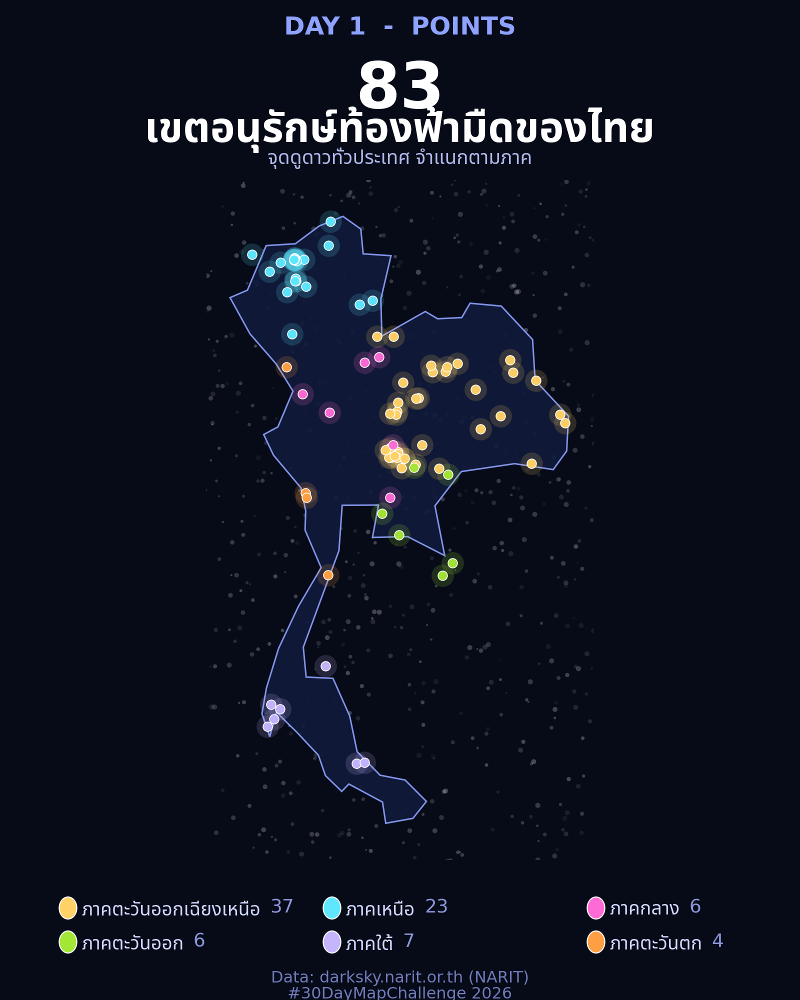

## ที่มาของแผนที่

[#30DayMapChallenge](https://30daymapchallenge.com/) คืองานท้าทายประจำเดือนพฤศจิกายน —
ทำแผนที่วันละหนึ่งใบตามธีมหัวข้อที่กำหนด แล้วแชร์ด้วยแฮชแท็ก `#30DayMapChallenge`
ปี 2026 ธีมวันแรกคือ **Points** (จุด) ผมเลยหยิบข้อมูลที่คุ้นมือที่สุดมาทำ

ข้อมูลที่ใช้คือ **83 เขตอนุรักษ์ท้องฟ้ามืด (Dark Sky Thailand)** ของ
[สถาบันวิจัยดาราศาสตร์แห่งชาติ (NARIT)](https://darksky.narit.or.th/)
ที่ผมเคยดึงผ่าน WP API เก็บไว้เป็นไฟล์ CSV/GeoJSON แล้ว —
มีพิกัด ชื่อสถานที่ จังหวัด ภาค และค่า SQM (ความมืดของท้องฟ้า) ครบทั้ง 83 แห่ง

## ผลลัพธ์



คอนเซปต์คือ "จุดดูดาว = ดวงดาวบนแผนที่" เลยใช้พื้นหลังสีน้ำเงินเข้มแบบท้องฟ้ายามค่ำคืน
วาดขอบประเทศไทยด้วยเส้นสีฟ้าอ่อน แล้วให้แต่ละจุดเรืองแสงเหมือนดาว
แยกสีตามภาค 6 ภาค — ภาคอีสานมากสุด 37 จุด รองลงมาภาคเหนือ 23 จุด

## เครื่องมือ

- **Python + matplotlib เท่านั้น** — ไม่ต้องติดตั้ง geopandas (เครื่องผม pip ติดปัญหา dependency เลยใช้วิธีนี้)
- ขอบประเทศไทยจาก **Natural Earth 110m** (ไฟล์ GeoJSON) กรองเฉพาะ `ISO_A3 == 'THA'`
- ฟอนต์ไทย **Noto Sans Thai** (มีในระบบอยู่แล้ว)

## ขั้นตอนสำคัญ

**1. เตรียมข้อมูลจุด** — อ่าน CSV ด้วย pandas มีคอลัมน์ `latitude`, `longitude`, `region` อยู่แล้ว

```python
import pandas as pd
pts = pd.read_csv("darksky_thailand.csv")
print(pts["region"].value_counts())
# northeast 37, north 23, south 7, eastern 6, center 6, western 4
```

**2. วาดขอบประเทศไทย** — โหลด GeoJSON ของ Natural Earth แล้ววาด polygon ด้วย `matplotlib.patches.Polygon`
ไม่ต้องพึ่ง geopandas เลย

```python
import json
import numpy as np
from matplotlib.patches import Polygon as MplPolygon

countries = json.load(open("ne_110m_admin_0_countries.geojson"))
th = next(f for f in countries["features"]
          if f["properties"].get("ISO_A3") == "THA")
for ring in th["geometry"]["coordinates"]:
    ax.add_patch(MplPolygon(np.asarray(ring), closed=True,
                            facecolor="#101a3a", edgecolor="#8ea2ff"))
```

**3. ทำจุดให้เรืองแสง** — เทคนิคง่าย ๆ คือ scatter สองชั้นซ้อนกัน
ชั้นล่างจุดใหญ่สีจาง (halo) ชั้นบนจุดเล็กขอบขาว (core)

```python
ax.scatter(x, y, s=260, c=color, alpha=0.16, linewidths=0)          # halo
ax.scatter(x, y, s=46, c=color, edgecolors="white", linewidths=0.6) # core
```

**4. ฟอนต์ไทย** — จุดที่ต้องระวัง: ฟอนต์ Noto Sans Thai ใน Linux
บางรุ่นมีเฉพาะ glyph ภาษาไทย (ไม่มีตัวเลข/อักษรละติน)
วิธีแก้คือแยก `FontProperties` สองชุด — ชุดไทยกับชุดละติน แล้วเรียก `fig.text` แยกบรรทัดกัน

```python
from matplotlib.font_manager import FontProperties
FP_TH = FontProperties(fname="/usr/share/fonts/truetype/noto/NotoSansThai-Bold.ttf")
FP_LA = FontProperties(family="DejaVu Sans", weight="bold")
```

**5. Legend ทำมือ** — เพราะป้ายมีทั้งไทยและตัวเลข ผมเลยไม่ใช้ `ax.legend()`
แต่วาดวงกลม + ข้อความเองด้วยพิกัด figure แล้วใช้ `get_window_extent()`
วัดความกว้างข้อความไทยก่อนวางตัวเลขต่อท้าย จะได้ไม่ทับกัน

## บทเรียน

1. **ไม่มี geopandas ก็ทำแผนที่ได้** — ถ้ามีแค่พิกัดจุดกับ polygon ประเทศ matplotlib อย่างเดียวพอ
2. **ฟอนต์ไทยบน Linux ต้องเช็ก glyph** — อย่าเพิ่งเชื่อว่า "Noto Sans Thai" จะมีตัวเลข ใช้ `FT2Font.get_charmap()` เช็กก่อนได้
3. **ธีมช่วยตัดสินใจเรื่องดีไซน์** — พอโจทย์คือ "ท้องฟ้ามืด" โทนสีและสไตล์มันเลือกตัวเองเกือบหมด

สคริปต์ฉบับเต็ม (`make_map.py`) รันซ้ำได้ทั้งหมด — วันต่อไปธีม **Clusters**
ผมวางแผนจะเอา fire hotspot รายวันของ GISTDA มาทำ แล้วเจอกันครับ 🔥
