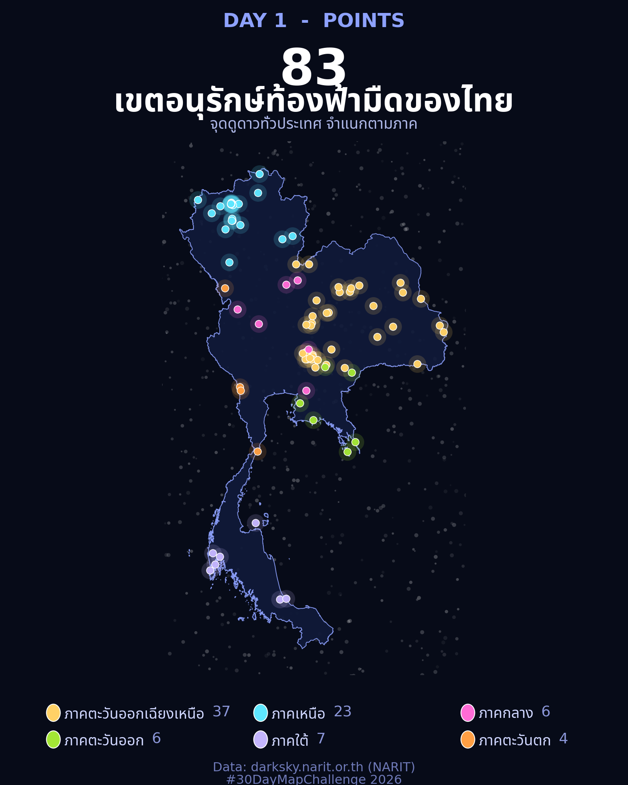

[](https://colab.research.google.com/github/thammarat-ai/geo-notes/blob/main/notebooks/day01_points_colab.ipynb
)

อยากทำแผนที่แต่ไม่อยากติดตั้ง Python? โพสต์นี้พาทำแผนที่วันแรกของ
[#30DayMapChallenge 2026](https://30daymapchallenge.com/) ในหัวข้อ **Points**
บน Google Colab ตั้งแต่ศูนย์ — เปิดลิงก์ กด Run all แล้วได้ภาพนี้เลย

## ที่มาของแผนที่

ข้อมูลที่ใช้คือ **83 เขตอนุรักษ์ท้องฟ้ามืด (Dark Sky Thailand)**
ของ[สถาบันวิจัยดาราศาสตร์แห่งชาติ (NARIT)](https://darksky.narit.or.th/)

เว็บของ NARIT สร้างด้วย WordPress ซึ่งมี **REST API** ติดมาให้โดยอัตโนมัติ
ผมเลยดึงข้อมูลตรงจาก endpoint นี้แทนการ copy ทีละหน้า:

```
https://darksky.narit.or.th/wp-json/wp/v2/darksky
```

สิ่งที่ได้กลับมาเป็น JSON — รายชื่อสถานที่ทั้ง 83 แห่งพร้อมพิกัด ชื่อจังหวัด
และภาค ผมแปลงเก็บเป็นไฟล์ CSV ไว้ใช้ซ้ำ ข้อควรรู้คือ API นี้เปิดสาธารณะ
(ไม่มีระบบล็อกอิน) แต่เว็บมี Cloudflare กันบอท สคริปต์เลยดึงตรง ๆ ไม่ได้ —
โน้ตบุ๊กนี้จึงใช้ไฟล์ CSV ที่ดึงไว้แล้วแทน

ผมเลือกทำบน Colab เพราะอยากให้โน้ตบุ๊กนี้เป็นของที่**แชร์ให้นักศึกษาเปิดรันตามได้ทันที**
ไม่ต้องตั้ง Python ไม่ต้องตั้งฟอนต์บนเครื่องตัวเอง

## ผลลัพธ์



คอนเซปต์คือ "จุดดูดาว = ดวงดาวบนแผนที่" — พื้นหลังสีน้ำเงินเข้มแบบท้องฟ้ายามค่ำคืน
ขอบประเทศไทยสีฟ้าอ่อน แล้วให้แต่ละจุดเรืองแสงเหมือนดาว แยกสีตามภาค 6 ภาค
ภาคอีสานมากสุด 37 จุด รองลงมาภาคเหนือ 23 จุด

## วิธีทำบน Colab แบบย่อ

### ขั้นที่ 1: ติดตั้งฟอนต์ไทย

Colab ไม่มีฟอนต์ไทยมาให้ ต้องติดตั้งก่อนวาดภาพเสมอ ผมใช้ฟอนต์
**Noto Sans Thai** — เพราะทดสอบแล้วว่าวาดสระบน/วรรณยุกต์ที่ซ้อนกัน
(เช่นคำว่า "ทั่ว" ที่มี ั ซ้อนกับ ่) ได้ถูกต้อง ส่วนฟอนต์ Sarabun
ที่ลองก่อนหน้านี้วาดสระซ้อนไม่ชัด

```python
import urllib.request
from fontTools.ttLib import TTFont
from fontTools.varLib.instancer import instantiateVariableFont
from matplotlib import font_manager

# โหลด variable font แล้วสร้างไฟล์ static (Regular + Bold)
urllib.request.urlretrieve(
    "https://github.com/google/fonts/raw/main/ofl/notosansthai/"
    "NotoSansThai%5Bwdth%2Cwght%5D.ttf",
    "NotoSansThai-VF.ttf",
)
for _name, _wght in [("NotoSansThai-Regular", 400), ("NotoSansThai-Bold", 700)]:
    _f = TTFont("NotoSansThai-VF.ttf")
    instantiateVariableFont(_f, {"wght": _wght, "wdth": 100}, inplace=True)
    _f.save(f"{_name}.ttf")
    font_manager.fontManager.addfont(f"{_name}.ttf")

plt.rcParams["font.family"] = "Noto Sans Thai"
```

### ขั้นที่ 2: โหลดข้อมูลและขอบประเทศ

จุดดูดาวโหลดจากไฟล์ CSV บน GitHub — ถ้าโหลดไม่ได้ (เช่นยังไม่ได้ push ไฟล์)
โน้ตบุ๊กจะให้อัปโหลดไฟล์เองแทน:

```python
CSV_URL = "https://raw.githubusercontent.com/thammarat-ai/geo-notes/main/data/darksky_thailand.csv"
try:
    pts = pd.read_csv(CSV_URL)
except Exception:
    from google.colab import files
    up = files.upload()  # กดปุ่ม Choose Files แล้วเลือกไฟล์ darksky_thailand.csv
    pts = pd.read_csv(next(iter(up)))
```

ขอบประเทศไทยโหลดจาก **GADM v4.1** (ฐานข้อมูลขอบเขตการปกครองทั่วโลก เปิดให้ใช้ฟรี)
โดยตรง ผมเลือก GADM เพราะตอนแรกใช้ Natural Earth 110m แล้วเส้นขอบหยาบเกินไป
จนจุดชายแดนแม่ฮ่องสอน มุกดาหาร และชายฝั่งตราดหลุดออกนอกประเทศ

```python
with urllib.request.urlopen(
    "https://geodata.ucdavis.edu/gadm/gadm4.1/json/gadm41_THA_0.json",
    timeout=60,
) as r:
    gj = json.load(r)
geom = gj["features"][0]["geometry"]
polys = [geom["coordinates"]] if geom["type"] == "Polygon" else geom["coordinates"]
```

จุดที่ต้องเข้าใจคือโครงสร้าง GeoJSON: ขอบประเทศเป็น **MultiPolygon**
(หลายแผ่นดิน/เกาะ) แต่ละ polygon มีหลายวง — `poly[0]` คือ**วงนอก**ของแผ่นดินนั้น
จากนั้นวาดแต่ละวงด้วย `matplotlib.patches.Polygon` ไม่ต้องใช้ geopandas เลย:

```python
from matplotlib.patches import Polygon as MplPolygon
for poly in polys:
    ax.add_patch(MplPolygon(np.asarray(poly[0]), closed=True,
                            facecolor="#101a3a", edgecolor="#8ea2ff",
                            lw=0.7, alpha=0.9, zorder=2))
```

### ขั้นที่ 3: วาดแผนที่ธีมท้องฟ้ายามค่ำคืน

เทคนิคสำคัญมีอย่างเดียว: วาดจุด **2 ชั้นซ้อนกัน** —
ชั้นล่างจุดใหญ่สีจางเป็น halo ชั้นบนจุดเล็กขอบขาวเป็น core
แค่นี้จุดก็ดูเรืองแสงเหมือนดาวแล้ว

```python
ax.scatter(x, y, s=260, c=color, alpha=0.16, linewidths=0)          # halo
ax.scatter(x, y, s=46, c=color, edgecolors="white", linewidths=0.6) # core
```

ที่เหลือคือการจัดองค์ประกอบ: ดาวพื้นหลังสุ่ม 700 ดวง หัวเรื่อง คำอธิบายใต้ภาพ
และ legend แยกสีตามภาค

### ขั้นที่ 4: ดาวน์โหลดภาพ

```python
fig.savefig("day01_points_darksky_thailand.png", dpi=200, facecolor="#070b18")
from google.colab import files
files.download("day01_points_darksky_thailand.png")
```

## หมายเหตุเรื่องขอบประเทศ (เพิ่มทีหลัง 7 พ.ย. 2569)

ซีรีส์นี้ไม่ได้ใช้เส้นขอบประเทศแหล่งเดียวตลอด · Day 1 และ Day 3 ใช้ **GADM** (เพราะ Natural Earth
110m หยาบเกินไปสำหรับงานนั้น) ส่วน Day 6–7 ใช้ **Natural Earth 10m** ซึ่งละเอียดกว่าคนละระดับ

ผลต่างที่วัดได้จริง: union ของหกเหลี่ยม 1,738 บล็อกจาก Day 3 = **496,867 ตร.กม.** เทียบกับ
Natural Earth Thailand = **512,593 ตร.กม.** → มีพื้นที่ **18,692 ตร.กม. (3.6%)** ที่ hex กลบไม่ถึง
เส้น NE และ hex **2,967 ตร.กม. (0.6%)** ล้นออกนอกเส้น (ทะเล/เกาะ) แปลว่าคำว่า "พื้นที่ประเทศ"
ที่อ้างในแต่ละวันไม่เท่ากันโดยนัย

ตั้งแต่วัน 8 เป็นต้นไป มาตรฐานของซีรีส์นี้คือ **Natural Earth 10m** (public domain) เพราะ
ฟรี ไม่ต้องมี token และเส้นละเอียดพอสำหรับทั้งงาน raster และ vector


## บทเรียน

- **ฟอนต์ไทยมีเรื่องซับซ้อนกว่าที่คิด** — ฟอนต์ Sarabun วาดสระบน/วรรณยุกต์ที่ซ้อนกัน
  (เช่นคำว่า "ทั่ว") ไม่ชัด เพราะมันต้องการ text shaping engine ที่ matplotlib ไม่มี
  สุดท้ายจบที่ **Noto Sans Thai** ซึ่งวาดสระซ้อนได้ถูกต้อง บทเรียนคือ:
  เห็นฟอนต์ไทยอย่าเพิ่งไว้ใจ ทดสอบคำที่มีสระซ้อนก่อนเสมอ
- **ความละเอียดของขอบประเทศสำคัญกว่าที่คิด** — ตอนแรกใช้ Natural Earth 110m
  แล้วจุดชายแดนแม่ฮ่องสอน มุกดาหาร และชายฝั่งตราดหลุดออกนอกขอบประเทศ
  เปลี่ยนมาใช้ GADM แล้วหาย
- **Colab เหมาะกับงานแชร์ ไม่ใช่งานประจำ** — ทำแผนที่รายวัน 30 วัน
  ทำบนเครื่องตัวเองลื่นกว่า แต่พออยากให้นักศึกษาเปิดรันตาม Colab คือคำตอบ

พรุ่งนี้ธีม **Lines** — แล้วเจอกันครับ 🔥
