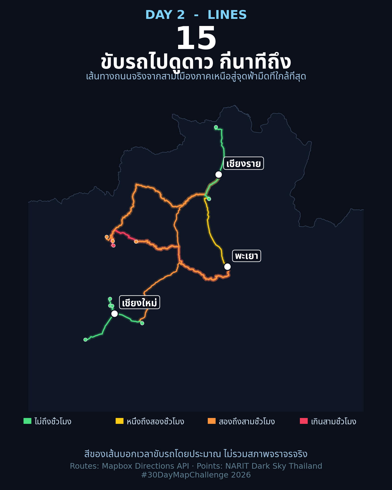

<!-- [](https://colab.research.google.com/github/thammarat-ai/geo-notes/blob/main/notebooks/day02_lines.ipynb) -->

Day 1 เราปักหมุด 83 จุดอนุรักษ์ท้องฟ้ามืดของ NARIT ลงแผนที่ไปแล้ว
แต่วันนี้ผมอยากตอบคำถามที่นักท่องเที่ยวถามจริง ๆ คือ
**"ถ้าออกจากในเมือง ต้องขับรถนานแค่ไหนถึงจะได้เห็นดาวเต็มฟ้า"**

คำตอบอยู่ในเส้นทั้ง 15 เส้นบนแผนที่นี้ครับ

## ที่มาของแผนที่

ไอเดียคือเอาจุดจาก Day 1 มาต่อยอด — แทนที่จะวาดแค่จุด
ผมลาก**เส้นทางถนนจริง**จาก 3 เมืองภาคเหนือ (พะเยา · เชียงใหม่ · เชียงราย)
ไปยังจุดฟ้ามืดที่ใกล้ที่สุดของแต่ละเมือง แล้วระบายสีเส้นตามเวลาขับรถ
เขียวคือถึงในไม่ถึงชั่วโมง แดงคือเกินสามชั่วโมง

ที่เลือก 3 เมืองนี้เพราะเป็นฐานของคนเหนือตอนบน
และพะเยาคือบ้านผมเอง — ผมอยากรู้เหมือนกันว่าขับออกจากบ้านไปดูดาวที่ไหนใกล้สุด

## ผลลัพธ์



ตัวเลขที่น่าสนใจ:

- **เชียงใหม่**โชคดีที่สุด — มีจุดดูดาวห่างจากตัวเมืองแค่ **12 นาที**
  (สิริน วิลล์ แม่ริม) ขับรถแป๊บเดียวก็หนีแสงเมืองได้แล้ว
- **จากพะเยา** (บ้านผม) จุดที่ใกล้สุดคือ**ฮ่อมลมจอย เชียงราย**
  ขับ **67 นาที** ระยะทาง 73 กม.
- เส้นที่โหดที่สุดคือ**พะเยา → ดารกะ เชียงดาว** —
  ขับ **200 นาที** (สามชั่วโมงกว่า) ถนนยาว 182 กม.
  ทั้งที่ระยะเส้นตรงแค่ 98 กม. ถนนคดเคี้ยวกว่าเส้นตรง **1.85 เท่า**

แผนที่ฉบับ interactive (ซูม คลิกดูรายละเอียดแต่ละเส้นได้)
ผมแปะไว้ให้ในโน้ตบุ๊กครับ

## วิธีทำแบบย่อ

### ขั้นที่ 1: คัดจุดที่ใกล้ที่สุดด้วยระยะเส้นตรงก่อน

ยิง API ครบทุกคู่ (3 เมือง × 83 จุด = 249 ครั้ง) มันเปลือง
ผมเลยคำนวณระยะเส้นตรงด้วยสูตร haversine ก่อน แล้วคัดแค่ 5 จุด
ที่ใกล้ที่สุดของแต่ละเมือง — เหลือแค่ 15 คู่ที่ต้องขอเส้นทางจริง

```python
def haversine_km(lat1, lon1, lat2, lon2):
    R = 6371.0088
    p1, p2 = math.radians(lat1), math.radians(lat2)
    dp, dl = p2 - p1, math.radians(lon2 - lon1)
    a = math.sin(dp / 2) ** 2 + math.cos(p1) * math.cos(p2) * math.sin(dl / 2) ** 2
    return 2 * R * math.asin(math.sqrt(a))
```

### ขั้นที่ 2: ขอเส้นทางถนนจาก Mapbox Directions API

Mapbox เป็นสปอนเซอร์ของ #30DayMapChallenge ปีนี้พอดี
API นี้รับพิกัดต้นทาง–ปลายทาง แล้วคืนเส้นทางถนนจริงเป็น GeoJSON LineString
พร้อมเวลาขับรถและระยะทาง — จุดสำคัญคือ**อย่า hardcode token ในโค้ด**
ผมเก็บใน Colab Secrets (ไอคอนรูปกุญแจแถบซ้าย) แล้วดึงด้วย `userdata.get()`
โน้ตบุ๊กแชร์ต่อได้โดย token ไม่หลุด

```python
url = f"https://api.mapbox.com/directions/v5/mapbox/driving/{o_lon},{o_lat};{d_lon},{d_lat}"
params = {"geometries": "geojson", "overview": "full", "access_token": MAPBOX_TOKEN}
r = requests.get(url, params=params, timeout=30).json()
route = r["routes"][0]
geometry, minutes, km = route["geometry"], route["duration"] / 60, route["distance"] / 1000
```

ถ้าไม่มี token โค้ดจะสลับไปใช้ OSRM demo server ให้อัตโนมัติ (ไม่ต้องมี token แต่ยิงถี่ไม่ได้)

### ขั้นที่ 3: วาดแผนที่ด้วย folium ระบายสีตามเวลา

```python
BINS = [(60, "#4ade80", "< 1 ชม."), (120, "#facc15", "1–2 ชม."),
        (180, "#fb923c", "2–3 ชม."), (float("inf"), "#f43f5e", "> 3 ชม.")]
```

เส้นแต่ละเส้นอยู่คนละ layer ตามเมืองต้นทาง เปิด–ปิดดูแยกกันได้
จุดปลายทางเก็บเป็น GeoJSON ไว้ด้วย เปิดใน QGIS ต่อได้เลย

## บทเรียน

- **เส้นตรงหลอกเราได้** — จุดที่ใกล้ตามเส้นตรงอาจไม่ใช่จุดที่ขับถึงเร็วที่สุด
  ถนนดอยคดเคี้ยวทำให้ระยะทางจริงยาวกว่าเกือบสองเท่า (ดูค่า detour ที่ผมคำนวณไว้)
  แต่การคัดด้วยเส้นตรงก่อนก็ยังคุ้ม เพราะประหยัด API call ไปเยอะ
- **token ต้องอยู่ใน Secrets ไม่ใช่ในโค้ด** — กฎเหล็กของงานที่ใช้ API key
  โดยเฉพาะถ้าจะแชร์โน้ตบุ๊กให้นักศึกษา
- **เวลาขับรถเป็นค่าประมาณจากโมเดล** — ไม่รวมรถติด ถนนดอยหน้าฝน
  หรือการขับกลางคืนจริง อย่าเอาไปวางแผนทริปแบบตรงตัว

พรุ่งนี้ธีม **Polygons** — ทางการของวันที่ 3 พ.ย. เจอกันครับ 🔷
