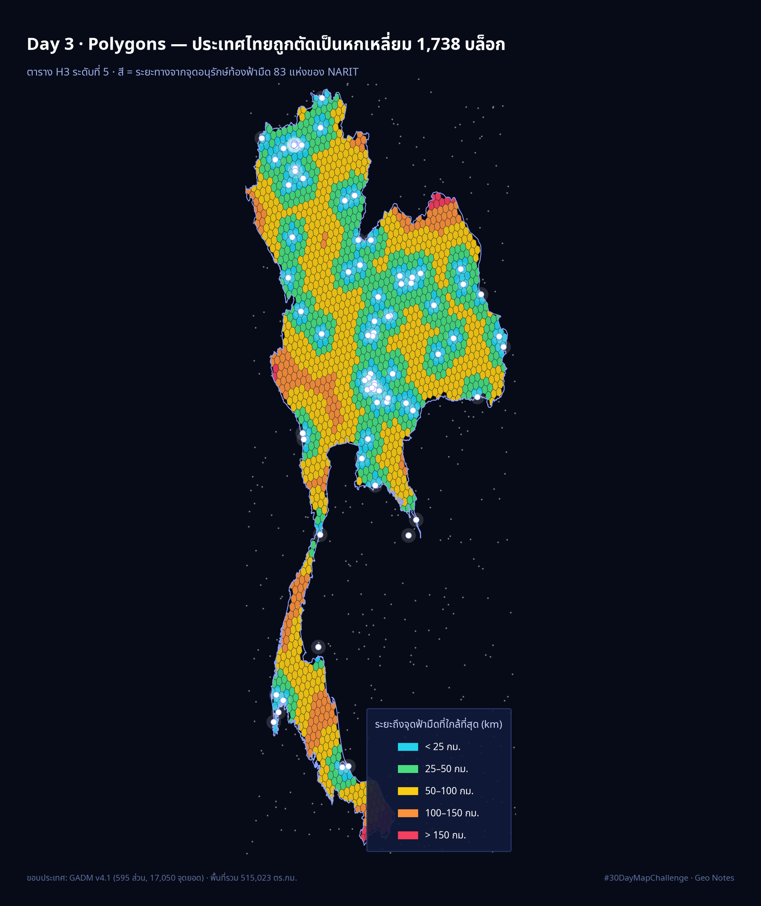

[](https://colab.research.google.com/github/thammarat-ai/geo-notes/blob/main/notebooks/day03_polygons.ipynb)

Day 1 เราปัก**จุด** 83 แห่ง · Day 2 เราลาก**เส้น** 15 สาย
แต่วันนี้มีคำถามที่จุดกับเส้นตอบไม่ได้เด็ดขาด — **"พื้นที่ของไทยกี่ตารางกิโลเมตร
ที่ใกล้พอจะดูดาวยัง"**

คำถามที่มีคำว่า "กี่ตารางกิโลเมตร" ต้องใช้ **polygon** เท่านั้นครับ

## ที่มาของแผนที่

ไอเดียคือแทนที่ประเทศทั้งประเทศด้วย "หน่วยนับ" ที่เท่ากันทุกจุด
ผมเลือกใช้ **H3** (ระบบ grid หกเหลี่ยมของ Uber) ระดับที่ 5 ซึ่งบล็อกละประมาณ 289 ตร.กม.
แล้วตอบคำถามสองชั้น:

1. **เต็มประเทศด้วยหกเหลี่ยม** — `polygon_to_cells` รับ polygon ของไทย
   แล้วคืนทุกบล็อกที่อยู่ข้างใน (1,738 บล็อก)
2. **ระบายสีแต่ละบล็อก** ตามระยะทาง (เส้นตรง) ถึงจุดอนุรักษ์ท้องฟ้ามืดของ NARIT ที่ใกล้ที่สุด

ทำไมต้องหกเหลี่ยม ไม่ใช้ตารางสี่เหลี่ยม? เพราะสี่เหลี่ยมมีเพื่อนบ้านสองแบบ
— ติดด้านห่าง 1 หน่วย ติดมุมห่าง 1.41 หน่วย ทำให้ "ระยะทาง" บน grid เพี้ยน
หกเหลี่ยมมีเพื่อนบ้าน 6 ตัวห่างเท่ากันหมด เหมาะกับงานวัดระยะแบบนี้มากกว่า

ส่วน**ขอบประเทศ** ผมอยากใช้ของ Mapbox ให้สมกับที่เขาเป็นสปอนเซอร์ชาเลนจ์ปีนี้
(รายละเอียดด้านล่าง — มีดราม่าเรื่องฟรี/เสียเงินนิดหน่อย)

## ผลลัพธ์



ตัวเลขจาก 1,738 บล็อก:

| ระยะถึงจุดฟ้ามืด | จำนวนบล็อก | พื้นที่ | สัดส่วน |
|---|---|---|---|
| < 25 กม. | 307 | 90,718 ตร.กม. | 17.6% |
| 25–50 กม. | 516 | 152,418 ตร.กม. | 29.6% |
| 50–100 กม. | 717 | 212,762 ตร.กม. | 41.3% |
| 100–150 กม. | 175 | 52,317 ตร.กม. | 10.2% |
| > 150 กม. | 23 | 6,809 ตร.กม. | 1.3% |

- **พื้นที่เกือบครึ่งประเทศ (47.2%) อยู่ไกลจุดดูดาวไม่เกิน 50 กม.** —
  นับเป็นตารางกิโลเมตรจะ ๆ ว่าราว 243,000 ตร.กม.
- ค่ามัธยฐานของประเทศคือ **52 กม.** แปลว่าถ้าคุณสุ่มโยนลูกเต๋าลงบนแผนที่ไทย
  มีโอกาสสูงที่จะอยู่ใกล้แหล่งฟ้ามืดในระดับ "ขับคืนเดียวไปกลับได้"
- **ไม่มีบล็อกไหนไกลเกิน 200 กม. เลย** — 83 จุดของ NARIT กระจาย covers ประเทศ
  ได้ทั่วกว่าที่ผมคิดมาก
- **แต่ช่องว่างจริงมีอยู่** 23 บล็อกที่ไกลเกิน 150 กม. แบ่งเป็น **14 บล็อกอยู่ปลายสุด
  คาบสมุทรมลายู** (ละติจูด 5.7–6.3 แถวนราธิวาส–ชายแดนมาเลเซีย ซึ่งจุดที่ใกล้ที่สุด
  คือหอดูดาวฯ สงขลา ยังห่างตั้ง 194 กม.) กับอีก **7 บล็อกอยู่แอ่งที่ราบอีสาน**
  (สกลนคร–ขอนแก่น)
- 198 บล็อก (11.4%) ไกลเกิน 100 กม. และไม่ได้กระจุกอยู่ไหนที่เดียว —
  กระจาย 68 บล็อกภาคใต้ · 67 บล็อกภาคกลาง/ตะวันออก · 63 บล็อกภาคเหนือ
  (จุดที่พวกมันใกล้ที่สุดคือสงขลา — นับเป็นจำนวนบล็อก: สงขลา 43 บล็อก ราชบุรี 28 สุราษฎร์ธานี 24)

แผนที่ interactive (เปิด–ปิดดูทีละช่วงระยะ คลิกบล็อกเพื่อดูว่าใกล้จุดไหน)
อยู่ใน `day03_polygons_map.html` ครับ ส่วน `day03_hex_polygons.geojson`
(1,738 features พร้อม properties `km_nearest` / `bucket` / `nearest`) เปิดใน QGIS ต่อได้เลย

## วิธีทำแบบย่อ

### ขั้นที่ 1: ได้ polygon ของประเทศมาก่อน — Mapbox ให้ฟรีแค่ระดับ "ประเทศ"

ผมอยากใช้ Mapbox Boundaries และไปเจอความจริง 2 ข้อใน docs:

- tileset `mapbox.country-boundaries-v1` (ขอบเขต**ประเทศ**) **ฟรีให้ผู้ใช้ Mapbox ทุกคน**
- แต่ระดับ**จังหวัด/อำเภอ** คือ Mapbox Boundaries v4 ซึ่ง**เสียเงิน** ต้องติดต่อ sales
- และ tileset ทั่วไป "Raw geometries are not provided for offline use" —
  วาดบน Mapbox GL ได้ แต่ดูด geometry ดิบไปทำ PNG/วิเคราะห์ต่อไม่ได้

ทางรอดคือ **Tilequery API** ซึ่งตอบมาเป็น GeoJSON:

```python
r = requests.get(
    "https://api.mapbox.com/v4/mapbox.country-boundaries-v1"
    f"/tilequery/{lon},{lat}.json",
    params={"access_token": MAPBOX_TOKEN, "limit": 10,
            "layers": "country_boundaries"}, timeout=60)
for ft in r.json()["features"]:
    p = ft["properties"]
    if p["iso_3166_1"] == "TH" and p["disputed"] == "false":
        geom = ft["geometry"]      # polygon ของไทย เป็น GeoJSON เอามาใช้ต่อได้ทันที
```

ผมยิง 5 จุดกระจายทั่วไทย (ภาคกลาง เหนือ อีสาน ตะวันออก ใต้) เพื่อเก็บ polygon
ให้ครบทุกเกาะ แล้วต่อกันเป็น MultiPolygon

ข้อจำกัดที่ต้องรู้: geometry จาก tileset ถูก **clip ตามขอบ tile** (มี buffer 4 พิกเซล)
จุดที่ตกใกล้ขอบ tile อาจได้ polygon ไม่ครบทั้งประเทศ — เลยต้องยิงหลายจุดแล้ว union

**ตามจริงของแผนที่ฉบับนี้:** โน้ตบุ๊กเขียนให้เดินสองทาง — มี token ใช้ Mapbox,
ไม่มี token สลับไปใช้ **GADM v4.1** อัตโนมัติ
ตอนผมรันรอบนี้ไม่มี token ในเครื่อง (เก็บไว้ใน Colab Secrets เท่านั้น)
**ภาพที่เห็นจึงสร้างจาก GADM** — มุมซ้ายล่างของภาพระบุแหล่งข้อมูลไว้เสมอ
ส่วน endpoint ของ Mapbox ผมทดสอบแล้วว่าเขาตอบ `401 Not Authorized` ถูกต้อง
(แปลว่า URL/ชั้นข้อมูลใช้ได้ แค่ต้องใส่ token จริง)

### ขั้นที่ 2: เปลี่ยน polygon เป็นตารางหกเหลี่ยม

```python
polys = [h3.LatLngPoly([(la, lo) for lo, la in outer],
                        *[[(la, lo) for lo, la in h] for h in holes])
         for outer, holes in rings]
cells = sorted({c for p in polys for c in h3.polygon_to_cells(p, RES)})
```

กับดักที่ใหญ่ที่สุดของขั้นนี้อยู่บรรทัดเดียว: **GeoJSON เก็บ `(lon, lat)`
แต่ H3 รับ `(lat, lon)`** — สลับผิดคือแผนที่ไปโผล่ somewhere ในมหาสมุทรแอตแลนติก
(ไม่ใช่เรื่องตลก เพราะมันยัง render ออกมาเป็นภาพสวย ๆ ด้วยซ้ำถ้าคุณไม่สังเกต)

อีกเรื่องคือเกาะ: GADM ให้มา 595 ส่วน (แผ่นดินใหญ่ + เกาะเล็กเกาะน้อย)
ผมตัดส่วนที่เล็กกว่า 300 ตร.กม. ทิ้ง เพราะเล็กกว่าหกเหลี่ยมหนึ่งบล็อก
ใส่ไปก็ไม่มี cell ตกอยู่ข้างใน เหลือแผ่นดิน+เกาะใหญ่ 2 ส่วน
พื้นที่ mask ที่คำนวณได้ **513,732 ตร.กม.** ตรงกับตัวเลขทางการ (~513,120) ต่างกัน **+0.12%**

### ขั้นที่ 3: นับพื้นที่ด้วยสูตรทรงกลม ไม่ต้องพึ่ง pyproj

อยากเทียบ "ผลรวมพื้นที่หกเหลี่ยม" กับ "พื้นที่ประเทศจริง" ว่าเพี้ยนแค่ไหน
ใช้ spherical polygon area บน lon/lat ตรง ๆ ได้เลย 10 บรรทัด:

```python
def ring_area_km2(ring):
    tot, R = 0.0, 6371.0088
    for i in range(len(ring) - 1):
        lon1, lat1 = math.radians(ring[i][0]), math.radians(ring[i][1])
        lon2, lat2 = math.radians(ring[i+1][0]), math.radians(ring[i+1][1])
        tot += (lon2 - lon1) * (2 + math.sin(lat1) + math.sin(lat2))
    return abs(tot * R * R / 2.0)
```

ผลคือ 1,738 บล็อก รวมเป็น **515,023 ตร.กม.** — เกินจริง +0.25%
เพราะหกเหลี่ยมเป็นรูปหลายเหลี่ยม ไม่ใช่ขอบประเทศจริงที่หยัก ๆ
**ค่าคลาดเคลื่อน 0.25% รับได้กับงาน visualization แต่ต้องรายงานเป็นตัวเลขเสมอ**
ไม่ใช่ทำเป็นว่าพื้นที่ที่ได้คือค่าจริงเป๊ะ ๆ

### ขั้นที่ 4: ตัดหกเหลี่ยมที่ล้นออกนอกประเทศ (polygon clipping)

นี่คือขั้นที่ "polygons" เป็น polygons จริง — บล็อกตรงชายแดนล้นออกทะเล
ออกประเทศเพื่อนบ้าน ถ้าไม่ตัด แผนที่จะไม่เหลือรูปทรงไทย

```python
MASK = MultiPolygon([SPoly(o, h) for o, h in rings])
g = SPoly([(lo, la) for la, lo in h3.cell_to_boundary(cell)])
if not g.within(MASK):
    inter = unary_union([s.intersection(g) for s in MASK.geoms])
    coords = ([list(inter.exterior.coords)] if inter.geom_type == "Polygon"
              else [list(p.exterior.coords) for p in inter.geoms])
```

**243 จาก 1,738 บล็อก (14.0%) ถูกตัดขอบ** —
14% ของภาพนี้มาจากบล็อกที่แตะชายแดน ถ้าข้ามขั้นนี้ไปรูปทรงประเทศจะผิดทันที
และบล็อกที่แตะเกาะ/อ่าวถูกตัดเป็น 2 ชิ้นจริง — ในไฟล์ GeoJSON ที่ปล่อยออกมา
มี 24 features ที่เป็น `MultiPolygon` ไม่ใช่ `Polygon`
(ถ้าใส่ type เป็น Polygon ทุกบล็อก 24 บล็อกนี้กลายเป็น shape เพี้ยนไปเลย
polygon ที่ไม่ convex ต้องคิดกรณี "ได้หลายชิ้น" ไว้ตั้งแต่แรก)


## ไฟล์ประกอบ

แผนที่แบบ interactive ของหกเหลี่ยม 1,738 บล็อก และข้อมูล hex พร้อม `km_nearest` เป็น GeoJSON

- [day03_polygons_map.html](day03_polygons_map.html) — 1.09 MB
- [day03_hex_polygons.geojson](day03_hex_polygons.geojson) — 0.94 MB

## หมายเหตุเรื่องขอบประเทศ (เพิ่มทีหลัง 7 พ.ย. 2569)

ซีรีส์นี้ไม่ได้ใช้เส้นขอบประเทศแหล่งเดียวตลอด · Day 1 และ Day 3 ใช้ **GADM** (เพราะ Natural Earth
110m หยาบเกินไปสำหรับงานนั้น) ส่วน Day 6–7 ใช้ **Natural Earth 10m** ซึ่งละเอียดกว่าคนละระดับ

ผลต่างที่วัดได้จริง: union ของหกเหลี่ยม 1,738 บล็อกจาก Day 3 = **496,867 ตร.กม.** เทียบกับ
Natural Earth Thailand = **512,593 ตร.กม.** → มีพื้นที่ **18,692 ตร.กม. (3.6%)** ที่ hex กลบไม่ถึง
เส้น NE และ hex **2,967 ตร.กม. (0.6%)** ล้นออกนอกเส้น (ทะเล/เกาะ) แปลว่าคำว่า "พื้นที่ประเทศ"
ที่อ้างในแต่ละวันไม่เท่ากันโดยนัย

ตั้งแต่วัน 8 เป็นต้นไป มาตรฐานของซีรีส์นี้คือ **Natural Earth 10m** (public domain) เพราะ
ฟรี ไม่ต้องมี token และเส้นละเอียดพอสำหรับทั้งงาน raster และ vector


## บทเรียน

- **polygon คือหน่วยนับของคำถามประเภท "กี่ตารางกิโลเมตร"** —
  Day 1–2 ตอบได้แค่ "ที่ไหน" กับ "ไกลแค่ไหน" แต่พอมี polygon
  เราวัด *พื้นที่* ได้ ซึ่งเอาไปทำต่อได้ทั้ง choropleth ทั้ง join กับข้อมูลอื่น
- **Mapbox Boundaries ฟรีแค่ admin-0** — ระดับจังหวัดต้องจ่าย
  ทางเลือกฟรีสำหรับ polygon ไทยคือ geoSAPI/GIST2019 (ละเอียดสุด แต่ต้องอัปโหลดไฟล์เอง)
  Natural Earth admin-1 (ฟรี public domain แต่เส้นหยาบ) OSM/Geofabrik (ฟรี ต้องให้เครดิต)
  หรือสร้าง polygon เองแบบ H3 วันนี้ที่ไม่ต้องพึ่ง data ภายนอกเลย
- **อย่าเชื่อ polygon ที่ไม่ได้ตรวจพื้นที่** — ผมจับเลข mask เทียบตัวเลขทางการ
  ทุกครั้ง (+0.12%) เพราะ polygon จากคนละแหล่งให้ผลต่างกันได้ถึงขั้นที่
  จำนวนหกเหลี่ยมเปลี่ยน ถ้าสลับแหล่งข้อมูลแล้วจำนวนบล็อกขยับเกิน ~1%
  แปลว่ารายละเอียดของ mask มีผลต่อการวิเคราะห์จริง
- **14% ของงานอยู่ใน clipping ไม่ใช่การวาด** — งาน polygon ส่วนใหญ่
  เสียเวลาตรงจัดการขอบ ไม่ใช่ตรงใส่สี
- **ระยะเส้นตรง ≠ ขับถึง** — โยงกลับ Day 2: ถนนดอยทำให้ระยะจริงยาวกว่าเส้นตรง
  เกือบ 1.85 เท่า แผนที่นี้จึงตอบ "ใกล้แค่ไหนในเชิงพื้นที่" ไม่ใช่ "ไปได้เมื่อไหร่"
  ถ้าจะวางแผนทริปจริงต้องใช้เส้นทางขับรถ (Day 2) มาทับอีกชั้น

พรุ่งนี้ธีม **Clusters** (ทางการของวันที่ 4 พ.ย.) —
หกเหลี่ยม 1,738 บล็อกวันนี้คือวัตถุดิบชั้นดีของการหา hotspot เจอกันครับ ⬡
