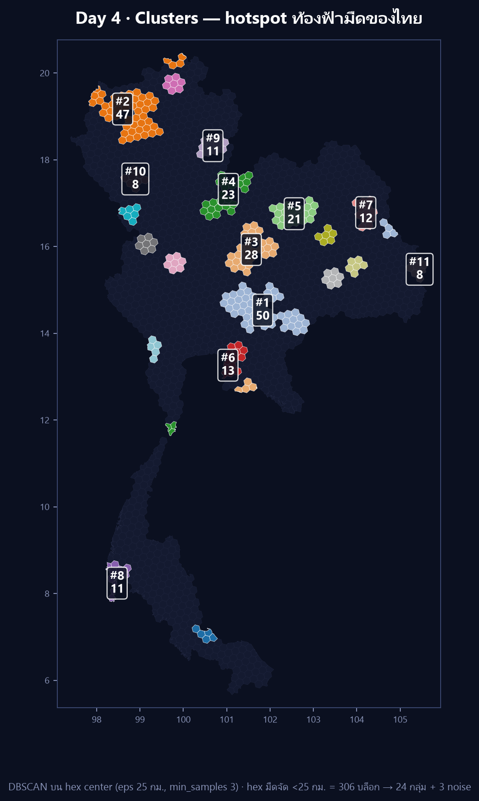

[](https://colab.research.google.com/github/thammarat-ai/geo-notes/blob/main/notebooks/day04_clusters.ipynb)

Day 1 เราปัก**จุด** · Day 2 เราลาก**เส้น** · Day 3 เราวัด**พื้นที่**
วันนี้ (ธีมทางการ **Clusters**) ถามต่อว่า — **"พื้นที่ฟ้ามืดของไทยมันจับกลุ่มกันตรงไหน
หรือกระจายเท่า ๆ กันทั้งประเทศ?"** คำถามประเภท "ก้อน / กลุ่ม / hotspot" ต้องใช้ clustering

## ที่มาของแผนที่

ต่อจาก Day 3 ตรง ๆ: ผมมีหกเหลี่ยม H3 ระดับ 5 อยู่ 1,738 บล็อก แต่ละบล็อกมีค่า
`km_nearest` = ระยะถึงจุดอนุรักษ์ท้องฟ้ามืดของ NARIT ที่ใกล้ที่สุด

ถ้าจะหา "กลุ่ม" ต้องตอบก่อนว่า **จะจับกลุ่มของอะไร** ผมเลือก hex ที่ *มืดจัด*
(`km_nearest < 25 กม.`) ทั้งหมด **306 บล็อก** แล้วรัน **DBSCAN บนจุดศูนย์กลางของ hex**
จากนั้นทาสี hex ทั้งก้อนตาม label ที่ได้ (ไม่ใช่แค่จุด)

ทำไม **DBSCAN** ไม่ใช้ K-means? เพราะ (1) ไม่ต้องเดาจำนวนกลุ่ม `k` ล่วงหน้า
(2) จับกลุ่มรูปทรงอิสระตามพื้นที่จริง ไม่บังคับให้กลม (3) แยก "จุดที่อยู่โดด" เป็น noise ได้
ซึ่งตรงกับคำว่า *hotspot* ในธีมวันนี้เป๊ะ

> ผมลองอีกทางก่อนหน้าคือ `h3.compact_cells` (ยุบ hex ลูกเป็น hex พ่อ) แต่กับเซตที่
> กระจายแบบนี้มันยุบไม่ขึ้น — ได้ 258 "โซน" จาก 306 บล็อก (ยุบจริงแค่ ~48 ครั้ง)
> ภาพออกมาเป็นหิมะโปรย ไม่ใช่ก้อน **DBSCAN จึงชนะขาด** (รายละเอียดในบทเรียน)

## ผลลัพธ์



**ว่าด้วยตัวเลขในภาพ** — แต่ละก้อนมีเลขสองตัว ตัวบน `#N` คือ **อันดับตามจำนวนหกเหลี่ยมในกลุ่ม**
(กลุ่มใหญ่สุด = 1) ตัวล่างคือจำนวนหกเหลี่ยมของกลุ่มนั้น **ทั้งสองตัวไม่ใช่ระดับความมืด** เพราะทุก
กลุ่มถูกคัดด้วยเกณฑ์เดียวกันคือ `km_nearest < 25 กม.` อยู่แล้ว ผมตรวจกับไฟล์ข้อมูลแล้วว่า `#N`
เรียงตามขนาดเป๊ะ 100% (0 คู่ขัดแย้งจาก 276 คู่ของกลุ่ม) และระยะเฉลี่ยสู่จุดฟ้ามืดของแต่ละกลุ่ม
อยู่ที่ 12.2–17.0 กม. เท่านั้น ต่างกันน้อยมากจนใช้จัดอันดับไม่ได้

306 บล็อก → **24 กลุ่ม + 3 บล็อก noise** รวมพื้นที่ที่จับกลุ่มได้ **87,463 ตร.กม.**
10 กลุ่มแรกเรียงตามขนาด:

| # | บล็อก | พื้นที่ | จังหวัดหลัก | จุดฟ้ามืดที่ใกล้สุด |
|---|---|---|---|---|
| 1 | 50 | 14,895 ตร.กม. | นครราชสีมา–สระแก้ว | หาดชมตะวัน (อุทยานทับลาน) |
| 2 | 47 | 13,578 ตร.กม. | เชียงใหม่ | ป่าสนวัดจันทร์ (กัลยาณิวัฒนา) |
| 3 | 28 | 8,296 ตร.กม. | ชัยภูมิ | เขตรักษาพันธุ์ฯ ภูเขียว |
| 4 | 23 | 6,607 ตร.กม. | พิษณุโลก–เลย | อุทยานฯ ภูหินร่องกล้า |
| 5 | 21 | 6,160 ตร.กม. | ขอนแก่น | อุทยานฯ ภูเวียง |
| 6 | 13 | 3,635 ตร.กม. | ฉะเชิงเทรา–ชลบุรี | หอดูดาวเฉลิมพระเกียรติฯ ฉะเชิงเทรา |
| 7 | 12 | 3,483 ตร.กม. | มุกดาหาร–สกลนคร | ทุ่งโนนป่าก่อ (ภูสีฐาน) |
| 8 | 11 | 2,754 ตร.กม. | พังงา–ภูเก็ต | บ่อแสนวิลล่า |
| 9 | 11 | 3,220 ตร.กม. | น่าน | อุทยานฯ ศรีน่าน |
| 10 | 8 | 2,369 ตร.กม. | ลำพูน | อุทยานฯ แม่ปิง |

สิ่งที่ผมไม่คาดคิด:

- **hotspot ใหญ่สุดคือ "ตะวันออก" ไม่ใช่ "เหนือ"** — #1 (กลุ่มใหญ่สุด) อยู่รอยต่อ
  นครราชสีมา–สระแก้ว (14,895 ตร.กม.) ใหญ่กว่าก้อนเชียงใหม่ที่ผมคิดว่าต้องมาก่อน
  เพราะโซนทับลานมีจุดฟ้ามืดหลายแห่งอยู่ชิดกันจน hex เชื่อมเป็นผืนเดียว
- **อีสานไม่ใช่พื้นที่แห้งด้านดาว** — มีกลุ่มของตัวเองกระจาย 7 ก้อน
  (ชัยภูมิ · ขอนแก่น · สุรินทร์ · มหาสารคาม · ร้อยเอ็ด · มุกดาหาร · อุบลฯ)
  แต่ละก้อนไม่ใหญ่แต่มีจริง คนอีสานไม่ต้องขึ้นเหนือก็ดูดาวได้
- **3 บล็อก noise = "มืดแต่โดนตัดขาด"** — เกาะพะลวย (สุราษฎร์ฯ) กับอีก 2 บล็อก
  ติดอุทยานฯ เขาพระวิหาร (ศรีสะเกษ) มืดจัด (`km` 13–25) แต่ไม่มี hex เพื่อนบ้านที่
  มืดเท่าในรัศมี → DBSCAN ปล่อยเป็น noise ตรงกับที่ตามองเห็นว่ามันเป็น "เกาะ" จริง
- 14 กลุ่มที่เหลือมีขนาด 3–7 บล็อก = hotspot ระดับอำเภอ ที่ยังเล็กเกินจะติดป้ายในภาพ

### ตัวเลขนี้ใช้ต่อใน Day 5–6

อันดับ `#N` จากวันนี้กลายเป็นป้ายอ้างอิงที่โพสต์วันถัดไปใช้ต่อ: Day 5 (Sight) และ Day 6 (Vintage)
เขียนเลขเดียวกันนี้เป็น `cNN` ตัวเล็กข้าง ๆ ตัวเลขใหญ่ที่เป็น **อันดับความฟ้าเปิด** ของแต่ละจุด
(ปรับปรุง 7 พ.ย. 2569: เดิมรูปของ Day 5 ใช้ `#N` ของวันนี้เป็นเลขใหญ่ ซึ่งทำให้คนอ่านเข้าใจว่า
เป็นอันดับความฟ้าเปิด — ตอนนี้สลับให้เลขใหญ่คือค่าที่แผ่นนั้นแสดงจริงแล้ว)

## วิธีทำแบบย่อ

### ขั้นที่ 1: เลือกเซตก่อน แล้วค่อย cluster

จุดสำคัญที่สุดของวันนี้: **จะ DBSCAN ทั้ง 1,738 บล็อกไม่ได้** เพราะ hex grid กระจาย
สม่ำเสมอทั้งประเทศ → ทุกบล็อกมีเพื่อนบ้านใกล้ ๆ เท่ากันหมด DBSCAN จะยุบเป็น
*blob เดียวกลืนทั้งประเทศ* ผมจึงป้อนเฉพาะ hex ที่ "มืดจัด" ให้ DBSCAN หาว่า
hex มืดพวกนี้กองอยู่ตรงไหนบ้าง

```python
mask = km_nearest < 25          # เลือกเฉพาะ hex ที่มืดจัด (306 บล็อก)
X    = np.radians(centers[mask]) # จุดศูนย์กลาง hex เป็นเรเดียน
```

### ขั้นที่ 2: DBSCAN บนพิกัดกลม (haversine)

```python
from sklearn.cluster import DBSCAN
R = 6371.0088
lab = DBSCAN(eps=25.0 / R, min_samples=3, metric="haversine").fit_predict(X)
```

`metric="haversine"` รับพิกัดเรเดียนแล้ววัดระยะเป็นกิโลเมตรจริง (ไม่ต้อง project)
**กับดักเรื่อง `eps`:** ระยะระหว่างจุดศูนย์กลาง hex ที่ชิดกัน ≈ **18 กม.** ถ้าตั้ง
`eps < 18` จะไม่มีคู่ไหนเชื่อมถึงกัน → ทุกบล็อกกลายเป็น noise ถ้า `eps` ใหญ่เกิน
(เช่น 30–40) กลุ่มเล็กจะเริ่มเชื่อมกันเป็นก้อนโต ผมเลือก **25 กม.** = เชื่อมเฉพาะ
hex ที่แตะกันจริง ๆ (บวกเผื่อ curvature นิดหน่อย) และตั้ง `min_samples=3`
เพื่อบังคับว่า "กลุ่ม" ต้องมีอย่างน้อย 3 บล็อก ไม่งั้นเป็นแค่คู่โดด

### ขั้นที่ 3: ทาสี hex ทั้งก้อน (ไม่ใช่แค่จุด)

```python
for i, l in zip(np.where(mask)[0], lab):
    if l == -1:
        continue                 # noise = ไม่ทา ให้เป็น backdrop
    color = palette[cluster_rank.index(l)]
    for ring in clipped_rings(cells[i]):   # ใช้ geometry ที่ตัดขอบประเทศแล้วจาก Day 3
        draw_polygon(ring, facecolor=color, edgecolor="white", lw=0.3)
```

ผมวาด hex ด้วย **geometry ที่ clip แล้วจาก Day 3** (ไม่ใช่ `cell_to_boundary` ดิบ)
เพื่อให้บล็อกตรงชายแดนไม่ล้นออกทะเล/ออกประเทศเพื่อนบ้าน — ไม่งั้นรูปทรงไทยจะเสีย
และ backdrop เทา 1,738 บล็อกยังวาดไว้ทั้งประเทศ เพื่อให้ "ก้อนสี" ลอยอยู่ในบริบท
ว่าอยู่ตรงไหนของไทย ไม่ใช่ลอยบนพื้นดำเปล่า ๆ

ไฟล์ `day04_clusters.geojson` (303 features พร้อม `cluster` / `rank` / `size` / `nearest`)
เปิดใน QGIS หรือเอาไปทำแผนที่ interactive ต่อได้เลย

## บทเรียน

- **เลือกเซต input = นิยาม "cluster" ของคุณ** — DBSCAN ไม่ได้บอกว่าอะไรควรถูกกลุ่ม
  มันแค่บอกว่าอะไร "อยู่ชิดกัน" คำถาม "กลุ่มของอะไร" (มืดจัด? <50กม.? ทุก hex?)
  ให้ผลต่างกันคนละเรื่อง ผมลองทั้ง 3 แบบจนได้คำตอบว่า <25กม. เล่าเรื่อง hotspot ได้ชัดสุด
- **`compact_cells` ไม่ใช่เครื่องมือหา cluster** — มันยุบ hex ลูก→พ่อเมื่อบล็อกครบ 7 ลูก
  เท่านั้น กับเซตที่กระจาย ๆ มันจึงแทบไม่ยุบ (258 โซน/306 บล็อก) ถ้าอยากได้ "ก้อน"
  จาก polygon ให้ใช้ DBSCAN บน centroid หรือ flood-fill ตามความต่อเนื่อง
- **eps ต้องสัมพันธ์กับระยะ grid ไม่ใช่ความรู้สึก** — hex res5 ชิดกัน ~18 กม.
  ตั้ง eps ต่ำกว่านี้คือได้ noise ทั้งดง, สูงกว่านี้คือ blob กลืนประเทศ ตัวเลข eps
  ที่ดีจึงผูกกับ resolution ของ grid ที่เลือก
- **คลัสเตอร์ใหญ่สุด ≠ จุดที่คนนึกถึงก่อน** — ผมนึกว่าเหนือต้องมาที่หนึ่ง
  แต่ข้อมูลชี้ว่าตะวันออก (ทับลาน–โคราช–สระแก้ว) กินพื้นที่มืดจัดมากกว่า
  นี่คือเหตุผลที่ต้องรันจริงก่อนสรุปในโพสต์ (บทเรียนเดียวกับ Day 3 เรื่องอย่าเชื่อโดยยังวัด)
- **noise ก็เล่าเรื่องได้** — 3 บล็อกที่ DBSCAN ปล่อยไว้ ไม่ใช่ข้อผิดพลาด
  มันคือ "พื้นที่มืดแต่โดดเดี่ยว" ที่ควรค่าแก่การตั้งคำถามว่าทำไมมันถึงอยู่ลำพัง

พรุ่งนี้ธีม **Senses: Sight** (ทางการวันที่ 5 พ.ย. — "How do you see something?
Maybe map a viewshed?") ต่อจากนี้สวยเลย: คำนวณ **viewshed** จากหอสังเกตการณ์
แต่ละแห่งว่า "มองท้องฟ้าเห็นบริเวณกว้างแค่ไหน" แล้วทับลงบน hex ที่เรามี ⬡
