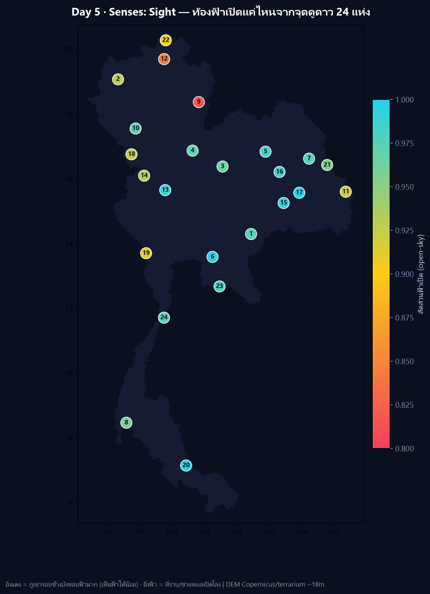
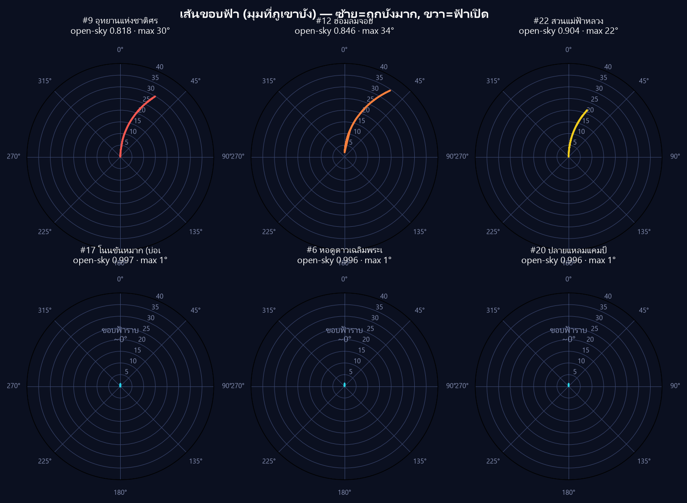
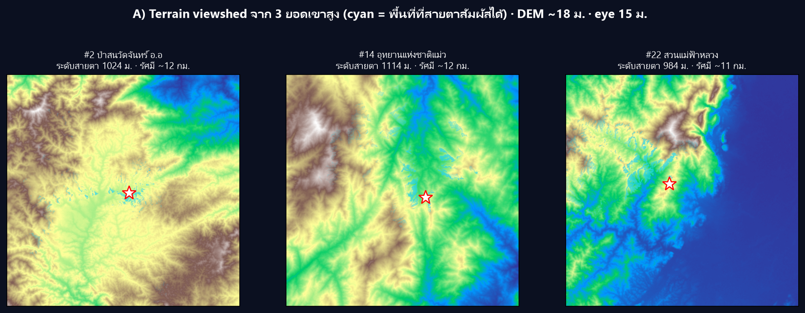

[](https://colab.research.google.com/github/thammarat-ai/geo-notes/blob/main/notebooks/day05_sight.ipynb)

Day 1 ปัก**จุด** · Day 2 ลาก**เส้น** · Day 3 วัด**พื้นที่** · Day 4 จับ**กลุ่ม**
วันนี้ธีมทางการ **Senses: Sight** บอกตรง ๆ ว่า *"How do you see something? Maybe map a viewshed?"*
— ผมจึงตอบคำถามว่า **"จากจุดดูดาวแต่ละแห่งของไทย มองขึ้นไปบนฟ้าแล้วเห็นท้องฟ้าเปิดกว้างแค่ไหน
และภูมิประเทศรอบข้างบังขอบฟ้าไว้เยอะเพียงใด"**

## ที่มาของแผนที่

ต่อจาก Day 4 ตรง ๆ: ผมมี 24 กลุ่ม (hotspot) ฟ้ามืด แต่ละกลุ่มผูกกับ "จุดอนุรักษ์ท้องฟ้ามืด
ของ NARIT ที่ใกล้สุด" (คอลัมน์ `nearest`) ผมเอา **หอดูดาวประจำกลุ่มทั้ง 24 แห่ง** มาเป็น
*จุดสังเกตการณ์ (observer)* แล้วคำนวณ **viewshed จากแบบจำลองความสูง terrain (DEM)**

DEM ใช้ **terrarium tiles** (AWS `elevation-tiles-prod`, มาจาก Copernicus GLO-30) — เป็น
PNG ที่เข้ารหัสความสูงไว้ในช่องสี RGB, โหลดฟรีไม่ต้อง login, ความละเอียด ~18 ม. ที่ res 13

ผมคำนวณ "การมองเห็น" สองแบบที่คนละความหมายกัน:

- **B) Sky-viewshed (เส้นขอบฟ้า)** — จากจุดนั้นหมุนเข็มทิศครบ 360° แล้วถามว่า "แต่ละทิศ
  สันเขา/terrain ยกตัวสูงขึ้นจากสายตาไปกี่องศา" → ได้ *เส้นขอบฟ้า (horizon profile)* และ
  ค่า **open-sky** = สัดส่วนโดมท้องฟ้าที่อยู่ *เหนือ* ขอบฟ้า (ยิ่งเข้าใกล้ 1 = ฟ้าเปิดโล่ง,
  ยิ่งต่ำ = ภูเขารอบข้างบังมาก) **นี่คือหัวใจของธีม Sight**
- **A) Terrain viewshed (มองพื้น)** — จากยอดเขาสูง "สายตาสัมผัสพื้นดินบริเวณไหนได้บ้าง"
  (ทำ 3 จุดที่เป็นยอดเขาจริง เพื่อให้เห็นความต่างของภูมิประเทศ)

## ผลลัพธ์



24 จุด · ค่า **open-sky เฉลี่ย 0.951** · 3 จุดฟ้าเปิด ≥ 99% และ 2 จุดถูกบังจนเปิด < 90%
สิ่งที่ผมไม่คาดคิดคือ **คนที่ฟ้าเปิดที่สุดไม่ได้อยู่บนยอดเขา แต่เป็นที่ราบ/ชายทะเล**:

| อันดับฟ้าเปิด | จุด | open-sky | ระดับสายตา |
|---|---|---|---|
| 1 | #17 โนนขันหมาก (อีสาน) | 0.997 | 133 ม. |
| 2 | #6 หอดูดาวเฉลิมพระเกียรติฯ ฉะเชิงเทรา | 0.996 | 13 ม. |
| 3 | #20 ปลายแหลมแคมป์ (ชายทะเล) | 0.996 | 6 ม. |
| 4 | #13 ภาวนานิเวศน์ แคมป์ | 0.989 | 55 ม. |
| 5 | #15 คชอาณาจักรสุรินทร์ | 0.989 | 129 ม. |

| ถูกบังมากสุด | จุด | open-sky | ขอบฟ้าเฉลี่ย | ขอบฟ้าสูงสุด |
|---|---|---|---|---|
| 1 | #9 อุทยานแห่งชาติศรีน่าน | **0.818** | 16.4° | 29.9° |
| 2 | #12 ฮ่อมลมจอย | 0.846 | 13.8° | 34.5° |
| 3 | #22 สวนแม่ฟ้าหลวง | 0.904 | 8.7° | 21.6° |
| 4 | #19 ขุนเขา ตำนานไพร รีสอร์ท | 0.909 | 8.2° | 15.2° |
| 5 | #11 วนอุทยานน้ำตกผาหลวง | 0.919 | 7.3° | 15.4° |

**ข้อสรุปที่ขัดสัญชาตญาณ:** *"ฟ้ามืด" ไม่ได้แปลว่า "ฟ้าเปิด"* — อุทยานฯ ศรีน่าน (#9) เป็น
หนึ่งใน hotspot มืดจัดจาก Day 4 แต่กลับมีเส้นขอบฟ้าแย่ที่สุด (open-sky 0.818, ภูเขาบังสูงถึง
~30°) เพราะจุดนี้อยู่ใน **หุบเขา** มืดจากแสงไฟแต่โดนเขาล้อม → เหมาะส่องดาวเหนือศีรษะ
(zenith) แต่เสียเปรียบมากเวลาจะดูดาว/ดาวเคราะห์ที่ *ต่ำใกล้ขอบฟ้า*

และ **เส้นขอบฟ้ามีทิศทาง** — กราฟกุหลาบ (roses) ด้านล่างบอกว่าจะเห็น "ทางไหน" บ้าง:



*ซ้ายบน = ถูกบังมากสุด 3 จุด (เส้นขยายออก = ภูเขาบังสูง) · ขวาล่าง = ฟ้าเปิด ~0° (ขอบฟ้าราบ)*

ฝั่ง **A) Terrain viewshed** จาก 3 ยอดเขาสูงจริง (ป่าสนวัดจันทร์ · แม่่วงก์ · แม่ฟ้าหลวง,
ระดับสายตา ~1 กม.) แสดงพื้นที่ cyan ว่าสายตาสัมผัสถึง:



## วิธีทำแบบย่อ

### ขั้นที่ 1: ถอดรหัสความสูงจาก terrarium tile

terrarium เก็บความสูง (เมตร) ไว้ใน 3 ช่องสี: `h = R·256 + G + B/256 − 32768`

```python
rgb = read_png_tile(z, x, y)                       # rasterio ผ่าน MemoryFile
h   = rgb[0]*256 + rgb[1] + rgb[2]/256.0 - 32768.0  # elevations (m), ~18m/pixel ที่ z=13
```

คำนวณตำแหน่ง observer ด้วยสูตร Web Mercator แล้วประกอบ tile 3×3 เป็นหน้าต่าง ~±7 กม.
รอบจุด (radius เพียงพอให้เส้นขอบฟ้า stabilise)

### ขั้นที่ 2: Sky-viewshed — ray-march หาเส้นขอบฟ้า 360 ทิศ

```python
for a in range(360):                               # ทิศละ 1°
    hmax = -90.0
    for r in range(1, maxrange):                   # เดินออกจากรัศมีใกล้→ไกล
        z = dem[y(r, a), x(r, a)]
        ang = atan2(z - z_obs, r * res_m)          # มุมเงยของ terrain ที่ระยะ r
        hmax = max(hmax, ang)                      # ขอบฟ้าสะสมของทิศนี้
    horizon[a] = hmax
open_sky = mean((90 - clip(horizon, 0, 90)) / 90)  # สัดส่วนโดมฟ้าที่อยู่เหนือขอบฟ้า
```

`open_sky` คือค่าเฉลี่ยของ "มุมเงยที่ว่างเหนือขอบฟ้า" หารด้วย 90° ต่อทิศ — จึงเป็นตัวเลขที่
**เสถียรและวัดได้จริง** เพราะนับจากมุมขอบฟ้าต่อทิศ ไม่ใช่จากจำนวนพิกเซล

### ขั้นที่ 3: Terrain viewshed — ทาสีพื้นที่ที่สายตาสัมผัส

เดินรังสี 1,440 ทิศ (ทุก 0.25°) แบบ sub-pixel แล้ว mark ว่า cell ไหนมุมเงย ≥ ขอบฟ้าสะสม
→ ได้ fan สี cyan (ใช้ high angular resolution ไม่งั้นภาพจะเป็นจุดกระจาย ไม่ใช่รัศมีต่อเนื่อง)

ไฟล์ `day05_sight.geojson` (24 จุด พร้อม `open_sky` / `mean_horizon` / `max_horizon` / `z_obs`)
และ `day05_sight_map.html` เปิดดูรายจุดแบบ interactive ได้เลย

## บทเรียน

- **viewshed ≠ ความมืด** — สองมิตินี้แยกกันโดยสิ้นเชิง จุดที่มืดจากแสงไฟอาจมีขอบฟ้าแย่ถ้าอยู่
  ในหุบเขา ถ้าจะดูดาวต่ำ/ดาวเคราะห์ใกล้ขอบฟ้า ต้องดู *open-sky* ไม่ใช่แค่ *ความมืด*
- **ที่ราบ/ชายทะเลชนะด้านขอบฟ้า** — หอดูดาวฯ ฉะเชิงเทรา (NARIT จริง, ระดับ 13 ม.) ได้
  open-sky 0.996 สูงเป็นอันดับ 2 → สะท้อนว่าทำไมเขาเลือกตั้งหอสังเกตการณ์ไว้บนที่ราบโล่ง ไม่ใช่ยอดเขา: ขอบฟ้าราบ
  = เห็นโดมฟ้าได้เกือบครบ
- **ตัวเลข coverage จาก ray-march หยาบคือกับดัก** — ตอนแรกผมรายงาน "% พื้นที่ที่มองเห็น"
  จากการยิงรังสี 360 เส้น × ก้าว 1 พิกเซล ได้แค่ ~1% ซึ่ง **ผิด** เพราะพิกเซลระหว่างรังสีไม่ถูก
  sample เลย (undersampling) ไม่ใช่เพราะterrain บัง ผมจึงเปลี่ยนไปใช้ *มุมขอบฟ้าต่อทิศ* เป็น
  ตัวชี้วัดหลัก และเพิ่มความละเอียดรังสี (1,440 ทิศ) สำหรับภาพ fan — บทเรียน: อย่าเชื่อตัวเลข
  coverage ที่เกิดจาก scheme การ sample
- **terrarium = DEM ฟรีไม่ต้อง login** — เร็วกว่าการ unzip ไฟล์ Copernicus ทั้ง tile มาก
  (216 tiles ของ 24 จุดจบใน ~5 นาที, 0 fail) เหมาะกับ Colab ที่เน็ตจำกัด

พรุ่งนี้ธีม **Vintage** (ทางการ 6 พ.ย. — "do a map which looks like a historical map")
— ต่อจากแผนที่สมัยใหม่ของเรา คงสนุกถ้าเอาข้อมูลฟ้ามืดชุดเดียวกันมาย้อมลุคแผนที่โบราณ 🗺️
