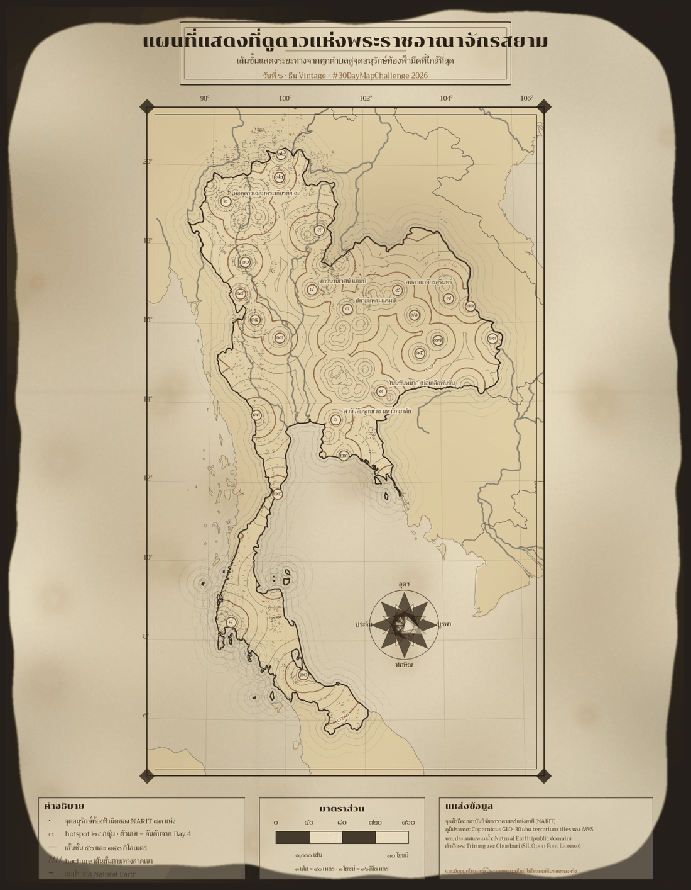
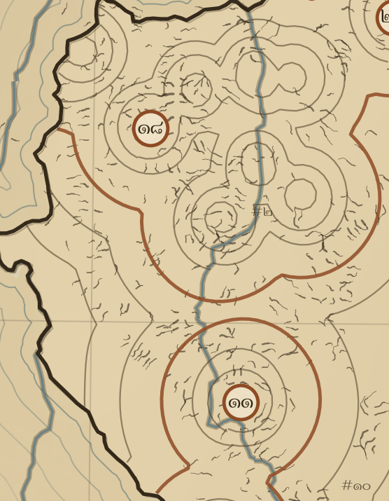
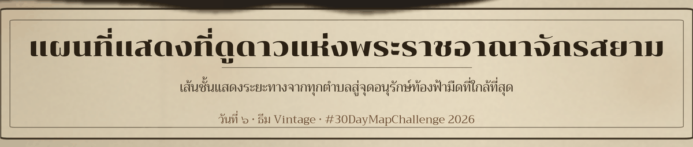
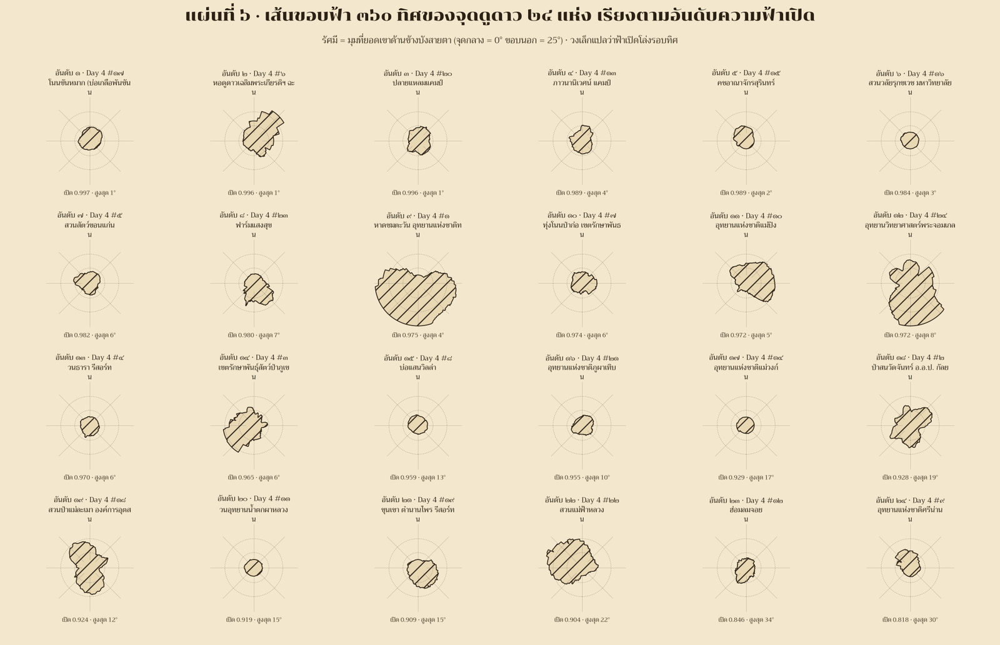

[](https://colab.research.google.com/github/thammarat-ai/geo-notes/blob/main/notebooks/day06_vintage.ipynb)

Day 1 ปัก**จุด** · Day 2 ลาก**เส้น** · Day 3 วัด**พื้นที่** · Day 4 จับ**กลุ่ม** · Day 5 วัด**สายตา**
วันนี้ธีมทางการ **Vintage** บอกว่า *"do a map which looks like a historical map"* —
โจทย์ที่ผมตั้งไว้ก่อนเริ่มคือ **ของเก่าตรงไหน?** เพราะถ้าคำตอบคือ "ทำให้เป็นสีน้ำตาล + ฟอนต์เก่า"
มันก็แค่ฟิลเตอร์ ไม่ใช่แผนที่โบราณ

## ที่มาของแผนที่

คำว่า vintage ในชาเลนจ์นี้แยกได้สามทาง: **สไตล์** (หน้าตาแผ่น), **ข้อมูล** (ตัวเลขเก่า),
**เทคโนโลยี** (เครื่องมือเก่า) ผมลองเช็กทาง "ข้อมูล" ก่อน แล้วพบว่าทั้งสองทางเหลือบไปชนธีมวันอื่น
(DMSP-OLS ยุค 90s ต้องสมัครบัญชี EOG ถึงจะโหลดได้, เส้นทางสุริยุปราคา 1868 ของ ร.4 NASA
ยังไม่มี vector ให้ดึงตรง ๆ) จึงเลือกทาง **สไตล์** แต่ทำให้ถึงกึ๋น: **ใช้เฉพาะ notation ที่คนทำแผนที่
ก่อน พ.ศ. 2400 ใช้ได้จริง**

สิ่งที่เปลี่ยนจากแผนที่สมัยใหม่ของผมเอง (ข้อมูลชุดเดิมเป๊ะ ๆ จาก Day 1–5):

| สิ่งที่วัด | เมื่อวาน (สมัยใหม่) | วันนี้ (ย้อนยุค) | ทำไมถึงถูกยุค |
|---|---|---|---|
| ภูมิประเทศ | เงาภูมิประเทศ (hillshade) จาก DEM | **hachure** — เส้นสั้น ๆ วาดตามทางลาดเขา | เป็นวิธีมาตรฐานก่อนยุค contour + colour band |
| ระยะทางสู่จุดฟ้ามืด | choropleth หกเหลี่ยม H3 | **เส้นชั้น** (isopleth) 10–150 กม. ที่เขียนให้มือสั่น | เส้นชั้นใช้กันก่อนยุคตารางหกเหลี่ยม |
| เส้นขอบฟ้า 360 ทิศ | polar plot สีนีออน | **วงเส้นขอบฟ้า 24 วง** ขีดลายทแยงแบบ engraving | วางในสไตล์ compass rose ของแผ่น atlas ยุคนั้น |
| มาตราส่วน | กิโลเมตร | **เส้น / โยชน์** (40 ม. / 16 กม.) | หน่วยวัดไทยก่อนใช้เมตริก |
| กระดาษ | พื้นหลังเรียบ | **กระดาษแก่ procedural** + คราบรา + รอยพับ + ขอบฉีก | กระดาษเซลลูโลสแก่เหลืองจริง |

**ว่าด้วยคำศัพท์ในโพสต์นี้** — ผมตั้งใจไม่แต่งคำไทยใหม่ครับ คำไหนมีศัพท์มาตรฐานก็ใช้
(เส้นชั้นความสูง, เงาภูมิประเทศ, แผนที่ภูมิประเทศ) คำไหนไม่มีก็เรียกทับศัพท์ไปเลยแล้วอธิบายต่อ
เพราะ *hachure* กับ *compass rose* ไม่มีศัพท์ไทยที่ราชบัณฑิตฯ หรือตำราไทยใช้กันจริง
ใครรู้จักคำที่วงการแผนที่ไทยใช้กว่านี้บอกได้ ผมแก้ทั้งโพสต์และบนแผ่นให้

มีอยู่อย่างหนึ่งที่ *ตั้งใจ* ไม่เลียนแบบ: แผนที่โบราณมักวาดภูมิประเทศ "ตามรู้สึก" — ของผมทุกเส้น hachure
มาจาก DEM จริง (Copernicus GLO-30) และทุกเส้นชั้นมาจาก distance field จริง
บนแผ่นจึงมีหมายเหตุเล็ก ๆ กำกับไว้ว่า *"แบบย้อนยุคในแผ่นนี้เป็นงานออกแบบใหม่ ไม่ใช่แผนที่โบราณของจริง"*

## ผลลัพธ์



[ดาวน์โหลดแผ่นเต็ม 1700×2185 px](day06_vintage_plate.png) ·
[ไฟล์เส้นหมึก SVG สำหรับ plotter](day06_vintage_lineart.svg)

ตัวเลขบนแผ่นวันนี้: **3,664 เส้น hachure** จาก 4,884 จุดตั้งต้นที่ความชัน ≥ 4°, **181 ช่วงเส้นชั้น** 7 ระดับ,
**83 จุด** NARIT, **24 วงเส้นขอบฟ้า** และ 1 เข็มทิศในอ่าวไทย (อุดร–บูรพา–ทักษิณ–ประจิม)

ตัวเลขในวงกลมสนิมบนแผ่นคือ **อันดับ hotspot จาก Day 4** (จัดตามขนาด/ความมืดของกลุ่ม) ไม่ใช่อันดับ
ความฟ้าเปิด — ผมเลือกเฉพาะ 6 จุดที่ฟ้าเปิดที่สุดมาใส่ชื่อไว้ เพื่อไม่ให้แผ่นรกเกินแบบ atlas จริง

 

ของที่ได้เพิ่มมาจริง ๆ ไม่ใช่ความสวย แต่คือ **แผ่นวงเส้นขอบฟ้า** ซึ่งยืนยันข้อสรุปของ Day 5 แบบมองปุ๊บเข้าใจปั๊บ:
จุดที่ฟ้า *มืดที่สุด* บางแห่งมีเส้นขอบฟ้า *แย่ที่สุด* เพราะอยู่ในหุบเขา — วงที่ปูดเป็นก้อนคือ
อุทยานแห่งชาติศรีนภา (open-sky 0.818 · มุมสูงสุด 30°) และลุ่มน้ำจอย (0.846 · 34°)
ส่วนวงเล็กกลมนั้นคือที่ราบ/ชายทะเลที่เห็นฟ้าเกือบครบโดม



## วิธีทำแบบย่อ

### ขั้นที่ 1: เดิน fall-line บน DEM ที่เกลี่ยแล้ว ไม่งั้นได้ก้นหอย

hachure คือเส้นสั้น ๆ ที่ไหลลงตามความชัน ผมเริ่มจาก gradient ของ terrarium tile (z=9, ~306 ม./px)
แล้วเดินทวน gradient ทีละ 2.6 พิกเซล ปรากฏว่าเส้นที่ได้ **ม้วนเป็นวง** — วัดออกมา straightness
(ระยะปลาย–ต้น หารด้วยความยาวเส้นทาง) ได้แค่ **0.20** สาเหตุคือ noise ต่อพิกเซลของ GLO-30
ทำให้ทิศ gradient ส่ายไปมาในบริเวณที่ราบ

แก้ด้วยการเกลี่ย DEM ด้วย Gaussian ก่อนหา gradient + หยุดเมื่อทิศทางกลับด้าน (แปลว่าถึงตีนเขาแล้ว):

```python
smooth = gaussian_filter(np.nan_to_num(DEM, nan=0.0), 2.0)   # ~600 ม.
g_row, g_col = np.gradient(smooth)
gx = g_col / row_res[:, None]        # row_res = เมตร/พิกเซล ตามละติจูดของแถวนั้น
gy = g_row / row_res[:, None]
slope = np.degrees(np.arctan(np.hypot(gx, gy)))
ok = LAND & (slope >= 4.0)           # seed lattice ทุก ~4.5 กม.

for c0, r0 in zip(cs, rs):           # เดินลงเขาทีละ seed
    c, r = c0, r0; pts = [(c, r)]; pc, pr = c, r; last = None
    for _ in range(max_len):
        i, j = int(round(r)), int(round(c))
        L = math.hypot(gx[i, j], gy[i, j])
        if L < 1e-9: break
        dc, dr = -gx[i, j] / L, -gy[i, j] / L
        if last is not None and dc * last[0] + dr * last[1] < 0.2:
            break                    # ทิศกลับ = ลงมาถึงเชิงเขาแล้ว เลิกเส้น
        c += dc * step_px; r += dr * step_px
        if not LAND[int(round(r)), int(round(c))]: break
        pts.append((c, r)); last = (dc, dr)
    # เก็บเฉพาะเส้นที่ยาวพอและ "ตรง" พอ (straightness > 0.55)
    if len(pts) < 7: continue
    if math.hypot(c - pc, r - pr) < 0.55 * len(pts) * step_px: continue
    strokes.append(pts)
```

### ขั้นที่ 2: เส้นชั้นที่เขียนให้มือสั่น จาก KD-tree

ระยะทางสู่จุดฟ้ามืดที่ใกล้ที่สุดไม่ต้องคำนวณใหม่ — ใช้ `cKDTree` บน 83 จุดพิกัด (หน่วย กม.
แบบ equirectangular) query ทั้งกริดแล้ว `contour` เอาเฉพาะเส้น (ไม่ fill) ส่วนลายมือสั่น
ทำใหม่ด้วยการ resample เส้นทุก 5 กม. แล้วเลื่อนจุดตามเส้นตั้งฉากด้วย noise เรียบ (ผลรวม sine
3 ความยาวคลื่น) เพื่อให้เส้นอืดเหมือนปากกา ไม่สั่นแบบ white noise:

```python
def wobble(P, amp_m=2200.0, res_m=6000.0, seed=0, close=False):
    P = np.asarray(P, float)
    if len(P) < 3: return P
    if close: P = P[:-1]
    seg = np.hypot(*np.diff(P, axis=0).T)
    cum = np.concatenate([[0], np.cumsum(seg)])
    n = max(int(cum[-1] / res_m), 6)
    ds = np.linspace(0, cum[-1], n)
    Q = np.column_stack([np.interp(ds, cum, P[:, 0]), np.interp(ds, cum, P[:, 1])])
    d = np.gradient(Q, axis=0); L = np.hypot(d[:, 0], d[:, 1]) + 1e-9
    Q = Q + np.column_stack([-d[:, 1] / L, d[:, 0] / L]) * smooth_noise(n, amp_m, seed)[:, None]
    return np.vstack([Q, Q[:1]]) if close else Q
```

เส้น index (50/150 กม.) ระบายสีสนิม + ตัวเลขกำกับเป็นเลขไทย (๕๐, ๑๕๐) พร้อม halo สีกระดาษ
ให้เหมือนหมึกกันเส้นขาดตอน

### ขั้นที่ 3: กระดาษแก่สร้างด้วย noise ล้วน (ไม่มี texture ไฟล์จากที่อื่น)

ผมจงใจไม่โหลดภาพกระดาษมาจากที่ใดเลย ทั้งสวยกว่าและไม่ต้องกังวลสิทธิ์: noise ต่ำความถี่
(มอตลิง) + จุดรา 36 ดวงแบบวงแหวน + รอยพับ 2 แนว + vignette + **ขอบฉีก** ด้วย superellipse
กำลัง 9 ที่รัศมีถูกบิดด้วย sine หลายความถี่ แล้วทบทับหมึกด้วยชั้น stain โปร่งแสง
(คราบเหลืองจาง ๆ ทับเส้นหมึก) เพื่อให้สี "จม" ลงในกระดาษ ไม่ใช่ลอยอยู่ข้างบน

```python
p_ = 9.0                                    # superellipse -> sheet with rounded torn corners
inside = (((np.abs(x - W / 2) / rx) ** p_) + (np.abs(y - Hh / 2) / ry) ** p_) <= 1.0
alpha = np.clip(gaussian_filter(inside.astype(float), 1.8) * 1.04, 0, 1)
```

### ขั้นที่ 4: projection + cartouche + มาตราส่วนไทย

ผมเลือก **Equidistant Conic** (lat₁=8°, lat₂=20°, lon₀=101°) เพราะเส้นขนานเป็นวงโค้ง
กับเส้นลองจิจูดบรรจบกันขึ้นบน — เป็นลุคของแผ่นสำรวจยุคที่ 1 ซึ่ง *บังเอิญ* เป็น projection
ที่คนใช้กันจริงใน atlas สมัยนั้น (ธีม projection เต็ม ๆ ขอเก็บไว้ Day 22)

มาตราส่วนบนแผ่นเขียนเป็นหน่วยไทยโบราณ ซึ่งตรวจแล้ว:

| หน่วย | เท่ากับ | หมายเหตุ |
|---|---|---|
| 1 วา | 2 เมตร | ช่วงแขนกาง |
| 1 เส้น | 40 เมตร | = 20 วา |
| 1 โยชน์ | 16 กิโลเมตร | = 400 เส้น |

บนแถบมาตราส่วน 160 กม. จึงเท่ากับ **๔,๐๐๐ เส้น = ๑๐ โยชน์** พอดี (และใช้ "กม." ไม่ใช่ "ก.ม."
ตามแบบที่ราชบัณฑิตยสถานนิยมในป้ายทาง)

## บทเรียน

- **"vintage" ไม่ใช่ฟิลเตอร์** — สิ่งที่ทำให้แผ่นอ่านเป็นของยุค 1800 คือ *notation* (hachure,
  isopleth, rose, cartouche) ไม่ใช่สีน้ำตาล ผมต้องเลิกใช้ hex H3 ในแผ่นนี้ทั้งที่ข้อมูลมาจาก hex
  เพราะตารางหกเหลี่ยมไม่ใช่ของของยุคนั้น
- **อย่าเชื่อ gradient ดิบจาก DEM** — straightness 0.20 คือหลักฐานว่าเส้นที่ผมคิดว่า "ไหลลงเขา"
  จริง ๆ กำลังม้วนเป็นวง เกลี่ย 600 ม. ครั้งเดียวหาย
- **clip ก่อน reproject** — ผมไม่ clip ประเทศเพื่อนบ้าน แล้ว projector eqdc ส่งค่า inf/NaN
  กลับมา (อินโดนีเซียทั้งประเทศอยู่ไกล standard parallels มาก) กลายเป็นเส้นหายทั้งชั้นแบบเงียบ ๆ
- **`imshow` default aspect='equal' letterbox** — กระดาษถูกย่อให้เหลือแถบกลางแผ่น
  cartouche กับ legend ตกไปอยู่บนพื้นโต๊ะสีเข้ม อ่านไม่ออกตั้งนาน (กว่าจะวัด pixel แล้วเห็นว่า alpha=0)
- **ตรวจซ้ำ = ของแถม** — รัน sky-viewshed ใหม่ทั้ง 24 จุดเพื่อวาด rose ได้ mean|Δ| กับ Day 5
  แค่ **0.027°** (max 0.050°) ซึ่งเป็นการพิสูจน์ว่าโน้ตบุ๊กวันก่อน *reproducible* จริง
- **ฟอนต์ไทยยุคนี้ไม่ต้อง instancer** — Trirong/Chonburi ใน google/fonts เป็น static TTF แล้ว
  (ต่างจาก Noto Sans Thai ของ Day 1 ที่ต้อง instancer) แต่ยังคงบทเรียนเดิม: ต้องทดสอบคำที่มีสระซ้อน+วรรณยุกต์
  ("ท้องฟ้าทั่วจังหวัดบูรพา ๒๕๖๙") ก่อนวางลงแผ่นเสมอ
- **ระวังของปลอมหลอกคนอ่าน** — แผนที่ที่ *ดูเหมือน* เอกสารประวัติศาสตร์มีอำนาจหลอกคน
  ผมจึงใส่ disclaimer บนแผ่นและในโพสต์นี้ด้วย

พรุ่งนี้ธีม **10 minute map** (7 พ.ย.) — โจทย์คือทำแผนที่ภายใน 10 นาทีจริง ๆ
ซึ่งน่าจะเป็นวันที่ "ห้าม perfectionism" ที่สุดของชาเลนจ์ 🗺️
