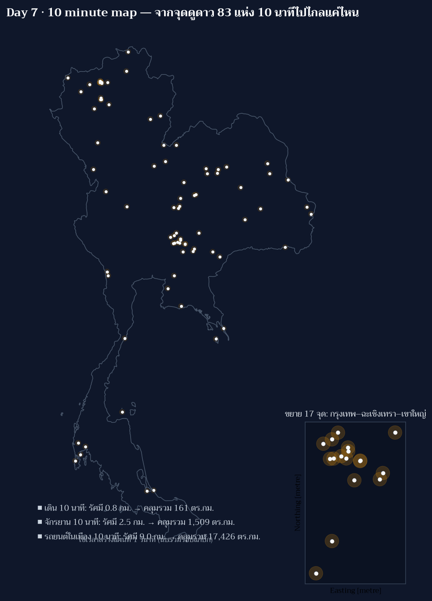

[](https://colab.research.google.com/github/thammarat-ai/geo-notes/blob/main/notebooks/day07_10min.ipynb)

Day 1 ปัก**จุด** · Day 2 ลาก**เส้น** · Day 3 วัด**พื้นที่** · Day 4 จับ**กลุ่ม** · Day 5 วัด**สายตา**
· Day 6 ย้อม**ยุคสมัย** · วันนี้ธีม **10 minute map** ซึ่งเข้าใจยากกว่าที่คิด:
มันไม่ใช่ "แผนที่ของ 10 นาที" แต่คือ "แผนที่ที่ *ต้องทำ* ให้เสร็จใน 10 นาที"

## ที่มาของแผนที่

กติกาที่ผมตั้งให้ตัวเองวันนี้มีสองข้อ

1. **จับเวลาจริง** ตั้งแต่กดเริ่มเขียนบรรทัดแรกถึงไฟล์ PNG ที่ยอมรับได้ ห้ามต่อเวลา
   และห้าม "เตรียมโค้ดไว้ก่อนแล้วกดรัน" เพราะนั่นคือโกงธีม
2. **หาหัวข้อที่คำนี้มีความหมายสองชั้น** — ผมมีข้อมูล 83 จุดดูดาวของ NARIT อยู่แล้ว
   จึงพลิก "10 นาที" ให้กลายเป็น *ระยะทางที่คนคนหนึ่งไปได้ใน 10 นาที* จากจุดดูดาวแต่ละแห่ง
   แผนที่จึงทั้ง "ทำใน 10 นาที" และ "เล่าเรื่อง 10 นาที" ในแผ่นเดียว

สามพาหนะที่เลือกเพราะมันคือคำถามจริงของคนที่อยากไปดูดาวหลังเลิกงาน: เดิน (4.8 กม./ชม.),
จักรยาน (15 กม./ชม.), และรถยนต์ในจราจรเมือง (54 กม./ชม.) × 1 ใน 6 ชั่วโมง = รัศมี **0.8 / 2.5 / 9.0 กม.**

## ผลลัพธ์



**เวลาที่ใช้จริง: 23:45:22 → 23:52:51 น. = 7 นาที 29 วินาที** (คอมคิดเลขเสร็จใน 1.1 วินาที
เวลาที่เหลือทั้งหมดคือ *คิด* กับ *แก้บั๊ก*)

| พาหนะใน 10 นาที | รัศมี | พื้นที่รวมที่คลุม | คิดเป็น |
|---|---|---|---|
| เดิน | 0.8 กม. | 161 ตร.กม. | 0.03% ของประเทศ |
| จักรยาน | 2.5 กม. | 1,509 ตร.กม. | 0.29% ของประเทศ |
| รถยนต์ (จราจรเมือง) | 9.0 กม. | 17,426 ตร.กม. | 3.40% ของประเทศ |

ตัวเลขนี้ตอบคำถามที่ Day 1–6 ยังไม่ตอบ: **จุดฟ้ามืดของไทย "ใกล้" คนแค่ไหนในเชิงเดินทาง**
แม้ 83 จุดจะกระจายทั่วประเทศ (Day 3 พบว่าไม่มีจุดไหนไกลเกิน 200 กม.) แต่พอถามเป็น
"10 นาทีจากบ้าน" ภาพกลับตรงกันข้าม — มีพื้นที่เพียง 0.03% ของประเทศที่เดินไปถึงจุดฟ้ามืดได้
และแม้แต่ขับก็ยังแตะแค่ 3.4% เพราะจุดส่วนใหญ่อยู่บนเขา/ในอุทยานฯ ไม่ใช่ใกล้ชุมชน

panel ขวาล่างคือ 17 จุดรอบกรุงเทพ–ฉะเชิงเทรา–เขาใหญ่ ที่รัศมีอ่านออกจริง เพราะในระดับประเทศ
วง 0.8 กม. เล็กกว่าหัวปากกา

## วิธีทำแบบย่อ (พร้อม log เวลาจริง)

```text
23:45:22  เริ่ม — คิดหัวข้อ + ตั้งกติกา
23:46:11  รันครั้งแรกสำเร็จใน 1.2 วินาที  → เจอบั๊ก 2 ตัว
23:47:45  แก้ legend/ลำดับวาดวง + เพิ่ม panel ขยาย → crash 1 ครั้ง
23:48:20  แก้ filter ที่ใช้เมตรเทียบกับ degree → ได้ 0 จุด เป็น 17 จุด
23:49:45  แก้ legend ที่พิมพ์ "ความเร็ว" เป็น "รัศมี" (ผิด 1000 เท่าในกรณีเดิน)
23:50:54  แก้ตำแหน่ง panel ที่ทับชื่อเรื่อง
23:52:51  ปิดงาน: 7 นาที 29 วินาที
```

โครงโค้ดมีแค่สี่ช่วง (โหลดข้อมูล → buffer → union+area → วาด) และนี่คือแกนกลาง

```python
MODES = [("เดิน 10 นาที", 4.8, ...), ("จักรยาน 10 นาที", 15.0, ...),
         ("รถยนต์ในเมือง 10 นาที", 54.0, ...)]
R = {n: v / 3.6 * 600.0 for n, v, ... in MODES}      # เมตรใน 10 นาที
u = unary_union(pts.geometry.buffer(R[n]))           # pts เป็น eqdc (หน่วยเมตร)
cov[n] = u.area / 1e6                                # ตร.กม.
```

## หมายเหตุเรื่องขอบประเทศ (เพิ่มทีหลัง 7 พ.ย. 2569)

ซีรีส์นี้ไม่ได้ใช้เส้นขอบประเทศแหล่งเดียวตลอด · Day 1 และ Day 3 ใช้ **GADM** (เพราะ Natural Earth
110m หยาบเกินไปสำหรับงานนั้น) ส่วน Day 6–7 ใช้ **Natural Earth 10m** ซึ่งละเอียดกว่าคนละระดับ

ผลต่างที่วัดได้จริง: union ของหกเหลี่ยม 1,738 บล็อกจาก Day 3 = **496,867 ตร.กม.** เทียบกับ
Natural Earth Thailand = **512,593 ตร.กม.** → มีพื้นที่ **18,692 ตร.กม. (3.6%)** ที่ hex กลบไม่ถึง
เส้น NE และ hex **2,967 ตร.กม. (0.6%)** ล้นออกนอกเส้น (ทะเล/เกาะ) แปลว่าคำว่า "พื้นที่ประเทศ"
ที่อ้างในแต่ละวันไม่เท่ากันโดยนัย

ตั้งแต่วัน 8 เป็นต้นไป มาตรฐานของซีรีส์นี้คือ **Natural Earth 10m** (public domain) เพราะ
ฟรี ไม่ต้องมี token และเส้นละเอียดพอสำหรับทั้งงาน raster และ vector


## บทเรียน

- **10 นาทีไม่พอให้สวย แต่พอให้ถูก** — แผนที่นี้ยังไม่สวยและผมรู้ว่า panel ยังเบียด legend
  แต่ทุกตัวเลขบนแผ่นตรวจแล้วถูกต้อง *กฎเวลาบังคับให้เลือกว่าจะลงทุนที่ไหน* และผมเลือกแก้ข้อผิดพลาด
  ทางข้อมูลก่อนความงาม
- **บั๊ก 4 ตัวใน 7 นาที คือของจริงที่ธีมนี้เปิดเผย** — ในวันปกติผมจะเห็นมันตอนรีวิวช้ากว่านั้น
  และบางตัว (เช่น legend พิมพ์ความเร็ว 5 กม./ชม. เป็น "5 กม.") จะติดตาคนอ่านทันที
  การถูกบังคับให้จบเร็วทำให้ *กระบวนการหาบั๊ก* ถูกทดสอบ ไม่ใช่แค่ผลลัพธ์
- **อย่าโกงธีมด้วยการเตรียมของไว้ก่อน** — ผมมี cache DEM/horizon จาก Day 5–6 อยู่แล้ว
  แต่จงใจไม่ใช้ เพราะ "10 นาที" ต้องวัดตั้งแต่คิดหัวข้อ ไม่ใช่ตั้งแต่กดรัน
- **reproject ก่อนทำ buffer ระยะเมตรเสมอ** — บั๊กที่ filter แล้วได้ 0 จุดเกิดจากเอาพิกัด
  `eqdc` (เมตร) ไปเทียบกับขอบเขต 99.3–102.4 (ดีกรี) แบบนี้ไม่ error มันแค่คืนค่าว่างเงียบ ๆ
  ต้อง print จำนวนแถวหลัง filter ทุกครั้ง
- **รัศมี "10 นาที" ต้องระบุโหมดและสมมติฐาน** — 54 กม./ชม. คือความเร็วในจราจรเมือง
  ถ้าใช้กับจุดบนเขา (ซึ่งส่วนใหญ่เป็นแบบนั้น) จะ *มองโลกดีเกินจริง* มาก
  รอบต่อไปถ้ามีเวลา 10 นาที *จริง* ควรใช้ isochrone จากถนนจริง (Mapbox/OSRM) ไม่ใช่รัศมีวงกลม
- **สิ่งที่ยอมปล่อยเพราะหมดเวลา**: วง 0.8/2.5 กม. อ่านไม่ออกในระดับประเทศ, ไม่มี label ชื่อจุด,
  และ panel ขวาล่างยังไม่มีกรอบชัดเจนพอ

โพสต์นี้เขียนหลังหมดเวลา 10 นาที (ตีพิมพ์ตอน 00:0x ของวันที่ 8 พ.ย.) — ตัวแผนที่ถูกสร้างเสร็จ
ภายในวัน Day 7 ตามกติกา ส่วนที่เป็นการเรียบเรียงผมแยกบันทึกไว้ชัดเจนใน log ข้างบน

พรุ่งนี้ธีม **Utopia** (Day 8) — "แผนที่ของสังคมในอุดมคติของคุณเป็นยังไง" ซึ่งน่าจะเป็นวันที่
ผมจะได้ใช้เวลากับความงามอย่างเต็มที่เสียที 🗺️
