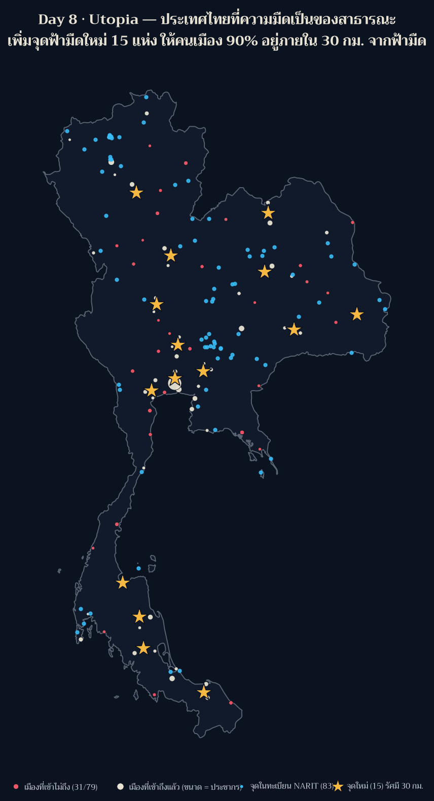
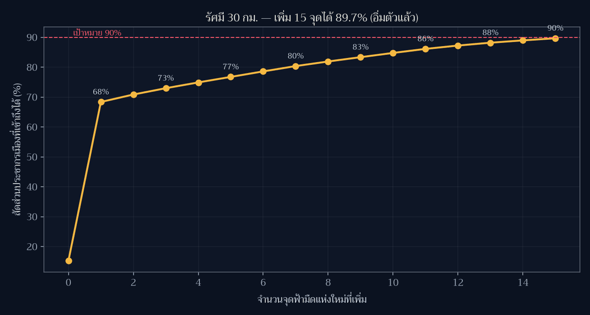

[](https://colab.research.google.com/github/thammarat-ai/geo-notes/blob/main/notebooks/day08_utopia.ipynb)

โจทย์ทางการของวันนี้คือ **"A map of something which could be"** — แผนที่ของสิ่งที่ *อาจเป็นได้*
ผมไม่อยากทำแผนที่เมืองในฝันแบบวาดเล่น จึงเอาคำถามของ Day 7 มาต่อยอดเป็นแผนที่นโยบาย:
Day 7 พบว่าแค่ **0.03%** ของพื้นที่ประเทศที่เดินถึงจุดฟ้ามืดใน 10 นาที วันนี้ถามกลับว่า
**ถ้าอยากให้ความมืดเป็นของสาธารณะจริง ต้องเพิ่มจุดที่ไหน อีกกี่แห่ง**

## ที่มาของแผนที่

"utopia" ต้องมี *บรรทัดฐาน* ชัด ๆ หนึ่งข้อ ไม่งั้นเป็นแค่แผนที่สวย ผมเลือกสามข้อ

1. **เป้าหมาย**: ประชากรเมืองอย่างน้อย 90% ต้องอยู่ภายในรัศมี **30 กม.** จากจุดฟ้ามืด
   (ประมาณครึ่งชั่วโมงจากบ้าน ยังไปกลับได้ในวันธรรมดา)
2. **ที่ที่จะตั้งจุดใหม่ได้**: ต้องเป็น hex จาก Day 3 ที่ *ไกล* จากจุดในทะเบียน NARIT เกิน 25 กม.
   แปลว่าเลือกเฉพาะ "ที่ที่ยังมืดจริงแต่ยังไม่มีชื่อในทะเบียน" — ไม่ใช่ไปตั้งทับของเดิม
   ได้ผู้สมัคร **1,429 hex** จาก 1,738 hex
3. **วิธีเลือก**: greedy set cover —ทุกครั้งเลือกจุดที่เก็บประชากร *ที่ยังไม่ถูกบริการ* ได้มากที่สุด
   ทำซ้ำ 15 รอบจนอิ่มตัว

ข้อมูลเมืองมาจาก Natural Earth 10m populated places (79 เมือง, POP_MAX รวม **14.1 ล้านคน**)
และขอบประเทศใช้ Natural Earth 10m ตามมาตรฐานที่เพิ่งตั้งไว้ตั้งแต่ Day 8

## ผลลัพธ์



**คำตอบสั้น: เพิ่ม 15 แห่ง → จาก 15.2% เป็น 89.7% ของประชากรเมือง**

| รัศมีเป้าหมาย | ทุกวันนี้ | ต้องเพิ่มกี่จุด | หลังเพิ่ม |
|---|---|---|---|
| 30 กม. (ครึ่งชั่วโมง) | 18/79 เมือง · 15.2% | **15 จุด** | 48/79 เมือง · 89.7% |
| 60 กม. (หนึ่งชั่วโมง) | 44/79 เมือง · 28.2% | 14 จุด | 100% |
| 100 กม. (เที่ยวคืนเสาร์) | 71/79 เมือง · 94.7% | 5 จุด | 100% |

จุดที่ "แพงที่สุด" ในเชิงผลลัพธ์คือจุดแรก: ที่ละติจูด 13.854 ลองจิจูด 100.527 (แถวสุพรรณบุรี–นครปฐม)
เก็บคนได้ถึง **7.5 ล้านคน** ในรอบเดียว เพราะกรุงเทพ+ปริมณฑลทั้งก้อนอยู่นอกทะเบียนทั้งหมด
จุดที่เหลือเก็บได้ 0.1–0.35 ล้านคนต่อจุด — เส้นโค้งอิ่มตัวชัดเจน



### 15 จุดที่แผนที่เสนอ

| # | ละติจูด | ลองจิจูด | เก็บประชากร | ไกลจากจุดเดิม |
|---|---|---|---|---|
| 1 | 13.854 | 100.527 | 7,505,882 | 83.9 กม. |
| 2 | 17.626 | 102.760 | 351,736 | 88.0 กม. |
| 3 | 6.671 | 101.203 | 298,140 | 83.0 กม. |
| 4 | 15.281 | 104.840 | 273,893 | 68.2 กม. |
| 5 | 8.398 | 99.719 | 260,558 | 123.7 กม. |
| 6 | 13.573 | 99.978 | 259,988 | 80.4 กม. |
| 7 | 16.278 | 102.658 | 251,056 | 42.0 กม. |
| 8 | 14.618 | 100.597 | 217,114 | 61.5 กม. |
| 9 | 18.095 | 99.592 | 204,081 | 79.1 กม. |
| 10 | 16.660 | 100.422 | 199,777 | 33.4 กม. |
| 11 | 7.671 | 99.817 | 191,342 | 90.1 กม. |
| 12 | 9.174 | 99.330 | 157,627 | 54.3 กม. |
| 13 | 15.542 | 100.089 | 134,134 | 34.2 กม. |
| 14 | 14.952 | 103.344 | 109,828 | 36.3 กม. |
| 15 | 14.013 | 101.196 | 101,066 | 47.0 กม. |

## วิธีทำแบบย่อ

### ขั้นที่ 1: ระยะทางแบบ haversine เป็นเมทริกซ์

```python
def hav_km(a, b):                      # a:(N,2) b:(M,2) ของ (lon,lat) -> (N,M) กม.
    la1, lo1 = np.radians(a[:,1][:,None]), np.radians(a[:,0][:,None])
    la2, lo2 = np.radians(b[:,1][None,:]), np.radians(b[:,0][None,:])
    d = np.sin((la2-la1)/2)**2 + np.cos(la1)*np.cos(la2)*np.sin((lo2-lo1)/2)**2
    return 2*6371.0*np.arcsin(np.sqrt(d))
```

### ขั้นที่ 2: greedy set cover

```python
covered = (hav_km(city, sites).min(axis=1) <= R)      # สถานะวันนี้
for step in range(15):
    gain = [pop[(~covered) & (d_city_cand[:, j] <= R)].sum() for j in range(len(cand))]
    j = int(np.argmax(gain))
    if gain[j] <= 0: break                            # อิ่มตัวแล้ว
    covered |= (d_city_cand[:, j] <= R)
```

### ขั้นที่ 3: ตรวจก่อนวาด (กติกาของซีรีส์)

```python
assert len(chosen) == len({(round(c["lat"],4), round(c["lon"],4)) for c in chosen})
assert all(c["km_nearest_existing"] > 25 for c in chosen)   # ไม่ตั้งทับของเดิม
assert covered.sum() >= base[R].sum()                        # ความครอบคลุมไม่ลดลง
```

## ข้อจำกัดที่ต้องบอกตรง ๆ

- **ประชากร 14.1 ล้านคนนั้นคือ "ประชากรเมือง" ในชุดข้อมูล Natural Earth** ไม่ใช่ประชากรไทย
  ทั้งประเทศ (~66 ล้าน) ตัวเลข % จึงหมายถึง *คนที่อยู่ในเมืองที่ถูกบันทึก* เท่านั้น
- **ระยะทางเป็นเส้นตรง** ไม่ใช่เวลาเดินทางจริง — เทือกเขาและแม่น้ำหายไปจากสมการ
  ถ้าจะจริงจังต้องใช้ isochrone จากถนน (Mapbox/OSRM) และนั่นคือแผนที่อีกแผ่นหนึ่ง
- **ความมืดวัดจาก proxy ที่วนตัวเอง**: ผู้สมัครคือ hex ที่ `km_nearest > 25 กม.`
  ซึ่ง `km_nearest` คือระยะถึงจุด *ในทะเบียน* ไม่ใช่ค่าความมืดที่วัดด้วยเครื่อง
  แปลว่าแผนที่นี้ตอบ "ตั้งที่ไหนจึงบริการคนได้มาก" แต่ไม่ตอบ "ที่ไหนฟ้ามืดจริง"
  คำตอบที่ถูกต้องต้องใช้ข้อมูล VIIRS/DMSP หรือการวัดภาคสนาม
- hex grid resolution 5 (~258 ตร.กม./บล็อก) ทำให้ตำแหน่งที่เสนอหยาบระดับ 10 กม.

## ไฟล์ประกอบ

พิกัด 15 จุดที่แบบจำลองเสนอ พร้อมจำนวนคนที่แต่ละจุดเก็บได้ และสถานะก่อน–หลังของทั้งสามรัศมี

- [day08_utopia_sites.geojson](day08_utopia_sites.geojson)
- [day08_stats.json](day08_stats.json)

## บทเรียน

- **แผนที่ utopia ต้องมีตัวเลขกำกับความฝัน** — "ความมืดเป็นของสาธารณะ" เป็นคำสวย
  แต่พอบอกว่า "เพิ่ม 15 จุด ขยับจาก 15% เป็น 90%" มันกลายเป็นสิ่งที่ถกเถียงและตรวจสอบได้
- **greedy ให้คำตอบที่ดี แต่ไม่ใช่คำตอบที่ดีที่สุด และนั่นโอเค** — ใน 10–15 จุดแรกมันกิน
  population ที่กระจุกตัว ถ้าอยากได้ optimal ต้อง solve set-cover จริง (integer programming)
  ซึ่งเปลี่ยนคำถามจาก "ที่ไหน" เป็น "ที่ไหน + งบเท่าไหร่"
- **จุดเดียวใกล้กรุงเทพมีน้ำหนักเท่าอีก 14 จุดรวมกัน** — การกระจาย "ความเท่าเทียม"
  ไม่ใช่การกระจาย "พื้นที่" แผนที่แบบ area-weighted (Day 3) กับ people-weighted ให้คำตอบ
  คนละเรื่อง และคนละนโยบาย
- **proxy ที่วนตัวเองต้องประกาศ** — ผมใช้ระยะถึงทะเบียนเป็นตัวแทนความมืด ซึ่งทำให้
  แผนที่นี้ตอบคำถามการเข้าถึงได้ดี แต่ตอบคำถาม "ที่ไหนมืดจริง" ไม่ได้ ถ้าไม่เขียนกำกับไว้
  คนอ่านจะเข้าใจผิดว่าดาวสีเหลืองคือ "ที่ที่ฟ้ามืดที่สุด" ซึ่งไม่ใช่
- **ใช้ Natural Earth 10m ทั้งขอบประเทศและข้อมูลเมือง** ตามมาตรฐานที่ประกาศไว้ในหมายเหตุ
  เรื่องขอบประเทศของ Day 1–7 ทำให้แผ่นนี้กับ Day 6–7 เส้นฝั่งตรงกันแล้ว

พรุ่งนี้ธีม **Urban-rural** (Day 9) — ต่อจากแผ่นนี้ได้พอดี เพราะคำถาม "เมืองกับชนบท"
ในบริบทนี้คือ *ใครมีสิทธิ์มองเห็นทางช้างเผือก*
