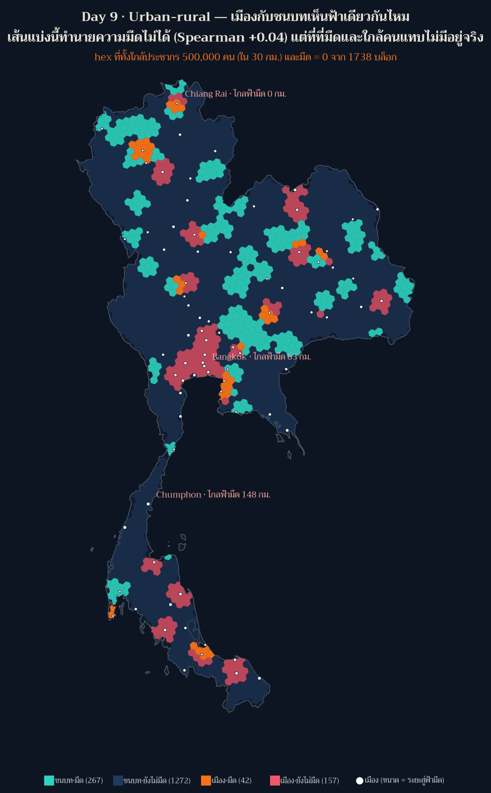
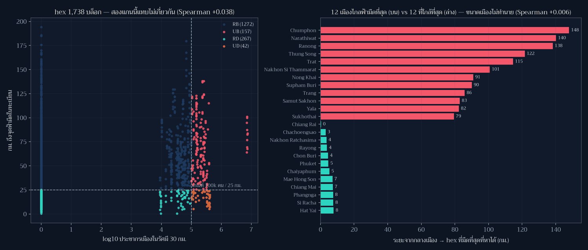

[](https://colab.research.google.com/github/thammarat-ai/geo-notes/blob/main/notebooks/day09_urban_rural.ipynb)

โจทย์ทางการวันนี้คือ **"Urban or rural. Cities and countryside."** และสมมติฐานที่ผม (กับคนทำแผนที่
ส่วนใหญ่) ตั้งไว้ก่อนเปิดข้อมูลคือ *เมืองสว่าง ชนบทมืด* — ซึ่งฟังดูจริงจนไม่ต้องตรวจ
แผ่นนี้จึงเป็นโพสต์ที่เกี่ยวกับ "สมมติฐานที่สวยที่สุดที่ผมต้องทิ้ง"

## ที่มาของแผนที่

ผมวัดสองแกนบน hex grid เดิมของ Day 3 (1,738 บล็อก) แล้วจับมันตีกันเป็นสี่กลุ่ม

| แกน | นิยาม | เกณฑ์ |
|---|---|---|
| **ความเป็นเมือง** | ผลรวมประชากรเมือง (Natural Earth `POP_MAX`) ที่อยู่ในรัศมี 30 กม. ของ hex | ≥ 100,000 คน = "เมือง" |
| **ความมืด** | `km_nearest` จาก Day 3 = ระยะถึงจุดอนุรักษ์ท้องฟ้ามืดในทะเบียน NARIT | ≤ 25 กม. = "มืด" |

แล้วตั้งคำถามที่สองที่เป็นคำถามของประชาชนมากกว่า: **จากกลางเมืองแต่ละแห่ง ต้องออกเดินทางกี่กิโลเมตร
จึงจะถึง hex ที่จัดว่ามืด** (วัดด้วย haversine จากจุดศูนย์กลางเมือง 79 แห่งไปยัง hex มืดทุกบล็อก)

## ผลลัพธ์



**1. เส้นแบ่งเมือง/ชนบททำนายความมืดไม่ได้เลย** — Spearman ระหว่างแรงกดดันเมืองกับระยะสู่จุดฟ้ามืด
ที่ระดับ hex = **+0.038** และที่ระดับเมือง (ระยะที่ต้องเดินทาง vs log ประชากร) = **+0.006**
พูดภาษาคน: เมืองใหญ่ไม่ได้ไกลฟ้ามืดกว่าเมืองเล็กอย่างเป็นระบบ และ hex ที่ใกล้เมืองก็ไม่ได้สว่างกว่า
hex ที่ไกลเมือง อย่างเป็นระบบเช่นกัน

**2. แต่ "ที่ที่ทั้งมืดและใกล้คน" แทบไม่มีอยู่จริง** — นี่คือตัวเลขที่ทำนายใหม่ทั้งหมด

| กลุ่ม | จำนวน hex | พื้นที่ |
|---|---|---|
| ชนบท · ยังไม่มืด | 1,272 | 363,099 ตร.กม. |
| ชนบท · มืด | 267 | 76,629 ตร.กม. |
| เมือง · ยังไม่มืด | 157 | 45,323 ตร.กม. |
| **เมือง · มืด** | **42** | **11,814 ตร.กม.** |
| ที่ที่ใกล้ประชากร 500,000 คน (ใน 30 กม.) *และ* มืด | **0** | — |

แปลว่าความมืดกับประชากรไม่ได้ *ต่อต้าน* กัน (correlation ≈ 0) แต่ **ไม่ได้อยู่ที่เดียวกัน** —
จุดที่มืดกระจายแบบสุ่มต่อความหนาแน่นคน เพราะทะเบียน 83 จุดถูกตั้งด้วยเหตุผลอื่น (อุทยานฯ
หอดูดาว สถานศึกษา) ไม่ใช่ด้วยจำนวนประชากรรอบข้าง ตามที่ Day 3 เคยพบว่าไม่มีที่ใดไกลเกิน 200 กม.

**3. ระยะเดินทางจากกลางเมืองสู่ฟ้ามืด** (มัธยฐาน 39.2 กม.)

| เมือง | ระยะสู่ hex มืด |
|---|---|
| เชียงราย (ใกล้ที่สุด) | **0.3 กม.** — ตัวเมืองติดเขตฟ้ามืดเลย |
| กรุงเทพ (6.7 ล้านคน) | 63.3 กม. |
| ชุมพร (ไกลที่สุด) | **148.0 กม.** |

15 เมืองจาก 79 อยู่ชิด hex มืดภายใน 10 กม. และมี 6 เมืองที่ต้องไปไกลเกิน 100 กม.
และในกลุ่มที่ *ใกล้ที่สุด* ก็มีเมืองใหญ่อยู่ด้วย: ฉะเชิงเทรา 3.0 · นครราชสีมา 3.6 · ระยอง 3.9 ·
ชลบุรี 4.5 กม. — แปลว่า "เมืองกับฟ้ามืดอยู่ด้วยกันได้" ถ้าจุดทะเบียนถูกวางไว้ใกล้เมือง

ข้อสังเกตที่ผมไม่คาดคิด: เมืองที่ไกลฟ้ามืดที่สุด 5 ใน 6 แห่งอยู่ภาคใต้ (ชุมพร 148 · นราธิวาส 140 ·
ระนอง 138 · ทุ่งสง 122 · นครศรีธรรมราช 101 กม.) อีกแห่งคือตราด 115 กม. และส่วนใหญ่เป็นเมืองเล็ก
(ระนอง 24,561 คน · ชุมพร 85,686 คน) เพราะทะเบียนจุดฟ้ามืดลงใต้บางมาก — **นี่คือปัญหาของ
"ทะเบียน" ไม่ใช่ปัญหาของ "เมือง"**



## วิธีทำแบบย่อ

### ขั้นที่ 1: แรงกดดันเมืองเป็นเมทริกซ์ระยะทาง ไม่ใช่ join

```python
D = hav_km(cen, city)                      # (1738 x 79) กม.
urban_press = (D <= 30) @ pop              # นับเฉพาะเมืองในรัศมี 30 กม. แล้วรวมประชากร
is_urban = urban_press >= 100_000
is_dark  = km <= 25
quad = np.select([is_urban & is_dark, is_urban & ~is_dark, ~is_urban & is_dark],
                 ["UD", "UB", "RD"], default="RB")
```

### ขั้นที่ 2: คำถามฝั่งประชาชน = min over dark hexes

```python
ctd = hav_km(city, cen[is_dark]).min(axis=1)     # จากกลางเมือง → hex มืดที่ใกล้สุด
```

### ขั้นที่ 3: ตั้ง guard ก่อนวาด (บทเรียนจาก Day 7 ที่รอบนี้เจออีก)

```python
assert set(np.unique(quad)) == {"UD", "UB", "RD", "RB"}
assert int(((urban_press >= 500_000) & is_dark).sum()) == 0     # ข้ออ้างในโพสต์ต้อง check ได้
# ในประเทศเดียว ระยะเมือง→hex ต้องไม่เกิน ~1,000 กม.
assert ctd.max() < 1000, "check haversine"
```

สองบรรทัดสุดท้ายไม่ใช่ของตกแต่ง — ระหว่างทำรอบนี้ผมพิมพ์สูตร haversine ผิดหนึ่งตัว
(`lo2-la1` เป็น `lo1`) ได้ระยะ 10,000 กม. **โดยไม่มี error ใด ๆ** ถ้าไม่มี bound ข้อนี้
แผนที่จะออกมาสวยและโกหกทั้งแผ่น

## ข้อจำกัดที่ต้องบอกตรง ๆ

- **ความมืดเป็น proxy ที่วนตัวเอง** เหมือน Day 8: `km_nearest` คือระยะถึง *ทะเบียน* ไม่ใช่ค่าวัดแสง
  ดังนั้น "เมือง·มืด 42 บล็อก" แปลว่า "ใกล้เมืองและใกล้จุดในทะเบียน" ไม่ใช่ "ใกล้เมืองแล้วฟ้ามืดจริง"
- **ประชากร 14.1 ล้านคน** = เฉพาะเมืองใน Natural Earth ไม่ใช่ประชากรไทยทั้งประเทศ (~66 ล้าน)
  คนที่อยู่นอกเมืองเหล่านี้ถูกนับเป็น "ชนบท" ทั้งหมด ซึ่งอาจทำให้แกนเมืองอ่อนเกินจริง
- **ระยะทางเป็นเส้นตรง** ไม่มีถนน ไม่มีเทือกเขา ไม่มีแม่น้ำ
- เกณฑ์ 100,000 คน / 30 กม. เป็น *การตัดสินใจของผู้ทำแผนที่* ไม่ใช่ข้อเท็จจริง — เปลี่ยนเกณฑ์แล้ว
  สัดส่วนสี่กลุ่มเปลี่ยนทันที ผมจึงรายงานตัวเลข
  ทุกกลุ่มแทนที่จะรายงานแค่ข้อสรุป (ทดสอบแล้ว: เกณฑ์ 30,000 คน → hex เป็นเมือง 451 บล็อก
  และเมือง·มืด 75 บล็อก · 100,000 คน → 199 / 42 · 500,000 คน → 10 / 0)

## ไฟล์ประกอบ

- [day09_hex_classes.geojson](day09_hex_classes.geojson) — hex 1,738 บล็อกพร้อม `km_nearest`,
  `urban_pop_30km`, `quadrant`
- [day09_stats.json](day09_stats.json) — สี่กลุ่ม, Spearman, ระยะของแต่ละเมือง, เกณฑ์ที่ใช้ทั้งหมด

## บทเรียน

- **สมมติฐานที่สวยที่สุดต้องถูกตรวจก่อนวาด** — "เมืองสว่าง ชนบทมืด" เป็นประโยคที่ผมจะพิมพ์ลงโพสต์
  โดยไม่คิดถ้าไม่วัด Spearman จริง และมันเกือบผิดทั้งแผ่น ความสัมพันธ์เกือบศูนย์แต่ *พื้นที่ทับซ้อน*
  เป็นศูนย์ ซึ่งเป็นคนละปัญหาและต้องการคนละนโยบาย
- **correlation ≈ 0 ไม่ได้แปลว่าไม่มีปัญหา** — มันแปลว่าปัญหาไม่ใช่เส้นตรง เมืองไม่ใช่สาเหตุของ
  ความสว่าง และชนบทไม่ใช่ที่เก็บความมืด ปัญหาอยู่ที่ *การจัดวางทะเบียน* ไม่ได้ออกแบบมาเพื่อคน
  (ซึ่งต่อตรงกับ Day 8 ที่พบว่าการเพิ่มจุด 15 จุดเปลี่ยนชีวิตคน 12 ล้านคน)
- **ขนาด marker บนแผนที่ต้องประกาศนิยามเสมอ** — แผ่นนี้จุดขาวมีขนาด = *ระยะทางที่ต้องเดินทาง*
  ไม่ใช่ประชากร (ซึ่งคนอ่านจะเดาว่าเป็นประชากรโดยอัตโนมัติ) ผมเขียนไว้ใน legend แล้ว
- **geometry ที่ไม่สม่ำเสมอทำโค้ดพังเงียบ ๆ** — hex ที่ clip ขอบประเทศแล้วกลายเป็น MultiPolygon
  ทำให้ `g.exterior` พัง และตอน export geojson ก็ต้องเปลี่ยนไปใช้ `shapely.geometry.mapping()`
  บทเรียน: เขียน helper ที่รองรับทั้งสองแบบตั้งแต่แรก อย่าสมมติว่าทุก geometry เป็น Polygon
- **ใช้ Natural Earth 10m ทั้งขอบประเทศและข้อมูลเมือง** ตามมาตรฐานที่ตั้งไว้ตั้งแต่ Day 8 ✓

พรุ่งนี้ธีม **Prompting only** (Day 10) — วันที่ต้องทำงานจาก prompt ล้วน ๆ ซึ่งน่าจะเป็นวันที่
ผมจะได้ทดสอบว่าสิ่งที่เรียนรู้ 9 วันที่ผ่านมาส่งต่อให้โมเดลทำต่อได้แค่ไหน 🗺️
