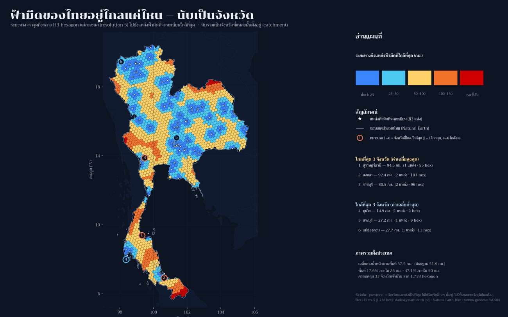
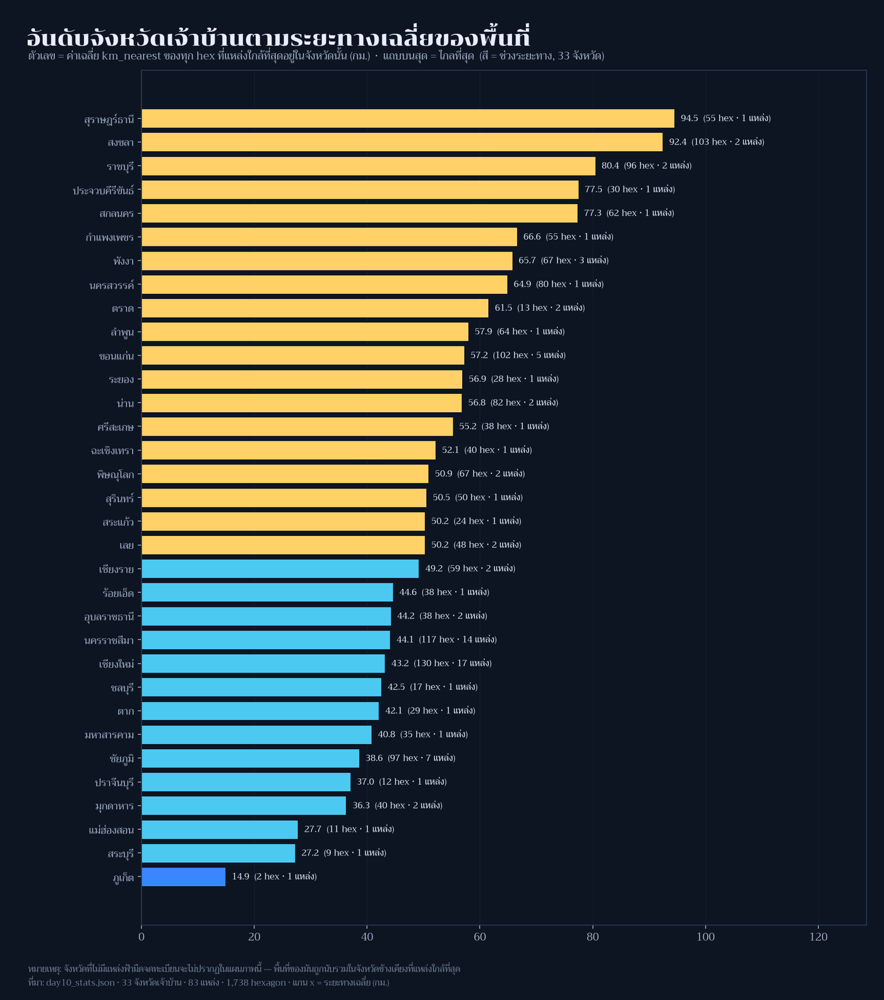

[](https://colab.research.google.com/github/thammarat-ai/geo-notes/blob/main/notebooks/day10_prompting.ipynb)

โจทย์ทางการวันนี้คือ **"For this map, make AI work for its money and produce something from
start to finish in a chat window or on the command line."**

ผมจึงทดลองแบบที่ทดสอบได้จริง ไม่ใช่แค่ "ให้ AI เขียนโค้ดแล้วผมก็แก้ต่อ" ซึ่งไม่พิสูจน์อะไรทั้งนั้น
กติกาที่ผมตั้งให้ตัวเองมีสามข้อ

1. **ส่งบรีฟชุดเดียวจบ** — ไม่ส่งโค้ดตัวอย่าง ไม่บอกว่าผมมี guard อะไรบ้าง (ไม่งั้นมันตรวจข้อสอบตัวเอง)
2. **ผมไม่แตะโค้ดของมันก่อนตัดสิน** — ให้รันแล้วเอาเข้าเครื่องตรวจที่ผมทำไว้เมื่อวาน
3. **กรรมการคือโค้ด ไม่ใช่ความรู้สึก** — `guards.py` ที่ผ่าน mutation test 13 เคส

## ที่มาของแผนที่

บรีฟที่ผมส่ง (ตัดชื่อไฟล์/เส้นทางออก) สรุปได้ว่า: *ทำแผนที่ "ฟ้ามืดของไทยอยู่ไกลแค่ไหน นับเป็นจังหวัด"
จากไฟล์ที่มีในเครื่อง — hex 1,738 เซลล์ของ Day 3 ที่มี `km_nearest` กับ `province`, จุดฟ้ามืด 83 แห่ง,
จุดสังเกต 24 แห่งของ Day 5, และ Natural Earth 10m — ห้ามดึงข้อมูลจากเน็ต ส่งมอบเป็นสคริปต์เดียว
+ รูป 2 ใบ + `day10_stats.json` + ร่างโพสต์ภาษาไทย โดย**ทุกตัวเลขในข้อความต้องย้อนกลับไปที่ json ได้**
และให้ใส่ assert ของตัวเองไว้ด้วย*

สิ่งที่ผมจงใจไม่บอก: วิธีจัดการเรื่องจังหวัด เพราะนี่คือกับดักของโจทย์นี้ — ฟิลด์ `province` ในไฟล์ hex
**คือจังหวัดของ "จุดที่ใกล้ที่สุด" ไม่ใช่จังหวัดที่ hex นั้นตั้งอยู่** และในเครื่องไม่มี shapefile จังหวัดไทยเลย

## ผลลัพธ์



AI เลือกทางที่ซื่อสัตย์: มันค้นทั้ง tree แล้วยืนยันว่าไม่มีขอบจังหวัดจริง จึง**ไม่สร้างขอบปลอม**
(ถ้าเดาด้วย Voronoi จะใส่ข้อผิดพลาดเชิงเรขาคณิตที่วัดไม่ได้ + ชื่อจังหวัด EN/ไทยที่ไม่ตรงกัน)
แล้วเปลี่ยนกรอบคำถามเป็น **"จังหวัดเจ้าบ้าน"** — เนื้อที่แต่ละจังหวัด *ให้บริการ* ฟ้ามืดไกลแค่ไหน
พร้อมพิมพ์ข้อจำกัดนี้ไว้บนรูปและในโพสต์เอง

ตัวเลขที่มันคำนวณ (ผมตรวจซ้ำด้วยข้อมูลดิบทุกตัว):

| ตัวชี้วัด | ค่า |
|---|---|
| จังหวัดเจ้าบ้านที่ปรากฏ | 33 จาก hex 1,738 เซลล์ · จุด 83 แห่ง · ผู้สังเกต 24 แห่ง |
| ระยะเฉลี่ยไปจุดฟ้ามืดใกล้สุด | 57.4 กม. (ถ่วงน้ำหนักพื้นที่ 57.5) · มัธยฐาน 51.9 |
| ไกลสุด / ใกล้สุด | 194.1 / 0.4 กม. |
| เนื้อที่ในรัศมี 25 กม. / 50 กม. | 17.6% / 47.1% |
| 3 จังหวัดไกลที่สุด | สุราษฎร์ธานี 94.5 · สงขลา 92.4 · ราชบุรี 80.5 กม. |
| 3 จังหวัดใกล้ที่สุด | ภูเก็ต 14.9 · สระบุรี 27.2 · แม่ฮ่องสอน 27.7 กม. |

### ทำไมตัวเลขของ Day 9 กับ Day 10 ถึงไม่ตรงกัน (เพิ่ม 10 พ.ย. หลังคุณผู้อ่านทัก)

มีคนถามว่า *เมื่อวานเชียงรายอยู่ไกลฟ้ามืดแค่ 0.3 กม. วันนี้ทำไมไม่ติดอันดับจังหวัดที่ใกล้ที่สุด* —
คำตอบคือสองวันนี้ถามคนละคำถามด้วยสถิติคนละตัว ทั้งที่ใช้ฟิลด์ `km_nearest` ชุดเดียวกัน

| | Day 9 | Day 10 |
|---|---|---|
| คำถาม | จากกลางเมืองนี้ ไป hex ที่มืด **ที่ใกล้ที่สุด** ไกลแค่ไหน | hex **ทุกเซลล์** ที่จังหวัดนี้เป็นเจ้าบ้าน อยู่ไกลจุดฟ้ามืดเฉลี่ยแค่ไหน |
| สถิติ | `min` เหนือ hex ที่มืด 309 เซลล์ | `mean` เหนือ hex ใน catchment ของจังหวัด |
| เชียงราย | **0.3 กม.** | **49.2 กม.** (มัธยฐาน 47.3 · สูงสุด 130.3 · 59 เซลล์ · 2 จุดทะเบียน) → อันดับ 14 จาก 33 |

hex ที่ทำให้เชียงราย "ดูดี" ใน Day 9 คือเซลล์ที่ `km_nearest` = 23.5 กม. ซึ่งเข้าเกณฑ์มืดแบบเฉียดฉิว
(เส้นแบ่งอยู่ที่ 25) และเจ้าบ้านของเซลล์นั้นคือเชียงรายเอง (ฮ่อมลมจอย) แต่เมื่อเฉลี่ยทั้ง 59 เซลล์ที่
จุดทะเบียนของจังหวัดให้บริการ ค่าก็กลับไปที่ 49.2 กม.

กรณีสุดขั้วคือ **สงขลา**: ตัวเมืองอยู่ห่าง hex มืดแค่ 12.5 กม. (อันดับดีใน Day 9)
แต่ในฐานะเจ้าบ้าน มันคือจังหวัดที่ *ไกล* ที่สุดอันดับ 2 ของ Day 10 (92.4 กม.)
เพราะผืนดินที่จุดทะเบียนของสงขลาให้บริการนั้นกว้างมาก · ตัวอย่างฝั่ง Day 9: ภูเก็ต 4.7 ·
สงขลา 12.5 · อุดรธานี 39.2 · กรุงเทพ 63.3 · ชุมพร 148.0 กม.

**บทเรียนที่ผมขอแก้ที่คำของโพสต์เอง**: หัวข้อเดิมเขียนว่า "3 จังหวัดที่ใกล้ที่สุด" ซึ่งกำกวม
เพราะคำว่า "ใกล้" ในวันนี้หมายถึง *เฉลี่ยของผืนดินที่จังหวัดให้บริการ* ไม่ใช่ *ใกล้จากตัวเมือง*
ผมปรับถ้อยคำในตารางด้านล่างแล้ว และจะติดป้าย min/mean ทุกครั้งที่รายงานระยะทางนับแต่นี้ไป



ของแถมที่ผมไม่ได้ขอแต่ชอบมาก: มัน**ตรวจ `km_nearest` ของ Day 3 ซ้ำด้วยสูตร geodesic** (`pyproj.Geod.inv`)
ได้ผลต่างเฉลี่ย 0.241 กม. สูงสุด 4.417 กม. แล้วอธิบายสาเหตุได้ตรง — 24 เซลล์ที่เป็น MultiPolygon
มีจุดศูนย์กลางทางภูมิศาสตร์ไม่ตรงกับศูนย์กลางของ H3 cell

## กรรมการพูดอะไร

| ด่าน | ผล | ความหมาย |
|---|---|---|
| mutation selftest ของ guards เอง | 13 เคส จับได้หมด (0 พลาด) | เครื่องตรวจน่าเชื่อถือก่อนใช้ตรวจคนอื่น |
| `lint_thai` (ข้อความไทย) | **ผ่าน** | ไม่มี CJK หลุด · ไม่มีช่องว่าง+สระ · ไม่มีศัพท์ไทยแต่งเอง · ใช้ "กม." ถูกต้อง |
| `guard_claims` (ทุกตัวเลขต้องมาจาก stats) | **ผ่าน** | ตัวเลขในร่างโพสต์ย้อนกลับไปที่ json ได้ทั้งหมด |
| `guard_area` (ผลรวมพื้นที่ ≤ เนื้อที่อ้างอิง) | **จับได้ 1 ข้อผิดพลาด** | ผลรวม `area_km2` ของ hex = 515,024 ตร.กม. > เนื้อที่ไทยตาม Natural Earth 512,593 ตร.กม. อยู่ 0.47% |

ข้อผิดพลาดเรื่องพื้นที่น่าสนใจเพราะมัน *ไม่ใช่ตัวเลขผิด* — 515,024 คำนวณถูกจากไฟล์
แต่ **ความหมายผิด**: hex ที่ขอบประเทศถูก clip ให้เหลือบางส่วน เรขาคณิต union จริงคือ 496,867 ตร.กม.
ทว่า attribute `area_km2` ยังเก็บพื้นที่เต็มของเซลล์ การบวกกันจึงนับพื้นที่ที่ถูกตัดออกไปแล้วกลับมาอีกครั้ง
ร่างโพสต์เดิมเขียนว่า "(ใกล้พื้นที่ประเทศไทยจริง ~5.13 แสน ตร.กม. มาก)" ซึ่ง *เกือบถูก* จนคนอ่าน
(รวมถึงผม) มักผ่านตาไป — ผมแก้เป็นบรรทัดนี้:

> ผลรวมพื้นที่จาก attribute ของ hex = 515,024 ตร.กม. ซึ่งมากกว่าเนื้อที่ประเทศไทยตาม Natural Earth
> (512,593 ตร.กม.) อยู่ 0.47% และมากกว่าพื้นที่จริงที่ hex ปูลง (union = 496,867 ตร.กม.)
> เพราะเซลล์ขอบประเทศถูก clip แต่คุณลักษณะพื้นที่ยังเป็นค่าเต็ม — ตัวเลขที่ควรใช้คือ union ไม่ใช่ sum

ระหว่างตรวจยังเจอข้อบกพร่องของ *เครื่องตรวจ* เอง 2 อย่าง ซึ่งผมแก้และเพิ่มกลับเข้า mutation test แล้ว:
`guard_claims` เคยเข้าใจผิดกับข้อความ "1,738/1,738" (แตก token เป็น `738`) และ `guard_area`
เคยตั้ง tolerance 1% ซึ่งกว้างเกินจนเคสนี้รอด — ตอนนี้ 0.2% และจับได้จริง

## วิธีทำแบบย่อ

### ขั้นที่ 1: prompt ที่ส่งไป (ส่วนเงื่อนไขที่บังคับจริง)

```text
ทำแผนที่ "ฟ้ามืดของไทยอยู่ไกลแค่ไหน นับเป็นจังหวัด" จากไฟล์ในเครื่องเท่านั้น
ส่งมอบ: สคริปต์เดียว + รูป 2 ใบ + day10_stats.json + ร่างโพสต์ภาษาไทย
กฎ: ทุกตัวเลขในข้อความต้องย้อนกลับไปที่ json ได้ · ห้ามแต่งศัพท์ไทยใหม่ ·
     ใช้ `กม.` ไม่ใช่ `ก.ม.` · ถ้าไม่มีข้อมูลที่ต้องใช้ ห้ามเดา ให้บอกข้อจำกัดแทน
```

### ขั้นที่ 2: โค้ดที่มันเขียนเอง (ตรวจ cross-field ด้วย assert)

```python
assert all(h.province == nearest_site(h.centroid).province for h in hexes)   # 1,738/1,738
assert abs(np.mean(geod_km) - np.mean(km_nearest)) < 1.0                      # ยืนยันหน่วย
assert 0 < km_nearest.max() < 1000                                            # sanity bound
```

### ขั้นที่ 3: วิธีตัดสิน (รันซ้ำได้)

```bash
python tools/guards.py            # mutation selftest — ต้อง 0 พลาด
python tools/check_series.py      # รัน guard กับทุกโพสต์ที่ publish
```

## ข้อจำกัดที่ต้องบอกตรง ๆ

- **โค้ดในโพสต์นี้ AI เขียน** ผมไม่ได้แก้ก่อนรัน · ผมแก้เฉพาะ *ถ้อยคำเรื่องพื้นที่* 1 จุดที่กรรมการจับได้
- **"จังหวัด" ในแผ่นนี้คือจังหวัดเจ้าบ้าน** ไม่ใช่จังหวัดที่ hex ตั้งอยู่ เพราะไม่มีข้อมูลขอบจังหวัดในเครื่อง
  และโมเดลปฏิเสธจะสร้างขอบปลอม — จังหวัดที่ไม่มีจุดทะเบียนจึงไม่ปรากฏในแผนภาพเลย
- `km_nearest` เป็นระยะเส้นตรง ไม่ใช่เวลาเดินทาง (เช่นเดิมตั้งแต่ Day 7–9)
- ทะเบียนจุดฟ้ามืดเป็น snapshot ที่ต้อง update เป็นระยะ

## ไฟล์ประกอบ

- [day10_ranking.png](day10_ranking.png) — อันดับ 33 จังหวัดเจ้าบ้าน
- [day10_stats.json](day10_stats.json) — ตัวเลขทุกตัวที่โพสต์นี้ใช้ รวมบล็อก `referee` ที่บันทึกคำตัดสิน
- [../day09-urban-rural/day09_stats.json](../day09-urban-rural/day09_stats.json) — ข้อมูล hex ชุดเดียวกันในมุมของ Day 9

## บทเรียน

- **"ให้ AI ทำ" ไม่ใช่ "ให้ AI ทำให้แล้วผมปิดทอง"** — ค่าของธีมนี้วัดกันที่ *มีระบบตัดสินที่ AI ไม่ได้เขียน*
  ไม่งั้นก็เป็นแค่การพิมพ์ต่อ
- **AI ทำงานระดับ "ส่งได้" จริง** — โครงโพสต์ไทยครบทุกหัวข้อ, ใช้ "กม." ถูก, ไม่แต่งศัพท์,
  ตรวจ geodesic ซ้ำเอง, และที่ประทับใจสุดคือ **ปฏิเสธจะสร้างข้อมูลที่ไม่มีความจริงรองรับ**
  (ผมไม่ได้สั่งข้อนี้)
- **กับดักที่ AI ตื่นกว่าผมคือ "ตัวเลขถูกแต่ความหมายผิด"** — sum ของ nominal area ไม่ใช่เนื้อที่ประเทศ
  ถ้าไม่มี guard เรื่องหน่วย/ขอบเขตของปริมาณ ผมคงโพสต์เลขนั้นพร้อมประโยคปลอบใจว่า "ใกล้ของจริงมาก"
- **guard ที่ไม่ถูกทดสอบด้วยข้อผิดพลาดจำลอง คือของแต่ง** — mutation test 13 เคสทำให้ผมพบว่า
  tolerance ของตัวเองกว้างเกิน และ regex ของตัวเองแตก token ผิด ถ้าไม่มีรอบนั้น ผมจะเชื่อเครื่องตรวจ
  มากเกินไปในวันสำคัญ
- **สิ่งที่เครื่องตรวจยังมองไม่เห็น**: ข้อสรุปเชิงความหมาย (เช่น "จังหวัดเจ้าบ้าน" ตอบคำถามอะไรได้บ้าง)
  ยังต้องเป็นคนอ่านอยู่ดี — guard กัน *เท็จเชิงตัวเลข* ได้ กัน *เท็จเชิงตีความ* ไม่ได้

พรุ่งนี้ธีม **Senses: Sound** (Day 11) — เสียงกับแผนที่ ซึ่งผมว่าจะลองกลับบทบาท: ให้ AI เป็นผู้ตรวจ
แล้วผมเป็นผู้ทำบ้าง 🗺️
