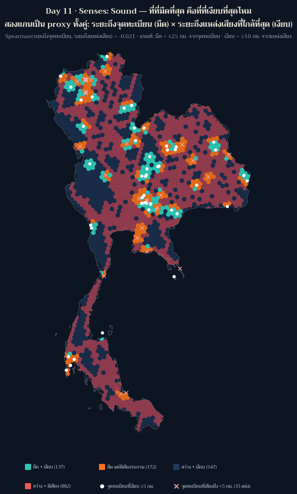
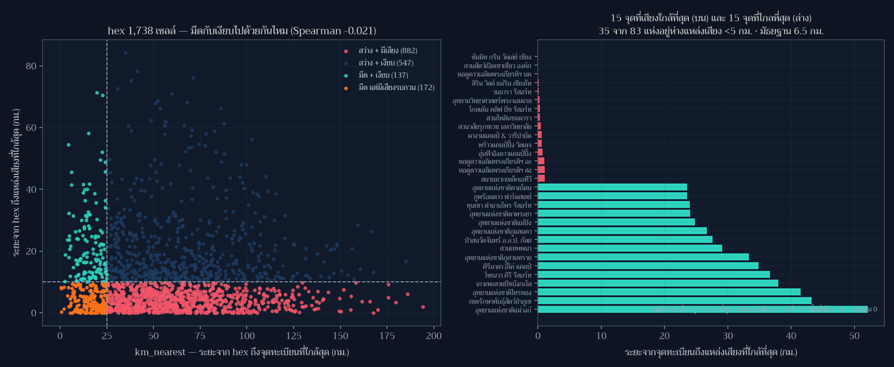

[](https://colab.research.google.com/github/thammarat-ai/geo-notes/blob/main/notebooks/day11_sound.ipynb)

โจทย์ทางการวันนี้คือ **"How do you hear something? How do you map a soundscape? Noise
pollution mapped?""

ซีรีส์นี้วัด "แสง" มาสิบวันแล้ว วันนี้ผมจึงเพิ่มแกนที่สองที่คู่กันโดยธรรมชาติ: **เสียง**
และตั้งคำถามที่ทดสอบได้ทันที — *ที่ที่มืดที่สุด คือที่ที่เงียบที่สุดไหม* ถ้าคำตอบคือใช่
เราก็มีเหตุผลเพิ่มอีกข้อในการปกป้องผืนฟ้าเดียวกัน ถ้าไม่ใช่ เราก็เพิ่งทำลายสมมติฐานที่หลายคน
(รวมถึงผม) ใช้พูดโดยไม่คิด

## ที่มาของแผนที่

ผมสร้างแกน "เงียบ" ด้วยวิธีที่ซื่อสัตย์แต่ยังไม่ใช่การวัดจริง: สำหรับ hex แต่ละเซลล์จาก Day 3
คำนวณระยะทาง (เมตร) จากศูนย์กลาง hex ไปถึง **แหล่งเสียงที่ใกล้ที่สุด** ในสี่ชนิดจาก Natural Earth 10m

| แหล่งเสียง | จำนวนที่ตกในกรอบไทย | เหตุผลที่นับ |
|---|---|---|
| ถนนสายหลัก (NE ไม่จำแนกชั้น: Unknown 1,537 / Road 238 / Major Highway 39 → ใช้ทุกสาย) | 1,814 เส้น | เสียงจราจร คือแหล่งที่ครอบคลุมที่สุด |
| พื้นที่เมือง (polygon) | 127 ผืน | เสียงชุมชน/กิจกรรมกลางคืน |
| รถไฟ | 104 เส้น | เสียงเป็นช่วง ๆ แต่ไกล |
| สนามบิน | 13 จุด | เสียงเครื่องบินกินบริเวณกว้าง |

แล้วเทียบกับ `km_nearest` (ระยะถึงจุดอนุรักษ์ท้องฟ้ามืดในทะเบียน) ที่ใชามาตั้งแต่ Day 3
**ทั้งสองแกนเป็น proxy ทั้งคู่** — ผมไม่ได้วัด dB และไม่ได้วัด sky brightness จริง

เกณฑ์ที่ใช้ติดป้ายไว้บนแผ่น: **มืด** = `km_nearest ≤ 25 กม.` · **เงียบ** = ระยะถึงแหล่งเสียง `≥ 10 กม.`
และสำหรับจุดทะเบียน **เสียงถึง** = `< 5 กม.`

## ผลลัพธ์



**1. ไม่มีความสัมพันธ์ระหว่างความมืดกับความเป็นระเบียบของเสียง**

| สถิติ (ระดับ hex, n = 1,738) | ค่า |
|---|---|
| `mean` / `median` ของ `km_nearest` (ความมืด) | 57.4 / 51.9 กม. |
| `mean` / `median` ของระยะถึงแหล่งเสียง (ความเงียบ) | 11.1 / 7.1 กม. |
| `min` / `max` ของระยะถึงแหล่งเสียง | 0.0 / 84.3 กม. |
| **Spearman(`km_nearest`, ระยะถึงแหล่งเสียง)** | **−0.021** (p = 0.39) |
| ความไว: ใช้เฉพาะ Major Highway (39 เส้น) | Spearman −0.039 · hex "เงียบ" 1,394 เซลล์ |

**2. สี่กลุ่มที่ได้** — และนี่คือตัวเลขที่สำคัญกว่าค่าสหสัมพันธ์

| กลุ่ม | จำนวน hex | พื้นที่ |
|---|---|---|
| มืด + เงียบ | 137 | 39,423 ตร.กม. |
| **มืด แต่มีเสียงรบกวน** | **172** | **49,020 ตร.กม.** |
| สว่าง + เงียบ | 547 | 156,654 ตร.กม. |
| สว่าง + มีเสียง | 882 | 251,768 ตร.กม. |

แปลว่าใน hex ที่ "มืด" ตามทะเบียน 309 เซลล์ **172 เซลล์ (56%) อยู่ใกล้แหล่งเสียงไม่ถึง 10 กม.**
ผืนฟ้ากับผืนเสียงจึงไม่ได้เป็นของคู่กัน — ที่ที่มืดอาจเป็นริมทางหลวงก็ได้

**3. ฝั่งจุดทะเบียน 83 แห่ง** — `median` ระยะถึงแหล่งเสียง = 6.5 กม. (min 0.0, max 52.1)
และ **35 จาก 83 แห่งอยู่ใกล้แหล่งเสียง < 5 กม.** แหล่งที่ถูกชี้ว่าใกล้ที่สุด เรียงเป็นจำนวนจุด: ถนนสายหลัก 63 แห่ง
พื้นที่เมือง 16 แห่ง รถไฟ 4 แห่ง สนามบิน 0 แห่ง

ชื่อที่ "เสียงถึง" ที่สุด five แห่ง: ซัมมิท กรีน วัลเล่ย์ เชียงใหม่ คันทรี คลับ (0.0 กม. · ในพื้นที่เมือง) ·
สวนสัตว์เปิดเขาเขียว (0.0) · **หอดูดาวเฉลิมพระเกียรติฯ นครราชสีมา (0.0)** · สิริน วิลล์ แม่ริม (0.11) ·
วนธารา รีสอร์ท (0.12 · ติดถนนสายหลัก)

ส่วน five แห่งที่เงียบที่สุด: อุทยานแห่งชาติแม่วงก์ (52.1 กม.) · เขตรักษาพันธุ์สัตว์ป่าภูเขียว (43.3) ·
อุทยานแห่งชาติไทรทอง (41.5) · เกาะพะลวยบีชบังกะโล (38.0) · โซเนวา คีรี รีสอร์ท (36.7)



การที่ **หอดูดาว** แห่งหนึ่งถูกนับว่าอยู่ในพื้นที่เมือง (ระยะ 0.0 กม.) ไม่ได้แปลว่าหอดูดาวนั้นเสียงดัง
แต่แปลว่า polygon "พื้นที่เมือง" ของ Natural Earth ขยายกินพื้นที่รอบ ๆ ละเอียดกว่าที่เราคิด
และนั่นคือเหตุผลที่ผมรายงานเป็น "จุดที่ต้องไปฟังเอง" ไม่ใช่ "จุดที่เสียงดังแล้ว"

## วิธีทำแบบย่อ

### ขั้นที่ 1: รวม layer เป็น geometry เดียวก่อนวัดระยะ

```python
from shapely.ops import unary_union
import shapely

def dist_km(geoms_wgs):
    merged = unary_union(list(gpd.GeoSeries(geoms_wgs, crs="EPSG:4326").to_crs(EQ).values))
    pts = np.array([Point(x, y) for x, y in cent], dtype=object)   # cent อยู่ในหน่วย *เมตร*
    return shapely.distance(pts, merged) / 1000.0
```

ใช้ `GeoSeries.distance(GeoSeries)` ตรง ๆ ไม่ได้ — มัน **align index** ของสองฝั่งแล้วคืนค่า
ที่รูปผิดไปเงียบ ๆ (ได้ array ยาว 1,814 แทน 1,738 แล้วพังตอน `np.vstack`)

### ขั้นที่ 2: บั๊กที่ผมจับได้ด้วย assert ของตัวเอง

รอบแรก `ระยะถึงแหล่งเสียง` ออกมา **mean 13.0 · min 12.95 · max 13.0** ทุกเซลล์เท่ากันหมด
สาเหตุคือลืม reproject จุดศูนย์กลาง hex — วัดระยะระหว่างจุด *ดีกรี* กับ union หน่วย *เมตร*
ซึ่งได้ค่าที่ "ดูสมเหตุสมผล" จน `guard_distances` (ที่เช็กแค่ว่าไม่เกิน 2,500 กม.) ไม่ร้อง

ผมจึงเพิ่ม guard ใหม่:

```python
guard_variance(noise_km, "noise_km", min_spread_km=3.0)   # ทุกค่าเท่ากัน = ผิดปกติ
guard_bbox(cent_deg, 96.5, 107.6, 4.3, 21.7)              # จุดต้องอยู่ในกรอบไทย (ดีกรี)
guard_crs((cent[:,0].min(), cent[:,1].min(), cent[:,0].max(), cent[:,1].max()), expect="metres")
```

### ขั้นที่ 3: ตรวจความไวต่อสมมติฐาน

เพราะ NE 10m ไม่จำแนกชั้นถนนในไทย (1,537 จาก 1,814 เส้นเป็น `type = Unknown`) ผมจึงรันซ้ำ
โดยใช้เฉพาะ **Major Highway 39 เส้น** เป็นตัวแทนถนน → Spearman จาก −0.021 เป็น −0.039
ข้อสรุปไม่เปลี่ยน: **มืดกับเงียบไม่เกี่ยวกัน** ไม่ว่าถนนจะนิยามแบบหลวมหรือแคบ

## ข้อจำกัดที่ต้องบอกตรง ๆ

- **ไม่ได้วัดระดับเสียงจริง (dB)** — นี่คือ "ระยะทางถึงแหล่งเสียง" ซึ่งเป็น proxy หยาบ
  ลม ภูมิประเทศ กำแพงกันเสียง และเวลาของวัน ล้วนมีผลต่อการได้ยินจริง
- **Natural Earth 10m เป็นชั้นข้อมูลเชิงภาพรวม** ถนน 1,537 เส้นไม่มีชั้นความสำคัญ,
  polygon พื้นที่เมืองหยาบระดับหลายกิโลเมตร → จุดทะเบียนหลายแห่ง "ติด 0.0 กม." เพราะ
  polygon คลุมทับ ไม่ใช่เพราะอยู่กลางเมือง
- **สนามบิน 13 จุด** คือเฉพาะที่ NE บันทึก ไม่ใช่ทางวิ่ง/เส้นทางบินทั้งหมด
- **ความมืดยังเป็น proxy วนตัวเอง** เหมือน Day 8–10: `km_nearest` คือระยะถึง *ทะเบียน*
  ไม่ใช่ค่าความสว่างของท้องฟ้า
- เกณฑ์ 10 กม. (เงียบ) และ 5 กม. (เสียงถึงจุดทะเบียน) เป็น **การตัดสินใจของผู้ทำแผนที่**
  ไม่ใช่มาตรฐานทางเสียงวิทยา

## ไฟล์ประกอบ

- [day11_hex_quadrants.geojson](day11_hex_quadrants.geojson) — hex 1,738 เซลล์พร้อม
  `km_nearest`, `noise_km`, `nearest_source`, `quadrant`
- [day11_stats.json](day11_stats.json) — ตัวเลขทุกตัวในโพสต์นี้ พร้อม `metric_definitions`

## บทเรียน

- **สมมติฐานที่ "ฟังดูชัด" ต้องถูกทดสอบก่อนถูกใช้เป็นเหตุผล** — ผมเกือบเขียนว่า "ที่มืดคือที่เงียบ
  เพราะทั้งคู่ไกลคน" ซึ่งเป็นประโยคที่ดูมีเหตุผลมากและผิดในข้อมูล (Spearman −0.021, p=0.39)
- **ค่าที่ "ดูสมเหตุสมผล" อันตรายกว่าค่าที่ดูผิด** — 13.0 กม. ทุกเซลล์ผ่าน guard เดิมของผมทั้งหมด
  แต่ assert ที่ตรวจ *การกระจาย* จับได้ทันที ผมจึงเพิ่ม `guard_variance` เข้าชุดตรวจถาวร
- **การวัดระยะต้องระบุหน่วยของทั้งสองฝั่ง** — จุดศูนย์กลางดีกรีกับ union หน่วยเมตรไม่ error
  มันแค่ให้ตัวเลขที่ผิดแบบแนบเนียน (บทเรียนเดียวกับ Day 7 แต่รอบนี้จับได้เร็วขึ้นเพราะ assert)
- **ตรวจความไวต่อชั้นข้อมูลก่อนสรุป** — ถนน "ทุกสาย" กับ "Major Highway เท่านั้น" ให้ผลต่างกัน
  น้อยมาก (−0.021 vs −0.039) ซึ่งทำให้ข้อสรุปนี้แข็งขึ้น ไม่ใช่เพราะตัวเลขสวย แต่เพราะมันไม่เปลี่ยน
- **ชื่อสถานที่ต้องอ่านจากไฟล์ข้อมูล** — รายชื่อ 5 จุดเงียบสุด/ดังสุดในโพสต์นี้ผมดึงจาก
  `day11_stats.json` ที่สคริปต์เขียนออก ไม่ได้ถอดจากภาพ (บทเรียนราคาแพงจาก Day 6)

พรุ่งนี้ธีม **Power** (Day 12) — ข้อความทางการเขียนว่า *"Power as in nuclear power? Or physical power or influence? Power grid on a map?"* พร้อมต่อท้ายว่า *"Read this the way you want, like every other prompt."*

ซึ่งต่อจากแผ่นนี้ได้พอดี: ถ้าความมืดไม่ได้มากับความเงียบ คำถามถัดไปคือ *ใครมีอำนาจกำหนดว่าตรงไหนจะได้มืด* 🗺️
