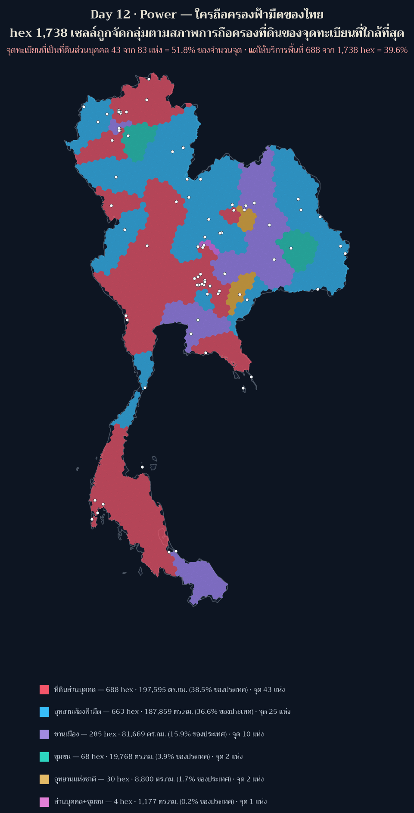
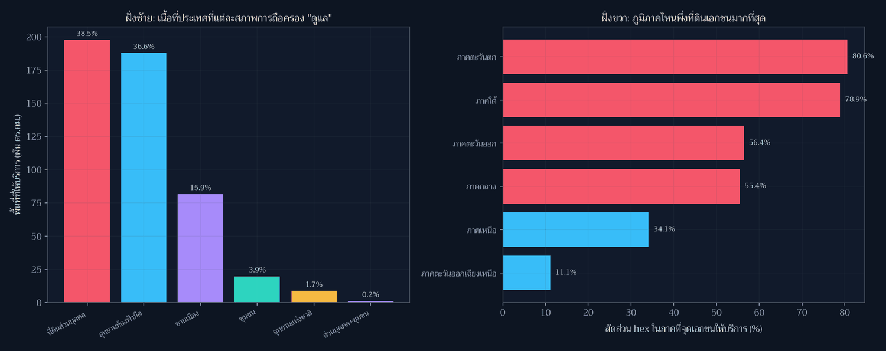

[](https://colab.research.google.com/github/thammarat-ai/geo-notes/blob/main/notebooks/day12_power.ipynb)

โจทย์ทางการวันนี้คือ **"Power as in nuclear power? Or physical power or influence? Power grid on a
map?"** พร้อมต่อท้ายว่า *"Read this the way you want, like every other prompt."*

ผมเลือกอ่านทาง **"อำนาจ"** ไม่ใช่เพราะทางอื่นไม่น่าสนใจเท่า เพราะเป็นทางเดียวที่ข้อมูลในมือ
ตอบได้ — ทะเบียนจุดอนุรักษ์ท้องฟ้ามืดของ NARIT มีฟิลด์ `type` ซึ่งโดยเนื้อแท้แล้วไม่ใช่ "ประเภทสถานที่"
แต่เป็น **สภาพการถือครองที่ดิน**: เขตอนุรักษ์ในพื้นที่ส่วนบุคคล / อุทยานท้องฟ้ามืด / พื้นที่ชานเมือง /
ชุมชนอนุรักษ์ / อุทยานแห่งชาติ

คำถามของแผ่นนี้จึงคือ: **ฟ้ามืดของไทยเป็นของใคร**

## ที่มาของแผนที่

ผมให้ hex แต่ละเซลล์จาก Day 3 (1,738 เซลล์) สืบทอด "ผู้ถือครอง" จากจุดทะเบียนที่ใกล้ที่สุดของมัน
โดยใช้ฟิลด์ `nearest` ที่บันทึกไว้ตั้งแต่ Day 3 แล้ว join กับ `type` ใน CSV — join ครบ **100%**
(0 ชื่อที่ไม่พบในทะเบียน) และมีจุดที่ "ให้บริการ" hex จริงเพียง **76 จาก 83 แห่ง**

**ตัวเลขสองตัวที่ต้องไม่พูดปนกัน** — และนี่คือหัวใจของโพสต์นี้

| วิธีนับ | ที่ดินส่วนบุคคลได้ | ความหมาย |
|---|---|---|
| นับ **จำนวนจุด** | 43 จาก 83 = **51.8%** | "เกินครึ่งของจุดทะเบียนเป็นของเอกชน" |
| นับ **พื้นที่ที่ให้บริการ** | 688 จาก 1,738 hex = **39.6%** · 197,595 ตร.กม. = **38.6%** ของประเทศ | "เกือบสองในห้าของประเทศพึ่งจุดเอกชน" |

จุดเอกชนกระจายตัว *กว้างกว่า* จุดสาธารณะ (เฉลี่ย 16.0 hex ต่อจุด เทียบกับอุทยานท้องฟ้ามืด 26.5 hex ต่อจุด)
เพราะจุดเอกชนหลายแห่งอยู่ในพื้นที่ที่จุดสาธารณะไปไม่ถึง — ซึ่งยิ่งทำให้การพึ่งพาเช่นนี้เป็นเรื่องโครงสร้าง ไม่ใช่เรื่องบังเอิญ

## ผลลัพธ์



| ผู้ถือครอง | จุด | hex | พื้นที่ | % ของประเทศ |
|---|---|---|---|---|
| ที่ดินส่วนบุคคล | 43 | 688 | 197,595 ตร.กม. | 38.55% |
| อุทยานท้องฟ้ามืด | 25 | 663 | 187,859 ตร.กม. | 36.65% |
| พื้นที่ชานเมือง | 10 | 285 | 81,669 ตร.กม. | 15.93% |
| ชุมชนอนุรักษ์ | 2 | 68 | 19,768 ตร.กม. | 3.86% |
| อุทยานแห่งชาติ | 2 | 30 | 8,800 ตร.กม. | 1.72% |
| ส่วนบุคคล + ชุมชน | 1 | 4 | 1,177 ตร.กม. | 0.23% |



**สามข้อสังเกตที่เปลี่ยนวิธีมองทะเบียนนี้**

1. **ภูมิภาคพึ่งเอกชนไม่เท่ากัน** — ตะวันตก 80.6% · ใต้ 78.9% · ตะวันออก 56.4% · กลาง 55.4% ·
   เหนือ 34.1% · **อีสาน 11.1%** เท่านั้น อีสานเป็นภาคเดียวที่ "ฟ้ามืดสาธารณะ" ยังเป็นแกนหลัก
   ทั้งที่มีจุดทะเบียนมากสุด (37 แห่ง) — แปลว่าที่นั่นมี *อุทยานท้องฟ้ามืด* จริง ไม่ใช่รีสอร์ท
2. **11 จังหวัดพึ่งที่ดินเอกชน 100%** — ราชบุรี นครสวรรค์ พังงา เชียงราย สุราษฎร์ธานี ตาก ระยอง
   ตราด ปราจีนบุรี สระบุรี ภูเก็ต ในจังหวัดเหล่านี้ *ทุก hex* ในประเทศชี้ไปที่จุดเอกชนใกล้สุด
   ถ้าเจ้าของที่ดินเปลี่ยนการใช้ประโยชน์หรือปิดพื้นที่ ฟ้ามืดทั้งจังหวัดหายไปจากทะเบียนโดยที่
   รัฐไม่มีเครื่องมืออะไรเลย
3. **7 จุดทะเบียนไม่มี hex ใดถือเป็นจุดที่ใกล้ที่สุด** — เป็นจุดที่ "มีชื่อ" แต่ไม่มีพื้นที่บริการจริง
   ในเชิง Voronoi ซึ่งควรถามต่อว่าจุดเหล่านั้นถูกขึ้นทะเบียนด้วยเหตุผลอะไร

## วิธีทำแบบย่อ

### ขั้นที่ 1: สืบทอดผู้ถือครองผ่านจุดที่ใกล้ที่สุด (ไม่ใช่ recompute)

```python
lut_type = dict(zip(df["name"], df["type"].map(SHORT)))
hex_type = np.array([lut_type[n] for n in near])      # near = ฟิลด์ nearest จาก Day 3
assert not [n for n in set(near) if n not in lut_type]     # join ต้องครบ
```

### ขั้นที่ 2: ตรวจว่าฟิลด์ยังตรงอยู่ (และพบว่ามันตรง 99.94%)

```python
recheck = names[hav(cent_deg, sites).argmin(axis=1)]
agree = float((recheck == near).mean())     # 99.94% · ต่าง 1 เซลล์
```

หนึ่งเซลล์ที่ต่างมาจาก polygon centroid ของเซลล์ที่ถูก clip ≠ ศูนย์กลาง H3 cell ที่ Day 3 ใช้
(ระหว่างทำผมเคยได้ตัวเลข 96.26% จากคำสั่งตรวจที่คำนวณ "ศูนย์กลาง" ด้วยการเฉลี่ยจุดของ ring
ซึ่งผิดวิธี — ตัวเลขที่ถูกต้องคือ 99.94% และผมใช้ของสคริปต์ ไม่ใช่ของคำสั่งด่วนที่ผมพิมพ์เล่น)

### ขั้นที่ 3: ส่วนแบ่งพื้นที่ต้องบวกจาก geometry ไม่ใช่จาก attribute

```python
area = cen.area / 1e6                                  # reproject เป็น eqdc แล้ววัด
guard_area(sum(area_by_type.values()), ne_area, tol=0.02)
```

ผลรวม hex ครั้งนี้ได้ **496,867 ตร.กม.** ซึ่ง *น้อยกว่า* เนื้อที่ประเทศตาม Natural Earth (512,593)
— ต่างจาก Day 10 ที่ผมเคยเอา `area_km2` ใน attribute มาบวกแล้วได้ 515,024 ตร.กม. (>ประเทศ)
เพราะ attribute เก็บพื้นที่เต็มของเซลล์ที่ถูก clip แล้ว บทเรียนจากรอบก่อนถูกใช้แล้วจริง

## ข้อจำกัดที่ต้องบอกตรง ๆ

- **นี่คือแผนที่ "ขอบเขตบริการ" ไม่ใช่ "สภาพที่ดินจริง"** — hex ถูกจัดกลุ่มตามจุดที่ใกล้ที่สุด
  แบบ Voronoi บน hex grid ดังนั้นสีของเซลล์บอก "ถ้าคุณอยู่ตรงนี้ จุดไหนจะใกล้ที่สุด" ไม่ใช่
  "ที่ดินผืนนั้นเป็นของใคร" ข้อสรุปเรื่องผู้ถือครองจึงเป็นข้อสรุปของ *ระบบทะเบียน* ไม่ใช่ของกรรมสิทธิ์ทั้งประเทศ
- ฟิลด์ `type` เป็นคำเรียกของ NARIT ผมตีความว่า "พื้นที่ส่วนบุคคล" = ที่ดินเอกชน ซึ่งควรยืนยัน
  กับผู้ดูแลทะเบียนอีกครั้งก่อนนำไปอ้างอิงเชิงนโยบาย
- `registration_year` ในไฟล์ **ว่างทั้ง 83 แถว** ผมจึงไม่ทำไทม์ไลน์นโยบายเลย (แทนที่จะเดาปี)
- จำนวน 77 จังหวัดเป็นข้อมูลภายนอก ไม่ใช่จากไฟล์ในเครื่อง
- ระยะทางเป็นเส้นตรง และ hex resolution 5 หยาบระดับ ~258 ตร.กม. ต่อเซลล์

## ไฟล์ประกอบ

- [day12_hex_holders.geojson](day12_hex_holders.geojson) — hex 1,738 เซลล์พร้อม `nearest_site`,
  `holder`, `region_th`, `km_nearest`
- [day12_stats.json](day12_stats.json) — ตัวเลขทุกตัวในโพสต์นี้ รวม `metric_definitions` ที่แยก
  "ส่วนแบ่งจำนวนจุด" ออกจาก "ส่วนแบ่งพื้นที่"

## บทเรียน

- **"อำนาจ" วัดได้จาก metadata** — ผมไม่ต้องมีข้อมูลกรรมสิทธิ์ที่ดินเลย แค่ใช้ฟิลด์ `type` ที่ทะเบียน
  ให้มาอย่างตรงไปตรงมา ก็เห็นโครงสร้างอำนาจของนโยบายฟ้ามืดไทยแล้ว
- **ตัวเลขเดียวกัน สองตัวส่วนให้ประโยคที่ต่างกันโดยสิ้นเชิง** — 51.8% (ของจุด) กับ 38.6% (ของประเทศ)
  เป็นจริงทั้งคู่ แต่พาดหัวคนละเรื่อง ผมจึงใส่ `metric_definitions` กำกับไว้ใน stats ว่าตัวไหนคือตัวไหน
- **ข้อผิดพลาดที่เรียนรู้แล้วจะคืนทุน** — `guard_area` ที่เกิดจากบั๊ก Day 10 ทำงานทันทีในรอบนี้
  และบังคับให้ผมวัดพื้นที่จาก geometry ไม่ใช่บวก attribute
- **คำสั่งด่วนที่พิมพ์ระหว่างสำรวจ ≠ สคริปต์ที่ตรวจแล้ว** — ผมได้ 96.26% จากโค้ดทดลองที่คำนวณ
  ศูนย์กลางผิดวิธี ถ้าเอาตัวเลขนั้นไปเขียนโพสต์ก็จะผิดอีกแบบหนึ่ง บทเรียน: ตัวเลขที่ใช้อ้างต้องมาจาก
  สคริปต์ที่รันซ้ำได้เท่านั้น
- **สิ่งที่ไม่มีข้อมูลต้องบอกว่าไม่มี** — ไทม์ไลน์การจดทะเบียนทำไม่ได้เพราะฟิลด์ว่าง ผมเลือกเขียนว่า
  "ทำไม่ได้" ดีกว่าเดาปีขึ้นมาให้แผนดูสมบูรณ์

พรุ่งนี้ธีม **Interactions** (Day 13) — ผมยังไม่ได้เช็กข้อความทางการ จะดึงมาก่อนแล้วค่อยออกแบบ
(บทเรียนจากวันนี้: อย่าจำโจทย์ไปเขียน) 🗺️
