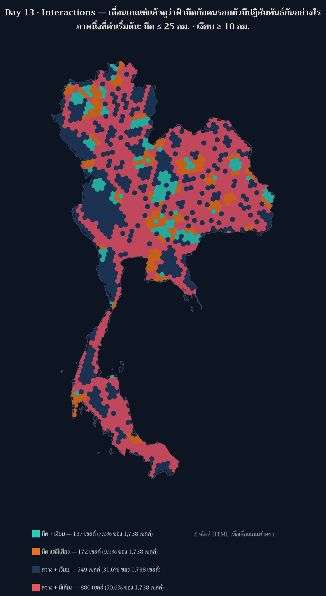

[](https://colab.research.google.com/github/thammarat-ai/geo-notes/blob/main/notebooks/day13_interactions.ipynb)

โจทย์ทางการวันนี้คือ **"Interactions between things, or maybe the result would be an interactive
map?"** — เขาเปิดทั้งสองทาง ผมจึงทำทั้งสองทางพร้อมกัน: แผนที่ที่แสดง *ปฏิสัมพันธ์ระหว่างสิ่ง*
(ระบบทะเบียน × เสียง × การถือครองที่ดิน × ประชากรเมือง) และแผนที่ที่เป็น *interactive จริง*

**เปิดแผนที่: [day13_interactions_map.html](day13_interactions_map.html)**

*(แผ่นนี้ทำล่วงหน้าหนึ่งวัน — สร้างและทดสอบตอนสายของวันที่ 12 พ.ย. สำหรับ Day 13 ที่ 13 พ.ย.
ผมเขียน `date:` เป็น 13 พ.ย. ตามวันที่ธีมของมัน และบอกไว้ตรงนี้เพื่อไม่ให้สับสนกับลำดับเวลา)*

## ที่มาของแผนที่

สิบสองวันที่ผ่านมาผมตั้งเกณฑ์เองหมด (`≤ 25 กม.` สำหรับมืด, `≥ 10 กม.` สำหรับเงียบ) ซึ่งหมายความว่า
ตัวเลขที่ผมรายงานล้วนเป็น *ผลของการตัดสินใจของผม* ไม่ใช่ของพื้นที่

วันนี้ผมจึงยกเกณฑ์นั้นให้ผู้ชมถือแทน — เลื่อนแถบ "มืด" และ "เงียบ" แล้วดูว่าประเทศเปลี่ยนกลุ่มอย่างไร
สด ๆ ในเบราว์เซอร์ นี่คือความหมายของ "interactions" ที่ผมชอบที่สุด: **ปฏิสัมพันธ์ระหว่างคนดูกับ
สมมติฐานของคนทำแผนที่**

## ผลลัพธ์



ที่ค่าเริ่มต้น (มืด ≤ 25 กม. · เงียบ ≥ 10 กม.) แผนที่นับได้ **137 / 172 / 549 / 880 เซลล์**
ในสี่กลุ่ม "มืด+เงียบ / มืดแต่มีเสียง / สว่าง+เงียบ / สว่าง+มีเสียง" จาก 1,738 เซลล์
= มีเพียง **7.9%** ของประเทศที่ทั้งมืดและเงียบตามเกณฑ์นี้

สิ่งที่เกิดขึ้นเมื่อท่านเลื่อนเกณฑ์ (ผมทดสอบในเบราว์เซอร์แล้ว ไม่ใช่คาดเดา):

| สถานการณ์ | ผลที่ได้ |
|---|---|
| เข้มขึ้น: มืด ≤ 5 กม. และเงียบ ≥ 40 กม. | เหลือ **1 เซลล์** ที่ทั้งมืดและเงียบ · 1,650 เซลล์ตกกลุ่ม "สว่าง+มีเสียง" |
| ตัวกรอง "ที่ดินส่วนบุคคล" | นับเฉพาะ hex ที่เอกชนให้บริการ: **40 + 72 + 237 + 339 = 688 เซลล์** ซึ่งเท่ากับจำนวน hex ที่ Day 12 รายงานไว้พอดี (ยืนยันว่าสองแผ่นใช้ข้อมูลชุดเดียวกัน) |
| คลิก hex ใดก็ได้ | popup บอกจุดทะเบียนที่ให้บริการ · ผู้ถือครอง · ระยะถึงจุดทะเบียน · ระยะถึงแหล่งเสียง · ประชากรเมืองใน 30 กม. · ภูมิภาค และชนิดแหล่งเสียงที่ใกล้ที่สุด |

และนี่คือเหตุผลที่ผมชอบแผนที่แบบ interactive: **ข้อสรุปของผมอ่อนลงต่อหน้าคนดู** ผมพูดมาหลายวันว่า
"ที่ที่มืดกับที่ที่เงียบเป็นคนละเรื่อง" พอคนดูเลื่อนเกณฑ์เองได้ เขาจะเห็นว่าประโยคนั้นจริงเฉพาะที่
เกณฑ์ประมาณ 25/10 กม. เท่านั้น เข้มกว่านี้เล็กน้อยประเทศทั้งประเทศก็หลุดจากกลุ่ม "มืด+เงียบ" แล้ว

## วิธีทำแบบย่อ

### ขั้นที่ 1: ไม่คำนวณใหม่ — อ่านจาก artifact ของวันก่อน และตรวจว่าเรียงตรงกัน

```python
k03 = np.array([f["properties"]["km_nearest"] for f in F03["features"]], float)
for name, arr in (("day09", k09), ("day11", k11), ("day12", k12)):
    assert np.allclose(arr, k03, atol=1e-6), f"ลำดับ hex ของ {name} ไม่ตรงกับ Day 3"
```

สคริปต์อื่นอาจไม่เช็กข้อนี้ และถ้าไฟล์เรียง hex ไม่ตรงกัน ทุกค่าที่แสดงจะสลับเซลล์แบบเงียบ ๆ

### ขั้นที่ 2: ลดรายละเอียดเรขาคณิต *ในระบบเมตร* แล้วค่อยแปลงกลับ

```python
cells_m = [shapely.transform(c, _fwd) for c in cells_wgs]        # lon/lat -> eqdc (เมตร)
cells_m = [c.simplify(1500.0, preserve_topology=True) for c in cells_m]
cells = [shapely.transform(c, _inv) for c in cells_m]            # กลับเป็น lon/lat ให้ Leaflet
assert abs(area_after - area_before) / area_before < 0.01        # พื้นที่ต้องไม่หาย
```

รอบแรกผมเรียก `simplify(1500)` ใส่ geometry ที่ยังอยู่ใน *ดีกรี* ตรง ๆ ผลคือ tolerance กลายเป็น
1,500 องศา — ประเทศทั้งประเทศหดเหลือพื้นที่ 110,322 ตร.กม. (จาก 496,867) map ยังวาดออกมาสวย
และไม่มีใครรู้ถ้าไม่มี assert บรรทัดนี้ (บทเรียนเดียวกับ Day 10/11 แต่คนละรูปแบบ)

### ขั้นที่ 3: ตัวเลขที่ panel คำนวณสด ต้องอยู่ใน stats ด้วย

```python
"live_panel_at_defaults": {"dark_quiet_pct": 7.9, "dark_quiet_on_private_hex": 40},
```

ไม่งั้น `guard_claims` จะตรวจโพสต์ไม่ทัน เพราะตัวเลขที่คนเห็นบนจอจะไม่มีที่อยู่ใน artifact ใดเลย

## ข้อจำกัดที่ต้องบอกตรง ๆ

- **ไม่ใช้ tile ภายนอกแล้ว** — เดิมผมใช้ CARTO dark basemap ซึ่งตอนนี้ *บังคับ API key* ทำให้แผนที่
  ขึ้น "API KEY REQUIRED" ทั้งแผ่น (เห็นตอนเปิดเบราว์เซอร์ตรวจ ไม่ใช่ตอนเขียนโค้ด) ผมจึงเปลี่ยนมา
  วาดขอบประเทศไทยจาก Natural Earth เอง ผลคือโหลดเร็วขึ้น ไม่ต้องพึ่งบริการภายนอก และไม่มี
  ข้อผูกพันเรื่อง attribution ของ tile แต่ก็ได้แผนที่ไม่มีถนน/เมืองเป็นฉากหลัง
- เรขาคณิตถูก simplify ที่ tolerance 1.5 กม. → เส้นขอบ hex ไม่คมเท่าต้นฉบับ (พื้นที่ต่างไป 0.15%)
- เกณฑ์ "มืด" ยังเป็น proxy จากทะเบียน ไม่ใช่ค่าวัดแสงจริง · "เงียบ" เป็นระยะถึงแหล่งเสียง ไม่ใช่ dB
- ตัวกรองผู้ถือครอง *นับตามกรองแล้ว* แต่แผนที่ยังแสดงเซลล์อื่นแบบจาง ๆ เพื่อให้เห็นบริบท

## ไฟล์ประกอบ

- [day13_interactions_map.html](day13_interactions_map.html) — แผนที่ interactive (0.94 MB, เปิดเองได้ ไม่ต้องมีเซิร์ฟเวอร์)
- [day13_stats.json](day13_stats.json) — ตัวเลขทุกตัวที่ panel แสดงที่ค่าเริ่มต้น + นิยามฟิลด์ + cross-check กับ Day 11/12

## บทเรียน

- **ต้องเปิดแผนที่จริงในเบราว์เซอร์ก่อน publish** — บั๊ก API key ของ tile กับ callback `style` ที่
  รับ feature ตรง ๆ (ไม่ใช่ `s.feature`) ไม่มีทางเจอจากการอ่านโค้ดหรือดูไฟล์ HTML ทั้งสองอย่าง
  โผล่เฉพาะตอนเรนเดอร์จริง
- **ตัวกรองที่ต้องนับตามตัวกรอง** — ตอนแรก panel เขียนว่า "แสดงเฉพาะ…" แต่ตัวเลขยังนับทั้งประเทศ
  ซึ่งเป็นการหลอกคนดูด้วยข้อความ ไม่ใช่ด้วยข้อมูล ผมแก้ให้นับตามกรอง และตัวเลขที่ได้ (688 เซลล์)
  กลับไปตรงกับ Day 12 พอดี — การตรวจแบบ cross-day ให้ผลแบบนี้เอง
- **interactive คือการยอมเสียการควบคุมข้อสรุป** — ผมเคยเลือกเกณฑ์เองแล้วรายงานผล วันนี้ให้คนดูเลือก
  เอง ผลที่ได้คือข้อความที่ซื่อสัตย์กว่า: "ที่เกณฑ์ประมาณ 25/10 กม. มี 7.9% ของประเทศที่มืดและเงียบ
  พอเลื่อนเกณฑ์ขึ้นลง ตัวเลขนี้จะเปลี่ยนเร็วมาก"
- **artifact เดียวกันต้องเรียงแถวตรงกัน** — การ join หลายไฟล์ตามลำดับแถว (ไม่ใช่ id) ต้องมี assert
  ไม่งั้นค่าจะสลับเซลล์โดยไม่ error ใด ๆ
- **ลดขนาดไฟล์เรขาคณิตต้องทำในระบบหน่วยเมตร** และต้องมี assert เรื่องพื้นที่คอยคุม

พรุ่งนี้ธีม **Borgesian map** (Day 14) — ข้อความทางการคือ *"A map so detailed it becomes the
territory."* (จากเรื่องสั้นของ Borges) ซึ่งผมเพิ่งดึงมาอ่านก่อนออกแบบ และจะเขียนถึงเฉพาะเมื่อ
ลงมือทำจริง 🗺️
