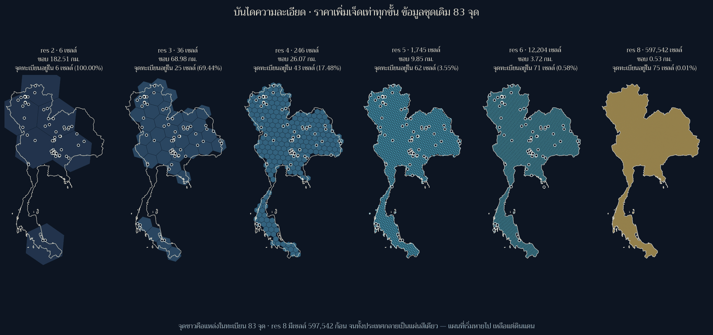
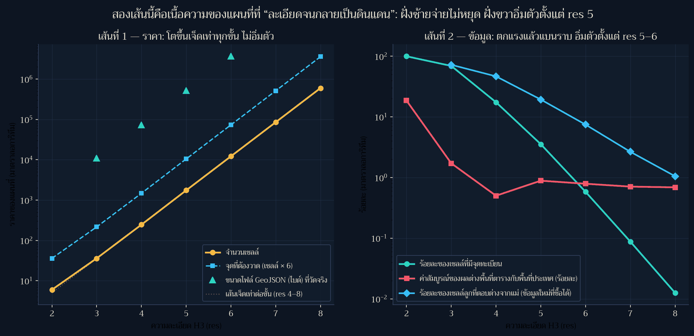
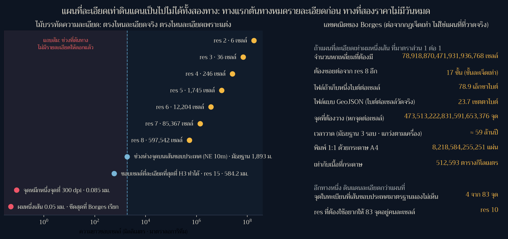

โจทย์ทางการวันนี้คือ **"A map so detailed it becomes the territory."** ภายใต้หัวข้อ *"Borgesian map"*
พร้อมหมายเหตุจากหน้าโจทย์ว่า *"Inspired by Borges' On Exactitude in Science"* — ข้อความทั้งสองบรรทัด
ผมเปิดหน้า 30daymapchallenge.com อ่านสดในวันเขียน ไม่ได้ท่องต่อมาจากความจำ

เรื่องสั้นของ Borges เป็นเพียงย่อหน้าเดียว พิมพ์ครั้งแรกปี 1946 ใต้ชื่อปากการ่วม "B. Lynch Davis"
(คือ Borges กับ Adolfo Bioy Casares) และแกล้งอ้างว่าเป็นข้อความจากหนังสือปี 1658 — ใจความที่
Wikipedia สรุปไว้คือ *"only a map on the same scale as the empire itself will suffice"*
(ผมอ้างประโยคนี้ในฐานะสรุปของ Wikipedia ไม่ใช่ประโยคที่ Borges เขียนเอง)

**คำถามของแผ่นนี้** — คำพังเพย "ละเอียดจนกลายเป็นดินแดน" *วัด* ได้ไหม
ได้ ถ้าไม่ถามคำถามเดียว แต่ถามสองคำถามพร้อมกัน แล้วพล็อตเป็นสองเส้น

* เส้นที่ 1 — **ราคา**ของแผนที่เมื่อละเอียดขึ้นอีกขั้น (จำนวนเซลล์ · จำนวนจุดที่ต้องวาด · ขนาดไฟล์ · เวลาวาด)
* เส้นที่ 2 — **ข้อมูล**ที่แผนที่บอกเพิ่มขึ้นจริงแค่ไหน (สัดส่วนเซลล์ที่มีของอยู่ · คำตอบที่เปลี่ยนไปเมื่อซอย)

## ที่มาของแผนที่

ซีรีส์นี้ใช้ตารางหกเหลี่ยม H3 มาตั้งแต่ Day 3 ที่ `res 5` (1,738 เซลล์) และไม่เคยถามคำถามที่ควรถามที่สุด
ว่า **"แล้ว res 6, res 7, res 8 ล่ะ"** — ทุกขั้นของ H3 แบ่งแม่หนึ่งเซลล์เป็นลูกเจ็ดเซลล์
แปลว่าราคาต้องโต 7 เท่าต่อขั้น ส่วนข้อมูลจะโตตามหรือเปล่า เป็นอีกเรื่องหนึ่ง

ต้นทางข้อมูลที่ใช้ (ทุกค่าในโพสต์นี้อ่านจากไฟล์ที่สคริปต์เขียนไว้ ไม่ใช่จำมาจากภาพ)

| อย่าง | ใช้อะไร | ทำไม |
|---|---|---|
| เส้นขอบประเทศ | Natural Earth 10m `admin_0_countries` | มาตรฐานที่ซีรีส์สลับมาใช้ตั้งแต่ Day 8 · พื้นที่ 512,593.1 ตร.กม. |
| ข้อมูลจุด | ทะเบียนแหล่งท้องฟ้ามืด NARIT 83 จุด (CSV ของ Day 1) | เป็นเนื้อหาที่แผนที่ต้องรับใช้ |
| ตาราง | H3 4.5.0 (`pip install` เพิ่มวันนี้) | เป็นระบบเดียวกับ Day 3 แต่เปิดให้ไล่ระดับได้ |

## ผลลัพธ์

### ๑. บันไดความละเอียด

| res | จำนวนเซลล์ | ขอบเซลล์ (กม.) | เซลล์ที่มีจุดทะเบียน | สัดส่วนที่มีข้อมูล | เทียบพื้นที่ตารางกับประเทศ |
|---|---|---|---|---|---|
| 2 | 6 | 182.513 | 6 | 100% | 118.64% |
| 3 | 36 | 68.979 | 25 | 69.44% | 101.72% |
| 4 | 246 | 26.072 | 43 | 17.48% | 99.50% |
| 5 | 1,745 | 9.854 | 62 | 3.55% | 100.89% |
| 6 | 12,204 | 3.725 | 71 | 0.58% | 100.79% |
| 7 | 85,367 | 1.406 | 75 | 0.09% | 100.71% |
| 8 | 597,542 | 0.531 | 75 | 0.013% | 100.69% |

กฎ 7 เท่าที่ H3 สัญญาไว้ เป็นจริงกับข้อมูลจริง (อัตราส่วนจำนวนเซลล์ต่อขั้น):
**6.00 · 6.833 · 7.093 · 6.994 · 6.995 · 7.00** — ค่าต่ำสุด 6.00 ที่ขั้น 2→3 เพราะเซลล์ res 2 มีเพียง
6 เซลล์ทั้งประเทศ การปัดเศษจึงเห็นผลมาก ส่วน res 4 ขึ้นไปนิ่งที่ประมาณ 7

### ๒. เส้นราคากับเส้นข้อมูล

**ด้านราคา** (วัดจริง ไม่ใช่สูตร) — ที่ res 6 ไฟล์ GeoJSON ของตารางทั้งประเทศมีขนาด 3.661 MB
(ที่ res 5 คือ 0.524 MB) และเมื่อวัดจำนวนไบต์ต่อเซลล์ได้คงที่ราว 300.0 ไบต์/เซลล์ การ extrapolate
ไปข้างหน้าจึงเป็นการคูณ ไม่ใช่การเดา ส่วน res 8 ต้องวางจุดทั้งหมด 3,585,252 จุด (หกจุดต่อเซลล์)

**ด้านข้อมูล** — ผมวัดด้วยคำถามเดียวที่ตอบได้ทันทีจากข้อมูล "จุดทะเบียนที่ใกล้ที่สุดของเซลล์นี้คือจุดไหน"
แล้วเทียบว่าเซลล์ลูกตอบต่างจากแม่หรือไม่

| ขั้น | เซลล์ลูกที่เทียบได้ | ตอบเหมือนแม่ | คำตอบใหม่ที่ได้ |
|---|---|---|---|
| 2→3 | 29 | 27.586% | 21 เซลล์ |
| 3→4 | 214 | 53.271% | 100 เซลล์ |
| 4→5 | 1,626 | 80.627% | 315 เซลล์ |
| 5→6 | 11,887 | 92.53% | 888 เซลล์ |
| 6→7 | 84,453 | 97.337% | 2,249 เซลล์ |
| 7→8 | 594,973 | 98.948% | 6,262 เซลล์ |

อ่านตารางจากขวาไปซ้าย: ขั้นที่แพงที่สุด (7→8) ซื้อคำตอบใหม่มาได้ 6,262 เซลล์จากห้าแสนกว่าเซลล์
คือ **1.052%** ของแผนที่ ที่จ่ายไป 7 เท่า ส่วนถ้าย้อนดูทั้งช่วง **res 5 เทียบ res 8** คำตอบตรงกัน
91.947% ต่างกัน 46,763 เซลล์ และระยะทางสู่จุดที่ใกล้ที่สุดเปลี่ยนไปอย่างมากที่ ±10.665 กม.
(ค่าต่ำสุด −10.665 กม. · ค่าสูงสุด +10.665 กม.) ซึ่งก็คือขนาดของเซลล์ res 5 นั่นเอง

### ๓. เพดานของต้นทาง และเลขคณิตของ Borges

นี่คือส่วนที่ผมไม่ได้คาดไว้ และมันน่าสนใจกว่าเส้นสองเส้นข้างบน

* เส้นขอบประเทศใน Natural Earth 10m ประกอบด้วยช่วงทั้งหมด 3,297 ช่วง ระยะระหว่างจุดต่อเนื่อง
  **ค่าต่ำสุด 11.06 ม. · ค่าที่ 5 เปอร์เซ็นไทล 619.4 ม. · ค่ามัธยฐาน 1,892.8 ม. · ค่าเฉลี่ย 2,547.7 ม. ·
  ค่าที่ 95 เปอร์เซ็นไทล 6,637.4 ม. · ค่าสูงสุด 39,381.9 ม.**
* ขอบเซลล์ res 6 ยาว 3.725 กม. ยังหนากว่ามัธยฐาน 1,892.8 ม. ของเส้นขอบ — แต่ res 7 ยาวเพียง
  1.406 กม. ซึ่ง *บางกว่า* เส้นที่ตารางกำลังอ้างถึง
* แปลว่าตั้งแต่ **res 7** เป็นต้นไป ตารางไม่ได้ละเอียดกว่า "ดินแดน" แต่ละเอียดกว่า *ไฟล์เส้นขอบ*
  รายละเอียดที่เพิ่มหลังจากนั้นคือการเติมลงบนแบบจำลอง ไม่ใช่การวัด

และด้านกลับของ Borges ก็จริงเช่นกัน — **ดินแดนละเอียดกว่าแผนที่** ในกรณีนี้คือทะเบียนละเอียดกว่าแผนที่

* จุดในทะเบียน 4 จาก 83 จุด อยู่นอกเส้นขอบประเทศของ Natural Earth 10m คือ
  `หอดูดาวเฉลิมพระเกียรติฯ สงขลา`, `อุทยานแห่งชาติเขาพระวิหาร`, `เกาะพะลวยบีชบังกะโล`, `โซเนวา คีรี รีสอร์ท`
  (อ่านชื่อจาก CSV ไม่ใช่จากภาพ · ในจำนวนนี้มีจุดชายแดนที่เส้นเขตในไฟล์ต้นทางกับทะเบียนวางไว้คนละที่
  ซึ่งผมไม่ได้ตัดสินว่าใครถูก — ผมบันทึกว่าสองแหล่งไม่ตรงกัน)
* ที่ res 5 มี 5 จุดที่ไม่มีเซลล์ของตัวเองในตาราง (`ดาราควิซีน` เพิ่มเข้ามาอีกจุด เพราะเซลล์ของมัน
  มีจุดกลางอยู่นอกประเทศ) เหลือ **78 จาก 83 จุด** ที่มีที่อยู่จริงบนกริดที่ซีรีส์ใช้มาตั้งแต่วันนั้น
  ถ้าเทียบกับกริด GADM ของ Day 3 จะเหลือ 76 จุด
* ทะเบียนเองก็มีเพดาน: จุดสองจุดที่ใกล้กันที่สุดในทะเบียนห่างกันเพียง **0.061 กม.**
  (`พูโตะ` กับ `บ้านสวนป่าโป่งดอย`) มี 3 คู่น้อยกว่า 0.5 กม. · 7 คู่ต่ำกว่า 1 กม. · 25 คู่ต่ำกว่า 5 กม.
  (จากทั้งหมด 3,403 คู่) ที่ res 8 จุด 83 จุดยังครองเซลล์เพียง 80 เซลล์ — ต้องละเอียดถึง **res 10**
  จึงจะแยกทุกจุดออกจากกันคนละเซลล์ ซึ่งเลยจุดที่ต้นทางเส้นขอบรับได้ไปสามขั้นแล้ว

**ถ้าเดินไปจนถึงเส้นผมจริง ๆ** (0.05 มม. · extrapolate จากกฎ 7 เท่า ไม่ใช่แผนที่ที่วาดจริง)
พื้นที่ประเทศต้องถูกทับด้วยหกเหลี่ยม **7.89 × 10¹⁹ เซลล์** = ราว 1.32 × 10¹⁴ เท่าของ res 8
ต้องวางจุด **4.74 × 10²⁰ จุด** ไฟล์จะอยู่ที่ **78.9 เอ็กซาไบต์** ถ้าเก็บหนึ่งไบต์ต่อเซลล์
หรือ **23.7 เซตตาไบต์** ในรูปแบบ GeoJSON ที่วัดไบต์ต่อเซลล์จริง · และถ้ายอมลดมาตราส่วนลงมาพิมพ์
1 ต่อ 1 บนกระดาษ A4 ต้องใช้ **8.22 ล้านล้านแผ่น** ซึ่งกินเนื้อที่ **512,593.1 ตร.กม.** — เท่าประเทศ
นั่นคือประโยคของ Borges ตรงตัว: ที่มาตราส่วน 1 ต่อ 1 แผนที่กับดินแดนเท่ากัน *ไม่ว่าจะละเอียดแค่ไหน*

## วิธีทำแบบย่อ

1. อ่านขอบประเทศ Natural Earth 10m → แปลงเป็น `LatLngMultiPoly` ของ H3 (ลบจุดซ้ำ ปิดวงให้ครบ 3 จุดขึ้นไป)
2. `h3.polygon_to_cells` ที่ res 2–8 → ได้จำนวนเซลล์จริงทุกขั้น แล้วตรวจกฎ 7 เท่า (ต้องอยู่ระหว่าง 6.0–7.3)
3. ทุกขั้น: สุ่มวัดพื้นที่เซลล์ 20,000 เซลล์ด้วย `h3.cell_area` (seed 14) · นับเซลล์ที่มีจุดทะเบียน ·
   ตอบคำถาม "จุดทะเบียนที่ใกล้ที่สุด" ด้วย haversine เป็นก้อนก้อนละสองแสนแถว กัน index เพี้ยน
4. เทียบคำตอบของเซลล์ลูกกับแม่ (`h3.cell_to_parent`) → ได้ร้อยละ "ข้อมูลใหม่ที่ซื้อได้"
5. วัดราคาจริง: เขียน GeoJSON ที่ res 3–6 เพื่อหาไบต์ต่อเซลล์ · จับเวลาวาด res 8 สามรอบแล้วใช้ค่ามัธยฐาน
6. คำนวณเพดานของต้นทาง: ระยะระหว่างจุดต่อเนื่องบนเส้นขอบประเทศเป็นเมตร (projection เดียวกับทั้งซีรีส์)
7. ต่อเลขคณิตถึง "เส้นผม" จากสูตรพื้นที่หกเหลี่ยม 2.598·s² แล้วเขียนทุกอย่างลง `day14_stats.json`
8. ตรวจก่อนส่ง: `lint_thai` · `guard_bbox` · `guard_crs` · `guard_area` · `guard_variance` ·
   `guard_distances` · `guard_claims` · `guard_stat_labels` · `guard_assets`

## ข้อจำกัดที่ต้องบอกตรง ๆ

* **res 9 ขึ้นไปไม่ได้วาดจริง** — ตัวเลข "เส้นผม" ทั้งหมดเป็นการ extrapolate จากกฎ 7 เท่ากับสูตรพื้นที่
  หกเหลี่ยม ป้ายไว้ในภาพและในไฟล์ว่า extrapolate ทุกจุด
* **เวลาเป็นตัวเลขที่แกว่ง** — รอบที่บันทึกไว้ใน `day14_stats.json` วัดได้ 42,330.5 เซลล์/วินาที
  (มัธยฐาน 3 รอบ · ช่วง 39,056–43,560) คิดเป็น **59.08 ล้านปี** ผมรันสคริปต์เดียวกันซ้ำหลายรอบใน
  เย็นวันเดียวและได้ค่าต่างกันเกิน 2 เท่าตามภาระเครื่อง จึงเริ่มบันทึกประวัติทุกรอบไว้จริง
  (ไฟล์ `day14_throughput_history.json` ตั้งแต่รอบนี้) เพื่อพูดประโยคนี้จากหลักฐาน ไม่ใช่จากความจำ
  ตัวเลขปีควรอ่านเป็น "หลักสิบล้านปี" ไม่ใช่ค่าแน่นอน — ที่คงที่จริงคือจำนวนเซลล์ จำนวนจุด และขนาดไฟล์
* **การเทียบ "ขอบเซลล์" กับ "ช่วงห่างจุดของเส้นขอบ" เป็นการเทียบความยาวสองชนิดคนละความหมาย**
  มันบอกได้ว่าตารางละเอียดกว่าเส้นที่ลอกมาเมื่อไร แต่ไม่ใช่ทฤษฎีบทว่ารายละเอียดนั้นไร้ประโยชน์
* **พื้นที่ในตารางที่ 5 เป็นแบบ "เซลล์เต็ม"** (100.89% ของประเทศ) เพราะ H3 เก็บเซลล์ทั้งก้อน
  ไม่ clip ตามขอบ — ถ้า clip ตามขอบจะได้ 496,867.2 ตร.กม. หรือหายไป 3.07% ของประเทศตามที่ Day 12 บันทึกไว้
* **จำนวนเซลล์ res 5 ของวันนี้ 1,745 ไม่ตรงกับ 1,738 ของ Day 3** — วิธีเดียวกัน คนละต้นทางเส้นขอบ
  (Day 3 ใช้ GADM) ซ้อนกัน 1,720 เซลล์ Day 3 มีเฉพาะของตัวเอง 18 เซลล์ วันนี้มี 25 เซลล์
  ผมไม่แก้ Day 3 เพราะตัวเลขของวันนั้นถูกต้องตามต้นทางของวันนั้น แต่บันทึกการเทียบไว้ให้ตรวจสอบ
* **จุดทะเบียน 4 จุดอยู่นอกเส้นขอบประเทศมาตรฐาน** รวมถึงจุดในบริเวณชายแดนที่มีข้อโต้แย้งเรื่องเขตแดน
  ผมรายงานเฉพาะว่า "สองแหล่งไม่ตรงกัน" ไม่ได้เลือกข้างว่าเส้นไหนถูก
* **ฟอนต์ไทยในภาพใช้ Trirong** ที่ฝังใน repo แล้ว ถ้าเปิดภาพบนเครื่องที่ไม่มีฟอนต์นี้ตัวหนังสือจะไม่เพี้ยน
  เพราะภาพเป็น PNG ไม่ได้พึ่งฟอนต์ของผู้ดู

## ไฟล์ประกอบ

* [day14_ladder.png](day14_ladder.png) — บันไดความละเอียด res 2 ถึง res 8 (597,542 เซลล์ในแผ่นสุดท้าย)
* [day14_detail_vs_info.png](day14_detail_vs_info.png) — เส้นราคากับเส้นข้อมูล
* [day14_floor.png](day14_floor.png) — ไม้บรรทัดความละเอียด + เลขคณิตของ Borges
* [day14_ladder.csv](day14_ladder.csv) — ตารางทุกขั้นของบันได (11 ฟิลด์ต่อแถว)
* [day14_stats.json](day14_stats.json) — ตัวเลขทุกตัวในโพสต์นี้ พร้อม `metric_definitions`
  นิยามของแต่ละฟิลด์ รวมถึงช่วงที่วัดซ้ำและบล็อก `reconciliation_day3`

## บทเรียน

* **ตัวชี้วัดที่เกิน 100% คือบั๊กที่ส่งเสียง** — ตอนแรกผมคำนวณ "สัดส่วนเซลล์ที่มีจุดทะเบียน" แบบนับเซลล์
  ที่จุดตกอยู่โดยไม่เช็กว่าเซลล์นั้นอยู่ในชุดของประเทศไหม ได้ 13 เซลล์จากตารางที่มี 6 เซลล์ทั้งประเทศ
  คือเกิน 100% ชัดเจน เพิ่ม assert ว่า `occupied <= cells` แล้วจึงพบว่ามันไม่ใช่แค่บั๊ก แต่มันคือ
  เรื่องจริงอีกเรื่อง: จุดริมขอบตกอยู่ในเซลล์ที่จุดกลางอยู่ต่างประเทศ ซึ่งกลายเป็นข้อจำกัดของทั้งซีรีส์
  ที่เพิ่งถูกเขียนลงกระดาษวันนี้
* **อย่ารายงานตัวเลขที่ใช้เวลาเป็นหน่วย** ถ้าเวลานั้นวัดจากเครื่องของตัวเองโดยไม่ได้ทำซ้ำ
  ราคาที่ควรใช้ Argument คือ intrinsic cost (จำนวนเซลล์ · จำนวนจุด · ไบต์) ส่วน wall-clock
  รายงานพร้อมช่วงที่วัดซ้ำหรือไม่ก็อย่ารายงาน
* **`np.triu(D, 1) < x` ไม่ว่างเปล่าด้านล่าง** — มันถูกเติมด้วย 0 ซึ่งผ่านเงื่อนไขทุกข้อ
  ผมได้ "3,493 คู่" จากคู่ที่เป็นไปได้ทั้งหมด 3,403 คู่ ถ้าไม่มี assert ที่นับคู่สูงสุดไว้ก่อน
  ตัวเลขเพี้ยนระดับนี้ก็จะถูกพิมพ์ออกมาอย่างภาคภูมิ
* **การเทียบข้ามวันคือเครื่องมือหาบั๊กที่ถูกที่สุด** — 1,738 กับ 1,745 ต่างกันแค่ 7 เซลล์
  แต่การเปิดไฟล์ Day 3 มาเทียบบังคับให้ผมตอบว่า "เซลล์ของจุดทะเบียนอยู่ที่ไหน" และพบว่า 5 จุด
  ไม่มีเซลล์ของตัวเอง ซึ่งไม่ปรากฏขึ้นถ้าผมรันแต่วันของตัวเองต่อไปเงียบ ๆ
