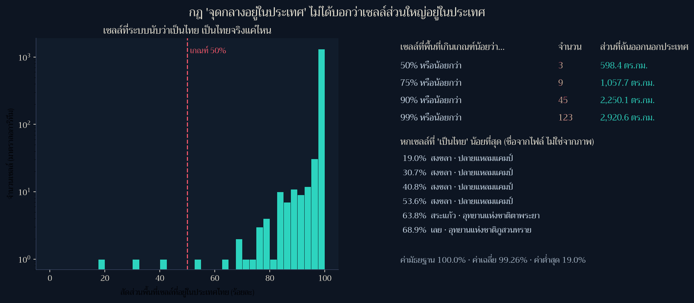
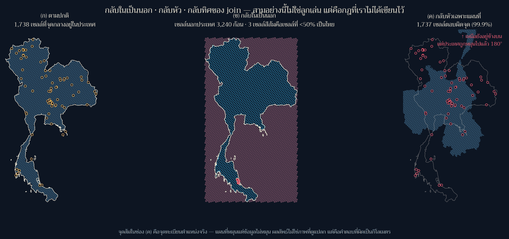
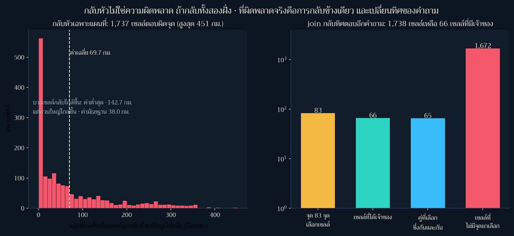

โจทย์ทางการวันนี้คือ **"Inside out, upside down. Something on this map is not quite right."**
(หัวข้อ *Inside out* — ดึงข้อความมาจากหน้า 30daymapchallenge.com อ่านสดวันเขียน)
แผ่นนี้สร้างในเย็นวันที่ 14 พ.ย. จึงเป็น **ล่วงหน้าหนึ่งวัน** ตามที่ผมทำเป็นประจำในชาเลนจ์นี้

ทางง่ายคือวาดแผนที่ผิดสักแผ่น แล้วเขียนว่า "สังเกตไหมว่าอะไรผิด" — แต่คำว่า "not quite right"
ใน GIS มีอยู่จริงและเป็นตัวเลขได้ ผมจึงเลือกกลับ **กฎสามข้อที่ซีรีส์นี้ใช้อยู่แล้ว** แล้ววัดของเสีย

| การกลับ | กฎที่ถูกกลับ | สิ่งที่วัด |
|---|---|---|
| ในเป็นนอก | H3 เก็บเซลล์ที่ *จุดกลาง* อยู่ในประเทศ | เซลล์ที่ระบบนับเป็นไทย เป็นไทยจริงกี่ % ของพื้นที่ |
| กลับหัว | หมุนแผนที่ 180° รอบ centroid แต่ไม่หมุนพิกัดจุดทะเบียน | คำตอบ "จุดที่ใกล้ที่สุด" เปลี่ยนกี่เซลล์ ไกลขึ้นกี่ กม. |
| กลับทิศคำถาม | เปลี่ยน `cell → site` เป็น `site → cell` | ได้คำตอบคนละคำถาม ไม่ใช่คำตอบที่ผิด |

## ที่มาของแผนที่

ต้นทางข้อมูลคือของเดิมทั้งซีรีส์ ไม่เพิ่มชุดใหม่

* กริด H3 res 5 ของ **Day 3** — 1,738 เซลล์ (สร้างจากขอบ GADM ในวันนั้น)
* เส้นขอบประเทศ **Natural Earth 10m** (`admin_0_countries`) — พื้นที่ 512,593.1 ตร.กม.
* ทะเบียนแหล่งท้องฟ้ามืด NARIT **83 จุด**

"Something is not quite right" ของแผ่นนี้จึงไม่ใช่ภาพที่วาดผิด แต่คือ **ช่องว่างระหว่างกฎที่ระบบใช้
กับความจริงบนพื้น** ซึ่งวัดได้ด้วยการ clip, การหมุน, และการสลับทิศของ join

## ผลลัพธ์

### ๑. ในเป็นนอก — เซลล์ที่ระบบบอกว่า "เป็นไทย" เป็นไทยจริงแค่ไหน

เอา 1,738 เซลล์มา clip กับเส้นขอบประเทศจริงแล้วหารด้วยพื้นที่เซลล์เต็ม

| สถิติ | ค่า |
|---|---|
| ค่ามัธยฐาน | 100.0% |
| ค่าเฉลี่ย | 99.257% |
| ค่าต่ำสุด | **18.97%** |
| ค่าสูงสุด | 100.0% |

และนับตามเกณฑ์

| เกณฑ์ (พื้นที่ในไทยน้อยกว่า) | จำนวนเซลล์ | ส่วนที่ล้นออกนอกประเทศ |
|---|---|---|
| 50% | 3 | 598.4 ตร.กม. |
| 75% | 9 | 1,057.7 ตร.กม. |
| 90% | 45 | 2,250.1 ตร.กม. |
| 99% | 123 | 2,920.6 ตร.กม. |
| ไม่เต็ม 100% | 481 | 2,966.7 ตร.กม. |

หกเซลล์ที่มีค่าต่ำสุดของสัดส่วนพื้นที่ในไทย — ชื่อจังหวัดและจุดทะเบียนอ่านจากไฟล์ ไม่ใช่ถอดจากภาพ

| สัดส่วนพื้นที่ในไทย (6 ค่าต่ำสุด) | จังหวัด | จุดทะเบียนที่ใกล้ที่สุด |
|---|---|---|
| 19.0% | สงขลา | ปลายแหลมแคมป์ |
| 30.7% | สงขลา | ปลายแหลมแคมป์ |
| 40.8% | สงขลา | ปลายแหลมแคมป์ |
| 53.6% | สงขลา | ปลายแหลมแคมป์ |
| 63.8% | สระแก้ว | อุทยานแห่งชาติตาพระยา |
| 68.9% | เลย | อุทยานแห่งชาติภูสวนทราย |

สี่เซลล์แรกของสงขลาอยู่ที่ละติจูด 7.35–7.63° ลองจิจูด 100.22–100.37° ซึ่งคือแนวทะเลสาบสงขลา
และชายฝั่งอ่าวไทย — จุดกลางเซลล์อยู่บนฝั่ง ระบบจึงนับทั้งก้อนเป็นประเทศ ทั้งที่ค่าต่ำสุด
(**18.97%** เป็นพื้นที่ในไทย เท่ากับ **81.03%** อยู่นอกเส้นขอบบก) อยู่ห่างจากคำว่า "เป็นไทย"
พอสมควร เซลล์ 1,555 เซลล์จาก 1,738 clip แล้วได้พื้นที่ครบทั้งก้อนไม่มีส่วนนอกประเทศปน
ที่เหลือคือรอยต่อที่กฎจุดกลางมองไม่เห็น นี่คือ "inside out" ที่ไม่ใช่ลูกเล่น:
กฎจุดกลางเป็นเพียง *ข้อจำกัดของวิธีการ* ไม่ใช่คำรับประกันว่าเซลล์นั้นเป็นไทย

ในทางกลับกัน ถ้าถามว่า "อะไรอยู่นอกประเทศใกล้เราที่สุด" — ในกล่องคลุมประเทศ (bounding box) มี
ตาราง res 5 ทั้งหมด 4,978 เซลล์ เป็นของไทย 1,738 เซลล์ และ **3,240 เซลล์ที่ไม่ใช่ไทย**
ประเทศเรากินพื้นที่เพียง **34.93%** ของกล่องที่แผนที่มักจะแสดง

### ๒. กลับหัว — แผนที่หมุน แต่ข้อมูลไม่หมุน

หมุนเซลล์ทั้ง 1,738 ก้อนไป 180° รอบ centroid ของประเทศ (แบบเดียวกับที่คนดูภาพกลับหัวทำ)
แต่ปล่อยพิกัดจุดทะเบียน 83 จุดไว้กับที่ แล้วถามคำถามเดิม "จุดทะเบียนที่ใกล้ที่สุดของเซลล์นี้คือจุดไหน"

* **1,737 จาก 1,738 เซลล์ตอบผิดจุด** (99.94%) — เหลือเซลล์เดียวที่โชคช่วย
* ระยะทางสู่จุดที่ใกล้ที่สุดเฉลี่ยเพิ่มจาก **57.368 กม. เป็น 127.054 กม.**
* ส่วนที่ไกลขึ้น: ค่าต่ำสุด **−142.714 กม.** (บางเซลล์ใกล้ขึ้น) · ค่ามัธยฐาน **38.049 กม.** ·
  ค่าเฉลี่ย **69.686 กม.** · ค่าสูงสุด **450.898 กม.**

และนี่คือส่วนที่ผมชอบที่สุดของการทดลอง: **ถ้าหมุนทั้งสองฝั่งพร้อมกัน การกลับหัวไม่ใช่ความผิดพลาดเลย**
วัดระยะบนระนาบ projection เดียวกัน ผลต่างสัมบูรณ์สูงสุด = **0.0 ม.** (rigid motion ตามนิยาม)
แต่ถ้าไปวัดระยะทางบนทรงกลมหลังหมุนในระนาบ จะได้ผลต่างถึง **0.849 กม.** เพราะ
"การหมุนแผนที่" ใน projection หนึ่ง *ไม่ใช่* "การหมุนโลก" — สองอย่างนี้ฟังดูเหมือนกัน แต่ไม่เท่ากัน

### ๓. กลับทิศของ join — ตั้งคำถามจากฝั่งจุด

ซีรีส์นี้ตอบคำถาม "เซลล์นี้ใกล้จุดไหน" มาตั้งแต่ Day 3 วันนี้ลองถามกลับ "จุดนี้ใกล้เซลล์ไหน"
(เริ่มจากฝั่งจุด 83 จุด เลือกเซลล์ที่ใกล้ตัวมันที่สุด)

| ตัวเลข | ค่า |
|---|---|
| จุดในทะเบียน | 83 |
| เซลล์ที่ถูกเลือก (ไม่ซ้ำ) | **66** |
| เซลล์ที่ไม่มีจุดใดเลือกเลย | **1,672** |
| จุดที่ต้องใช้เซลล์ร่วมกัน | 17 |
| คู่ที่เลือกซึ่งกันและกัน (mutual) | 65 |
| เซลล์ที่ถูกเลือกแต่คำตอบของตัวเองไม่ตรง | 18 |
| ผู้ใช้เซลล์นั้นไกลขึ้นเฉลี่ย | 2.951 กม. (สูงสุด 22.704 กม.) |

ข้อสรุปไม่ใช่ "join กลับทิศให้คำตอบผิด" แต่คือ **มันตอบอีกคำถามหนึ่ง** — ถ้าเอา 66 เซลล์ที่จุดเลือก
ไปทำแผนที่ "พื้นที่ให้บริการของจุดทะเบียน" จะได้แผนที่ที่มีรูโหว่ 1,672 เซลล์ เพราะการจับคู่แบบ
nearest neighbour ไม่กลับด้าน (cell→site เป็นฟังก์ชัน, site→cell ไม่ใช่ตัวผกผันของมัน)
จุด 17 จุดใช้เซลล์เดียวกับจุดอื่น และใน 18 กรณี เซลล์ที่ถูกเลือกกลับตอบว่าจุดอื่นใกล้กว่าตัวเอง

### ๔. ของแถม: ตัวเลขเก่าที่หาที่มาไม่ได้ ถูกคำนวณซ้ำแล้วตรงกัน

`check_series.py` เคยฟ้องว่าตัวเลขในโพสต์ Day 7 หาที่มาใน artifact ไม่ได้ ผมคำนวณใหม่ด้วยวิธีของวันนี้

| ตัวเลขในโพสต์ Day 7 | คำนวณใหม่ 14 พ.ย. | ต่าง |
|---|---|---|
| 18,692 ตร.กม. (hex กลบไม่ถึง) | 18,692.57 ตร.กม. | +0.6 |
| 2,967 ตร.กม. (hex ล้นออกนอกเส้น) | 2,966.68 ตร.กม. | −0.3 |

ตัวเลขทั้งสอง *ถูก* มาตั้งแต่ต้น แค่ไม่เคยถูกเก็บไว้ในไฟล์ artifact — บทเรียนเรื่อง "ตัวเลขที่ย้อนกลับ
ไปที่ไฟล์ไม่ได้ ถือว่าผิดไว้ก่อน" ยังใช้ได้ แม้คนที่ผิดคือผมเองเมื่อสองสัปดาห์ก่อน

## วิธีทำแบบย่อ

1. อ่านกริด Day 3 (1,738 เซลล์) + เส้นขอบ NE 10m + ทะเบียน 83 จุด
2. `shapely.intersection` แบบ elementwise (ไม่ใช้ `GeoSeries.distance/intersection` ที่ index เพี้ยน)
   → พื้นที่เซลล์หลัง clip ÷ พื้นที่เซลล์เต็ม = `inside_share`
3. เติม H3 res 5 ใน bounding box ทั้งกล่อง → เซต complement = `bbox_cells − inside_cells`
4. หมุนเซลล์ 180° รอบ centroid ใน projection Equidistant Conic (หน่วยเมตร) แล้วแปลงกลับเป็น lon/lat
   เพื่อถามคำถาม nearest เดิมใหม่ (haversine chunk เดียวกับ Day 14)
5. สลับแกน `argmin(axis=1)` เป็น `argmin(axis=0)` เพื่อทำ join ฝั่งจุด แล้วนับ mutual pairs
6. ตรวจ: `guard_area` (พื้นที่ประเทศ), `guard_bbox` (เซลล์และจุด), `guard_distances` (ระยะต้องไม่เกิน
   2,500 กม.), `guard_variance`, assert ว่า `inside_share ≤ 1`, assert ว่าการหมุนสองฝั่งบนระนาบต้องให้
   ผลต่าง 0, และ `lint_thai` + สแกน unicode ทั้งไฟล์
7. เขียน `day15_stats.json` + `day15_cells_inside_out.csv` แล้วให้โพสต์อ่านจากสองไฟล์นี้เท่านั้น

## ข้อจำกัดที่ต้องบอกตรง ๆ

* **ตัวเลข 2,966.7 ตร.กม. ที่ "ล้นออกนอกประเทศ" เกิดจากการผสมต้นทาง** — กริดของ Day 3 สร้างจากขอบ
  GADM แต่วันนี้ clip กับขอบ Natural Earth 10m ซึ่งเป็นมาตรฐานที่ซีรีส์ใช้ตั้งแต่ Day 8
  ถ้า clip ด้วย GADM ของวันนั้นเอง ตัวเลขจะต่างออกไป (ผมยังไม่ได้รันเทียบ เพราะไฟล์ GADM ไม่ได้อยู่ในเครื่อง)
* **18,692.57 ตร.กม. ที่ "hex กลบไม่ถึง" ไม่ใช่พื้นที่ประเทศจริงที่หายไปทั้งหมด** — ส่วนหนึ่งคือทะเลสาบ
  และเกาะเล็กที่เส้นขอบมีแต่กริดจุดกลางไม่ครอบคลุม
* **การหมุน 180° ใน projection ไม่ใช่การหมุนทรงกลม** — ผมวัดทั้งสองแบบและรายงานต่างกัน
  (0.0 ม. บนระนาบ · 0.849 กม. บนทรงกลม) เพื่อไม่ให้ตัวเลขเดียวถูกตีความเป็นสองเรื่อง
* **ช่อง (ค) ในภาพหลักไม่ใช้แผนที่สำหรับใช้งาน** — เป็นภาพประกอบคำอธิบายที่จงใจให้ผิดกติกาการอ่านแผนที่
* **แผ่นนี้ทำล่วงหน้าหนึ่งวัน** (เย็นวันที่ 14 สำหรับวันที่ 15) และรันซ้ำได้ผลตรงกันเพราะใช้ seed เดิม
  และไม่มีขั้นตอนสุ่มในบทที่ 2–4
* **ฟอนต์ไทยในภาพคือ Trirong ฝังในไฟล์ PNG** ผู้ดูไม่ต้องมีฟอนต์นี้จึงจะเห็นตัวหนังสือไม่เพี้ยน

## ไฟล์ประกอบ

* [day15_inside_out.png](day15_inside_out.png) — แผ่นหลักสามช่อง (ปกติ / กลับในเป็นนอก / กลับหัว)
* [day15_inside_share.png](day15_inside_share.png) — การกระจายของ % พื้นที่เซลล์ที่เป็นไทยจริง
* [day15_upside_down.png](day15_upside_down.png) — ความเสียหายจากการกลับหัว + ผลของการกลับทิศ join
* [day15_cells_inside_out.csv](day15_cells_inside_out.csv) — ทุก 1,738 เซลล์: พื้นที่เต็ม, พื้นที่ในไทย,
  สัดส่วน, คำตอบถ้าแผนที่ถูกกลับหัว
* [day15_stats.json](day15_stats.json) — ตัวเลขทุกตัวในโพสต์นี้ พร้อม `metric_definitions`,
  `cross_check_day07` และ `cross_check_day14`

## บทเรียน

* **ลูกเล่นกับข้อเท็จจริงแยกกันด้วยการวัด** — "กลับหัว" เป็นความผิดพลาดก็ต่อเมื่อหมุนฝั่งเดียว
  ถ้าหมุนทั้งสองฝั่ง ระยะทางไม่เปลี่ยนแม้แต่มิลิเมตรเดียว การทดลองนี้บอกเส้นแบ่งนั้นด้วยตัวเลข
* **projection ไม่ใช่โลก** — การหมุนใน Equidistant Conic ต่างจากการหมุนบนทรงกลม 0.849 กม.
  ซึ่งน้อยจนไม่มีใครสังเกตบนแผนที่ประเทศ แต่ไม่ใช่ศูนย์ และคนทำแผนที่ไม่ควรรู้สึกปลอดภัยกับ
  คำว่า "ก็แค่หมุน"
* **nearest-neighbour join ไม่กลับด้าน** — cell→site เป็นฟังก์ชันจาก 1,738 เซลล์ไป 83 จุด
  แต่ site→cell เลือกได้แค่ 66 เซลล์ เหลือ 1,672 เซลล์ที่ไม่มีเจ้าของ ถ้าใครเอาคำตอบจากฝั่งจุด
  ไปทำ choropleth "พื้นที่ให้บริการ" จะได้แผนที่ที่มีรูโหว่โดยที่ข้อมูลไม่ได้ขาด
* **กฎที่เขียนไม่ครบคือบั๊กที่ทำงานอยู่เงียบ ๆ** — "เซลล์ที่จุดกลางอยู่ในประเทศ" ไม่ได้บอกว่า
  "เซลล์ส่วนใหญ่อยู่ในประเทศ" และผลลัพธ์คือสี่เซลล์แนวทะเลสาบสงขลาที่เซลล์หนึ่งเป็นน้ำถึง 81.03%
  ซึ่งถูกนับเป็นไทยมาตั้งแต่ Day 3 โดยไม่มีใครทัก
