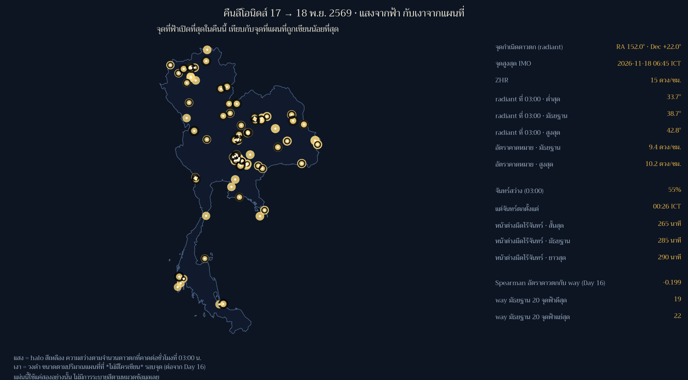
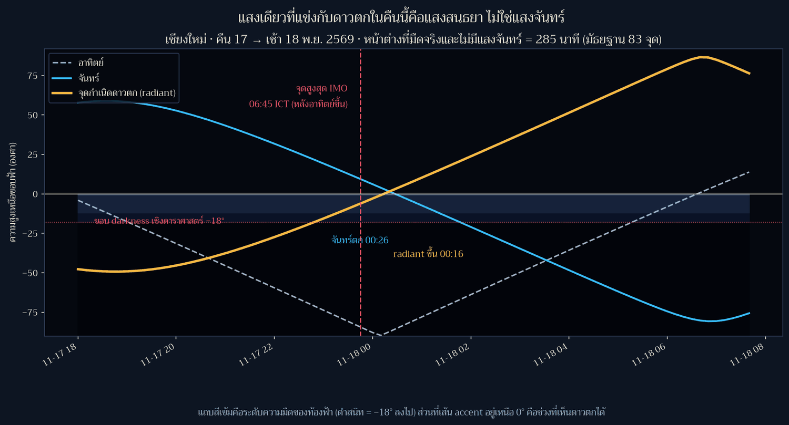
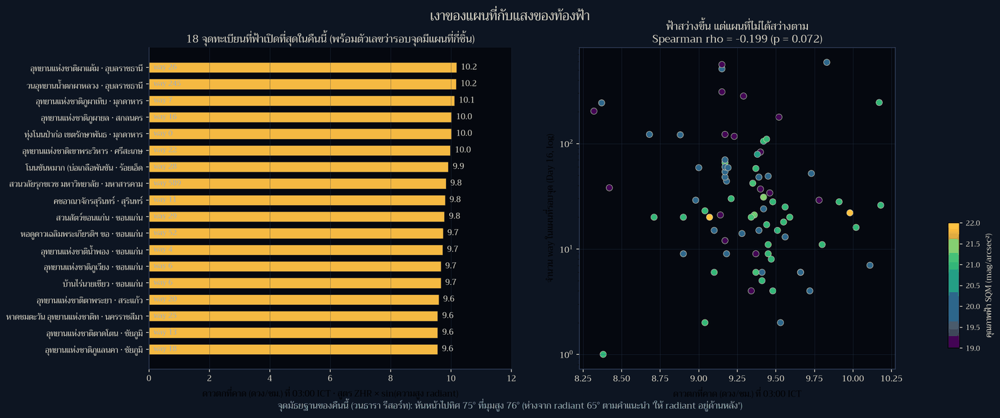

โจทย์ทางการวันนี้คือ **"Play with visual effects. What can you map with just light and shadows?"**
(หัวข้อ *Light & dark* — ดึงข้อความมาจากหน้า 30daymapchallenge.com อ่านสดวันที่ 17 พ.ย.)

เป็นวันที่โจทย์กับปฏิทินตรงกันพอดี: **คืนนี้ (17 ต่อเช้ามืด 18 พ.ย.) คือคืนที่ฝนดาวตกกลุ่มลีโอนิดส์
ถึงจุดสูงสุด** ตามปฏิทินของ IMO ผมจึงไม่ต้องใส่อะไรปลอมขึ้นเลย — ใช้แสงจริงของคืนนี้
สองแหล่ง (ดาวตกกับสนธยา) และเงาจริงแหล่งเดียว (แผนที่รอบจุดที่ *ไม่มีใครเขียน* ต่อจาก Day 16)

## ที่มาของแผนที่

ค่าคงที่ดาราศาสตร์ทั้งหมดมาจาก **IMO Meteor Shower Calendar 2026** (ไฟล์ PDF ที่ดาวน์โหลด
มาแตกข้อความใน session นี้) ไม่ใช่จากความจำ

| ค่า | ตัวเลข |
|---|---|
| กลุ่มดาวตก | 013 LEO (Leonids) · active 6–30 พ.ย. |
| จุดสูงสุด | **17 พ.ย. 23:45 UT** = **18 พ.ย. 06:45 ICT** (nodal crossing λ☉ = 235.27°) |
| ZHR | **15 ดวง/ชม.** |
| จุดกำเนิดดาวตก (radiant) | RA **152°** · Dec **+22°** |
| ความเร็วเข้าบรรยากาศ | 71 กม./ชม. · ต้นทางคือดาวหาง **55P/Tempel–Tuttle** |

Dec +22° คือหัวใจของไทยในคืนนี้ เพราะจุดสูงสุดของ radiant = 90 − |ละติจูด − 22|
ที่พะเยา = **87°** เกือบเหนือศีรษะ — ไทยอยู่ในตำแหน่งที่ *ดีที่สุดในโลกแห่งหนึ่ง* สำหรับลีโอนิดส์
แต่ peak ตรงกับ 06:45 ซึ่ง **หลังอาทิตย์ขึ้นแล้ว** ประเทศไทยจึงเห็นเฉพาะช่วงไต่ขึ้นสู่จุดสูงสุด

**สูตรที่ใช้** (ประกาศเป็นสมมติฐานไว้ชัด ๆ): `จำนวนดาวตกที่คาด = ZHR × sin(ความสูง radiant)`
เป็นการแก้ first-order ที่ใช้กันทั่วไป ไม่คิด limiting magnitude ไม่คิดเมฆ ไม่คิด extinction

## ผลลัพธ์

### ๑. แสงกับเงาของคืนนี้

| ตัวเลขที่ 03:00 ICT ของเช้าวันที่ 18 พ.ย. | ค่า |
|---|---|
| ความสูง radiant · ต่ำสุด / มัธยฐาน / สูงสุด | 33.7° / 38.7° / 42.8° |
| อัตราดาวตกที่คาด · ต่ำสุด / มัธยฐาน / สูงสุด | 8.3 / 9.4 / 10.2 ดวง/ชม. |
| หน้าต่างที่มืดจริง *และ* ไม่มีจันทร์ *และ* radiant อยู่เหนือขอบฟ้า | 265 / 285 / 290 นาที |
| จุดที่หน้าต่างเป็น 0 นาที | 0 จุด (ทั้ง 83 จุดดูได้) |

จุดที่ดีที่สุดคือ **อุทยานแห่งชาติผาแต้ม (อุบลราชธานี)** radiant 42.8° ให้อัตราคาด 10.18 ดวง/ชม.
จุดที่ต่ำสุดคือ **ดาราควิซีน (ภูเก็ต)** 8.32 ดวง/ชม. — ต่างกันเพียง 1.2 เท่า
เพราะสิ่งที่กำหนดเกมไม่ใช่ตำแหน่งจุด แต่คือ *เวลา* ที่คุณดู

### ๒. เส้นแสงของคืน: แสงที่แข่งกับดาวตกคือสนธยา ไม่ใช่จันทร์

คืนที่เชียงใหม่ (17 พ.ย. 18:00 → 18 พ.ย. 08:00 ICT): จันทร์ (สว่าง **54.7%** elongation 95.4°)
ยังอยู่สูง 63° ตอน 18:00 แล้ว **ตกประมาณ 00:26 ICT** ในขณะที่ radiant ขึ้นราว **00:16 ICT**
และ darkness เชิงดาราศาสตร์สิ้นสุด (อาทิตย์ขึ้น) **05:04 → 06:18 ICT**

แปลว่าช่วง **02:00–05:00** เป็นหน้าต่างที่จันทร์อยู่ใต้ขอบฟ้าแล้วและฟ้ามืดสนิท
ส่วนที่แสงจันทร์จะกวนคือช่วงหัวค่ำ ซึ่ง radiant ยังไม่ขึ้น — สองช่วงนี้ไม่ทับกันเลย
ข้อความที่แชร์กันมาว่า "ปีนี้มีจันทร์กวน" จึง *ถูกครึ่งเดียว*: จันทร์สว่างจริง แต่ตกก่อนเวลาที่ดี

**ตรวจเทียบแบบจำลองกับตารางที่เผยแพร่** (นี่คือส่วนที่ผมอยากให้ดู เพราะมันโชว์ความแม่นของเครื่องมือ)

| เหตุการณ์ | คำนวณเอง | เผยแพร่ (Bangkok) | ต่าง |
|---|---|---|---|
| อาทิตย์ขึ้น 18 พ.ย. | 06:18 ICT | 06:19 ICT | **−1.0 นาที** |
| จันทร์ตก 17 → 18 พ.ย. | 00:26 ICT | 23:19 ICT | **+67.0 นาที** |

ephemeris ของผม (Meeus series ที่ตัดพจน์) แม่นระดับนาทีสำหรับอาทิตย์ แต่เพี้ยนราวหนึ่งชั่วโมงสำหรับจันทร์
ข้อสรุป "ไม่มีแสงจันทร์ช่วง 02:00–05:00" ยังอยู่ได้ เพราะต่อให้เลื่อนไป 1 ชม. จันทร์ก็ยังตกก่อนหน้านั้น
แต่ผมไม่ใช้ค่าจันทร์ที่คำนวณได้อ้างอะไรที่ *ก้ำกึ่ง* เช่น "ตั้งกล้องตอน 00:30 ได้เลย"

### ๓. เงา: ที่ไหนฟ้าเปิด ที่นั่นแผนที่บาง

ต่อจาก Day 16 ที่วัดว่ารอบจุดทะเบียนแต่ละจุดมี `way` ใน OpenStreetMap กี่ชิ้น:

- สัมพันธ์อันดับระหว่าง **อัตราดาวตกที่คาดกับจำนวน way ที่ถูกเขียน** = **Spearman rho = −0.199 (p = 0.072)**
  ทิศทางถูก (ฟ้าดีกว่า ↔ แผนที่บางกว่า) แต่ **ยังไม่ถึงระดับที่มีนัยสำคัญ** ผมจึงไม่พูดว่า "พิสูจน์แล้ว"
- way มัธยฐานของกลุ่มฟ้าดี 20 อันดับแรก = **19 ชิ้น** เทียบกลุ่มอันดับล่าง 20 = **22 ชิ้น** ต่างกันน้อยมาก
- ใน 15 จุดอันดับแรก มี **ทุ่งโนนป่าก่อ (มุกดาหาร) ที่ way = 0** และ **อุทยานแห่งชาติน้ำพอง way = 4**
  ขณะที่ **สวนวลัยรุกขเวช ม.มหาสารคาม มี way 589 ชิ้น** แต่ radiant ต่ำกว่า (41.0°)
- สิ่งที่ *มี* นัยสำคัญคือ **SQM กับอัตราคาดหมาย rho = 0.243 (p = 0.027)** — แต่ผมอ่านมันเป็น
  **confound ทางภูมิศาสตร์** ไม่ใช่ causation: radiant สูงทางตะวันออก และจุดทะเบียนตะวันออก
  ในทะเบียนนี้มี SQM ดีกว่าด้วย จึงไปด้วยกันโดยไม่เกี่ยวกับว่าใครทำอะไร

สรุปตรง ๆ: **คืนนี้ที่คุณอยู่ในไทย คุณดูได้ดีเกือบเท่ากันหมด** (8.3–10.2 ดวง/ชม.)
สิ่งที่ต่างกันคือ *แผนที่รอบตัวคุณ* บางแห่งมี 0 ชิ้น บางแห่งมี 589 ชิ้น

### ๔. หันหน้าไปทางไหน (แปลงคำแนะนำเป็นตัวเลข)

BBC สัมภาษณ์ ริชาร์ด มอยส์เซิล (ESA) ไว้ว่าให้ **เอา radiant ไว้ด้านหลัง** แล้วนอนมองขึ้นฟ้า
ผมแปลงคำแนะนำนั้นเป็นจุดที่วาดได้: บนวงกลมใหญ่ที่ลากจาก radiant ไปทาง zenith
เอาจุดที่ห่างจาก radiant **65°** (มุมนี้เป็นค่านิยมทั่วไป ไม่ใช่ค่าที่วัดจากข้อมูล — ป้ายไว้เป็นสมมติฐาน)

ที่จุดมัธยฐานของคืนนี้ (**วนธารา รีสอร์ท พิษณุโลก**) เวลา 03:00 ICT ได้ทิศ **75°** (ตะวันออก–ตะวันออกเฉียงเหนือ)
มุมสูง **76.4°** — คือเกือบเหนือศีรษะค่อนไปทางตะวันออก ซึ่ง *ตรงข้าม* กับข้อความที่แชร์กันว่า
"มองไปทางทิศตะวันออก–ตะวันออกเฉียงเหนือ *ใกล้ขอบฟ้า*" เพราะ radiant ขึ้นมาสูงแล้วตั้งแต่ตีสาม

## วิธีทำแบบย่อ

1. `tools/astro17.py` — ephemeris (LST, อาทิตย์, จันทร์ Meeus series ที่ตัดพจน์) + ฟังก์ชันหาเวลาขึ้น/ตก
   โดยหา sign change ของความสูง (step 1 นาที)
2. ตรวจเทียบ ephemeris กับเวลาที่เผยแพร่ (อาทิตย์ต่าง 1 นาที · จันทร์ต่าง 67 นาที — บันทึกทั้งสองค่า)
3. ต่อทะเบียน 83 จุดกับ `day16_sites_osm.csv` (way/users) และ `sky_quality_sqm` จากทะเบียน
4. ทุกจุด: คำนวณความสูง radiant / จันทร์ / อาทิตย์ ที่ 03:00 ICT, อัตราคาดหมาย,
   นับนาทีของหน้าต่าง (มืด −18° + จันทร์ใต้ขอบฟ้า + radiant เหนือขอบฟ้า) ทุก 5 นาที
5. จุดที่ควรหันหน้าไป จาก spherical geometry (RA/Dec → alt/az) ที่ 03:00 ICT
6. วาด 3 ภาพด้วยแสง/เงาเท่านั้น (halo = แสง · วงดำ = เงาของแผนที่) แล้วเขียน artifact
7. ตรวจ: `guard_bbox` · `guard_crs` · `guard_variance` · assert ว่าจันทร์ต่ำกว่าขอบฟ้าทุกจุดที่ 03:00 ·
   assert ว่าอาทิตย์ต่ำกว่า −18° ทุกจุดที่ 03:00 · assert ว่าอัตรา ≤ ZHR · `lint_thai` + สแกน unicode

## ข้อจำกัดที่ต้องบอกตรง ๆ

* **peak อยู่หลังอาทิตย์ขึ้น** — 06:45 ICT คือช่วงที่ *ซีกโลกตรงข้าม* เห็นของจริง ไทยเห็นเฉพาะทางขึ้น
* **ไม่มีข้อมูลเมฆเลย** — อัตราที่คาดเป็นค่าทางฟิสิกส์ล้วน คืนที่ฟ้าปิดได้ 0 ดวงทุกจุด
  สูตรนี้ไม่บอกอะไรเกี่ยวกับสภาพอากาศเลย
* **แบบจำลองจันทร์เพี้ยน 67 นาที** (ตารางที่เผยแพร่ 23:19 vs คำนวณ 00:26) ผมใช้มันเฉพาะข้อสรุป
  ที่ไม่ก้ำกึ่ง และรายงานค่าที่เผยแพร่ไว้ข้างเคียง
* **มุม 65° เป็นสมมติฐาน** ไม่ใช่ค่าที่วัด — ถ้าใช้ 45° หรือ 90° ทิศที่แนะนำจะเลื่อนไป
  ผมเก็บ `look_az_0300` / `look_alt_0300` ทุกจุดไว้ใน CSV เพื่อให้ท่านคำนวณมุมอื่นเองได้
* **SQM ในทะเบียนบันทึกเป็นจำนวนเต็ม** (19 / 20 / 21 / 22) การเปรียบเทียบระหว่างจุดจึงหยาบ
  และค่ามัธยฐาน 20.0 มีจุดซ้อนกันจำนวนมาก
* **การ join กับ Day 11 ล้มเหลว** — `day11_hex_quadrants.geojson` ไม่มีฟิลด์ `cell` ให้จับคู่
  ได้ matched = 0 ผมจึง *ไม่ได้ใช้* ตัวเลข noise_km ใด ๆ ในโพสต์นี้ (บันทึกไว้เป็นหลักฐานว่าลองแล้วไม่ผ่าน)
* **rho = −0.199 (p = 0.072) ไม่ใช่ข้อสรุป** ผมรายงานทิศทางและขนาดผลพร้อม p-value
  ไม่ได้เลือกพูดเฉพาะฝั่งที่เข้าเรื่องเล่า

## ไฟล์ประกอบ

* [day17_light_dark.png](day17_light_dark.png) — แผ่นหลัก: แสงจากฟ้า (halo) กับเงาจากแผนที่ (วงดำ)
* [day17_night_curve.png](day17_night_curve.png) — เส้นความสูงของอาทิตย์/จันทร์/radiant ตลอดคืน พร้อมแถบสนธยา
* [day17_ranking.png](day17_ranking.png) — 18 จุดฟ้าเปิดที่สุด + สัมพันธ์กับปริมาณแผนที่ (Day 16)
* [day17_leonids_sites.csv](day17_leonids_sites.csv) — ทุกจุด: มุม radiant, อัตราคาด, นาทีหน้าต่าง, ทิศที่หัน, SQM, way
* [day17_stats.json](day17_stats.json) — ค่าคงที่ IMO, ผลตรวจเทียบ ephemeris, `assumptions`, `metric_definitions`

## บทเรียน

* **"visual effect" ที่ซื่อสัตย์ที่สุด คือ effect ที่มาจากข้อมูล** — halo กับวงดำในแผ่นนี้ไม่ได้ตั้ง
  ค่าความสวยงามเอง ขนาดของมันคือ `ZHR × sin(h)` กับจำนวน way ที่วัดเมื่อวาน ภาพจึง *เป็น* ข้อสรุป
  ไม่ได้ *ตกแต่ง* ข้อสรุป
* **ตรวจ ephemeris ก่อนเชื่อมัน** — ถ้าผมไม่เทียบกับตารางที่เผยแพร่ จะไม่มีทางรู้ว่าแบบจำลองจันทร์
  เพี้ยนหนึ่งชั่วโมง เพราะมันให้เลขที่ "ดูสมเหตุสมผล" ทุกตัว และข้อสรุปใหญ่ (จันทร์ไม่กวนช่วงก่อนสว่าง)
  ยังรอดได้ทั้งที่ตัวเลขผิด → *ข้อสรุปที่รอดจากข้อผิดพลาดขนาดใหญ่ ไม่ใช่หลักฐานว่าโมเดลแม่น*
* **อย่าให้ภูมิศาสตร์ปลอมเป็น causation** — SQM กับอัตราดาวตกสัมพันธ์กัน p = 0.027 ฟังดูสวย
  แต่เป็นเพราะ radiant สูงทางตะวันออกและจุดทะเบียนตะวันออกฟ้ามืดกว่า ผมเลยเขียนไว้เป็น confound
  ถ้าวันไหนมีคนเอาไปอ้างอิง จะได้รู้ว่าผมรู้อยู่แล้ว
* **ข้อความที่แชร์กันมักผิดที่รายละเอียด ไม่ใช่ที่สาระ** — "10–15 ดวง/ชม." ถูก, "หลังเที่ยงคืนถึงก่อนสว่าง" ถูก,
  "มองใกล้ขอบฟ้าทิศตะวันออก–ตะวันออกเฉียงเหนือ" ผิดสำหรับตีสามในไทย (radiant ขึ้นไป 76° แล้ว)
  แผนที่ที่ดีแก้ได้แค่ข้อสุดท้าย ก็คุ้มแล้ว
