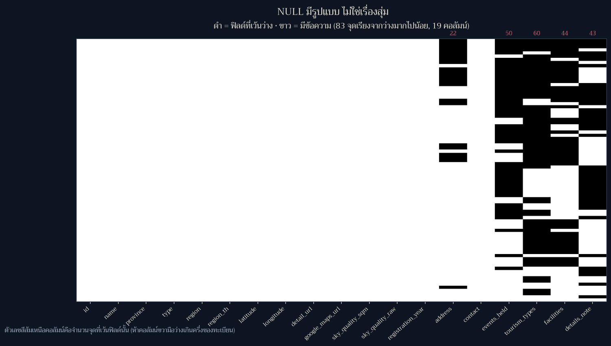
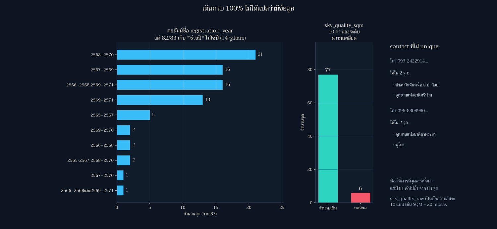
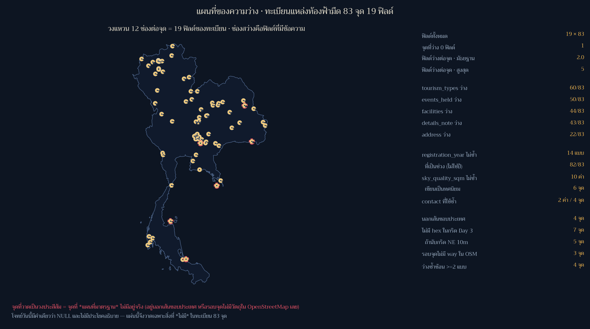

โจทย์ทางการวันนี้คือ **"NULL"** — และนั่นคือทั้งหมดที่เขาให้มา
ผมเปิดหน้า 30daymapchallenge.com สองครั้งเพื่อยืนยันว่าวันที่ 18-11-2026 มีแค่คำนั้นคำเดียว
**ไม่มีประโยคอธิบายเหมือนวันอื่น** โจทย์จึงเป็น NULL ด้วยตัวมันเอง ซึ่งเป็นวิธีเปิดเรื่องที่ยุติธรรมที่สุด

ผมอ่านโจทย์เป็นคำถามเดียว: **ในทะเบียนแหล่งท้องฟ้ามืด 83 จุดของไทย ความว่างหน้าตาเป็นอย่างไร**
และพบว่า NULL มีสามชนิดที่ไม่ควรพูดปนกัน

## ที่มาของแผนที่

ทะเบียน NARIT ที่ใช้มาตั้งแต่ Day 1 มี **83 จุด × 19 ฟิลด์ = 1,577 เซลล์** ผมอ่านไฟล์ด้วย
`keep_default_na=False` เพื่อให้ค่าว่างเป็น *สตริงว่างจริง ๆ* ไม่ถูก pandas แปลงเป็น NaN แล้วนับตกหล่น
(ถ้าให้ pandas แปลงเอง คอลัมน์ `registration_year` จะดูเหมือน "ครบ 100%" ทั้งที่ค่าข้างในไม่ใช่ปี)

ความว่างสามชนิดที่ผมวัด

| ชนิด | มันคืออะไร | วัดยังไง |
|---|---|---|
| NULL จริง | ฟิลด์ที่ไม่มีใครกรอก | นับเซลล์ที่ค่า (ตัดช่องว่างหัวท้าย) เป็นสตริงว่าง |
| NULL ที่แกล้งเป็นข้อมูล | ฟิลด์ที่เติมครบ 100% แต่ไม่ให้สิ่งที่ชื่อคอลัมน์สัญญา | นับรูปแบบไม่ซ้ำ / ระดับความละเอียด / ค่าที่ใช้ซ้ำ |
| NULL ที่แผนที่สร้าง | จุดทะเบียนที่แผนที่มาตรฐานไม่มีที่อยู่ | ตรวจกับ polygon, H3 fill และจำนวน way จาก Day 16 |

## ผลลัพธ์

### ๑. NULL จริง — 219 จาก 1,577 เซลล์ (13.89%)

ทั้งห้าคอลัมน์ที่ว่างอยู่คือคอลัมน์ "ข้อมูลเสริม" ทั้งหมด ส่วน 14 คอลัมน์หลักเติมครบ 100%

| คอลัมน์ | จุดที่เว้น | ร้อยละ |
|---|---|---|
| `tourism_types` | 60 จาก 83 | 72.3% |
| `events_held` | 50 จาก 83 | 60.2% |
| `facilities` | 44 จาก 83 | 53.0% |
| `details_note` | 43 จาก 83 | 51.8% |
| `address` | 22 จาก 83 | 26.5% |

ต่อจุด: **ต่ำสุด 0 · มัธยฐาน 2.0 · ค่าเฉลี่ย 2.639 · สูงสุด 5 ฟิลด์** (จาก 19)
มีจุดที่กรอกครบทุกฟิลด์เพียง **1 จุด** และมี **41 จุดที่ว่างตั้งแต่ 3 ฟิลด์ขึ้นไป**

**ความว่างไม่กระจายตัวสุ่ม — มันจัดกลุ่มตามสถานะที่ดิน**

| ผู้ถือครอง (ฟิลด์ `type`) | จำนวนจุด | ฟิลด์ว่าง · มัธยฐาน | ฟิลด์ว่าง · ค่าเฉลี่ย |
|---|---|---|---|
| อุทยานท้องฟ้ามืด | 25 | **3.0** | **3.2** |
| ชุมชนอนุรักษ์ | 2 | 4.0 | 4.0 |
| อุทยานแห่งชาติ | 2 | 2.5 | 2.5 |
| ที่ดินส่วนบุคคล | 43 | 2.0 | 2.395 |
| พื้นที่ชานเมือง | 10 | 2.0 | 2.1 |
| ส่วนบุคคล + ชุมชน | 1 | 2.0 | 2.0 |

จุดที่เป็น *อุทยานท้องฟ้ามืด* (สถานะที่ควรได้รับการดูแลมากที่สุด) เป็นกลุ่มที่กรอกข้อมูลน้อยที่สุด
(มัธยฐาน 3 ฟิลด์, ค่าเฉลี่ย 3.2) ส่วนที่ดินส่วนบุคคลซึ่งมีจุดมากที่สุดกลับกรอกดีกว่า (2.395)
นี่คือครั้งที่สามติดต่อกันที่ซีรีส์นี้เจอ pattern เดียวกัน — Day 16 พบว่าแผนที่รอบที่มืดที่สุดบางที่สุด
Day 17 พบว่าฟ้ากับแผนที่เดินคนละทาง และวันนี้ **ทะเบียนเองก็ว่างที่สุดตรงที่ฟ้าดีที่สุด**

### ๒. NULL ที่แกล้งเป็นข้อมูล — เติมครบ 100% ไม่ได้แปลว่ามีข้อมูล

**`registration_year`** เติมครบ 83/83 แต่ **82 ค่าเป็น *ช่วงปี* ไม่ใช่ปี** เช่น `พ.ศ. 2568 – 2570`
มีค่าเดียวที่เป็นปีเดี่ยว (`พ.ศ. 2564`) และเขียนได้ **14 รูปแบบ** ด้วยตัวคั่นที่ไม่เหมือนกันถึง 4 แบบ
(en dash 81 · hyphen 4 · คำว่า "และ" 2 · จุลภาคเพื่อต่อช่วง 19)
ชื่อคอลัมน์สัญญาข้อเท็จจริงอย่างหนึ่ง ข้อมูลให้ข้อเท็จจริงอีกอย่าง — ในเชิงความหมาย นี่คือ NULL
ที่ใส่ชุดมาเต็มยศ

**`sky_quality_sqm`** เติมครบ แต่ **77 จุดบันทึกเป็นจำนวนเต็ม (19, 20, 21, 22) ขณะที่ 6 จุดเป็นทศนิยม**
(20.50, 21.06, 21.10, 21.11, 21.28, 21.42) รวมแล้ว 10 ค่าไม่ซ้ำในคอลัมน์เดียว
ค่าที่พบมากที่สุดคือ `20` จำนวน 29 จุด (34.9%) — การเปรียบเทียบระหว่างจุดจึงทำได้แค่หยาบ
และจุดที่วัดละเอียดกว่าไม่ได้ "ดีกว่า" มันแค่ถูกบันทึกคนละแบบ

**`sky_quality_raw`** เติมครบ 100% เช่นกัน แต่เป็น **ข้อความอิสระ 10 แบบ** ที่ขึ้นต้นด้วย "SQM" ทั้ง 83 ค่า
(เช่น `SQM ~ 20 mpsas`) — ข้อมูลเดียวกับ `sky_quality_sqm` แต่ใส่ในรูปแบบที่เครื่องคำนวณต่อไม่ได้

**`contact`** เป็นฟิลด์ที่ชื่อชวนให้คิดว่ามีจุดละหนึ่งค่า แต่มี **81 ค่าไม่ซ้ำจาก 83 จุด**
คือมี 2 ค่าที่ถูกใช้ร่วมกัน 4 จุด — จุดทะเบียนสองคู่ใช้ช่องทางติดต่อเดียวกัน
(อ่านรายชื่อจุดได้จาก `day18_stats.json` under `fake_nulls.contact.examples`)

### ๓. NULL ที่แผนที่เป็นคนสร้าง

จุดที่ *มีอยู่จริงในทะเบียน* แต่ไม่มีที่อยู่บนแผนที่มาตรฐานที่ซีรีส์นี้ใช้ — และมันทับซ้อนกัน

| ความว่างแบบที่ | จำนวนจุด |
|---|---|
| พิกัดอยู่นอก polygon ประเทศไทยของ Natural Earth 10m | **4** |
| ไม่มี hex เป็นของตัวเองในกริด res 5 (นับตามกริด Day 3 ที่สร้างจาก GADM) | **7** |
| ไม่มี hex เป็นของตัวเอง (นับตามกริดที่เติมจาก Natural Earth 10m) | **5** |
| รอบจุด (1 กม.) ไม่มีวัตถุใน OpenStreetMap เลย (ต่อจาก Day 16) | **3** |
| **ว่างพร้อมกันตั้งแต่สองความหมายขึ้นไป** | **4** |

สี่จุดที่ว่างซ้ำซ้อนคือ `หอดูดาวเฉลิมพระเกียรติฯ สงขลา`, `อุทยานแห่งชาติเขาพระวิหาร`,
`เกาะพะลวยบีชบังกะโล`, `โซเนวา คีรี รีสอร์ท` — จุดแรกน่าสนใจที่สุดเพราะมัน **ไม่มีข้อมูลรอบตัวเลย**
ใน OSM ด้วย (way = 0) และอยู่ **นอกเส้นขอบประเทศ** ในไฟล์มาตรฐานด้วย:
ทะเบียนบอกว่ามีหอดูดาวแห่งหนึ่งอยู่ในประเทศไทย แต่แผนที่สองระบบที่ผมใช้ไม่ยอมรับว่ามันอยู่ข้างใน

นี่คือภาพที่วาดเป็น **วงประสีส้ม** บนแผ่นหลัก — จุดที่ผมจงใจไม่ใส่ marker เพราะ
"การไม่มีอยู่บนแผนที่" ควรถูกวาดเป็นการไม่มีอยู่ ไม่ใช่เป็นจุดสีดำเหมือนจุดอื่น

## วิธีทำแบบย่อ

1. อ่าน `data/darksky_thailand.csv` แบบ `keep_default_na=False` → นับสตริงว่าง (หลัง strip) ต่อเซลล์
2. นับต่อคอลัมน์ / ต่อจุด / ตามผู้ถือครอง (`type` ย่อตาม Day 12) / ตามภูมิภาค
3. วิเคราะห์ฟิลด์ที่เติมครบ: จำนวนรูปแบบไม่ซ้ำของ `registration_year`, ตัวคั่น,
   จำนวนเต็ม vs ทศนิยมของ `sky_quality_sqm`, ค่าซ้ำใน `contact`
4. คำนวณใหม่ (ไม่ลอก Day 14): จุดที่ `TH.contains(point)` ไม่เป็นจริง, จุดที่
   `h3.latlng_to_cell(..., 5)` ไม่อยู่ในกริด **ทั้งสองนิยาม** (Day 3 GADM และ NE 10m fill)
5. อ่าน `day16_sites_osm.csv` หาจุดที่ `ways == 0` → ตัดเซตหาจุดที่ว่างซ้ำซ้อน
6. วาดสามภาพ: matrix ความว่าง, แผง "แกล้งเป็นข้อมูล", และแผนที่วงแหวน 12 ช่องต่อจุด
   (ช่องสว่าง = ฟิลด์ที่มีข้อความ) + วงประสำหรับจุดที่แผนที่ไม่มีอยู่
7. ตรวจ: assert ว่าผลรวมความว่างต่อจุด = ต่อคอลัมน์ = ทั้งตาราง (219),
   assert ว่า 4 / 7 / 5 ตรงกับที่ Day 14 บันทึก, `lint_thai`, สแกน unicode ทั้งไฟล์

## ข้อจำกัดที่ต้องบอกตรง ๆ

* **"ว่าง" ในที่นี้หมายถึงสตริงว่าง** ผมไม่ได้ตรวจว่าค่าที่กรอกมา *จริง* หรือไม่
  เช่น `contact` ที่ซ้ำกันอาจเป็นการกรอกผิดหรือเป็นที่เดียวกันจริงก็ได้ — ผมรายงานความซ้ำ ไม่ได้ตัดสิน
* **ห้าคอลัมน์ที่ว่างมากอาจเป็น "ไม่ได้เก็บ" ไม่ใช่ "เก็บไม่ได้"** — ผมไม่รู้ว่าแบบฟอร์มของ NARIT
  บังคับหรือสมัครใจ ถ้าเป็นสมัครใจ อัตรา 72.3% คืออัตราการตอบแบบ ไม่ใช่คุณภาพท้องฟ้า
* **การเทียบผู้ถือครองมีกลุ่มตัวอย่างเล็กมาก** — ชุมชนอนุรักษ์ 2 จุด และอุทยานแห่งชาติ 2 จุด
  มัธยฐาน 4.0 กับ 2.5 ของกลุ่มละสองจุดไม่ใช่ข้อสรุป ผมรายงานไว้เพราะเป็นตัวเลขที่คำนวณได้
  ไม่ใช่เพราะมันมีความหมายทางสถิติ (ไม่ได้ทดสอบนัยสำคัญ)
* **ตัวเลข "4 / 7 / 5" ของจุดที่หายไปจากแผนที่ขึ้นกับต้นทางเส้นขอบ** — Day 3 ใช้ GADM
  วันนี้จึงรายงานทั้งสองนิยามแทนที่จะเลือกอันที่ดูดีกว่า
* **แผ่นนี้ไม่ใช่มุมมอง "ข้อมูลแย่"** — 14 จาก 19 คอลัมน์เติมครบ 100% และคอลัมน์ที่ขาด
  เป็นคอลัมน์ส่งเสริมการท่องเที่ยว ไม่ใช่คอลัมน์ที่จำเป็นต่อการทำแผนที่ ผมทำแผนที่นี้เพราะความว่างมีรูปแบบ ไม่ใช่เพราะทะเบียนแย่

## ไฟล์ประกอบ

* [day18_null.png](day18_null.png) — แผนที่วงแหวนความครบถ้วน 83 จุด + วงประสำหรับจุดที่แผนที่ไม่มีอยู่
* [day18_matrix.png](day18_matrix.png) — matrix 83 × 19 ของความว่าง เรียงจากจุดที่ว่างมากไปน้อย
* [day18_fake_nulls.png](day18_fake_nulls.png) — 14 รูปแบบของ `registration_year`, ความละเอียดปนกันของ SQM, `contact` ที่ซ้ำ
* [day18_null_sites.csv](day18_null_sites.csv) — ทุกจุด: จำนวนฟิลด์ว่าง, ฟิลด์ไหนว่าง, รูปแบบปี, ความละเอียด SQM, สถานะ "หายจากแผนที่"
* [day18_by_holder.csv](day18_by_holder.csv) — สรุปความว่างตามสภาพการถือครองที่ดิน
* [day18_stats.json](day18_stats.json) — ตัวเลขทุกตัว + `metric_definitions` + `cross_check_day14` / `cross_check_day16`

## บทเรียน

* **นับค่าว่างต้องอ่านแบบไม่ให้ pandas แปลงเอง** — ถ้าปล่อยให้เป็น NaN ผมจะนับไม่ตรง
  และที่สำคัญกว่านั้น *คอลัมน์ที่เต็มไปด้วยช่วงปีจะถูกเรียกว่า "ครบ 100%" โดยไม่มีใครสงสัย*
  `keep_default_na=False` + strip แล้วเทียบกับสตริงว่าง คือวิธีเดียวที่ได้ 219 ที่ถูกต้อง
* **assert ข้ามวันจับบั๊กของผมเองได้จริง** — ตอนแรกผม assert ว่า "จุดที่ไม่มี hex ต้องเป็น 5"
  ตามตัวเลขของ Day 14 แล้วมันพัง เพราะ Day 14 บันทึกไว้ **สอง** ตัวเลข (5 จากกริด NE 10m, 7 จากกริด GADM)
  ถ้าไม่มี assert นั้น ผมจะรายงาน 7 แล้วอ้างว่าตรงกับ 5 — และทั้งโพสต์จะผิดแบบที่ไม่มีใครจับได้
* **หมวดหมู่ "null" ทำให้ Quarto crash จริง** — ตอนแรกผมเขียน
  `categories: [30DayMapChallenge, ..., null]` โดยไม่ใส่อัญประกาศ YAML ก็แปลงคำนั้นเป็นค่าว่าง
  ตามความหมายของมันเอง แล้ว Quarto พังด้วย `Cannot read properties of null`
  ต้องแก้เป็น `"null"` แบบมีอัญประกาศ — วันที่ทำเรื่อง NULL เครื่องมือก็ล้มเพราะเรื่อง NULL เสียจริง
* **NULL ที่อันตรายที่สุดคือ NULL ที่เติมครบ** — เซลล์ว่างนั้นซื่อสัตย์ มันบอกว่า "ไม่มีข้อมูล"
  แต่ `registration_year` ที่เก็บช่วงปี 82 จาก 83 ค่า ทำให้ทุกโค้ดที่อ่านคอลัมน์นี้คิดว่าเป็นปี
  และจะได้คำตอบที่ผิดอย่างมั่นใจ
* **ความว่างมีรูปแบบ และรูปแบบนั้นคือข้อมูล** — ห้าคอลัมน์ที่ว่างล้วนเป็นคอลัมน์เสริม,
  จุดที่ว่างมากที่สุดคือจุดที่ฟ้าดีที่สุด, และจุดที่หายไปจากทะเบียนกับจุดที่หายไปจากแผนที่
  เป็นจุดกลุ่มเดียวกันสี่จุด นี่คือแผนที่ที่ *ควร* วาด: แผนที่ของตำแหน่งที่ระบบข้อมูลของเราไม่รู้จริง
