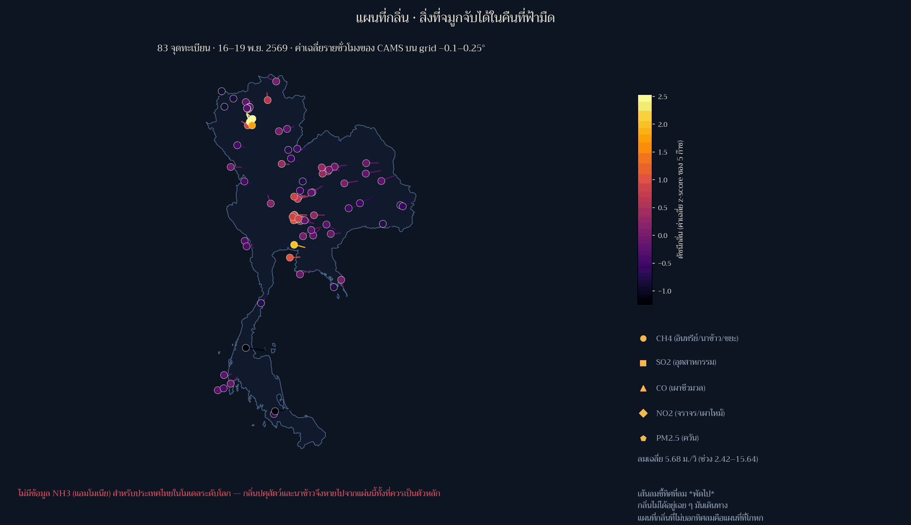
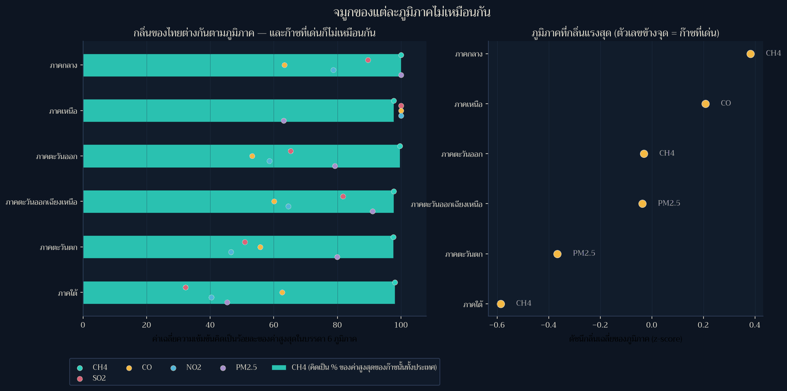
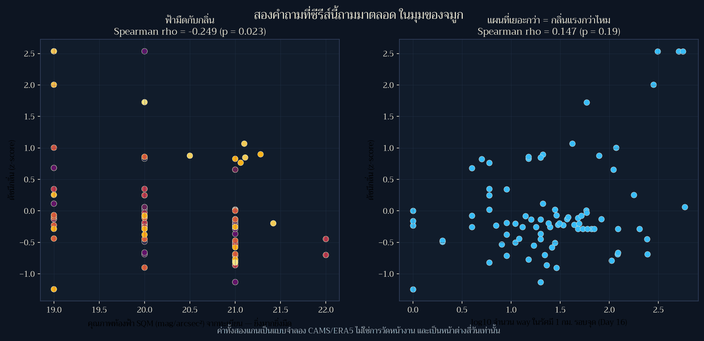

โจทย์ทางการวันนี้คือ **"How do you map things which your nose can sense? What does a smelly map look like?"**
(หัวข้อ *Senses: Smell* — ดึงข้อความมาจากหน้า 30daymapchallenge.com อ่านสดวันที่ 20 พ.ย.)
แผ่นนี้เขียนและเผยแพร่คืนวันที่ 19 ต่อเช้าวันที่ 20 ช้ากว่าวันของโจทย์ไม่กี่ชั่วโมง

**คำตอบสั้น**: แผนที่กลิ่นที่ซื่อสัตย์ต้องวาด *ก๊าซ* กับ *ลม* พร้อมกัน เพราะจมูกจับโมเลกุลที่ถูกพัดมา
ไม่ใช่จับตำแหน่งของแหล่งกำเนิด ผมจึงไม่ถามว่า "ที่ไหนมีของเหม็น" แต่ถามว่า
**ที่ which จุดที่เรานอนดูดาวยามวิกาล อากาศที่พัดมาถึงตัวเราพาโมเลกุลอะไรมา**

## ที่มาของแผนที่

Overpass ล่มอีกครั้งคืนนี้ (502 ทั้ง query) ผมจึงไม่ใช้แหล่งกำเนิดกลิ่นจาก OSM
แต่ใช้แบบจำลองบรรยากาศที่เรียกได้ตรง ๆ ว่า **CAMS ผ่าน Open-Meteo Air Quality API**
กับลมจาก **ERA5 ผ่าน Open-Meteo Archive API** ที่ 83 จุดทะเบียน ช่วง **16–19 พ.ย. 2569 (96 ชั่วโมง)**

| ก๊าซ | ทำไมมันคือ "กลิ่น" | เฉลี่ย 83 จุด (µg/m³) | ต่ำสุด | สูงสุด |
|---|---|---|---|---|
| CH4 (methane) | การย่อยสลายอินทรีย์ — นาข้าว บ่อขยะ คอกสัตว์ | 1,403.741 | 1,362.969 | 1,541.552 |
| SO2 (sulphur dioxide) | อุตสาหกรรม เชื้อเพลิงกำมะถัน กลิ่น "ไข่เน่า" | 3.527 | 0.716 | 9.780 |
| CO (carbon monoxide) | การเผาชีวมวล — ไร่อ้อย ฟาง ในฤดูเก็บเกี่ยว | 250.242 | 137.438 | 1,025.594 |
| NO2 (nitrogen dioxide) | จราจร การเผาไหม้อุณหภูมิสูง กลิ่น "คม" หลังฝน | 7.476 | 0.293 | 24.826 |
| PM2.5 | ควัน ซึ่งพาอนุภาคที่จมูกรับได้พร้อมปอด | 9.717 | 4.566 | 22.368 |

**ดัชนีกลิ่น** = ค่าเฉลี่ย z-score ของห้าก๊าซนี้ (z-score ทำให้ก๊าซที่หน่วยต่างกันมาบวกกันได้)
และ **ก๊าซเด่น** ของแต่ละจุดคือก๊าซที่มี z-score สูงสุดที่จุดนั้น ไม่ใช่ก๊าซที่มี µg/m³ สูงสุด
— ข้อนี้สำคัญ เพราะ CH4 มีพื้นหลังระดับพันหน่วย ส่วน SO2 มีหลักหน่วย
ถ้าเทียบดิบ ๆ ทุกจุดในประเทศจะ "เด่น CH4" ทั้งหมด ซึ่งเป็นคำตอบที่ผิดจากคำถามที่ผิด
(ผมทำผิดแบบนี้จริง ๆ ในรอบแรก แล้วแก้ — ดูหัวข้อ "สิ่งที่จับได้ระหว่างทาง" ด้านล่าง)

## ผลลัพธ์

**กลิ่นของไทยในสัปดาห์นั้นเป็นกลิ่นอะไร** — นับจาก 83 จุด

| ก๊าซที่เด่น | จำนวนจุด |
|---|---|
| CO (เผาชีวมวล) | **25** |
| PM2.5 (ควัน) | 20 |
| CH4 (อินทรีย์/นาข้าว/ขยะ) | 16 |
| SO2 (อุตสาหกรรม) | 12 |
| NO2 (จราจร/เผาไหม้) | 10 |

ดัชนีกลิ่นทั้งประเทศ: **ต่ำสุด −1.2448 · มัธยฐาน −0.1997 · สูงสุด 2.535**
ลมเฉลี่ย **5.682 ม./วิ** (ช่วง 2.419–15.636) — และเส้นลมในแผนที่ชี้ทิศที่ลมพัด*ไป* ไม่ใช่ทิศที่จุดนั้นหันไป

### ภูมิภาคที่จมูกต่างกัน

| ภูมิภาค | จุด | ดัชนีกลิ่นเฉลี่ย | ก๊าซเด่น | CO เฉลี่ย | PM2.5 เฉลี่ย | ลมเฉลี่ย |
|---|---|---|---|---|---|---|
| ภาคกลาง | 6 | **+0.383** | CH4 | 223.6 | 12.35 | 5.26 |
| ภาคเหนือ | 23 | +0.208 | **CO** | **353.0** | 7.79 | **3.07** |
| ภาคตะวันออก | 6 | −0.030 | CH4 | 187.5 | 9.78 | 5.63 |
| ภาคตะวันออกเฉียงเหนือ | 37 | −0.036 | PM2.5 | 212.2 | 11.24 | 6.93 |
| ภาคตะวันตก | 4 | −0.366 | PM2.5 | 196.5 | 9.87 | 5.27 |
| ภาคใต้ | 7 | **−0.586** | CH4 | 220.9 | 5.59 | **8.27** |

สองบรรทัดที่อธิบายตัวเอง: **ภาคเหนือมี CO สูงสุด (353.0 เทียบค่าเฉลี่ยทั้งประเทศ 250.2)
พร้อมลมเบสุด (3.07 ม./วิ)** — คือสูตรของคืนที่กลิ่นค้างอยู่นาน ส่วน
**ภาคใต้มีดัชนีกลิ่นต่ำสุด (−0.586) กับลมแรงสุด (8.27 ม./วิ)** — กลิ่นไม่ค้าง

### กลิ่นกับฟ้า: สัมพันธ์กันจริง (และทิศทางถูก)

**Spearman(ดัชนีกลิ่น, SQM) = −0.249 (p = 0.023)** — SQM สูงกว่า = ฟ้ามืดกว่า
เครื่องหมายลบแปลว่า **ที่ไหน ฟ้ามืดกว่า อากาศที่วัดได้มีกลิ่นน้อยกว่า** อย่างมีนัยสำคัญทางสถิติ
นี่คือครั้งแรกในซีรีส์ที่คำถาม "ฟ้ามืดกับสิ่งรอบตัว" ได้คำตอบที่ผ่านเกณฑ์นัยสำคัญ
(Day 16 ได้ −0.199 p = 0.072, Day 17 ได้ −0.199 เช่นกัน — คราวนี้ p ต่ำกว่า 0.05)

ส่วน **Spearman(ดัชนีกลิ่น, จำนวน way ใน OSM) = 0.147 (p = 0.186)** — ไม่มีความสัมพันธ์
แปลว่า "แผนที่เยอะ" ไม่ทำให้กลิ่นแรงขึ้นในสัปดาห์นี้ และผมรายงานตัวเลขที่ไม่มีความหมายนี้ไว้
เพราะมันคือคำตอบของคำถามที่ตั้งไว้ ไม่ใช่เลือกเฉพาะคู่ที่ตอบ

## สิ่งที่จับได้ระหว่างทาง (สองเรื่อง)

1. **คำถามผิดให้คำตอบที่ผิดอย่างมั่นใจ** — เวอร์ชันแรกผมจัดกลุ่มภูมิภาคด้วยค่า µg/m³ ดิบ
   แล้วได้ผลว่า *ทุกภูมิภาค* มี "ก๊าซเด่น" เป็น CH4 ทั้งหกกลุ่ม ซึ่งฟังดูสมเหตุสมผลมาก
   แต่เป็นคำตอบของคำถามที่ไม่มีอยู่จริง (CH4 พื้นหลัง 1,400 หน่วยชนะ SO2 ที่ 3 หน่วยเสมอ)
  พอกินค่าเป็น z-score จึงเห็นจริงว่าเหนือคือ CO กลางคือ CH4 ตะวันออกเฉียงเหนือคือ PM2.5
2. **แอมโมเนียไม่มีข้อมูล — และนั่นคือเรื่องใหญ่ของแผ่นนี้** — NH3 คือกลิ่นหลักของนาข้าว
   คอกสัตว์ และบ่อขยะ ซึ่งเป็นแหล่งที่ควรเจอที่สุดในไทย แต่ CAMS ระดับโลกคืนค่า
   `null` ทั้ง 96 ชั่วโมงที่ทุกจุดในไทย ผมจึงวาดแผนที่กลิ่นที่ *ขาดกลิ่นที่สำคัญที่สุดไป*
   และเขียนไว้บนหัวแผนที่แทนที่จะเงียบ

## วิธีทำแบบย่อ

1. `tools/collect_day19_smell.py` — เรียก Open-Meteo Air Quality (10 ตัวแปร, รายชั่วโมง, 16–19 พ.ย.)
   และ Archive (wind_direction_10m, wind_speed_10m) ที่ 83 จุด เก็บแคชรายจุดใน `cache/day19/`
2. แปลงแต่ละก๊าซเป็น z-score ข้าม 83 จุด → `smell_index` = ค่าเฉลี่ยห้า z, `signature` = ตัวที่สูงสุด
3. ทิศลมเฉลี่ยแบบ **เวกเตอร์** (แยกองค์ประกอบ u/v ถ่วงด้วยความเร็วแล้ว atan2) —
   เฉลี่ยเชิงมุมตรง ๆ จะพังเมื่อลมพัดสลับทิศ
4. เทียบกับซีรีส์: SQM จากทะเบียน, `ways` จาก Day 16, แล้ว Spearman ทั้งคู่
5. วาดสามภาพ: แผนที่ + เส้นลม, เทียบภูมิภาค (normalise รายก๊าซ), และ scatter สองคำถาม
6. ตรวจ: assert ว่าก๊าซหลักห้าตัวไม่มีค่าว่าง, assert ว่า mean(z) ≈ 0,
   assert ว่า **ต้องบันทึก NH3 ใน `no_data_variables`**, `lint_thai`, สแกน unicode

## ข้อจำกัดที่ต้องบอกตรง ๆ

* **ทั้งหมดคือแบบจำลอง ไม่ใช่การวัด** CAMS resolution ~0.1° (≈ 11 กม.) และ ERA5 ~0.25°
  จุดทะเบียนหลายจุดที่อยู่ใกล้กันจึงได้ค่า *ซ้ำกัน* — ผมเก็บ `grid_aq` / `grid_wind`
  ของ grid cell ที่ใช้ไว้ทุกแถวใน CSV เพื่อให้ตรวจสอบได้
* **ไม่ใช่หน่วยกลิ่นจริง** ในอุตสาหกรรมเขาวัด ou/m³ (odour units) ซึ่งต้องวัดหน้างาน
  `smell_index` เป็นเพียงการจัดอันดับเชิงเปรียบเทียบระหว่าง 83 จุดในช่วงเวลาเดียวกัน
* **หน้าต่างสี่วัน** 16–19 พ.ย. คือสภาพอากาศเฉพาะสัปดาห์ ถ้าเปลี่ยนสัปดาห์
  (โดยเฉพาะช่วงเผาไร่อ้อยกุมภาพันธ์–เมษายน) ลำดับภูมิภาคจะเปลี่ยน
* **ไม่มี NH3** ตามที่บอก และ `dust` เป็น 0 ทุกจุดทุกชั่วโมงในช่วงนี้
* **ไม่มีแหล่งกำเนิดกลิ่นจาก OSM** เพราะ Overpass ไม่ตอบคืนนี้ — แผ่นนี้จึงตอบ "อากาศพัดอะไรมา"
  ไม่ใช่ "อะไรอยู่ใกล้ ๆ" (สองคำถามนี้ต่างกัน และผมไม่ได้ทำอันหลัง)
* **p = 0.023 ที่ n = 83 ไม่ได้แปลว่า "ฟ้ามืดทำให้ไม่มีกลิ่น"** — อาจมีตัวแปรร่วม
  เช่นภาคใต้ที่ฟ้ามืดและลมแรงพร้อมกัน ผมรายงานสหสัมพันธ์ ไม่ได้สรุปสาเหตุ

## ไฟล์ประกอบ

* [day19_smell.png](day19_smell.png) — แผนที่กลิ่น 83 จุด พร้อมเส้นลมและก๊าซที่เด่น
* [day19_regions.png](day19_regions.png) — เทียบหกภูมิภาค (normalise รายก๊าซ) และดัชนีกลิ่นเฉลี่ย
* [day19_smell_vs_dark.png](day19_smell_vs_dark.png) — กลิ่นกับ SQM, กลิ่นกับจำนวน way (Day 16)
* [day19_smell_sites.csv](day19_smell_sites.csv) — ทุกจุด: ค่าก๊าซห้าชนิด, z-score, ดัชนี, ก๊าซเด่น, ทิศ/แรงลม, grid ที่ใช้
* [day19_by_region.csv](day19_by_region.csv) — สรุปตามภูมิภาค
* [day19_stats.json](day19_stats.json) — ตัวเลขทุกตัว + `metric_definitions` + `unavailable` (NH3/dust/grid)

## บทเรียน

* **อย่าเทียบตัวเลขข้ามหน่วย** — "ก๊าซที่เด่น" ด้วย µg/m³ ดิบคือกับดักที่ทำให้ทั้งประเทศตอบ CH4
  และมันดูถูกจนผมเกือบปล่อยไป การแปลงเป็น z-score ไม่ใช่เทคนิคสวยหรู มันคือวิธีเดียว
  ที่ถามคำถาม "อะไรเด่น *เมื่อเทียบกับจุดอื่น*" ได้
* **แผนที่กลิ่นต้องบอกทิศลม** — จุดที่กลิ่นแรงกับจุดที่ลมพัดผ่านกลิ่นแรงเป็นคนละที่กัน
  เส้นลมในแผ่นนี้จึงเป็นข้อมูล ไม่ใช่ของตกแต่ง และลมเฉลี่ยแบบเวกเตอร์ต่างจากเฉลี่ยเลขคณิต
  (ลม 350° กับ 10° เฉลี่ยเลขคณิตได้ 180° ซึ่งผิดไปครึ่งรอบ)
* **ข้อค้นพบที่ผ่านนัยสำคัญครั้งแรกของซีรีส์** — ฟ้ามืดกับอากาศสะอาดกว่ากัน
  (Spearman −0.249, p = 0.023) สอดคล้องกับ Day 16/17 ที่ว่าที่มืดที่สุดคือที่ที่คนอยู่น้อยที่สุด
  แต่ผมยังระวัง: n = 83 จุดที่เลือกโดยทะเบียน ไม่ใช่ตัวอย่างสุ่มของประเทศไทย
* **ข้อมูลที่ไม่ได้มาต้องพูดดัง ๆ** — NH3 หายไปทั้งคอลัมน์ และนั่นทำให้แผนที่นี้ *ไม่ใช่*
  แผนที่กลิ่นของนาข้าวและคอกสัตว์ทั้งที่ควรเป็น ผมเขียนไว้บนหัวแผนที่ เพราะแผนที่ที่เงียบเกี่ยวกับช่องว่างของตัวเอง คือแผนที่ที่ทำให้คนตัดสินใจผิดอย่างมั่นใจ
