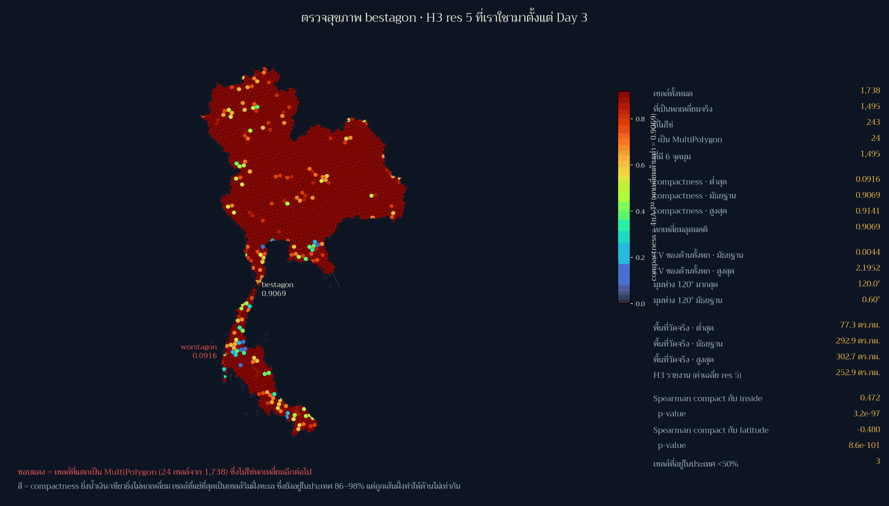
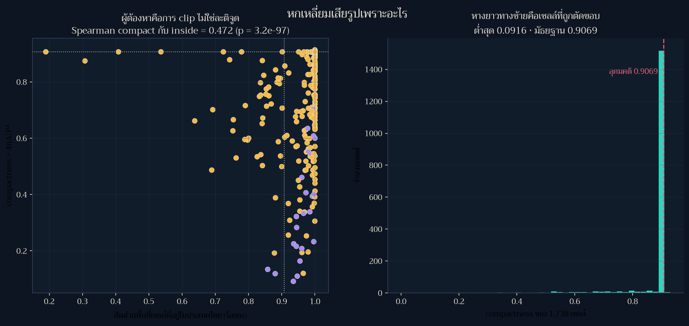
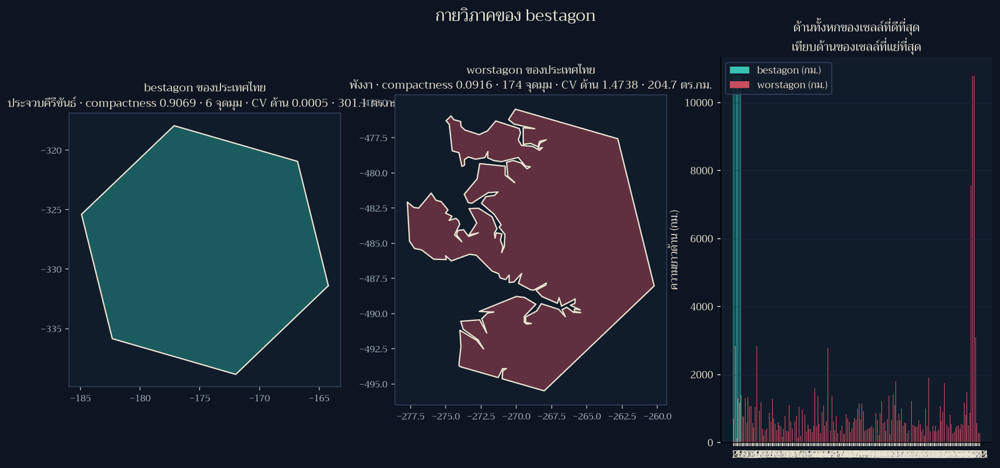

โจทย์ทางการวันนี้คือ **"Hexagons, the good old bestagons."** (หัวข้อ *Hexagons* — ดึงข้อความมาจาก
หน้า 30daymapchallenge.com อ่านสด 23:05 น. ของวันที่ 20 พ.ย.)

คำว่า "good old bestagons" ชวนให้ฉลองหกเหลี่ยม ผมขอทำอะไรที่ตรงข้ามกับการชม — **ตรวจสุขภาพมัน**
เพราะกริด H3 res 5 ชุดเดียวกันนี้คือพื้นของ Day 3, 9, 10, 11, 12, 13, 16, 18 ทั้งซีรีส์
ถ้ามันไม่ใช่อะไรที่ควรเชื่อ ผมควรต้องรู้

## ที่มาของแผนที่

วัดทุกเซลล์ของกริด Day 3 (**1,738 เซลล์**) ใน projection Equidistant Conic หน่วยเมตร
ไม่มีบริการภายนอกในคืนนี้ — เป็นเรขาคณิตล้วน

| ตัวชี้วัด | นิยาม | ค่าในอุดมคติ |
|---|---|---|
| compactness | 4πA ÷ P² | วงกลม = 1 · **หกเหลี่ยมด้านเท่ามุมเท่า = π√3/6 = 0.9069** |
| edge CV | ส่วนเบี่ยงเบนมาตรฐาน ÷ ค่าเฉลี่ย ของความยาวด้าน | 0 |
| angle deviation | ค่าสูงสุดของ |มุมภายใน − 120°| | 0° |
| parts / vertices | จำนวนชิ้นและจำนวนจุดมุม | 1 และ 6 |
| inside share | พื้นที่หลัง clip กับ Natural Earth 10m ÷ พื้นที่เซลล์เต็ม | — |

## ผลลัพธ์

### ๑. ส่วนใหญ่เป็นหกเหลี่ยมจริง — แต่ไม่ใช่ทั้งหมด

| | จำนวน |
|---|---|
| เซลล์ทั้งหมด | 1,738 |
| **ที่เป็นหกเหลี่ยมจริง** (1 ชิ้น, 6 จุดมุม, compactness ≥ 0.8969) | **1,495** |
| ที่ไม่ใช่หกเหลี่ยม | **243** |
|  ที่แตกเป็น MultiPolygon | **24** |
| ที่มี 6 จุดมุม | 1,495 |

ในบรรดา 1,495 เซลล์ที่ผ่านเกณฑ์ของจริง: **edge CV อยู่ระหว่าง 0.00053 ถึง 0.00829**
(median ทั้งกริด 0.00439) และ **มุมภายในห่างจาก 120° ไม่เกิน 1.177°** — นี่คือหกเหลี่ยมที่
เกือบสมบูรณ์แบบทางตัวเลข ฝั่งตรงข้ามคือ **edge CV สูงสุด 2.1952** และ
**มุมที่ห่างจาก 120° มากที่สุด 120.0°** (คือมีมุมที่พับกลับจนกลายเป็นเส้นตรง)

compactness ทั้งกริด: **ต่ำสุด 0.0916 · มัธยฐาน 0.90685 · สูงสุด 0.91411**

### ๒. ตัวชี้วัดที่ผมใช้ตอนแรกให้คำตอบผิด

นี่คือส่วนที่มีค่าที่สุดของแผ่นนี้ ถ้าจัดอันดับด้วย compactness อย่างเดียว
"bestagon" จะได้แก่เซลล์ `85416b9bfffffff` (สกลนคร) compactness **0.91411**
แต่เมื่อเปิดดูมันมี **9 จุดมุม** ไม่ใช่ 6 — เพราะรูปที่มีด้านมากกว่าจะ *กลมกว่า* เสมอ
และวงกลมคือเพดานของ compactness (1.0)

แปลว่า **compactness อย่างเดียววัด "ความกลม" ไม่ใช่ "ความเป็นหกเหลี่ยม"**
ผมจึงต้องนิยามใหม่: คัดเฉพาะเซลล์ที่เป็นหกเหลี่ยมจริง (1 ชิ้น 6 จุดมุม) แล้วเรียงด้วย
ความไม่สม่ำเสมอของด้าน ผลคือ bestagon ตัวจริงชื่อ

> **`85643277fffffff` — จังหวัดประจวบคีรีขันธ์ · edge CV 0.00053 · compactness 0.90690 ·
> มุมห่างจาก 120° มากที่สุด 0.072°**

ซึ่งคือหกเหลี่ยมด้านเท่ามุมเท่าเกือบสมบูรณ์ ต่างจากคำตอบแรกของผม 100%
(บันทึกทั้งการจัดอันดับแบบผิดและแบบถูกไว้ใน `day20_stats.json` under
`metric_warning`, `roundest_by_compactness`, `bestagon_by_equal_sides`)

### ๓. แล้วอะไรทำให้หกเหลี่ยมเสียรูป

| ความสัมพันธ์ (Spearman, n = 1,738) | rho | p-value |
|---|---|---|
| compactness กับสัดส่วนพื้นที่ที่อยู่ในประเทศ | **+0.472** | 3.2e-97 |
| compactness กับละติจูด | **−0.480** | 8.6e-101 |
| compactness กับ edge CV | −0.967 | ≈ 0 (ตรวจความสอดคล้องภายใน) |

ทั้งสองคำตอบถูกและมันไม่ตัดกัน: **เซลล์ที่ถูกเส้นขอบตัดยิ่งเสียรูป** และ **ยิ่งอยู่ไกลละติจูด
ศูนย์กลางของ projection ก็ยิ่งเสียรูป** (Equidistant Conic ของซีรีส์วาง standard parallels
ไว้ที่ 8°/20° ดังนั้นยิ่งไปทางใต้ของประเทศไทยยิ่งบิด)

แต่เคสที่สอนใจที่สุดคือ **worstagon**: `85643153fffffff` จังหวัดพังงา compactness **0.0916**
มี **3 ชิ้น** และ **174 จุดมุม** ทั้งที่ **93.5% ของพื้นที่ยังอยู่ในประเทศไทย**
แปลว่า "ถูกตัด" ไม่ใช่เรื่องเลวร้ายเท่า "ถูกตัดด้วยเส้นฝั่งทะเลที่หยัก" — เซลล์นี้ยังเป็นที่ของ
`อธิการ์เด้นแคมป์ปิ้ง` ในการจับคู่ของ Day 3 แต่รูปทรงของมันไม่ใช่อีกต่อไป

### ๔. ของแถม: พื้นที่จริงของ H3 res 5 ในไทย

H3 รายงานว่า res 5 มีพื้นที่เฉลี่ย **252.904 ตร.กม.** (ค่าเฉลี่ยทั้งโลก)
แต่ที่วัดจริงในกริดนี้: **ค่าเฉลี่ย 285.884 · ต่ำสุด 77.333 · สูงสุด 302.666 ตร.กม.**
คือใหญ่กว่าค่าเฉลี่ยที่ไลบรารีรายงานราว **13%** — ถ้าเคยใช้ตัวเลข nominal ไปคำนวณความหนาแน่น
ต่อตารางกิโลเมตร ควรใช้ตัวเลขที่วัดจริงแทน (Day 14 เจอแบบนี้แล้วครั้งหนึ่ง)
และ 3 เซลล์ที่มีพื้นที่ในประเทศต่ำกว่า 50% ตรงกับที่ Day 15 นับได้ — ตรวจแล้วตรงกัน

## วิธีทำแบบย่อ

1. อ่านกริด Day 3 → แปลงเป็น Equidistant Conic (เมตร) ทั้งพื้นที่ เส้นรอบวง ด้าน และมุม
2. compactness = 4πA/P² · edge CV = SD ÷ mean ของด้าน · angle deviation = |มุม − 120°| สูงสุด
3. clip กับ Natural Earth 10m → inside share (วิธีเดียวกับ Day 15)
4. จัดอันดับสองครั้ง: ครั้งแรกด้วย compactness อย่างเดียว (ได้คำตอบผิด)
   ครั้งที่สองคัดเฉพาะ 1 ชิ้น/6 จุดมุมแล้วเรียงด้วย edge CV (ได้ bestagon จริง)
5. Spearman กับ inside share, ละติจูด, และ edge CV
6. ตรวจ: assert ว่า compactness ≤ 1 · มัธยฐานต้องใกล้ 0.9069 ·
   parts=1 กับ vertices=6 ต้องนับได้ 1,495 เท่ากัน · MultiPolygon ต้อง 24 ·
   cells_below_half_inside ต้องเท่ากับ 3 ที่ Day 15 รายงาน

## ข้อจำกัดที่ต้องบอกตรง ๆ

* **การวัดด้าน/มุมของ MultiPolygon ใช้เฉพาะชิ้นที่ใหญ่ที่สุด** จึงเห็นได้ว่าการเรียงด้วย
  compactness ยังให้รางวัลกับเซลล์ที่ "กลมเพราะมีหลายด้าน" — ผมเจอข้อนี้หลังรันครั้งแรก
  และเขียนวิธีแก้ไว้แทนที่จะปล่อยผ่าน
* **projection มีผลต่อการวัดรูปทรง** ทุกตัวเลขเป็นเมตรใน Equidistant Conic ที่ standard
  parallels 8°/20° ถ้าเปลี่ยน projection ค่า compactness จะขยับ (นี่คือเหตุผลที่
  rho กับละติจูดไม่เป็นศูนย์ — บางส่วนคือความผิดของแผนที่ผม ไม่ใช่ของ H3)
* **`angle_dev_max = 120.0°`** หมายความว่าบางเซลล์มีมุมที่กลับทิศจนเป็นเส้นตรง
  ซึ่งมักเป็น artifact ของการ clip ไม่ใช่รูปทรงจริงของสนาม
* **พื้นที่ 77.333 ตร.กม. (ต่ำสุด) เป็นเซลล์ที่ถูกตัดจนเล็ก** ไม่ใช่เซลล์ที่ H3 สร้างเล็ก
* **แผ่นนี้ไม่เกี่ยวกับความมืดของฟ้าเลย** — เป็นแผ่นที่ตรวจเครื่องมือของตัวเอง
  ซึ่งผมคิดว่าจำเป็นกว่าการทำ hexmap สวย ๆ อีกแผ่น

## ไฟล์ประกอบ

* [day20_bestagon.png](day20_bestagon.png) — แผนที่ compactness ของ 1,738 เซลล์ พร้อมขอบแดงที่ MultiPolygon
* [day20_causes.png](day20_causes.png) — compactness กับ inside share และการกระจายทั้งกริด
* [day20_anatomy.png](day20_anatomy.png) — กายวิภาค bestagon เทียบ worstagon (ด้านทั้งหก)
* [day20_hexagons.csv](day20_hexagons.csv) — ทุกเซลล์: parts, vertices, compactness, edge CV, angle dev, พื้นที่, inside share
* [day20_stats.json](day20_stats.json) — ตัวเลขทั้งหมด + `metric_warning` + การจัดอันดับสองแบบ

## บทเรียน

* **ตัวชี้วัดที่ "ใช้ได้กับทุกอย่าง" มักไม่ตอบคำถามที่ตั้งไว้** — compactness เป็นตัวเลขที่ดี
  แต่มันตอบว่า "กลมแค่ไหน" ไม่ใช่ "หกเหลี่ยมแค่ไหน" และมันตอบแบบนั้นอย่างมั่นใจ
  ด้วยค่าสูงสุด 0.91411 ที่จริงแล้วคือรูปเก้าด้าน ถ้าผมไม่เปิดดูจำนวนจุดมุมของเจ้าของรางวัล
  ทั้งโพสต์จะยกให้เซลล์ผิดตัว
* **ตรวจคำตอบของอันดับด้วยตาตัวเองหนึ่งเคสเสมอ** — ผมเสียเวลาสามสิบวินาทีเปิดดูว่า
  bestagon ที่ได้ว่ามีกี่มุม แล้วทั้งแผ่นเปลี่ยน direction
* **เครื่องมือที่ใชามาสิบเจ็ดวันควรได้รับการตรวจสุขภาพ** — กริดเดียวกันนี้ผมใช้ทำแผนที่มา
  เกือบทั้งซีรีส์โดยไม่เคยถามว่าเซลล์ของมันมีกี่ด้าน วันนี้รู้ว่า 243 เซลล์จาก 1,738
  ไม่ใช่อะไรที่ควรเรียกว่าหกเหลี่ยม และ 24 เซลล์แตกเป็นชิ้น
