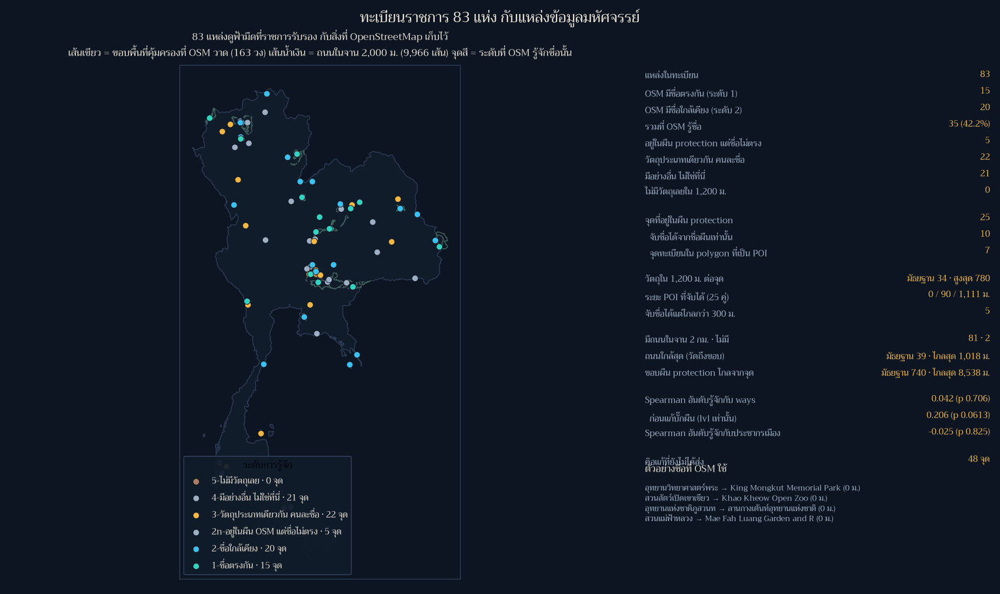
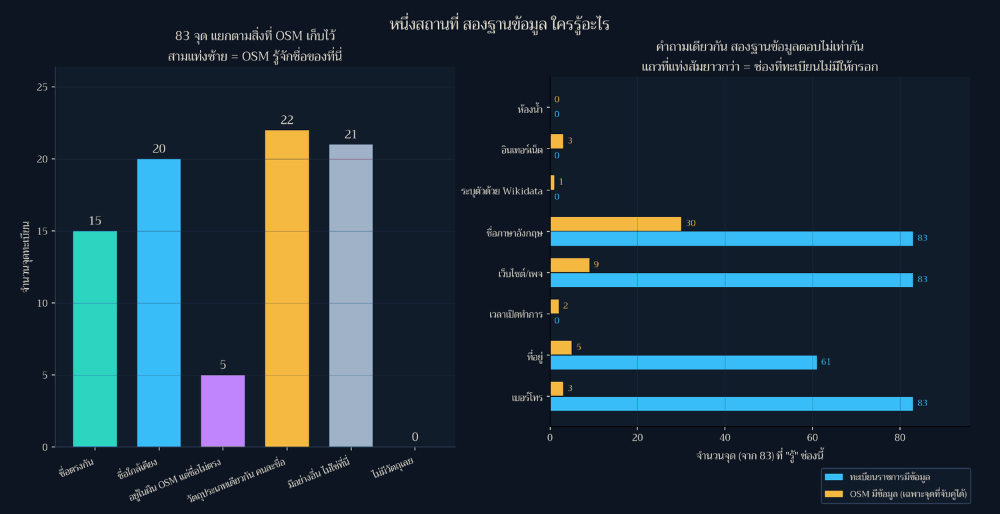
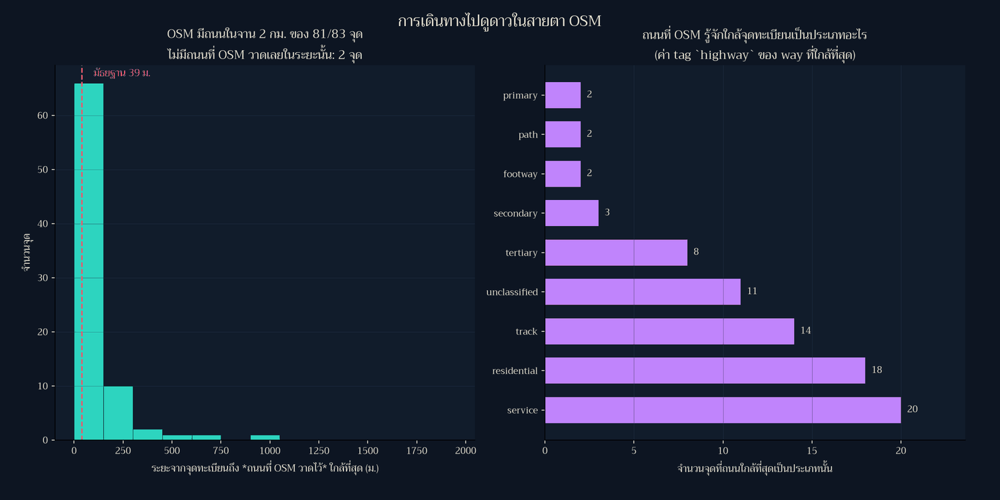

โจทย์ทางการวันนี้คือ **"The awesome data source for mapping. You can also use this day to edit OSM."**
(หัวข้อ *OpenStreetMap* — ดึงข้อความมาจากหน้า 30daymapchallenge.com อ่านสด 19:12 น. ของวันที่ 21 พ.ย.)

สองประโยคนั้นเปิดทางคนละทิศ ประโยคแรกชวนใช้ OSM เป็นแหล่งข้อมูล ประโยคหลังชวน *แก้* มัน
ผมทำประโยคแรกจนจบ ส่วนประโยคหลังผมเตรียมไว้เป็นไฟล์แต่**ไม่ได้ส่งขึ้นระบบ** — เหตุผลอยู่ท้ายโพสต์

คำถามที่ผมถาม OSM คืนนี้: **ทะเบียนแหล่งดูฟ้ามืดของประเทศไทยมี 83 แห่งที่ราชการรับรอง
แล้ว OpenStreetMap รู้จักกี่แห่ง?**

## ที่มาของข้อมูล (คืนนี้ต่างจากทุกวันที่ผ่านมา)

แผนวันแรกคือยิง Overpass API แบบ Day 16 แต่ตั้งแต่ 19:15 น. ทุก mirror ตอบ 502/504 ต่อเนื่อง
`overpass-api.de`, `maps.mail.ru`, `overpass.kumi.systems`, `overpass.private.coffee` ล้มพร้อมกัน
(มีคนทำ Day 21 ทั่วโลกพร้อมกันพอดี) ผมจึงเปลี่ยนไปใช้เส้นทางที่คนที่ทำงานกับ OSM ทั้งประเทศใช้:
ดาวน์โหลดไฟล์ extract ของประเทศไทยจาก Geofabrik มาอ่านในเครื่อง

| | ค่า |
|---|---|
| ไฟล์ | `thailand-latest.osm.pbf` จาก Geofabrik |
| ขนาด | 330,640,775 ไบต์ |
| md5 | `db3958a037ce717c462101b86e2f75f3` |
| ข้อมูลในไฟล์มีถึง | 21 พ.ย. 2026 01:00 GMT (HTTP Last-Modified) |
| จำนวน object ที่อ่าน | node 44,124,360 · way 5,303,991 · relation 25,842 |
| สิ่งที่ได้จากจาน 2,000 ม. รอบ 83 จุด | node ที่มีแท็ก 1,963 · way 16,353 · relation 139 |
| วัตถุที่นำมาวัดระยะจริง | 14,120 ชิ้น |

สองอย่างที่ Overpass ให้ไม่ได้ในรูปแบบนี้: **แท็กทั้งหมด**ของวัตถุ
และ **geometry จริงของ way** — Day 16 วัดระยะจาก *จุดศูนย์กลางของ way* ซึ่งทำให้ way ยาว
อย่างถนนสายเดียวถูกนับว่า "อยู่ใกล้" ทั้งที่เส้นของมันลากผ่านไปไกล
คืนนี้ผมวัดจากจุดทะเบียนไปถึง **ขอบวัตถุที่ใกล้ที่สุด** ใน projection Equidistant Conic หน่วยเมตร
เดียวกับการ์ดวันอื่นทั้งซีรีส์

| นิยาม | ความหมายที่ใช้ในโพสต์นี้ |
|---|---|
| จานสแกน | รัศมี 2,000 ม. รอบจุดทะเบียน (วัตถุแตะจาน = เข้าชุดข้อมูล) |
| ระยะจับคู่ | ภายใน 1,200 ม. จึงนับว่า "วัตถุนี้อยู่ที่นี่" |
| ระยะประเภทรายวัน | ภายใน 300 ม. จึงนับว่ามีวัตถุประเภทที่พัก/แหล่งเที่ยวอยู่ตรงนั้นจริง |
| การจับชื่อ | 4 การทดสอบเรียงความเข้ม: ชื่อไทยตรงกันทุกตัวอักษร · รูปละตินของ slug จาก URL ทางการตรงกับชื่อใน OSM · คำหลักละตินตรงกันเกินครึ่ง · ความคล้ายลำดับตัวอักษร ≥ 0.78 |
| เพดานระยะแยกตามหลักฐาน | ชื่อเต็มตรง = ได้ถึง 1,200 ม. · คล้ายตามตัวอักษร = ถึง 600 ม. · คำหลักตรงกัน = ถึง 400 ม. |

เพดานสามค่าไม่ได้มาจากการคิดเอาเอง ผมตั้งหลัง**ตรวจคู่ชื่อทุกคู่ด้วยตา** —
กลไกนี้ตัดทิ้ง **23 คู่จาก 7 จุด** ที่ชื่อคล้ายแต่ไกลเกินเพดาน
เช่น "สิริน วิลล์ แม่ริม เชียงใหม่" ที่ไปชนกับ *Mae Rim Highway Office* คนละสถานที่
ที่ระยะ 1,041.0 ม. (คู่ที่ถูกตัดทั้งหมดพร้อมระยะเก็บไว้ใน `day21_stats.json`
ใต้ `false_positives_rejected` ไกลสุด 1,158.5 ม. และคู่ที่ผ่านเกณฑ์ทั้งหมดอยู่ใน
`day21_sites_osm.csv`)

## ผลลัพธ์: OSM รู้จัก 35 จาก 83 แห่ง

| ระดับ | จำนวน |
|---|---|
| 1 · ชื่อตรงกัน (พิสูจน์ได้จากตัวชื่อ) | **15** |
| 2 · ชื่อใกล้เคียง | **20** |
| **รวมที่ OSM รู้ชื่อ** | **35 (42.17%)** |
| 2n · อยู่ในผืนที่ OSM วาด แต่ชื่อไม่ตรงกับทะเบียน | 5 |
| 3 · มีวัตถุประเภทเดียวกันใน 300 ม. แต่คนละชื่อ | 22 |
| 4 · มีวัตถุอื่นใน 1,200 ม. แต่ไม่ใช่ที่นี่ | 21 |
| 5 · ไม่มีวัตถุเลยใน 1,200 ม. | **0** |

ตัวเลข 0 ในแถวสุดท้ายคือของจริงที่เพิ่งเป็นจริงตอนสองทุ่มกว่า — ดูหัวข้อ "บั๊กสองชั้น" ข้างล่าง

เมื่อแยกตามประเภทแหล่ง คำตอบน่าสนใจกว่าค่ารวมมาก:

| ประเภทแหล่งในทะเบียน | จุด | OSM รู้จักชื่อ | อยู่ในผืนคุ้มครองที่ OSM วาด |
|---|---|---|---|
| อุทยานท้องฟ้ามืด (อุทยานแห่งชาติ/อุทยานวิทยาศาสตร์) | 25 | 18 (72%) | 16 |
| เขตอนุรักษ์ท้องฟ้ามืดในพื้นที่ชานเมือง | 10 | 5 (50%) | 1 |
| เขตอนุรักษ์ท้องฟ้ามืดในพื้นที่ส่วนบุคคล | 43 | 11 (25.6%) | 7 |
| ชุมชนอนุรักษ์ท้องฟ้ามืด | 2 | 0 | 0 |

**OSM รู้จักสถานที่ที่เป็นสถาบันมากกว่าที่เป็นธุรกิจส่วนตัว** —
อุทยานแห่งชาติมีชื่อใน OSM ถึง 72% แต่ลานกางเต็นท์/รีสอร์ตส่วนบุคคลมีแค่ 25.6%
ซึ่งสมเหตุสมผลกับธรรมชาติของแหล่งข้อมูลนี้: คนที่ map พื้นที่ส่วนบุคคลคือคนที่ไปที่นั่น
และชุมชน mapper ไทยยังไม่ได้ไปที่นั่นกันมาก

## บั๊กสองชั้น ที่เกือบทำให้ผมเขียนอะไรที่ไม่จริง

รันแรกสุดผมได้ class 5 = 2 จุด คือ **อุทยานแห่งชาติเขาใหญ่** กับ
**ทุ่งโนนป่าก่อ เขตรักษาพันธุ์สัตว์ป่าภูสีฐาน** (มุกดาหาร) ถ้าผมโพสต์ตอนนี้ ผมจะเขียนว่า
"OSM ไม่มีอะไรเลยรอบเขาใหญ่ในระยะ 1,200 ม." ซึ่ง**เท็จ** — เพราะรันที่สองที่สแกน polygon
ทั้งประเทศพบผืน `อุทยานแห่งชาติเขาใหญ่` (relation 2971358) เนื้อที่ **1,360.145 ตร.กม.**
ห่อจุดทะเบียนอยู่นั่นเอง แค่เส้นขอบของมันอยู่ไกลกว่าจาน 2 กม. ที่ผมสแกนรอบแรก

ชั้นที่ 1 — ขอบเขตใหญ่กว่าจานสแกน: จาน 2,000 ม. เก็บเฉพาะ node/way ที่ *แตะ* จาน
เส้นขอบอุทยานแห่งชาติซึ่งอยู่ไกลกว่านั้นจึงหลุดไปทั้งผืน ผมจึงสแกนเพิ่มอีกไฟล์หนึ่ง
(`collect_day21_polygons.py`) เก็บทุก relation/way ที่เป็นพื้นที่คุ้มครอง
ประกอบเป็นรูปหลายเหลี่ยมแล้วถามว่า **จุดทะเบียนอยู่ภายในผืนไหน** ด้วย STRtree
ผล: มี **25 จุดทะเบียนที่อยู่ในผืนที่ OSM วาดไว้** (เส้นขอบ 163 วงที่วาดลงแผนที่)
class 5 กลายเป็น 0 ทันที และ **10 จุดในจำนวนนั้นจับชื่อได้ผ่านชื่อผืนเท่านั้น**
เพราะรอบตัวมันไม่มี POI ที่ชื่อตรงเลย — ระยะจากจุดทะเบียนไปหาขอบผืน protection ที่ใกล้ที่สุด
มัธยฐาน **740.2 ม.** และไกลที่สุดที่วัดได้ในจาน 10 กม. คือ **8,537.9 ม.** (ต่ำสุด 0 ม.
คือจุดที่อยู่บนเส้นขอบพอดี)

ชั้นที่ 2 — ค่าที่ผมใช้กรอง "พื้นที่คุ้มครอง" ก็ผิดต่อประเทศไทย: รอบแรกผมรับเฉพาะ
`boundary=protected_area` ตามที่คู่มือ OSM สอนไว้ แต่ในไฟล์จริงวิธีนั้นเห็นเพียง
**121 จาก 1,139** relation ที่เป็นพื้นที่คุ้มครอง อีก **1,018** ตัวถูกมองข้าม
โดยแยกเป็น `landuse=forest` 815 · `boundary=national_park` 122 · `leisure` 85 ·
`natural` 20 · `tourism` 3 (รวมแล้วมากกว่า 1,018 เพราะหนึ่ง relation ถือได้หลายคีย์)
หลักฐานชัดที่สุดคือ **อุทยานแห่งชาติเขาใหญ่ = relation 2971358** ซึ่งใส่
`boundary=national_park` (ค่าเก่า) ไม่ใช่ `protected_area` พร้อม `name:en`
= *Khao Yai National Park*, `operator` = กรมอุทยานแห่งชาติ สัตว์ป่า และพันธุ์พืช,
`wikidata` = `Q386420` และเนื้อที่ที่ OSM วาดไว้ **1,360.145 ตร.กม.**
พอยอมรับค่าได้หลายแบบ polygon ที่ประกอบได้เพิ่มเป็น 17,948 ผืนฝั่ง way กับ
1,137 ผืนฝั่ง relation · บันทึกที่ได้จากการทดสอบ contains ทั้งหมด 122 คู่ (จุด×ผืน)
ในจำนวนนั้น 42 คู่เป็น "จุดอยู่ภายในผืน" จริง
(ตัวเลขชุดนี้ นับจาก `prot_ways.json.gz` ที่สคริปต์สแกนไว้ ไม่ใช่ประมาณการ —
ดู `filter_probe` ใน `day21_stats.json`)

บั๊กนี้ไม่ใช่เรื่องจัดป้ายผิดเฉย ๆ — มัน**เปลี่ยนข้อสรุปทางสถิติ**
ความสัมพันธ์ระหว่าง "ระดับที่ OSM รู้จัก" กับ "จำนวน way รอบจุดจาก Day 16"

| ช่วง | Spearman (rho) | p-value |
|---|---|---|
| ก่อนสแกนผืน protection (10 จุดยังถูกนับว่า "ไม่รู้จัก") | 0.206 | 0.061 |
| หลังแก้แล้ว (นับชื่อจากผืน protection ด้วย) | 0.029 | 0.796 |
| ใช้ 6 ระดับเป็นอันดับ (0–5) หลังแก้ | 0.042 | 0.706 |

ก่อนแก้ ผมเกือบเขียนว่า "ยิ่งชุมชน map แถวนั้นหนาแน่น OSM ยิ่งรู้จักสถานที่นี้ (ใกล้จะมีนัยสำคัญ)"
หลังแก้ คำตอบคือ **ไม่มีความสัมพันธ์** — เพราะ 10 จุดที่ผมเพิ่งรู้ว่า OSM รู้จักผ่านชื่อผืนล้วนเป็นอุทยานที่อยู่ห่างไกล
ซึ่งมี way น้อยมาก (ค่ามัธยฐานของ ways ที่กลุ่มจับชื่อไม่ได้อยู่ที่ 24.5 เส้น
กลุ่มที่จับชื่อได้ตรงอยู่ที่ 18.0 เส้น) การนับกลุ่มผิดจึงดึงค่าสหสัมพันธ์ขึ้นทั้งดุ้น

ข้อที่สองที่น่าอายพอกัน: ค่ามัธยฐานของระยะคลาดระหว่างสองแหล่ง (POI 25 คู่ที่วัดได้)
คือ **90.1 ม.** ค่าเฉลี่ย 158.5 ม. และไกลสุด **1,110.9 ม.** (กรณีอุทยานแห่งชาติผาแต้ม
ที่ทะเบียน point ไปตั้งคนละจุดกับ POI ใน OSM ทั้งที่ชื่อตรงกันทุกตัวอักษร)
มี 5 คู่ที่จับชื่อได้แต่ไกลเกิน 300 ม. — คือ "รู้ว่ามีที่นี่ แต่ไม่รู้ว่าตรงไหน"
ส่วนจุดทะเบียนที่ *ตกลงไปอยู่ใน* polygon ที่ OSM วาดเป็น POI โดยตรงมี 7 จุด

## หนึ่งสถานที่ สองฐานข้อมูลรู้ไม่เท่ากัน

นับเฉพาะช่องที่เทียบกันได้จริง (ฝั่ง OSM นับจากวัตถุที่จับคู่ได้):

| ช่องข้อมูล | ทะเบียนมี | OSM มี | มีทั้งสอง | ทะเบียนอย่างเดียว | OSMอย่างเดียว | ไม่มีสักแหล่ง |
|---|---|---|---|---|---|---|
| เบอร์โทร | 83 | 3 | 3 | 80 | 0 | 0 |
| ที่อยู่ | 61 | 5 | 5 | 56 | 0 | 22 |
| ชื่อภาษาอังกฤษ | 83 (จาก slug ใน URL) | 30 | 30 | 53 | 0 | 0 |
| เว็บไซต์/เพจ | 83 (URL ของ NARIT) | 9 | 9 | 74 | 0 | 0 |
| เวลาเปิดทำการ | 0 (ไม่มีช่องนี้) | 2 | 0 | 0 | 2 | 81 |
| ระบุตัวตนด้วย Wikidata | 0 (ไม่มีช่องนี้) | 1 | 0 | 0 | 1 | 82 |
| อินเทอร์เน็ต | 0 (ไม่มีช่องนี้) | 3 | 0 | 0 | 3 | 80 |
| ห้องน้ำ | 0 (ไม่มีช่องนี้) | 0 | 0 | 0 | 0 | 83 |

อ่านตารางนี้ทางแนวนอนก็ได้สองบทเรียน:

* **ทะเบียนราชการรู้ "จะติดต่ออย่างไร" ส่วน OSM รู้ "ที่นี่เปิดเมื่อไร มี Wi-Fi ไหม"**
    ช่องที่ทะเบียนไม่มีให้กรอกเลย (เวลาเปิด · Wikidata · อินเทอร์เน็ต · ห้องน้ำ) OSM มีข้อมูลบ้าง
    และช่องที่ OSM แทบไม่มีเลย (เบอร์โทร 3 จาก 35 จุดที่จับได้) ทะเบียนมีครบ 83
* **ไม่มีแหล่งไหน "ครบ"** — ช่องที่อยู่มีในทะเบียน 61 จุด แต่ใน OSM มีเพียง 5
    และ 22 จุดที่ไม่มีที่อยู่จากไหนเลย ซึ่งตรงกับที่ Day 18 นับช่องว่างในทะเบียน (null 219 จาก 1,577 ช่อง)

คีย์ที่ถูกใช้มากที่สุดบนวัตถุที่จับคู่ได้: `name` 32 · `name:en` 30 · `tourism` 15 · `website` 9 ·
`addr:postcode` 7 · `leisure` 5 · `email` 4 · `addr:housenumber` 4 · `name:th` 4

## และถ้าจะขับรถไปดูดาว OSM พาไปได้ไหม

วัดจาก geometry ของ way ที่เป็น `highway` จริง (ไม่ใช้จุดศูนย์กลางแบบ Day 16):

* **81 จาก 83 จุด** มีถนนที่ OSM วาดไว้ภายในจาน 2,000 ม. อีก 2 จุดไม่มีเลย
* ระยะจากจุดทะเบียนไปถึงถนนใกล้ที่สุด: **มัธยฐาน 39.3 ม. · ค่าเฉลี่ย 94.1 ม. · ไกลสุด 1,017.8 ม.**
    มี 1 จุดที่ไกลเกิน 1,000 ม.
* ประเภทของถนนที่ใกล้ที่สุด: `service` 20 · `residential` 18 · `track` 14 · `unclassified` 11 ·
    `tertiary` 8 · `secondary` 3 · `footway` 2 · `path` 2 · `primary` 2

หมวด `track` (ทางลูกรัง/ทางเข้าไร่) 14 จุดกับ `service` 20 จุดคือคำตอบของคำถามที่ตั้งไว้ตั้งแต่ต้น
ว่า OSM ใช้เดินทางได้จริงไหม — สำหรับแหล่งดูฟ้ามืด คำตอบคือ "พาไปถึงหน้าปากทาง
แล้วแต่ว่าคุณกล้าขับตามทางลูกรังในแอป map ที่ใช้ข้อมูล OSM ต่ออีกกี่กิโล"

## ประโยคที่สองของโจทย์: "you can also use this day to edit OSM"

สคริปต์นี้**ไม่ล็อกอิน ไม่ส่ง changeset** เข้า OpenStreetMap แม้แต่ครั้งเดียว
สิ่งที่ทำแทนคือไฟล์ `day21_edit_queue.csv` ที่มี **48 จุด** = 83 จุดในทะเบียนลบด้วย
35 จุดที่จับชื่อได้ พร้อมคอลัมน์ `suggestion`
(เบอร์โทรที่ดึงจากช่อง contact ของทะเบียนผม **mask เป็น `0xx-xxx-xxxx` ในไฟล์ที่ลง repo**
เพราะการใส่ `phone` เข้า OSM ต้องมีการยืนยันจากภาคพื้นที่ก่อน การปล่อยตัวเลขทั้งก้อนให้คนดาวน์โหลดไปยิงใส่ระบบจึงไม่ควรค่าเริ่มต้น — ไฟล์เต็มที่ยังไม่ mask
เก็บไว้ในเครื่องเฉพาะคนที่ต้องโทรสอบถามจริง)

เหตุผลที่ปล่อยเป็นไฟล์ไม่ใช่เพราะขี้เกียจ แต่เพราะกฎของ OSM เอง:
การเอาข้อมูลจากฐานข้อมูลอื่นมาใส่ OSM ทั้งชุดถือเป็น **import** ซึ่ง
หน้า Import/Guidelines ของ OSM wiki ระบุไว้ตรง ๆ ว่า
*"Review the import guidelines fully before beginning"*,
*"You must obtain proper permissions and licenses to use the data in OSM from the data owner"*,
ต้องมี "Step 4: Community Buy-in — Discuss your plan" และ
*"Not following these guidelines puts your account at risk of being blocked."*
([แหล่งที่มา](https://wiki.openstreetmap.org/wiki/Import/Guidelines))

ทะเบียนฟ้ามืดเป็นข้อมูลราชการที่เปิดให้เข้าถึง แต่ไม่ได้หมายความว่าสัญญาอนุญาตจะเข้ากันได้กับ
ODbL และการเอาชื่อ+เบอร์โทรจากเว็บอื่นมาสร้าง POI โดยไม่เคยยืนยันภาคพื้นก็เป็นสิ่งที่
ชุมชน mapper ถือว่าไม่ควรทำ สิ่งที่ทำได้คือ **ตรวจทีละแห่ง** — เปิดภาพถ่ายทางอากาศ
เช็กว่าชื่อป้ายหน้าสถานที่เขียนตรงกันไหม แล้วค่อยเติม `name` / `name:en` / `tourism`
ลงบนวัตถุที่ OSM มีอยู่แล้ว (ใน 48 จุดของคิอแก้ มี 22 จุดที่มีวัตถุประเภทเดียวกันในระยะ 300 ม.
รออยู่แล้ว — กลุ่มนี้แค่ขาดชื่อ ไม่ได้ขาดสถานที่)

## วิธีทำแบบย่อ

1. โหลด Geofabrik Thailand extract → ตรวจ md5 → สแกน 3 passes ด้วย `pyosmium`
   (node ในจาน 2,000 ม. → way ที่แตะจานพร้อม geometry → relation ที่ชื่อ/ประเภทเกี่ยวข้อง)
2. สแกนซ้ำรอบที่สองเฉพาะ "พื้นที่คุ้มครอง" ทั่วประเทศ → ประกอบ polygon → STRtree
   ถามว่าจุดทะเบียนอยู่ *ใน* ผืนไหน (นี่คือขั้นที่แก้บั๊กชั้นที่ 1)
3. จับคู่ชื่อ 4 การทดสอบ + เพดานระยะตามความแรงของหลักฐาน แล้ว**ตรวจคู่ที่ได้ทุกคู่ด้วยตา**
4. จัด 83 จุดเข้า 6 ระดับ · วัดระยะถึงขอบวัตถุจริง · วัดระยะถึงถนนที่ OSM วาด
5. เทียบช่องข้อมูลทีละฟิลด์ระหว่างสองฐานข้อมูล
6. ตรวจความสอดคล้องกับวันก่อน: ใช้คอลัมน์ ways/users/pop จาก Day 16 ·
   นับช่องว่างของทะเบียนแบบเดียวกับ Day 18 · ยืนยันว่า class 5 ต้องเป็น 0 เมื่อมีข้อมูล polygon
7. assert ที่เขียนไว้หลังรู้บทเรียน: ผลรวม 6 ระดับต้องเท่า 83 · จำนวนการจับคู่ตามชนิดวัตถุ
   (node/way/polygon) ต้องรวมกันได้เท่ากับจุดที่จับชื่อได้ · ระยะที่รายงานต้องไม่เกินนิยาม ·
   class 5 ต้องตรงกับ "ไม่มีวัตถุและไม่อยู่ในผืน" จริง

## ข้อจำกัดที่ต้องบอกตรง ๆ

* **การจับคู่ชื่อไทย↔ละตินเป็น heuristics** มีพลาดได้เมื่อสะกดต่างโดยสิ้นเชิง
    ผมเลือกตั้งเพดานระยะตามความแรงของหลักฐานและตรวจด้วยตาแล้ว แต่ยังมีความเสี่ยง
    false negative (OSM รู้ แต่สะกดคนละแบบจนผมหาไม่เจอ) มากกว่า false positive
* **polygon ที่ประกอบได้ต้องมี node ครบ** — way ที่ node อยู่นอกขอบเขตไฟล์ถูกข้าม
    (สแกนได้ polygon ฝั่ง way 17,948 ผืน และฝั่ง relation 1,137 ผืน)
    จำนวนผืนที่ "หายไปเพราะข้อมูลไม่ครบ" จึงถูกนับเป็น "OSM ไม่รู้จัก" ไปโดยปริยาย
* **รัศมี 2,000 ม. เป็นนิยามของคำถาม ไม่ใช่ขอบเขตของความจริง** — "ไม่มีถนนในระยะนี้"
    แปลว่า OSM ไม่ได้วาดถนนไว้ตรงนี้ ไม่ใช่ไม่มีถนน
* **ทะเบียนก็เป็นแค่แหล่งหนึ่ง** — จุดทะเบียนอาจเป็นสำนักงาน/จุดขายบัตร ไม่ใช่จุดกางเต็นท์
    ระยะคลาด 1,110.9 ม. ที่ผาแต้มอาจเป็นความผิดของฝ่ายใดฝ่ายหนึ่งก็ได้ ผมไม่ตัดสิน
* **เวลาของข้อมูล**: extract มีถึง 21 พ.ย. 01:00 GMT ส่วนตัวเลข "จำนวน way/คนเขียน"
    ยืมมาจาก Day 16 ที่ยิง API เมื่อ 17 พ.ย. ทั้งสองช่วงเวลาไม่ตรงกัน
* **ค่าสหสัมพันธ์กับประชากรเมืองเป็นศูนย์จริง** (−0.025, p 0.825) และกับระยะถึงถนน
    ก็ไม่มีนัย (−0.135, p 0.222) — ไม่ควรอ่านตารางว่า "เมืองใหญ่กว่าแล้ว OSM รู้จักดีกว่า"
    เพราะข้อค้นพบนี้วัดจากสถานที่ท่องเที่ยว 83 แห่งที่กระจายคนละแบบกับเมือง

## ไฟล์ประกอบ

* [day21_two_sources.png](day21_two_sources.png) — แผนที่ 83 จุดพร้อมเส้นถนน/ขอบผืนที่ OSM วาด + สถิติหลัก
* [day21_fields.png](day21_fields.png) — หกระดับการรู้จัก และตารางเทียบสองฐานข้อมูลทีละช่อง
* [day21_roads.png](day21_roads.png) — ระยะถึงถนนที่ OSM วาด และประเภทถนนใกล้สุด
* [day21_sites_osm.csv](day21_sites_osm.csv) — ต่อจุด: ระดับการจับคู่ วัตถุที่ชน ชื่อ OSM ระยะ ถนนในจาน
* [day21_osm_named.geojson](day21_osm_named.geojson) — วัตถุ OSM 2,137 ชิ้นที่มีชื่อหรือเป็น tourism ในจาน 2,000 ม.
* [day21_fields.csv](day21_fields.csv) — ตารางฟิลด์สองแหล่ง (both / registry only / OSM only / neither)
* [day21_edit_queue.csv](day21_edit_queue.csv) — 48 จุดที่ OSM ยังไม่รู้จักชื่อ พร้อมข้อเสนอ (ยังไม่ได้ส่ง)
* [day21_stats.json](day21_stats.json) — ตัวเลขทั้งหมด + `bug_found_and_fixed` + `before_after_fix`

โค้ดสแกน: `tools/collect_day21_pbf.py` (จานรอบจุด) · `tools/collect_day21_polygons.py` (polygon คุ้มครอง)
· `tools/day21_osm.py` (จับคู่ชื่อ + วัด + วาด) — สองไฟล์แรกต้องสแกนไฟล์ 330,640,775 ไบต์
รอบละหลายรอบ (node / way / relation) จึงกินเวลาหลายนาทีต่อรอบ แต่ไม่ต้องพึ่งเน็ตเลย

## บทเรียน

* **ค่าว่างในผลลัพธ์ส่วนใหญ่เป็นค่าว่างของคำถาม ไม่ใช่ของข้อมูล** — "ไม่มีวัตถุใน 1,200 ม."
  กับ "OSM ไม่รู้จักที่นี่" ไม่ใช่ประโยคเดียวกัน ผมเกือบตีพิมพ์ประโยคหลังเพราะเขียนโค้ดชิ้นแรก
  จากความเคยใจ (จานสแกนแบบ Day 16) ทั้งที่คำถามเรื่องพื้นที่คุ้มครองต้องใช้ polygon ไม่ใช่ disc
* **มาตรฐานสากลไม่ได้เท่ากับข้อมูลจริงในพื้นที่** — `boundary=protected_area` คือค่าที่
  OSM แนะนำ แต่มันไม่ใช่ค่าที่ถูกใช้จริงในไทย เขายืนยันว่า `boundary=national_park` ยังใช้อยู่มาก
  การกรองข้อมูลตาม "คู่มือ" อย่างเดียวจึงหล่นทั้งอุทยาน
* **บั๊กจัดกลุ่มเปลี่ยนสถิติได้** — p-value ขยับจาก 0.061 ไป 0.796 จากการนับใหม่ 10 จุด
  ถ้าผมไม่เปิดดูว่า "จุดที่ไม่มีอะไรเลย" คือเขาใหญ่ ผมจะโพสต์ข้อความที่ผิดทั้งข้อสรุป
* **"ใช้ OSM เป็นแหล่งข้อมูล" กับ "แก้ OSM" ไม่เหมือนการ import** —
  คิอแก้ที่ตรวจแล้วคือสิ่งที่ควรทำ การยิงข้อมูลราชการ 48 แถวลงไปทั้งชุดคือสิ่งที่ไม่ควรทำ
  โดยไม่ผ่านชุมชนและไม่ดูเรื่องสัญญาอนุญาต
* **คืนที่ API ตายคือวันที่ได้เครื่องมือใหม่** — ถ้า Overpass ไม่ล่มคืนนี้ ผมจะไม่มี polygon
  ของพื้นที่คุ้มครองทั้งประเทศในเครื่อง และไม่รู้ว่า OSM ในเมืองไทยใช้ค่าแท็กแบบไหนจริง
