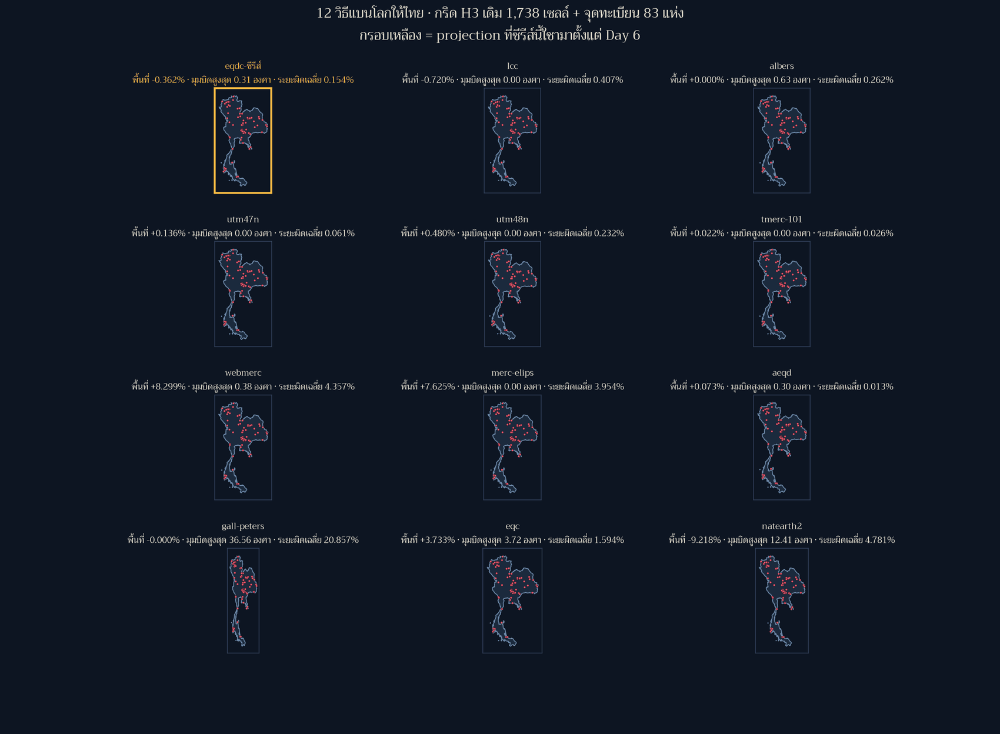
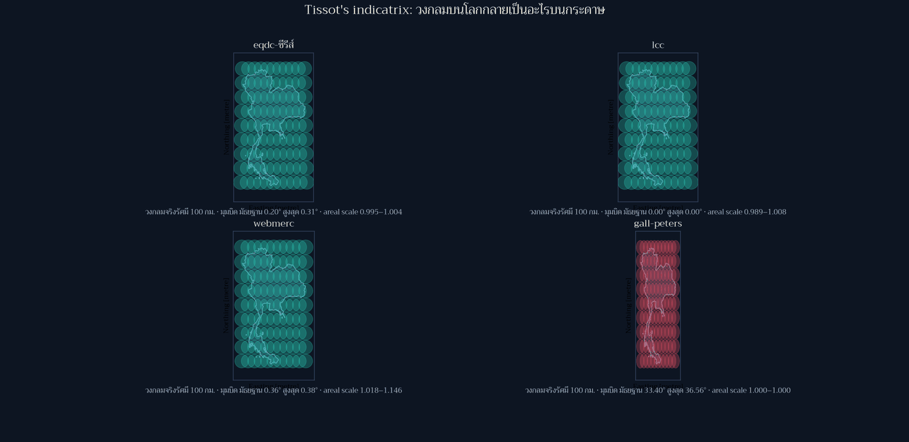
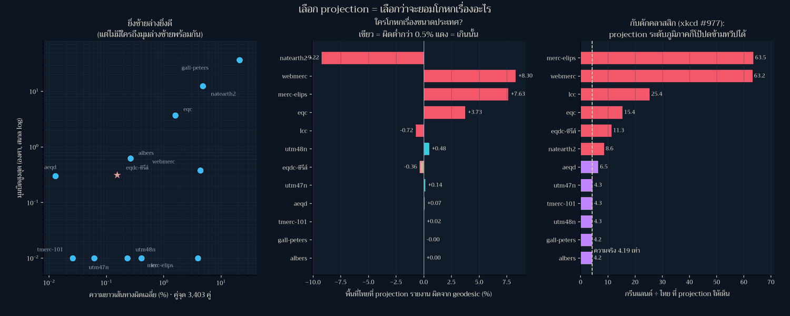

[](https://colab.research.google.com/github/thammarat-ai/geo-notes/blob/main/notebooks/day22_projections.ipynb)

โจทย์ทางการวันนี้คือ **"The different ways of representing a globe on a flat surface.
What does your favourite map projection say about you?"**
(หัวข้อ *Projections* — ดึงข้อความมาจากหน้า 30daymapchallenge.com อ่านสด 19:50 น. ของวันที่ 22 พ.ย.
ในโจทย์มีลิงก์ไปการ์ด xkcd #977 ที่ล้อการเถียงเรื่อง projection ว่าใครถูก)

เหตุผลที่โพสต์นี้ต้องมีอยู่ คือประโยคที่สองของโจทย์ — เพราะซีรีส์นี้ใช้ projection **ตัวเดียว**
มาตั้งแต่ Day 6 — Equidistant Conic ขนานมาตรฐาน 8°/20° จุดศูนย์กลางลองจิจูด 101°
ผมวาดแผนที่ไทยด้วยมันมาตั้งแต่ Day 6 โดยไม่เคยถามว่ามันโกหกอะไรไว้บ้าง
วันนี้จึงเอามันมาวัดจริงจัง พร้อมอีก 11 วิธี และถามกลับว่า
"ตัวเลขที่โพสต์ไปก่อนหน้าผิดไปเท่าไหร่"

## ตั้งสเปกก่อน: เทียบกับอะไร

กติกาข้อเดียวที่บังคับทั้งโพสต์: **ทุกตัวเลขเทียบกับ geodesic บนทรงรี WGS84**
ที่คำนวณด้วย `Geod(ellps="WGS84").geometry_area_perimeter()` ของวงเดียวกันนั้น
ไม่มีการเทียบ projection กับ projection เพราะแบบนั้นคือการเลือกพยานที่เข้าข้างตัวเอง

| geodesic reference (Natural Earth 10m, WGS84) | ค่า |
|---|---|
| พื้นที่ประเทศไทย | **514,453.7 ตร.กม.** |
| พื้นที่กรีนแลนด์ | 2,154,380.8 ตร.กม. |
| กรีนแลนด์ ÷ ไทย (ความจริง) | **4.1877 เท่า** |
| เซลล์ H3 res 5 ในกริด Day 3 (1,738 เซลล์) | ค่าเฉลี่ย 286.931 · ต่ำสุด 77.366 · สูงสุด 303.042 ตร.กม. |
| คู่จุดทะเบียนแหล่งฟ้ามืด 83 แห่ง | 3,403 คู่ · ระยะ geodesic มัธยฐาน 430.5 กม. |

หมายเหตุที่ควรบอกก่อนเริ่ม: เส้นขอบประเทศมาจาก Natural Earth 10m ไม่ใช่แนวเขตกรมที่ดิน
ตัวเลขทางราชการที่อ้างกันทั่วไปคือ 513,120 ตร.กม. ซึ่ง geodesic ของเราใหญ่กว่า **+0.2599%**
(ผลต่างระดับเดียวกันกับที่ projection สร้างให้ — ตารางข้างล่างจึงใช้เทียบ *ระหว่าง projection*
ไม่ใช่เอายอดเงินไปเทียบกับเลขราชการ)

ตัววัดที่ใช้ 5 เกณฑ์ (นิยามเดียวกับใน `day22_stats.json`):

| เกณฑ์ | วัดอย่างไร |
|---|---|
| **พื้นที่** | พื้นที่ polygon ใน projection ÷ พื้นที่ geodesic ของ polygon เดียวกัน − 1 |
| **มุม** | Tissot's indicatrix: Jacobian ของ projection ที่ 182 จุด (กริด 9×11 ครอบคลุมกล่องไทย + 83 จุดทะเบียน) แล้ว SVD → `a`, `b` คือ scale ตามแกนหลัก · `ω = 2·asin((a−b)/(a+b))` คือมุมบิดสูงสุด (max) ที่จุดนั้น |
| **ระยะ** | ระยะตรงระหว่าง 83 จุดทะเบียน 3,403 คู่บนแผนที่ หารด้วยระยะ geodesic ของคู่เดียวกัน |
| **ทิศ** | azimuth จากจุดกลางกริด (15.112°N 101.020°E) ไปยังทุกจุด บนแผนที่ − บนทรงรี |
| **คำสัญญาของชื่อ** | `h` = scale ตามแนวเมอริเดียน · `k` = ตามแนวขนาน — ตัวที่บอกว่าการันตีในชื่อ projection เป็นจริงแค่ไหน |

## 12 วิธีแบนโลก



`aeqd` (Azimuthal Equidistant) ตั้งศูนย์กลางที่จุดกลางของกริด Day 3 เองไม่ใช่ที่เมืองหลวง
มันชนะสองเกณฑ์คือ "ระยะ" (0.0129%) กับ "ทิศ" (0.0000°) — และนี่คือ projection ที่ผม
*ควรใช้* ถ้าจะวาด rose of the Leonids ของ Day 17 จริง ๆ เพราะสิ่งที่ rose ต้องการคือ
ทิศกับระยะจากจุดกลาง ซึ่งเป็นสองสิ่งที่ aeqd ให้ตรงโดยนิยาม (Day 17 วันนั้นคำนวณ
azimuth/distances แบบ geodesic บนพื้นหลัง eqdc ไม่ได้วาดเป็น aeqd)

| projection | พื้นที่ไทยที่รายงาน | ผิดจากจริง | `ω` สูงสุด | ระยะผิดเฉลี่ย | ทิศผิดสูงสุด |
|---|---|---|---|---|---|
| **eqdc-ซีรีส์** (ตัวที่ใช้จริง) | 512,593.1 | **−0.3617%** | 0.3127° | 0.1543% | 0.1682° |
| lcc | 510,750.8 | −0.7198% | 0.0000° | 0.4070% | 0.0714° |
| albers | 514,453.8 | **0.0000%** | 0.6254° | 0.2620% | 0.3230° |
| utm47n | 515,154.4 | +0.1362% | 0.0000° | 0.0615% | 0.5970° |
| utm48n | 516,923.6 | +0.4801% | 0.0000° | 0.2320% | 1.2297° |
| tmerc-101 | 514,565.4 | +0.0217% | 0.0000° | 0.0260% | 0.0597° |
| webmerc | 557,147.9 | **+8.2990%** | 0.3807° | 4.3574% | 0.5652° |
| merc-elips | 553,682.4 | +7.6253% | 0.0000° | 3.9544% | 0.5888° |
| aeqd | 514,829.1 | +0.0730% | 0.3021° | **0.0129%** | **0.0000°** |
| gall-peters | 514,453.5 | −0.0000% | **36.5639°** | 20.8572% | 17.0395° |
| eqc | 533,657.1 | +3.7328% | 3.7242° | 1.5936% | 1.6870° |
| natearth2 | 467,033.2 | **−9.2176%** | 12.4063° | 4.7809% | 9.1864° |

สรุปจากตาราง: **7 จาก 12 วิธี ผิดไม่เกิน 0.5% เรื่องพื้นที่** ค่ามัธยฐานของ
ความผิดพลาดสัมบูรณ์คือ 0.4209% — ตัวที่หลุดคือ Mercator สองตัว (บวม 7.6–8.3%)
กับ Natural Earth II (แฟบ 9.2%) ซึ่งเป็น projection ทั้งโลก ไม่ได้ตั้งใจให้ประเทศเดียว

## มุม: คำว่า "conformal" ทำงานจริงไหม



วงกลมจริงรัศมี 100 กม. บนพื้นผิว ถูกวาดเป็น ellipse ในแต่ละ projection
ผลที่ได้ตรงตามทฤษฎีเป๊ะ: มี **5 วิธีที่ให้ ω = 0.0000°** (lcc, utm47n, utm48n,
tmerc-101, merc-elips) ส่วน **albers กับ gall-peters ให้ areal scale = 1.00000 ทุกจุด**
ตามสัญญา equal-area แต่ gall-peters ต้องแลกมาด้วยมุมบิดสูงสุด **36.5639°**
และทิศเพี้ยนถึง **17.0395°** — นี่คือราคาจริงของ "พื้นที่ถูกทุกแห่งแต่รูปเสียหมด"

เคสที่สนุกที่สุดคือ `webmerc`: มันคือ conformal ตามทฤษฎี แต่ ω ที่วัดได้ = 0.3807°
ไม่ใช่ 0 เหตุผลไม่ใช่บั๊ก — `EPSG:3857` จำลองโลกเป็น *ทรงกลม*
ขณะที่ค่าจริงที่เราวัดกันทั้งโพสต์อยู่บน *ทรงรี* WGS84
ความต่างของสองแบบจำลองโผล่ออกมาเป็น angular deformation เล็กน้อย
ซึ่ง Mercator บนทรงรี (`EPSG:3395`) ไม่มี (0.0000°)

ส่วน projection ที่ซีรีส์นี้ใช้อยู่: `ω` มัธยฐาน 0.1984° สูงสุด 0.3127°
คือรักษา "ความตั้งฉากของกริด" ได้เกือบดีแต่ไม่ได้ perfect — และนี่คือตัวเลขที่บอกว่า
แผนที่ทุกแผ่นที่ทำมาไม่ได้บิดจนกว่าเราจะวัดมันขึ้นมา

## กับดักที่ xkcd ล้อ: "ตาเท่ากัน" ไม่เท่ากับ "ใหญ่เท่ากัน"



เอากรีนแลนด์ ÷ ไทย มาถาม projection แต่ละตัว (ความจริง **4.1877 เท่า**)

- Albers กับ Gall–Peters ตอบ **4.1877 เท่า** — ตรงเป๊ะ เพราะรักษาพื้นที่
- Web Mercator ตอบ **63.1565 เท่า** · Mercator ทรงรีตอบ 63.5257 เท่า
- Equirectangular 15.3626 เท่า · LCC 25.3660 เท่า · eqdc ที่เราใช้ 11.3500 เท่า

ข้อสุดท้ายต้องบอกให้ตรง: `eqdc`/`lcc` เป็น conic ระดับภูมิภาค
เอามาวัดข้ามทวีปไม่มีความหมายตั้งแต่ต้น (กรีนแลนด์ไปอยู่ไกลจาก standard parallels
จนบิดมหาศาล) ตัวเลข 11.3500 กับ 25.3660 จึงเป็น *คำเตือน* ไม่ใช่ผลค้นพบ
บทเรียนที่ใช้ได้จริงคือ: **ถ้าจะเถียงเรื่องขนาดข้ามทวีป ต้องใช้ projection ทั้งโลกเท่านั้น**
และในบรรดา projection ทั้งโลกที่มี equal-area เป็นคุณสมบัติ กรีนแลนด์ ÷ ไทย
จะตอบได้ 4.1877 ทุกครั้ง

## ๑. บั๊กที่เกือบทำให้ "Mercator ไม่รักษามุม" ขึ้นเว็บ

รันแรกได้ผลแบบที่ขัดทฤษฎีชัด ๆ: **ω ของทุก projection เป็น ~179.8° หมด**
รวม Mercator และ Lambert ซึ่งต้องได้ 0° — ค่า 12 ตัวกระจายกันเพียง 0.027°

`guard_variance` ใน `tools/guards.py` (ฟังก์ชันที่ตั้งไว้จับ "ตัวเลขที่เท่ากันผิดปกติ")
ฟ้องทันทีที่ผมรันจบทั้งรอบ

ต้นเหตุไม่ใช่คณิตศาสตร์ แต่เป็นลำดับ argument:

```python
# ผิด — เรียง (lons, lats, azimuths, distances) ไม่ถูก
lons, lats, _ = GEOD.fwd(np.full(NZIP, lon), np.full(NZIP, la0),
                         np.full(NZIP, R_KM * 1000.0), np.degrees(brg))
```

`Geod.fwd` รับ `(lons, lats, azimuths, distances)` ผมใส่ระยะทาง 100,000 ม.
ไปในตำแหน่ง azimuth และใส่ค่าทิศทาง (0 ถึง 360) ในตำแหน่งระยะทาง
"วงกลมรัศมี 100 กม." จึงกลายเป็นกลุ่มจุดรัศมีประมาณ 6 เมตร
covariance ที่ใช้หาแกน ellipse จึงบีบเป็นเส้น → `b ≈ 0` → `ω = 180°` ทุกตัว

วิธีแก้ทำให้ตัวเลขดีขึ้นด้วย: เลิกวัดจากวงกลม แล้วคำนวณ **Jacobian ของ projection
ด้วย central difference 0.02° แล้วทำ SVD** ซึ่งตรงนิยาม textbook ของ Tissot กว่า
และไม่ขึ้นกับจำนวนซี่ของวงกลมเลย — `a`, `b` ที่รายงานคือแกนของ ellipse ที่เกิดจาก
การแปลง "วงกลมหน่วยในระนาบสัมผัสพื้นผิว" ซึ่งเป็นนิยามของมันเอง
หลังแก้ `lcc` ให้ `ω = 0.0000°` ตรงตามทฤษฎี
(ทั้งสิบสองตัวก่อนแก้ได้ค่าใกล้ 179.8° หมด — ซึ่งไม่มี projection ไหนในธรรมชาติควรได้)
และค่าที่ผิดทั้ง 12 ตัวถูกเขียนทับใน `day22_stats.json` ผ่านบล็อก `bug_found`
(มี `observed_omega_wrong_deg = 179.8` กับ `observed_spread_deg = 0.027` เก็บไว้
เพื่อที่คนอ่านจะตรวจซ้ำได้ว่าบั๊กมีอยู่จริง ไม่ใช่เรื่องที่เล่าทีหลัง)

และเพราะ guard ตัวเดิมจับกรณี "ω เท่ากันหมดแต่ไม่ใกล้ 180" ไม่ได้
ผมเพิ่ม assert ใหม่ในสคริปต์: ทุก projection ที่อ้างว่า conformal
(lcc, utm47n, utm48n, tmerc-101, merc-elips) ต้องมี `ω` สูงสุดต่ำกว่า 0.005°
ไม่อย่างนั้นให้รันล้ม — บทเรียนซ้ำของซีรีส์นี้: **assert ต้องเกิดหลังจากความเข้าใจใหม่
ไม่ใช่ตอนเขียนโค้ดครั้งแรก**

## ๒. ปิดเคส 13% ของ Day 20

Day 20 ทิ้งคำถามไว้ประโยคเดียว: เซลล์ H3 res 5 ในไทยวัดได้เฉลี่ย **285.884 ตร.กม.**
ใหญ่กว่า `average_hexagon_area(5)` = **252.904 ตร.กม.** ราว 13%
ตอนนั้นผมแค่บอกว่า "ใช้ตัวเลขที่วัดจริงแทน nominal" แต่ไม่ได้อธิบายว่า 13% มาจากไหน

วันนี้อุปกรณ์พร้อมแล้ว (geodesic + H3 เอง + projection) จึงแยกองค์ประกอบได้:

| องค์ประกอบ | ค่า |
|---|---|
| projection (eqdc เทียบ geodesic) | **−0.365%** |
| H3 ใช้ทรงกลม แต่เราวัดบนทรงรี | **−3.172%** |
| ค่า nominal เป็นค่าเฉลี่ยทั่วโลก ไม่ใช่ค่าเฉลี่ยแถวละติจูดเรา | **+17.171%** |
| คูณกลับทั้งสามชิ้น | **+13.041%** |
| ช่องว่างจริงที่ Day 20 รายงาน | **+13.041%** |

พูดใหม่ให้เป็นประโยค: 13% นั้น**ไม่ได้มาจาก projection เลย** (projection มีส่วนแค่ 0.365%)
มันมาจากข้อเท็จจริงสองข้อ — H3 คำนวณบนทรงกลม (−3.172%)
และ `average_hexagon_area()` เป็นค่าเฉลี่ยทั่วโลก ซึ่งเซลล์แถวละติจูดต่ำ
อย่างประเทศไทย (6–20°N) ใหญ่กว่าค่าเฉลี่ยนั้นมาก
หลักฐานคือ `cell_area()` รายเซลล์ของไทยอยู่ระหว่าง 287.782–304.383 ตร.กม.
ไม่มีสักเซลล์ที่ใกล้ 252.904 และสหสัมพันธ์ Spearman ระหว่างพื้นที่เซลล์ (แบบทรงกลมของ H3) กับละติจูด
ภายในกริดเดียวกันคือ **−0.7977** (เหนือขึ้น = เซลล์เล็กลง)

ของแถมของการตรวจซ้ำ: `day20_reproduced = true` — วัด eqdc ซ้ำวันนี้ได้
ค่าเฉลี่ย 285.884 เท่ากับที่ Day 20 รายงานเป๊ะ และพื้นที่ไทยใน eqdc ได้
512,593.1 ตรงกับที่ใช้ใน Day 10/12/14 (traceable ครบ)

## projection ของผมบอกอะไรเกี่ยวกับผม

จัดอันดับ 12 วิธีด้วย 5 เกณฑ์ (อันดับ 1 = ดีที่สุด):

| | พื้นที่ | มุม | ระยะ | ทิศ | Scale ตามเมอริเดียน | รวมอันดับ |
|---|---|---|---|---|---|---|
| **eqdc-ซีรีส์** | 6 | 7 | 4 | 4 | **1** | 22 |
| tmerc-101 | 3 | 3 | 2 | 2 | 4 | **14** |
| aeqd | 4 | 6 | 1 | 1 | 3 | 15 |
| lcc | 8 | 1 | 7 | 3 | 5 | 24 |
| albers | **1** | 9 | 6 | 5 | 6 | 27 |
| gall-peters | 2 | 12 | 12 | 12 | 12 | 50 |
| natearth2 | 12 | 11 | 11 | 11 | 9 | 54 |

อ่านตารางนี้แบบซื่อ ๆ: projection ที่ผมใช้อยู่ **ชนะเกณฑ์เดียว** คือ
`ns_scale_dev_max = 0.00000` — ระยะตามแนวเมอริเดียนจริง 100% ทุกจุดใน 182 จุด
(มีแค่ eqdc กับ eqc เท่านั้นที่ทำได้) เกณฑ์ที่เหลือมันอยู่อันดับกลาง ๆ
และคนที่ชนะรวมอันดับคือ `tmerc-101` Transverse Mercator ที่ตั้ง central meridian
เหนือกลางประเทศเราเอง (พื้นที่ผิด +0.0217%, ω 0.0000°, ระยะผิด 0.0260%)

สรุปว่า projection ของผมบอกอะไร? สามอย่าง

1. **ผมเลือกตามธรรมเนียม ไม่ใช่ตามการวัด** — conic + standard parallels 8°/20°
   คือคำตอบแบบตำราสำหรับประเทศที่ยืดยาวเหนือ-ใต้ และมันไม่ได้ *ผิด*
   (พื้นที่หายไป 0.36% มุมบิด 0.31°) แค่ไม่ได้ *ดีที่สุด*
2. **ผมให้น้ำหนักกับ "ระยะทาง" มากกว่า "ขนาด"** — ซีรีส์นี้วัดระยะจากจุดทะเบียนถึงถนน
   ถึงถนน ถึงเซลล์ที่ใกล้ที่สุดมาตลอด (Day 3, 9, 16) ซึ่งคือสิ่งที่ eqdc สัญญา
   และมันรักษาข้อสัญญานั้นจริงแบบตัวเลขศูนย์ทศนิยมห้าตำแหน่ง
3. **ผมปล่อยผ่าน 2 เรื่องที่ควรตรวจตั้งนานแล้ว** — ไม่เคยตรวจ geodesic reference
   (จึงเข้าใจผิดเรื่อง 13% มาตั้งแต่วันนั้น และใช้ Mercator ทั้งเว็บ (webmerc)
   ในหัวโดยลืมว่าตัวเลข 8.299% ที่มันเติมให้ประเทศไทยนั้น มากกว่า error
   ทุกอย่างที่ projection ระดับภูมิภาคสร้างขึ้น

ถ้าให้เลือกใหม่เพื่อทำซีรีส์นี้ต่อ: **`tmerc-101` สำหรับแผนที่ประเทศ**
(ชนะ 4 จาก 5 เกณฑ์เมื่อคิดรวม) และ **`albers` ทุกครั้งที่รายงาน "เนื้อที่"**
เพราะมันให้ 0.0000% แบบไม่ต้องอธิบาอะไรเลย — แต่ผมจะไม่เปลี่ยน
เพราะทุกแผนที่ของซีรีส์นี้ใช้ eqdc และโพสต์นี้คือหลักฐานว่า
มันสร้าง error ให้เรากี่เปอร์เซ็นต์ ไม่ใช่ทิ้งงานเก่าแล้วเริ่มใหม่

## วิธีทำแบบย่อ

1. อ่านกริด H3 res 5 จาก Day 3 (1,738 เซลล์) + ขอบประเทศ Natural Earth 10m
   + จุดทะเบียน 83 แห่งจากไฟล์ชุดเดิมที่ทั้งซีรีส์ใช้
2. คำนวณ **reference บน WGS84**: `Geod(ellps="WGS84").geometry_area_perimeter()`
   ของ polygon จริง, `line_lengths` ของทุกคู่จุดทะเบียน (3,403 คู่)
3. สร้าง 12 projection ด้วย proj4 string + lookup EPSG (32647, 32648, 3395, 3857)
4. ต่อ projection: reproject polygon → คิดพื้นที่ → หาร reference ·
   reproject 1,738 เซลล์ → ดูการกระจายของ error (ไม่แค่ค่าเฉลี่ย) ·
   สแกน 182 จุดด้วย Jacobian (central difference 0.02°) → SVD → `a, b, ω, h, k, areal` ·
   reproject จุดทะเบียนแล้ววัดคู่ 3,403 คู่ · วัด azimuth จากจุดกลาง
5. จัดอันดับ 5 เกณฑ์แล้วรวมเป็น rank_sum เพื่อตอบคำถาม "projection ของคุณบอกอะไร"
6. แยกองค์ประกอบตัวเลข 13% ของ Day 20 เป็น projection × ทรงกลม/ทรงรี × ค่าเฉลี่ยละติจูด
   แล้วคูณกลับว่าครบ 13.041% พอดี
7. assert ที่ใส่เพิ่มหลังเจอบั๊ก: conformal ต้อง ω < 0.005° · albers ต้อง
   พื้นที่ error < 0.005% · eqdc ต้อง `ns_scale_dev_max < 1e-4` ·
   ผลคูณสามองค์ประกอบต้องตรงกับช่องว่างจริง · และเลข Day 20 ต้อง reproduce ได้

## ข้อจำกัดที่ต้องบอกตรง ๆ

* **grid Tissot 182 จุด** (99 กริด + 83 ทะเบียน) ไม่ครอบคลุมเกาะ/ชายฝั่งทุกละติจูด
  `ω` ที่รายงานจึงเป็น "สูงสุดจากที่สุ่มกริดไว้" ไม่ใช่ supremum ของทั้ง projection
* **central difference 0.02°** (ประมาณ 2 กม.) เป็นค่า step ที่ผมเลือก
  step ใหญ่ไปจะปน curvature, เล็กไปจะจม numerical noise — ไม่ได้ทดสอบ step size อื่น
* **aeqd ตั้งศูนย์กลางที่ centroid ของกริด Day 3** (15.112°N 101.020°E)
  ถ้าย้ายจุดกลาง ตัวเลข "ทิศผิด 0.0000°" จะเปลี่ยนทันที (เพราะเกณฑ์นี้วัดจากจุดนั้น)
* **UTM มีเขตเดียวต่อ zone**: utm47n ครอบคลุมไทยได้ทั้งประเทศแต่ utm48n ไม่ใช่
  ตัวเลือจริงของคนทำแผนที่ไทย การใส่มาเพื่อแสดง edge distortion เท่านั้น
* **เทียบตัวเลขข้ามทวีปจาก projection ระดับภูมิภาคไม่ได้** — ค่า gl_th_ratio ของ
  eqdc/lcc ในที่นี้คือคำเตือน ไม่ใช่ผลสรุป (เขียนไว้ให้ชัดเพราะตารางอาจถูกตัดไปใช้ต่อ)
* **ขอบประเทศมาจาก Natural Earth 10m** ซึ่งต่างจากตัวเลขทางราชการ +0.2599%
  ใหญ่กว่าผลของ projection หลายตัวในตัวมันเอง

## ไฟล์ประกอบ

* [day22_twelve.png](day22_twelve.png) — 12 small multiples พร้อม error ราย panel
  (กรอบเหลือง = eqdc ที่ซีรีส์นี้ใช้)
* [day22_tissot.png](day22_tissot.png) — Tissot's indicatrix 4 panel: eqdc · lcc · webmerc · gall-peters
* [day22_tradeoff.png](day22_tradeoff.png) — เกณฑ์ระยะทางเทียบกับเกณฑ์มุม, อันดับความเพี้ยนด้านพื้นที่, กับดักกรีนแลนด์
* [day22_projections.csv](day22_projections.csv) — เมทริกซ์หลัก 12 แถว (ทุกตัวเลขในโพสต์อยู่ในนี้)
* [day22_tissot.csv](day22_tissot.csv) — `a, b, areal, ω, h, k` รายจุด 182 จุด × 12 วิธี = 2,184 บรรทัด
* [day22_ranks.csv](day22_ranks.csv) — อันดับ 5 เกณฑ์ + rank_sum
* [day22_cells.csv](day22_cells.csv) — รายเซลล์ 1,738: พื้นที่ geodesic, พื้นที่ H3 (ทรงกลม),
  พื้นที่ใน eqdc / albers / utm47n / webmerc / gall-peters / aeqd / lcc พร้อมอัตราส่วน
* [day22_stats.json](day22_stats.json) — นิยามทั้งหมด + `bug_found` + `decomposition_of_day20`
  + `external_reference` + `cross_check_day20`

ไฟล์สคริปต์: `tools/day22_projections.py` (คำนวณ + วาด + referee ในไฟล์เดียว)
และ `notebooks/day22_projections.ipynb` ที่สร้างจากไฟล์เดียวกัน

## บทเรียน

* **assert ต้องเขียนหลังเข้าใจ ไม่ใช่ก่อน** — ผมมี guard 25 เคสใน `guards.py`
  แต่ไม่มีข้อไหนบอกว่า "conformal ต้องได้ ω เป็นศูนย์" จึงปล่อยให้บั๊ก
  ลำดับ argument ของ `Geod.fwd` ผลิตตัวเลขที่ผิดพร้อมกันทั้ง 12 ตัว
  โดยไม่มีตัวไหน "ดูเพี้ยน" ในสายตาคณิต — ดีที่มี guard_variance
* **guard ตัวเดียวจับบั๊กได้หนึ่งระดับ** — ครึ่งแรกของบั๊ก (ω = 179.8° ทุกตัว)
  คือ "ค่าไม่กระจาย" ซึ่ง `guard_variance` เห็น · ครึ่งหลัง (กรณีที่ไม่เพี้ยนหนัก
  แต่ผิด criteria) ต้องใช้ domain assert เพิ่ม ซึ่งผมใส่ไว้แล้ว
* **ตัวเลขเก่าในซีรีส์ควรตรวจซ้ำได้** — ข้อดีของการเก็บทุกอย่างเป็น artifact คือ
  13% ของ Day 20 วันนี้กลายเป็น "3 ชิ้นคูณกัน = 13.041%" ที่ปิดเคสได้
  และ 285.884 / 512,593.1 ยัง reproduce ตรงเป๊ะ (ไม่มี drift)
* **"ชื่อ projection" เป็นคำสัญญา ไม่ใช่ความจริง** — equidistant ของ eqdc
  เป็นจริงเฉพาะตามแนวเมอริเดียน (dev 0.00000) และเป็นเท็จตามแนวขนาน
  (dev สูงสุด 0.00544 = 0.544%) การรายงานแบบไม่ระบุทิศคือวิธีหลอกตัวเองที่เสถียรที่สุด
* **คำตอบของ "projection ของคุณบอกอะไรเกี่ยวกับคุณ" ควรวัดได้**
  ผมตอบว่า: ผมเลือกตามธรรมเนียม, ผมให้ค่ากับระยะทางมากกว่าขนาด
  และมี projection ที่ดีกว่า 4 ใน 5 เกณฑ์อยู่ห่างไปแค่การเปลี่ยน string หนึ่งบรรทัด
