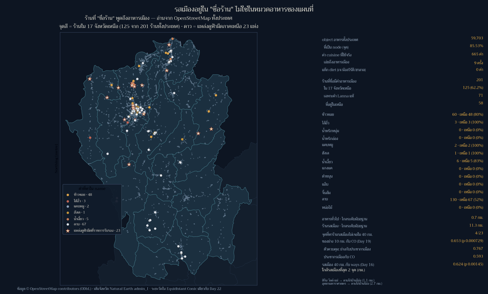
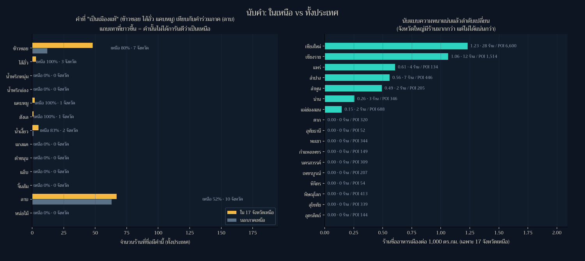
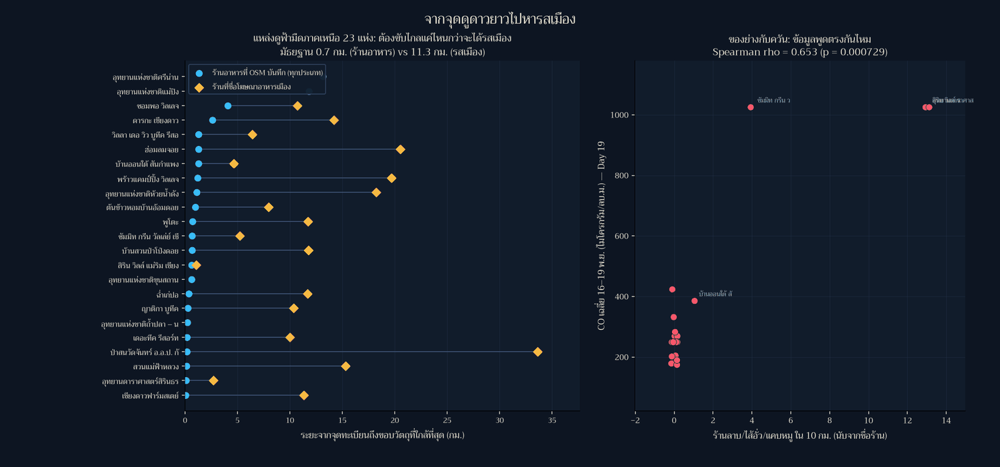

โจทย์ทางการวันนี้คือ **"Food, drink or something else which you can taste."**
(หัวข้อ *Senses: Taste* — ดึงข้อความมาจากหน้า 30daymapchallenge.com อ่านสด 20:55 น. ของวันที่ 23 พ.ย.
เป็น senses วันที่สี่ของซีรีส์ต่อจาก Day 5 sight · Day 12 sound · Day 19 smell)

อาจารย์ขอธีมเป็น **อาหารภาคเหนือ — ลาบ ข้าวซอย** ผมเลยตั้งคำถามที่ตอบได้ด้วยข้อมูลจริงว่า

> **แผนที่ที่คนช่วยกันวาดทั้งใบนี้ "รู้รส" ขนาดไหน และมันอยู่ไกลจากจุดที่เราไปดูดาวยาวแค่ไหน**

คำตอบสั้นคือ: OSM ไม่รู้รสเลย แต่ *ชื่อร้าน* รู้ — และชื่อร้านอยู่ที่เชียงใหม่กับเชียงรายเป็นหลัก

## ๐. ปัญหาแรก: "รส" ไม่มีที่อยู่ในหมวดหมู่ของ OSM

OSM มีแท็กสำหรับเรื่องนี้โดยตรงคือ `cuisine` (หมวด/ประเภทของอาหารที่ขาย)
ผมสแกน **Geofabrik Thailand extract ทั้งประเทศ** (ไฟล์เดียวกับ Day 21–22,
md5 `db3958a037ce717c462101b86e2f75f3`) แล้วเก็บทุก object ที่เข้าหมวด
อาหาร/เครื่องดื่ม/ของกิน = **59,703 ชิ้น** (node 51,062 · way 8,641 — 85.53% เป็นจุด)

ผลที่ได้คือ

| สิ่งที่ OSM บันทึกเรื่อง "รส" | ค่าที่วัดได้ |
|---|---|
| ค่า `cuisine` ที่ใช้จริงทั้งประเทศ | **665 ค่า** รวม **25,388 ครั้ง** |
| ค่าที่ใช้บ่อย 5 อันดับแรก | `thai` 5,989 · `coffee_shop` 4,386 · `burger` 761 · `pizza` 744 · `chicken` 711 |
| ครั้งที่ `cuisine` เอ่ยถึงอาหารเมือง (ข้าวซอย/ลาบ/ไส้อั่ว/แคบหมู/ฮังเล/น้ำเงี้ยว/Lanna/northern) | **9 ครั้ง** |
| ครั้งที่ `cuisine` เอ่ยถึง "อีสาน" (ไว้เทียบ) | **28 ครั้ง** |
| แท็ก `diet` (vegetarian / vegan / halal / kosher) | **0 ค่า** — ไม่มีใครใช้เลย |
| object ที่มี `opening_hours` | 11,028 ชิ้น |

ใน 9 ครั้งของการเอ่ยถึงอาหารเมืองนั้น ละเอียดขนาดนี้: `cuisine=ข้าวซอย` 1 ครั้ง,
`cuisine=ลาบ` 4 ครั้ง, `ลาบอีสาน` 1, `ลาบหมู` 1, `northern_thai` 1, `northern_thai_food` 1
และ **ไส้อั่ว / แคบหมู / ฮังเล / น้ำเงี้ยว / แกงแค / จิ้นส้ม = 0 ครั้ง**

พูดให้โหดหน่อย: ถ้าเชื่อหมวดหมู่ของ OSM ประเทศไทยมีอาหารประเภท "thai" กับ "coffee"
แต่ไม่มี "อาหารเหนือ" เป็นรสแยกต่างหาก และไม่มีข้อมูลมังสวิรัติแม้แต่น้อย
(ซึ่งไม่ใช่เรื่องแปลก — `cuisine` ถูกกรอกตอนคน map สนใจจะจำแนก ไม่ใช่ตามตำราอาหาร)

**ที่เหลือจึงมีที่เดียว: ป้ายชื่อร้าน**

## ๑. อ่าน "รส" จากชื่อร้าน — และกับดักแรกของภาษาไทย

ผมค้นหา 13 คำในช่องชื่อของ object (รวม `name`, `name:en`, `alt_name`, `official_name`,
`sig`, `brand`) แบ่งเป็น 11 คำเมือง + 2 คำควบคุม

รอบแรกได้ 380 คู่ (คำ×ร้าน) แต่เปิดดูแล้วรู้ว่า **substring ในภาษาไทยคือกับดัก**
คำว่า "ลาบ" ชนกับ

- *บ้านแม่สะลาบ* · *โรงเรียนวัดแม่สะลาบ* (ชื่อหมู่บ้าน)
- *13. กุหลาบพันปี* (ดอกไม้)
- *บึงบอระเพ็ด … อุโมงค์ปลาบึก*, *ตลาดปลาบางแสน* (ปลา + บ)
- *บริษัท เลาบราเดอร์ส อินเตอร์ เนชั่นแนล* ( Labrador!)
- *ถนนบ้านฉาง–พลาบูรพาพัฒน์* (ชื่อถนน)

จึงใส่ negative lookbehind ห้ามตัวอักษร 9 ตัวนำหน้าคำว่า "ลาบ"
ตามรายการใน `tools/day23_lanna.py` (บรรทัด `WORD_RE["ลาบ"]`)
ผล: คู่คำ×ร้านลดจาก **380 เหลือ 231** · ตัดร้านทิ้ง **149 แห่ง** · เหลือร้านที่ OSM
ระบุว่าเป็นอาหารจริง (มี `amenity`/`shop` หมวดอาหาร หรือมี `cuisine`) **201 ร้าน**

| คำ | ร้านทั้งประเทศ | ใน 17 จังหวัดเหนือ | สัดส่วนที่เป็นเหนือ | จังหวัดเหนือที่เจอ |
|---|---|---|---|---|
| **ข้าวซอย** | **60** | **48** | **80.00%** | เชียงใหม่ 25 · เชียงราย 8 · ลำปาง 7 · น่าน 3 |
| ลาบ *(คำควบคุม)* | 130 | 67 | 51.54% | เชียงใหม่ 29 · เชียงราย 9 · ลำปาง 6 · นครสวรรค์ 6 |
| น้ำเงี้ยว | 6 | 5 | 83.33% | เชียงราย 3 · เชียงใหม่ 2 |
| ไส้อั่ว | 3 | 3 | 100.00% | แม่ฮ่องสอน 1 · เชียงใหม่ 1 · ลำพูน 1 |
| แคบหมู | 2 | 2 | 100.00% | เชียงราย 2 |
| ฮังเล | 1 | 1 | 100.00% | แพร่ 1 |
| น้ำพริกหนุ่ม · น้ำพริกอ่อง · แกงแค · ตำขนุน · แอ็บ · จิ้นส้ม · หน่อไม้ | **0** | 0 | — | — |

รวมแล้ว **125 จาก 201 ร้าน (62.19%)** ตกอยู่ใน 17 จังหวัดภาคเหนือ
(เนื้อที่ 171,810 ตร.กม. ตาม Natural Earth admin_1)

สามเรื่องที่ตารางนี้บอก — และสองเรื่องผมไม่คิดว่าจะเจอ

1. **ข้าวซอยเป็น "เครื่องหมายภูมิภาค" ที่ชัดจริง** — 80.00% ของร้านที่ใช้ชื่อนี้อยู่ในเหนือ
   ที่เหลือนอกเหนือเป็นกรุงเทพฯ 6 แห่งกับขอนแก่น/ระยอง/จันทบุรีจังหวัดละ 1 ซึ่งสมเหตุสมผล
   (คนเหนือไปเปิดร้านต่างถิ่น)
2. **ลาบใช้บอก "เหนือ" ไม่ได้** — คำควบคุมทำงานตามหน้าที่: มีแค่ 51.54% ที่เป็นเหนือ
   และนอกเหนือนั้นไปกระจุกที่ *ขอนแก่น 15 · กรุงเทพฯ 14 · ระยอง 8 · ชลบุรี 6*
   ซึ่งเป็นร้านลาบ**อีสาน** ไม่ใช่ร้านลาบเมือง → ถ้าใครทำแผนที่ "อาหารเหนือ" ด้วยคำว่าลาบ
   จะได้แผนที่ที่ครึ่งหนึ่งไม่เกี่ยวกับภาคเหนือเลย
3. **อาหารเมืองที่คนกินจริงแทบไม่โผล่ในชื่อร้าน** — น้ำพริกหนุ่ม แคบหมู แกงแค ตำขนุน
   แอ็บ จิ้นส้ม มี 0–2 ร้านทั้งประเทศ (มีเพียงแคบหมู 2 ฮังเล 1 ไส้อั่ว 3)
   เพราะของพวกนี้เป็น *เมนู* ไม่ใช่ *ชื่อร้าน* — คนเขียนป้ายว่า "ร้านอาหารตามสั่ง"
   หรือ "ก๋วยเตี๋ยวเรือ" แล้วขายไส้อั่วข้างกัน
   → **OSM บันทึกสิ่งที่มองเห็นจากถนน ไม่ใช่สิ่งที่สั่งในเมนู** และผมไม่มีทางแก้ข้อนี้ด้วยการหา keyword เพิ่ม

## ๒. นับแบบไหนก็ได้คำตอบไม่เหมือนกัน

จังหวัดเหนือ 7 จังหวัดมีร้านชื่ออาหารเมือง อีก **10 จังหวัดเป็น 0**
(รวม 8 จังหวัด "เหนือล่าง" ตามนิยาม 17 จังหวัด: อุตรดิตถ์ พิจิตร พิษณุโลก สุโขทัย
อุทัยธานี กำแพงเพชร นครสวรรค์ ตาก เพชรบูรณ์ และพะเยา)

| จังหวัด (Natural Earth) | object อาหารที่ OSM รู้จัก | ร้านชื่ออาหารเมือง | % ของร้านอาหารในจังหวัด | ต่อ 1,000 ตร.กม. |
|---|---|---|---|---|
| เชียงใหม่ | 6,600 | 28 | 0.424% | 1.230 |
| เชียงราย | 1,514 | 12 | 0.793% | 1.064 |
| ลำปาง | 446 | 7 | 1.570% | 0.559 |
| แพร่ | 134 | 4 | 2.985% | 0.606 |
| น่าน | 346 | 3 | 0.867% | 0.256 |
| แม่ฮ่องสอน | 688 | 2 | 0.291% | 0.147 |
| ลำพูน | 205 | 2 | 0.976% | 0.492 |

อ่านสามแบบได้สามคำตอบ: **จำนวนจริง** ชี้เชียงใหม่ · **ต่อเนื้อที่** ชี้เชียงใหม่กับเชียงราย
สูสีกัน (1.230 vs 1.064) · **สัดส่วนต่อร้านอาหารที่ OSM รู้จัก** ชี้ *แพร่* (2.985%)
กับ *ลำปาง* (1.570%) ซึ่งไม่ใช่จังหวัดที่คนนึกถึงก่อนเลย

และต้องบอกตรง ๆ ว่าแบบสุดท้ายอ่านยาก: ตัวส่วนคือ "ร้านอาหารที่ OSM map ไว้"
ซึ่งขึ้นกับว่าจังหวัดนั้นมี mapper กี่คน (Day 16 เคยวัดไว้ว่าจำนวน way รอบแหล่งดูดาวย่าง
ต่างกันตั้งแต่ 0 ถึง 589 ชิ้น) — ลำปางมี object อาหาร 446 ชิ้นเทียบกับเชียงใหม่ 6,600
จึงไม่ใช่หลักฐานว่า "ลำปางขายไส้อั่วมากกว่า" แต่คือหลักฐานว่า **ลำปางถูก map น้อยกว่า**

## ๓. จากจุดดูดาวยาวไปหารสเมือง

แหล่งดูฟ้ามืดในทะเบียนราชการที่อยู่ภาคเหนือมี **23 แห่ง**
(เชียงใหม่ 17 · น่าน 2 · เชียงราย 2 · ลำพูน 1 · แม่ฮ่องสอน 1 — นับจากคอลัมน์ province ของทะเบียน)
วัดระยะจากจุดทะเบียนไปถึง **ขอบวัตถุที่ใกล้ที่สุด** ใน projection เดียวกับทั้งซีรีส์
(Day 22 ตรวจแล้วว่า projection นี้ทำให้พื้นที่คลาด −0.3617% ซึ่งจิ๊บจ๊อยเมื่อเทียบกับสิ่งที่เห็น)

| | ระยะ (กม.) |
|---|---|
| ร้านอาหารทั่วไป (ทุกประเภท) · มัธยฐานของ 23 จุด | **0.68** |
| ร้านที่ชื่อโฆษณาอาหารเมือง · มัธยฐาน | **11.34** |
| ค่าสูงสุดที่วัดได้ (ป่าสนวัดจันทร์ อ.อ.ป. กัลยาณิวัฒนา → ข้าวซอยพี่น้อง) | 33.63 |
| จุดที่ไม่พบร้านรสเมืองเลยในรัศมี 40 กม. | **4 จาก 23** |

ค่าต่ำสุด (min) ของระยะไปหาร้านรสเมือง: **สิริน วิลล์ แม่ริม** 1.08 กม. (ลาบไก่บ้านโอ่ง) และ
**อุทยานดาราศาสตร์สิรินธร** 2.69 กม. (ลาบไก่บ้านโอ่ง — ร้านเดียวกันคิดเป็นระยะจากสองจุด)
จุดที่มีร้านรสเมืองใน 10 กม. เยอะสุดคือ สิริน วิลล์ 29 ร้าน กับ อุทยานดาราศาสตร์สิรินธร 27 ร้าน

ส่วน 4 จุดที่หาไม่เจอ (ใน 40 กม.) คือ **อุทยานแห่งชาติขุนสถาน (น่าน) · อุทยานแห่งชาติแม่ปิง (ลำพูน) ·
อุทยานแห่งชาติถ้ำปลา–น้ำตกผาเสื่อ (แม่ฮ่องสอน) · อุทยานแห่งชาติศรีน่าน (น่าน)**
ทั้งสี่เป็นอุทยานที่อยู่ห่างชุมชน และมีนัยตรง ๆ กับคนไปกางเต็นท์: *ของกินต้องพกไปเอง*
(ซึ่ง Day 21 ก็เพิ่งพบว่ารอบ ๆ เขามี object ใน OSM น้อยมาก — ตรงกัน)

## ๔. ของย่างกับควัน: อย่าเพิ่งรีบสรุป

อาจารย์อยากได้ของย่าง (ลาบ · ไส้อั่ว · แคบหมู) ผมจึงทดสอบว่าจุดที่มี "ร้านของย่างในชื่อร้าน"
สัมพันธ์กับค่าฝุ่น/ควันที่วัดไว้ Day 19 (CO และ PM2.5 เฉลี่ย 16–19 พ.ย. จาก CAMS) ไหม

| คู่ที่ทดสอบ (Spearman, n = 23 จุดภาคเหนือ) | rho | p-value |
|---|---|---|
| ร้านของย่างใน 10 กม. ↔ CO | **0.653** | 0.00073 |
| ร้านของย่างใน 10 กม. ↔ PM2.5 | 0.673 | 0.00043 |
| **ตัวควบคุม:** ร้านของย่าง ↔ ประชากรเมือง 30 กม. | **0.767** | 2.0e-05 |
| **ตัวควบคุม:** ประชากรเมือง ↔ CO | **0.593** | 0.0029 |
| ร้านรสเมืองใน 40 กม. ↔ จำนวน way รอบจุด (Day 16) | 0.624 | 0.0015 |

ลำดับนี้พูดอะไร: ตัวแปรร่วม (ขนาดของเมืองที่ตั้งอยู่ใกล้) สัมพันธ์กับ *ทั้งสองฝั่ง* มากกว่า
ตัวมันเองเสียอีก — ร้านของย่างอยู่ใกล้เมืองใหญ่ และ CO ใน CAMS ก็สูงใกล้เมืองใหญ่
(จากจราจร/เผา/อุตสาหกรรม) **ดังนั้นrho 0.653 ไม่ได้บอกว่า "กลิ่นลาบทำให้ CO สูง"**
มันบอกว่า "จุดที่ OSM รู้จักร้านของย่าง คือจุดที่อยู่ใกล้เมือง" ซึ่งเป็นคำตอบแบบเดียวกับ
คอลัมน์ last ในตาราง (0.624 กับจำนวน way)

ถ้าจะยืนยันเรื่องควันจริง ต้องมีข้อมูลวันที่/เวลาปิ้งย่างหรือทะเบียนร้านอาหารที่ย่างถ่าน
ไม่ใช่ชื่อร้านในแผนที่ — และนี่คือขอบเขตที่ข้อมูลชุดนี้ไปไม่ถึง

## วิธีทำแบบย่อ

1. สแกน PBF สองรอบด้วย `pyosmium` (เหมือน Day 21):
   `collect_day23_food.py` เอา object อาหาร + counters ของ `cuisine`/`diet` ทั้งประเทศ,
   `collect_day23_dishes.py` เอา object ที่ *ชื่อ* ตรงคำอาหารเมือง (พร้อมเก็บ string
   ที่ใช้ค้นหาไว้ตรวจซ้ำ)
2. สร้าง geometry จริงของ way จาก node (ไม่ใช้ centroid แบบ Day 16) แล้ว reproject
   เป็น Equidistant Conic ครั้งเดียว
3. จับจังหวัดด้วย `STRtree.query(pt, predicate="within")` บน Natural Earth admin_1
   (77 จังหวัด · นับพื้นที่ด้วย geodesic ตามวิธี Day 22)
4. กรอง false positive ของคำว่า "ลาบ" ด้วย negative lookbehind แล้วตรวจชื่อที่ตกค้างทุกแถว
5. วัด 3 อย่างต่อคำ: จำนวนทั้งประเทศ · ส่วนที่อยู่ใน 17 จังหวัดเหนือ · ความหนาแน่น/สัดส่วน
   ต่อร้านอาหารที่ OSM รู้จักในจังหวัดนั้น
6. วัดระยะจาก 23 จุดทะเบียนฟ้ามืดภาคเหนือไปหาร้านรสเมือง (รัศมี 40 กม. · วัดถึงขอบวัตถุ)
7. ทดสอบสมมติฐาน "ของย่าง = ควัน" ด้วย Spearman **พร้อมตัวควบคุม** (ประชากรเมือง)
   เพื่อดูว่าความสัมพันธ์มาจากไหน
8. assert: ผลรวมต่อคำต้อง ≥ จำนวนร้าน (ร้านหนึ่งมีได้หลายคำ) · สัดส่วน ≤ 100% ·
   ทุกระยะที่รายงานต้องไม่เกินรัศมีที่ประกาศ · จำนวนจังหวัดต้อง 17 ·
   และถ้าจะอ้างว่า "ไม่พบ" รัศมีค้นต้องกว้างพอ (40 กม.)

## ข้อจำกัดที่ต้องบอกตรง ๆ

* **นี่คือ "รสที่ OSM บันทึก" ไม่ใช่ "รสที่มีอยู่จริง"** — ตลาดสดและรถเร่ขายน้ำพริกหนุ่ม
  แทบไม่ปรากฏใน OSM เลย การที่คำหนึ่งได้ 0 ครั้งจึงแปลว่า *ไม่มีใคร map ไว้* ไม่ใช่ไม่มีของ
* **การ match เป็น substring** — ภาษาไทยไม่มีช่องคำ ผมตัดเฉพาะตัวหน้าที่ยืนยันได้ว่าพบบ่อยในข้อมูล
  ว่าทำให้เกิดคำผิด (กุหลาบ/สะลาบ/ปลาบึก/เลาบราเดอร์ส/พลาบูรพา) ซึ่งยังอาจมีกรณีอื่นเหลืออยู่
  และในทางกลับกันก็อาจเผลอตัดชื่อที่สะกดแปลกออกไป (recall ลดลง) — ตรวจได้ทุกแถวใน
  `day23_lanna_places.geojson`
* **จังหวัดมาจาก Natural Earth admin_1** ซึ่งเส้นขอบหยาบกว่าเขตราชการ ร้านที่ติดขอบ
  อาจถูกนับผิดจังหวัด (มี flag `edge` ในไฟล์ geojson)
* **ตัวส่วน (จำนวนร้านอาหารในจังหวัด) ไม่เท่าเทียมกันเชิงคุณภาพ** เพราะความหนาแน่นของ
  mapping ขึ้นกับจำนวน mapper (Day 16) ไม่ใช่จำนวนร้านจริง
* **17 จังหวัดเหนือ** ใช้เกณฑ์ตามหน้า Wikipedia ของ Northern Thailand (9 จังหวัดกลุ่มบน
  บวก 8 จังหวัดกลุ่มล่าง) ซึ่งเป็นเขตการปกครอง ไม่ใช่เขตวัฒนธรรม Lanna —
  ในตาราง 10 จังหวัดมีร้านชื่ออาหารเมืองเป็น 0 (รวมถึง 8 จังหวัดกลุ่มล่างทั้งหมด)
  แต่บางจังหวัดในนั้นมีร้าน "ลาบ" (อุตรดิตถ์ 3 · พิจิตร 1) ซึ่งเป็นอาหารอีสาน ไม่ใช่ของเมือง
  และเนื้อที่จังหวัดที่ผมใช้คิดความหนาแน่นก็มาจาก Natural Earth เช่นกัน
  จึงใช้เทียบระหว่างจังหวัดได้ ไม่ใช่เทียบกับตัวเลขทางราชการ
* **CO/PM2.5 จาก CAMS grid ~0.1°** เฉลี่ย 96 ชม. (Day 19) — ละเอียดไม่พอเห็นควันจากเตาเดียว
* **ข้อมูล snapshot เดียวกับ Day 21/22 (21 พ.ย. 2569)** — ร้านเปิดใหม่หลังวันนั้นไม่มีในนี้

## ไฟล์ประกอบ

* [day23_lanna_map.png](day23_lanna_map.png) — แผนที่ 17 จังหวัดเหนือพร้อมร้านที่ชื่อมีคำอาหารเมือง
  + แหล่งดูฟ้ามืด 23 จุด + สถิติหลัก
* [day23_words.png](day23_words.png) — นับคำแบบในเหนือ vs ทั้งประเทศ และแบบต่อ 1,000 ตร.กม.
* [day23_sites.png](day23_sites.png) — ดัมเบลพล็อต 23 จุด: ระยะไปหาร้านอาหารทั่วไป เทียบกับร้านรสเมือง
  + scatter ของร้านของย่างกับ CO พร้อมตัวควบคุม
* [day23_words.csv](day23_words.csv) — ต่อคำ: hits · in_north · สัดส่วน · จังหวัดอันดับต้น · ตัวอย่างชื่อ
* [day23_provinces.csv](day23_provinces.csv) — ต่อจังหวัดเหนือ 17 แห่ง: เนื้อที่ · object อาหาร · จำนวนร้านต่อคำ
* [day23_sites_north.csv](day23_sites_north.csv) — ต่อจุดทะเบียน 23 แห่ง: ระยะใกล้สุดแต่ละคำ ฯลฯ
* [day23_lanna_places.geojson](day23_lanna_places.geojson) — ทุกจุดที่ match (พร้อมคำที่เจอ/จังหวัด/ชื่อร้าน) ให้ตรวจเอง
* [day23_stats.json](day23_stats.json) — ตัวเลขทั้งหมด + `bug_found` + `confounder` + `false_positive_filter`

โค้ด: `tools/collect_day23_food.py` · `tools/collect_day23_dishes.py` · `tools/day23_lanna.py`
(รันบน Colab ได้ — cell แรกมี bootstrap ดึงรีโป + Natural Earth + ฟอนต์ Trirong
และเทสต์บนเครื่องได้ด้วย `DAY23_FORCE_COLAB=1`)

## บทเรียน

* **แผนที่เก็บ "สิ่งที่มองเห็น" ไม่ใช่ "สิ่งที่ลิ้ม"** — OSM บันทึกป้ายร้านได้ดีมาก
  แต่บันทึกเมนูได้น้อยจนแทบเป็นศูนย์ (665 ค่า `cuisine` มีอาหารเมือง 9 ครั้ง, `diet` 0 ครั้ง)
  งานวิเคราะห์ที่ถามเรื่อง "รส" จึงต้องเริ่มจากการยอมรับว่าเรากำลังวัด *ป้าย* ไม่ใช่อาหาร
* **คำที่คิดว่าเป็นเอกลักษณ์ภูมิภาค อาจเป็นแค่คำที่ใช้กันทั้งประเทศ** — ลาบ 130 ร้าน
  มีเพียง 51.54% ในเหนือ ที่เหลือคือขอนแก่น/กรุงเทพฯ/ระยอง (ลาบอีสาน)
  การใส่ *คำควบคุม* ลงไปในชุดคำค้นตั้งแต่แรก คือสิ่งที่ทำให้ข้อสรุปไม่เพี้ยน
* **ภาษาไทยไม่มีช่องคำ → substring คือกับดักประจำภาษา** — "ลาบ" ฝังอยู่ใน กุหลาบ สะลาบ ปลาบึก
  เลาบราเดอร์ส พลาบูรพา ผมตรวจเห็นจากตัวอย่างชื่อ (149 แห่งถูกตัดทิ้ง) ไม่ใช่จากสมมติฐาน
  และนี่คือเหตุผลที่ artifact ต้องมีตัวอย่างชื่อแนบไปด้วยเสมอ
* **ตัวเลข 0 หลายตัวเป็นข้อมูล ไม่ใช่ช่องว่าง** — "น้ำพริกหนุ่ม = 0 ร้าน" คือคำบอกเล่า
  เรื่องวิธีตั้งชื่อร้านของคนเหนือ (ขายหลายอย่าง ไม่เอาชื่อน้ำพริกมาทำป้าย)
  ซึ่งมีประโยชน์กับการตีความมากกว่าการไปหา dataset อื่นมาเสริม
* **ความสัมพันธ์ต้องมียาแก้ คือตัวควบคุม** — rho 0.653 กับร้านของย่างฟังดูมีเรื่องเล่า
  แต่พอใส่ประชากรเมืองเข้าไป (0.767 / 0.593) เรื่องราวกลายเป็น "จุดที่อยู่ใกล้เมือง
  มีข้อมูล map มากกว่า" ซึ่งตรงกับ Day 16 และ Day 21 — สามวันสามวิธีเจอกำแพงเดียวกัน
* **ของแถมจากการตรวจตาราง: 4 แหล่งดูฟ้ามืดที่หาของกินไม่เจอ** คือข้อสรุปที่เอาไปใช้จริงได้
  (ขุนสถาน · แม่ปิง · ถ้ำปลา–ผาเสื่อ · ศรีน่าน) และนี่คือครั้งแรกในซีรีส์ที่
  คำตอบของแผนที่กลายเป็นคำแนะนำว่า "พกข้าวไปเอง"
