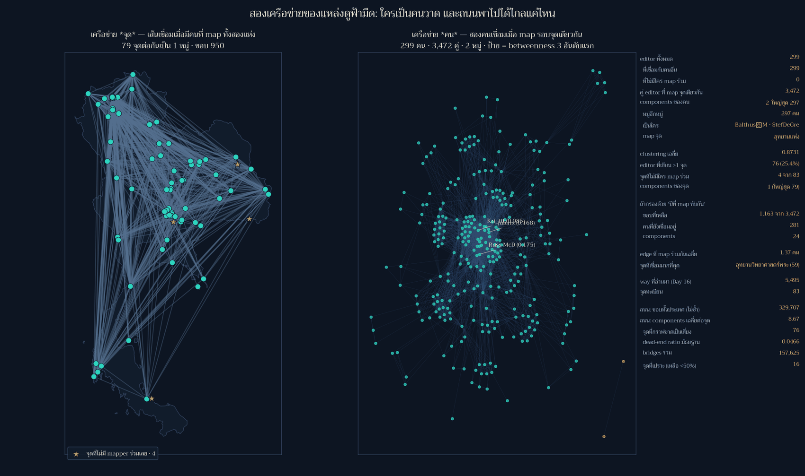
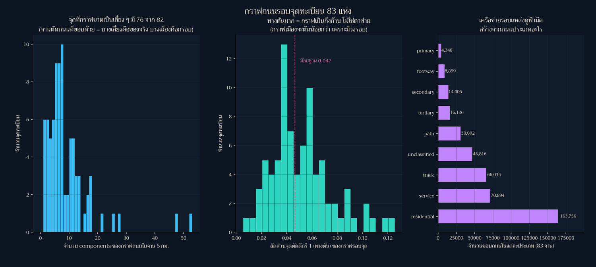
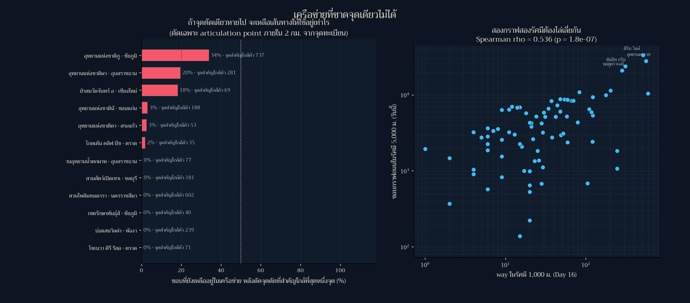
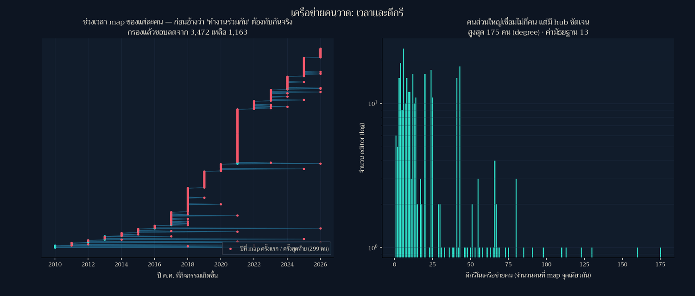

โจทย์ทางการวันนี้คือ **"Route network, transit network, human network or something completely
different."** (หัวข้อ *Network* — ดึงข้อความมาจากหน้า 30daymapchallenge.com อ่านสด 20:18 น.
ของวันที่ 24 พ.ย.)

ซีรีส์นี้พูดเรื่อง "จุด" มา 23 วัน — วันนี้ผมถามว่า **แล้วจุดเหล่านี้เชื่อมกันเป็นอะไร**
และคำตอบมีสองชั้นที่ต่างกันโดยสิ้นเชิง:

* **เครือข่ายคน** — ใครคือคนที่ map รอบแหล่งดูฟ้ามืดไทย และคนเหล่านั้นรู้จักกันทางอ้อมไหม
* **เครือข่ายถนน** — ถนนที่พาไปหาแหล่งดูฟ้ามืดเป็น *ตาข่าย* หรือเป็น *กิ่งก้านที่ขาดที่จุดเดียว*

## ๐. ข้อมูลสองชุดที่ไม่ต้องยิง API เลย

ชั้นที่ 1 มาจาก **แคชของ Day 16** ซึ่งเก็บไว้ตั้งแต่วันที่ 17 พ.ย.: object 5,495 way
พร้อม `user` และ `timestamp` ในรัศมี 1,000 ม. รอบ 83 จุดทะเบียน → 299 editor
(ตัวเลขตรงกับที่ Day 16 รายงาน: 5,495 way · 299 คน · 76 คนที่เขียนเกิน 1 จุด = 25.42%)

ชั้นที่ 2 มาจาก **Geofabrik Thailand extract** ไฟล์เดียวกับ Day 21–23 (md5 `db3958a0…`)
สแกน way ที่มีแท็ก `highway` ทั้งหมด 2,944,183 way จาก 5,303,991 way ในไฟล์
(ตัวเลขทั้งสองอยู่ใน `day24_stats.json` ภายใต้ `pbf_highway_ways` / `pbf_ways_in_file`)
แล้วเก็บเฉพาะท่อนที่ปลายทั้งสองอยู่ในจาน 5,000 ม. ของจุดเดียวกัน →
**node 413,758 slot · ขอบ 430,464 (ไม่ซ้ำกันจริง 329,707) · ประเภททาง 25 ค่า**

เหตุผลที่เก็บเฉพาะขอบที่อยู่ในจาน: ถ้าปล่อย way ยาว ๆ จากจังหวัดข้างเคียงเข้ามา
กราฟจะ "เชื่อม" เพราะเส้นผ่าน ไม่ใช่เพราะถนนของพื้นที่นั้นจริง

## ๑. เครือข่ายคน: เป็นกราฟเดียวกันทั้งดุ้น

สร้างกราฟสองแบบจากข้อมูล bipartite เดิม

| กราฟ | โหนด | ขอบ | components | ค่าอื่น |
|---|---|---|---|---|
| editor↔editor (map รอบจุดเดียวกัน) | 299 | **3,472** | **2** (297 + 2) | clustering เฉลี่ย **0.8731** |
| editor↔editor (กรองว่าช่วงปีทับกัน) | 281 ที่มีขอบ | **1,163** | **24** (ใหญ่สุด 269) | เหลือขอบแค่ **33.5%** |
| site↔site (มี editor ร่วม) | 79 | **950** | **1** | เฉลี่ย **1.37 คน/คู่จุด** |

สามเรื่องที่ตารางนี้บอก

**หนึ่ง — ชุมชนนี้เชื่อมถึงกันหมด** ไม่มี editor ที่โดดเดี่ยว (0 isolated) และ 297 จาก 299 คน
อยู่ใน component เดียว หมู่อีกหมู่มี 2 คน คือ `Balthus★MC` กับ `StefDeGreef`
ซึ่ง map อยู่จุดเดียวทั้งประเทศ: **อุทยานแห่งชาติเขาพระวิหาร**
แปลว่าในเชิงคนที่map แล้ว *แหล่งดูฟ้ามืดไทยคือเครือข่ายเดียว* ไม่ใช่กลุ่มเล็กกลุ่มน้อย

**สอง — แต่ "ร่วมกัน" ส่วนใหญ่ไม่ได้เกิดขึ้นพร้อมกัน**
พอกรองว่าช่วงปีที่สองคน map จริงต้องทับกัน (first–last year overlap) ขอบหายไปถึง 2 ใน 3
และกราฟแตกจาก 2 components เป็น 24 — คนที่ map จุดเดียวกันส่วนมากคือ
*มาต่อกันคนละปี* ไม่ใช่มาช่วยกัน ซึ่งเป็นคำอธิบายที่ต่างออกไปมาก
(ผมใส่ไว้เป็น limitation ด้วย: year range เป็นค่าประมาณบนของการ "ทำงานร่วมกัน")

**สาม — มีคนที่เป็น " สะพาน " ชัด** เรียงด้วย betweenness: `Russ McD` 0.1747 (23 จุด),
`julcnx` 0.1683 (26 จุด), `Kri_ttt` 0.0853 (10 จุด), `AlaskaDave` 0.0768 (18 จุด)
และเมื่อมองฝั่งจุด จุดที่เชื่อมกับจุดอื่นมากที่สุดคือ
**อุทยานวิทยาศาสตร์พระจอมเกล้า ณ หว้ากอ (59)** กับ **อุทยานดาราศาสตร์สิรินธร (59)**
ตามด้วย **สิริน วิลล์ แม่ริม (57)** — เป็นจุดที่คนซึ่ง map ที่อื่นด้วย แวะมา map ด้วย
(มักเป็นหอดูดาว/สถานที่ราชการที่ mapper สายดาราศาสตร์รู้จัก)

และ 4 จุดที่ **ไม่มีใคร map ร่วมกับจุดอื่นเลย**: ทุ่งโนนป่าก่อ (ภูสีฐาน) · เขาพระวิหาร ·
**อุทยานแห่งชาติเขาใหญ่** · หอดูดาวเฉลิมพระเกียรติฯ สงขลา
ในเชิงบริหารข้อมูล นี่คือจุดที่ *bus factor = 1* — ถ้าคนที่ map ไว้หายไป
จะไม่มีใครในเครือข่ายที่รู้จักสถานที่นี้เหลืออยู่

## ๒. เครือข่ายถนน: ตาข่าย หรือ กิ่งก้าน

กราฟถนนรอบแต่ละจุด (node = จุดตัดของ OSM, edge = ท่อนถนน) วัด 4 อย่าง:
จำนวน components, สัดส่วนขอบที่อยู่ใน component ใหญ่สุด, dead-end ratio
(สัดส่วน node ดีกรี 1 = ทางตัน), และจำนวน `bridges` (ขอบที่ตัดแล้วกราฟขาด) กับ
`articulation points` (จุดที่ลบแล้วกราฟขาด)

* **82 จาก 83 จุดมีกราฟถนนใน 5 กม.** จุดที่ไม่มีคือ **อุทยานแห่งชาติเขาใหญ่**
  — ซึ่งตรงกับ Day 21 ที่ว่ารอบเขามี object น้อยมาก (คราวนั้นวัดใน 2 กม.)
  และจุดที่ไกลถนนที่สุดคือ ทุ่งโนนป่าก่อ (ภูสีฐาน) ที่ **3,429.7 ม.**
* **components เฉลี่ย 8.67 (มัธยฐาน 6.5, สูงสุด 53)** — 76 จาก 82 จุด "ขาดเป็นเสี่ยง"
  แต่อย่าเพิ่งตกใจ: ขอบส่วนใหญ่อยู่ใน component ใหญ่ (largest_edge_share มัธยฐาน ~0.99)
  เสี่ยงเล็ก ๆ เหล่านั้นคือทางเท้า/บันได/ทางเดินในสวนที่ map ไว้ไม่ต่อกับถนน
  จุดที่เสี่ยงใหญ่จริงคือ **อุทยานแห่งชาติเขาพระวิหาร** ที่ largest_edge_share = **0.4422**
  (ครึ่งหนึ่งของถนนในรัศมี 5 กม. เข้าถึงจากจุดทะเบียนไม่ได้)
* **dead-end ratio มัธยฐาน 4.66%** (ต่ำสุด 0.54% · สูงสุด 12.54% ที่
  หอดูดาวเฉลิมพระเกียรติฯ ฉะเชิงเทรา) และ **bridges รวม 157,625 เส้น**
  เฉพาะจุดที่มีมากสุด (สิริน วิลล์ แม่ริม) มี bridge เดี่ยว ๆ ถึง 10,207 เส้น
  = ถนนที่ถ้าปิดหนึ่งท่อน มีจุดที่เข้าถึงไม่ได้ทันที
* ถนนที่โผล่มาเป็นประเภทหลักของกราฟรอบจุด: **residential 41 จุด · track 23 จุด ·
  secondary 5 · tertiary 4 · path 4 · unclassified 3** — สายดูดาวจำนวนไม่ใช่น้อย
  ลงท้ายด้วยทางลูกรัง (สอดคล้องกับ Day 23 ที่ว่าของกินอยู่ไกลออกไป 11 กม.)

## ๓. จุดที่ "จุดตัดเดียว" ตัดขาดทั้งเส้นทาง

ทดสอบต่อ: ลบ articulation point ที่อยู่ในระยะ 2 กม. จากจุดทะเบียนทีละจุด
(สูงสุด 40 จุด) แล้วดูว่าขอบที่ยังเดินถึงจากจุดทะเบียนเหลือกี่เปอร์เซ็นต์ของเดิม
— ผลคือตัวเลขที่ใช้วางแผนได้จริง

* **16 จุด** เหลือเครือข่ายไม่ถึง **50%** เมื่อจุดตัดสำคัญหายไปหนึ่งจุด
* **3 จุดเหลือ 0%** — คือตัดจุดเดียวแล้ว *ออกไม่ได้เลย* จากมุมมองของกราฟ:
  **โซเนวา คีรี รีสอร์ท (ตราด) · บ่อแสนวิลล่า (พังงา) ·
  เขตรักษาพันธุ์สัตว์ป่าภูเขียว (ชัยภูมิ)**
* จุดที่ "ไม่มีจุดตัดสำคัญใกล้ตัวเลย" มี 1 จุด — แปลว่าทางเข้าถึงเป็นตาข่ายจริง ไม่ใช่กิ่งเดี่ยว

ข้อจำกัดของตัวเลขนี้ต้องพูดให้หมด: มันคือ **ความเชื่อมโยงเชิงทอพอโลยีของกราฟที่ตัดขอบไว้
ที่รัศมี 5 กม.** ไม่ใช่การจำลองการจราจร ไม่มี one-way, ไม่มีการปิดถนนจริง, และ
components ที่มากกว่า 1 บางส่วนเกิดจากกรอบจานตัดถนนที่ยื่นเข้ามา — ผมเก็บคอลัมน์
`nodes`, `edges`, `components` ไว้ใน csv เพื่อให้ตรวจย้อนได้ว่าเสี่ยงจริงหรือเสี่ยงเพราะกรอบ

## ๔. ตรวจกลับสองวันก่อนหน้า

| การตรวจ | ผล |
|---|---|
| way · editor · คนที่เขียนเกิน 1 จุด | 5,495 · 299 · 76 (25.42%) ตรงกับที่ Day 16 รายงาน |
| ระยะไปหาถนน: Day 21 (ถึง *ขอบ* ใน 2 กม.) vs Day 24 (ถึง *node* ใน 5 กม.) | **rho 0.915** (p 6.0e-33) · ต่างกันมัธยฐาน **0.8 ม.** · สูงสุด 87.5 ม. |
| จำนวนขอบถนน 5 กม. ↔ จำนวน way ที่คนเขียน 1 กม. (Day 16) | rho **0.536** (p 1.8e-07) |
| dead-end ratio ↔ ประชากรเมืองในรัศมี 30 กม. (Day 9) | rho **+0.358** (p 0.00097) |
| จำนวน components ↔ ประชากรเมือง | rho +0.303 (p 0.0057) |

สองบรรทัดสุดท้ายน่าสนใจเพราะเครื่องหมาย: **เมืองใหญ่กว่า = ทางตันมากกว่าและกราฟเสี่ยงกว่า**
ซึ่งสมเหตุสมผล — หมู่บ้านจัดสรร/ซอยตัน/ทางเดินในโครงการถูก map ละเอียดกว่า
ส่วนพื้นที่เกษตรรอบนอกเป็นตาข่ายเส้นตรงยาว ๆ

## วิธีทำแบบย่อ

1. โหลดแคช Day 16 (way + user + timestamp ของ 83 จุด) → สร้าง 3 กราฟ:
   bipartite, editor↔editor (ร่วมจุด), site↔site (ร่วมคน)
2. กราฟ "คน" แบบที่สองกรองเพิ่มด้วยช่วงปีที่ map ทับกัน (first–last year) เพื่อแยก
   "ร่วมงาน" ออกจาก "มาทีหลัง"
3. สแกน `highway` จาก PBF ด้วย `locations=True` ของ pyosmium (libosmium สร้าง index
   ของ node ให้เอง → สแกนรอบเดียว) เก็บเฉพาะขอบที่ปลายทั้งสองอยู่ในจาน 5,000 ม. เดียวกัน
4. ต่อจุด: สร้างกราฟ, นับ components, dead-end, `nx.bridges`, `nx.articulation_points`
   แล้วลบจุดทีละตัวเพื่อหา `worst_cut_keep`
5. ตรวจกลับกับ Day 21 (ระยะไปถนน) และ Day 16 (ปริมาณ way ที่คนเขียน)
6. assert ที่ใส่ไว้: way ต้องได้ 5,495 · editor 299 · ผลรวม component ต้องเท่าจำนวน node ·
   จุดรวม 83 ต้อง = ที่เชื่อม + ที่ isolated · กรองเวลาต้องเหลือขอบน้อยลง ·
   node-slot ต้องตรงกับที่สแกน · `worst_cut_keep` อยู่ในช่วง 0–1

## ข้อจำกัดที่ต้องบอกตรง ๆ

* **กราฟคนสร้างจากรัศมี 1,000 ม. รอบจุดทะเบียน** (ของเดิมจาก Day 16) ไม่ได้ใช้ขอบเขต
  พื้นที่ทำงานจริงของ mapper แต่ละคน → สองคนที่ map ติดกันมากอาจไม่ถูกนับว่าร่วมจุด
  และคนเดียวกันที่ map คนละด้านของอำเภออาจถูกนับว่า "รู้จักกัน"
* **จาน 5,000 ม. ตัดถนนที่ยื่นเข้ามา** → `components > 1` บางส่วนคือกรอบของการศึกษา
  ไม่ใช่ความขาดจริง ผมจึงรายงาน `largest_edge_share` ควบคู่เสมอ
* **กราฟถนนเป็น 2D จาก OSM** ไม่มี one-way, weight, ระดับถนน หรือเวลาปิด-เปิด
  `worst_cut_keep` จึงตอบว่า "โครงสร้างขาดไหม" ไม่ใช่ "รถไปไม่ได้จริงไหม"
* ทดสอบจุดตัดเพียง 40 จุดใกล้สุดต่อจุดทะเบียน (`MAX_CUT_TRIALS`) เพื่อคุมเวลา
* **ระหว่าง 17 พ.ย. (แคช Day 16) กับ 21 พ.ย. (extract)** มีคน map เพิ่ม — สองชั้นข้อมูล
  ไม่ได้อยู่เวลาเดียวกันเป๊ะ
* ตัวเลขระหว่างประเทศ (เช่นจำนวน way 2.94 ล้าน) เป็นของ *ไฟล์ extract* ไม่ใช่ของทั้งโลก

## ไฟล์ประกอบ

* [day24_networks.png](day24_networks.png) — แผนที่ site network (เส้น = มีคน map ร่วม) +
  graph ของ editor + สถิติหลัก
* [day24_roads.png](day24_roads.png) — การกระจายของ components, dead-end ratio และ
  ประเภทถนนที่สร้างกราฟรอบ 83 จุด
* [day24_fragile.png](day24_fragile.png) — 12 จุดที่เปราะที่สุด (เหลือเครือข่ายกี่ % เมื่อ
  จุดตัดหายไปหนึ่งจุด) + ความสอดคล้องกับปริมาณ map ของ Day 16
* [day24_people.png](day24_people.png) — ช่วงเวลา map ของแต่ละคน (ก่อน-หลังกรองเวลา) และ
  การกระจายดีกรีของเครือข่ายคน
* [day24_roads.csv](day24_roads.csv) — ต่อจุด: nodes, edges, components, dead-end, bridges,
  articulations, ระยะไปถนน, worst_cut_keep, ประเภทถนนหลัก
* [day24_editors.csv](day24_editors.csv) — ต่อ editor: ดีกรี, จำนวนจุดที่ map, ปีแรก–ปีสุดท้าย,
  betweenness, component, ขอบที่ยังอยู่หลังกรองเวลา
* [day24_sites.csv](day24_sites.csv) — ต่อจุดทะเบียน: จำนวน editor, ดีกรีใน site network,
  component, จำนวน node/edge ของกราฟถนน
* [day24_site_edges.csv](day24_site_edges.csv) — คู่จุดที่เชื่อมกัน + จำนวนคน map ร่วม
* [day24_stats.json](day24_stats.json) — นิยามทั้งหมด + `cross_check_day16` +
  `cross_check_day21` + ตัวเลขทุกคู่ที่ทดสอบ

โค้ด: `tools/collect_day24_roads.py` (สแกน PBF → npz) และ `tools/day24_network.py`
(สร้างกราฟ + วาด + referee) — โน้ตบุ๊กมี Colab bootstrap แบบเดียวกับ Day 22–23
(`DAY24_FORCE_COLAB=1` ใช้ทดสอบเส้นทาง Colab บนเครื่องตัวเอง)

## บทเรียน

* **"เครือข่ายเดียวกัน" กับ "ทำงานร่วมกัน" ไม่ใช่คำเดียวกัน** — 297/299 คนเชื่อมถึงกันจริง
  แต่พอกำหนดว่าช่วงปีของสองคนต้องทับกันจริง ขอบเหลือ 33.5% และกราฟแตกเป็น 24 หมู่
  งานเชิง community ที่อ่านจาก co-occurrence อย่างเดียวจะเหมาเกินไปเสมอ
* **กราฟทำให้เห็นจุดที่ตารางมองไม่เห็น**: เขาใหญ่ไม่ใช่แค่ "ไม่มีถนนใน 2 กม." (Day 21)
  แต่ *ไม่มี node ถนนใน 5 กม.* และ *ไม่มีใคร map ร่วมกับจุดอื่นเลย* —
  สามวันสามกราฟชี้ไปที่จุดเดียวกันว่าเป็นขอบของข้อมูล
* **ความเสี่ยงของการเข้าถึงมักอยู่ที่จุดเดียว** — 3 จุดที่ตัดจุดตัดหนึ่งแล้วออกไม่ได้
  คือข้อมูลที่เอาไปใช้จริงได้ (ควรสำรองเส้นทางไว้/แจ้งผู้ไปจริง) มากกว่าค่าเฉลี่ยใด ๆ
* **อย่าเชื่อ components ที่มากกว่า 1 โดยไม่ดูกรอบ** — ผมจึงเก็บ
  `largest_edge_share` ไว้ทุกแถว เพราะ 76 จุดที่ "ขาดเป็นเสี่ยง" แทบทั้งหมด
  เป็นทางเดินในสวน ไม่ใช่ถนนที่เข้าไม่ถึง
* **ตรวจกลับวันเก่าคือวิธีที่ถูกที่สุด** — rho 0.915 กับส่วนต่างมัธยฐาน 0.8 ม.
  ระหว่างสองวิธีวัด (ขอบ vs node) ทำให้เชื่อได้ว่าวันนี้เราไม่ได้เปลี่ยนคำตอบ
  แค่เปลี่ยนคำถาม
